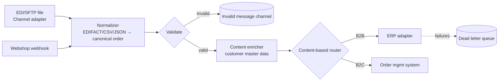
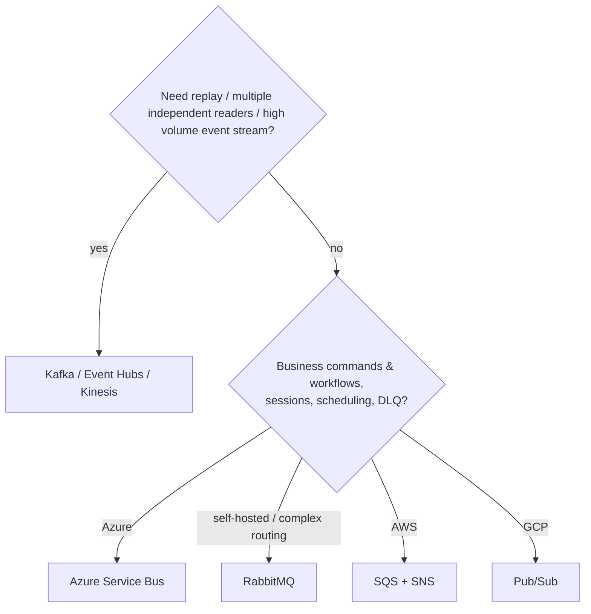
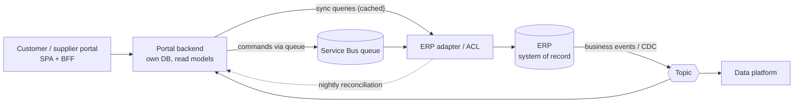

# Integration and Messaging

> **TL;DR** — Integration styles are file transfer, shared database, RPC, and messaging (Hohpe & Woolf). Messaging decouples in time and space; pick **queues** for work distribution (one consumer per message), **topics** for pub/sub fan-out, and **logs/streams** (Kafka) for replayable ordered event history. The *Enterprise Integration Patterns* vocabulary (channels, routers, translators, aggregators, DLQs) still describes every modern broker and iPaaS. For ERP integration: prefer the ERP's official APIs/events, isolate it behind an anti-corruption layer, make every flow idempotent and observable, and keep a reconciliation path.

---

## 1. Integration styles (Hohpe & Woolf)

| Style | How | Coupling | Timeliness | Use when |
|---|---|---|---|---|
| **File transfer** | Export/import files (CSV, XML, EDI) via SFTP/blob | Low (format only) | Batch (hours) | Legacy, partners, bulk data, EDI |
| **Shared database** | Multiple apps read/write same DB | Very high (schema) | Immediate | Avoid between independently evolving apps; OK for reporting replicas |
| **Remote procedure invocation** | Synchronous API calls (REST, gRPC, SOAP) | Temporal + interface | Immediate | Queries, user-facing requests needing answer now |
| **Messaging** | Asynchronous messages via broker | Low (message contract) | Near real-time | Events, commands, decoupled workflows, load leveling |

### Synchronous vs asynchronous

| Aspect | Synchronous (request/response) | Asynchronous (messaging) |
|---|---|---|
| Temporal coupling | Both must be up | Producer and consumer independent |
| Latency to result | Immediate | Eventual |
| Failure handling | Caller handles immediately | Retries, DLQs, compensations |
| Load handling | Caller absorbs spikes | Queue buffers spikes |
| Debuggability | Simple stack | Needs tracing/correlation |
| Consistency | Easier strong consistency | Eventual |
| Good for | Queries, validation, UI | Commands with deferred results, events, integration |

---

## 2. Enterprise Integration Patterns (EIP)

*Enterprise Integration Patterns* (Gregor Hohpe & Bobby Woolf, 2003): 65 patterns. Key ones:

### Messaging systems

| Pattern | Description |
|---|---|
| **Message Channel** | Logical pipe connecting sender and receiver |
| **Message** | Data packet: header + body |
| **Pipes and Filters** | Chain processing steps via channels |
| **Message Router** | Route message to a channel based on conditions |
| **Message Translator** | Convert between data formats |
| **Message Endpoint** | App's connection to the messaging system |

### Messaging channels

| Pattern | Description | Modern equivalent |
|---|---|---|
| **Point-to-Point Channel** | Exactly one receiver consumes each message | Queue (RabbitMQ queue, ASB queue, SQS) |
| **Publish-Subscribe Channel** | Each subscriber gets a copy | Topic (ASB topic/subscriptions, SNS, Pub/Sub, RabbitMQ fanout exchange) |
| **Datatype Channel** | One channel per message type | Topic per event type |
| **Invalid Message Channel** | Malformed messages | Validation DLQ |
| **Dead Letter Channel** | Messages that can't be delivered/processed | DLQ |
| **Guaranteed Delivery** | Persist messages until delivered | Durable queues, acks |
| **Channel Adapter** | Connect app to messaging | Kafka Connect, Logic Apps connectors |
| **Messaging Bridge** | Connect two messaging systems | MirrorMaker, shovel/federation |
| **Message Bus** | Shared infrastructure for apps to communicate | Enterprise service bus, event bus |

### Message construction

| Pattern | Description |
|---|---|
| **Command Message** | Invoke a procedure (`ReserveStock`) |
| **Document Message** | Transfer data (`CustomerSnapshot`) |
| **Event Message** | Notify of a change (`OrderPlaced`) |
| **Request-Reply** | Reply on a separate channel |
| **Return Address** | Message states where reply should go (`ReplyTo`) |
| **Correlation Identifier** | Match reply to request (`CorrelationId`) |
| **Message Sequence** | Split large data into sequence |
| **Message Expiration** | TTL |
| **Format Indicator** | Version/format of message (`schemaVersion`, CloudEvents `dataschema`) |

### Message routing

| Pattern | Description |
|---|---|
| **Content-Based Router** | Route by message content |
| **Message Filter** | Drop unwanted messages |
| **Dynamic Router** | Routing rules configured at runtime |
| **Recipient List** | Send to a computed list of recipients |
| **Splitter** | Split composite message into parts (order → order lines) |
| **Aggregator** | Combine related messages into one (completion condition: count, timeout, predicate) |
| **Resequencer** | Restore order of out-of-sequence messages |
| **Composed Message Processor** | Split → route → aggregate |
| **Scatter-Gather** | Broadcast request, aggregate replies (e.g., quotes from multiple suppliers) |
| **Routing Slip** | Message carries its itinerary of steps |
| **Process Manager** | Central component maintains state and determines next step (≈ saga orchestrator) |
| **Message Broker** | Central hub decoupling destination from sender |

### Message transformation

| Pattern | Description |
|---|---|
| **Envelope Wrapper** | Wrap message with headers required by infrastructure |
| **Content Enricher** | Add missing data from another source |
| **Content Filter** | Remove unneeded data |
| **Claim Check** | Store large payload elsewhere; pass a reference |
| **Normalizer** | Convert various formats to a common format |
| **Canonical Data Model** | Common format independent of apps (use with care — see anti-patterns) |

### Messaging endpoints

| Pattern | Description |
|---|---|
| **Messaging Gateway** | Encapsulate messaging code behind domain interface |
| **Messaging Mapper** | Map domain objects ↔ messages |
| **Transactional Client** | Coordinate messaging with transactions (→ outbox) |
| **Polling Consumer** | Consumer pulls messages |
| **Event-Driven Consumer** | Messages pushed to consumer |
| **Competing Consumers** | Multiple consumers on one queue for scale |
| **Message Dispatcher** | Distribute messages to performers |
| **Selective Consumer** | Filter messages consumed |
| **Durable Subscriber** | Receive messages published while offline |
| **Idempotent Receiver** | Safely handle duplicates (→ inbox) |
| **Service Activator** | Connect a service to messaging |

### System management

**Control Bus**, **Detour**, **Wire Tap** (copy messages for inspection), **Message History**, **Message Store**, **Smart Proxy**, **Test Message**, **Channel Purger**.

### EIP example: order intake flow



---

## 3. Message brokers: queues vs topics vs streams

| Concept | Semantics | Consumption | Retention | Ordering | Examples |
|---|---|---|---|---|---|
| **Queue** | Point-to-point; work distribution | Competing consumers; message removed on ack | Until consumed (or TTL) | FIFO-ish; per session/group | RabbitMQ queue, Azure Service Bus queue, SQS, Azure Storage Queue |
| **Topic (pub/sub)** | Fan-out to subscriptions | Each subscription gets a copy; each subscription behaves like a queue | Until each subscription consumes | Per subscription | ASB topics, SNS, Google Pub/Sub, RabbitMQ fanout/topic exchanges |
| **Log / stream** | Append-only, partitioned log | Consumers track **offsets**; many independent consumer groups; replay | Time/size-based (days, forever with compaction/tiered storage) | Per partition | Kafka, Azure Event Hubs, Kinesis, Redpanda, Pulsar, RabbitMQ Streams |

### Comparison of major brokers

| Feature | Apache Kafka | RabbitMQ | Azure Service Bus | Google Pub/Sub | AWS SQS/SNS |
|---|---|---|---|---|---|
| Model | Distributed log | Smart broker (exchanges → queues) | Enterprise broker (queues, topics) | Global pub/sub | Queue (SQS) + topic (SNS) |
| Throughput | Very high (millions msg/s) | High (tens of thousands/s per queue) | Moderate–high (tier dependent) | Very high | Very high |
| Ordering | Per partition | Per queue (single consumer) | Per **session** (FIFO) | With ordering keys | FIFO queues / message groups |
| Replay | ✅ (offsets) | Streams only | ❌ (except deferred/peek) | Seek to timestamp/snapshot | ❌ |
| Routing | Topic/partition key | Rich: direct, topic, fanout, headers exchanges | Subscription filters (SQL/correlation) | Filters on attributes | SNS filter policies |
| Transactions | Producer transactions, EOS within Kafka | Publisher confirms; no cross-queue tx | Transactions within namespace; duplicate detection | — | — |
| DLQ | Manual (DLQ topic pattern) | Dead-letter exchanges | Built-in per entity | Built-in dead letter topic | Built-in redrive |
| Scheduled delivery | ❌ | Plugin | ✅ | ❌ | Delay queues (≤15 min) |
| Ops | Heavy (managed: Confluent, MSK, Event Hubs Kafka API) | Moderate | Fully managed | Fully managed | Fully managed |
| Best for | Event streaming, CDC, analytics pipelines, event sourcing-ish, high volume | Task queues, complex routing, RPC over messaging | Enterprise integration on Azure, ERP/business workflows, sessions, scheduled messages | GCP event distribution | AWS decoupling |

### Kafka essentials

- **Topic** → **partitions** (unit of parallelism and ordering) → replicated across brokers (leader + followers, ISR).
- **Producer** chooses partition by **key** hash → same key, same partition, ordered.
- **Consumer group**: each partition consumed by exactly one consumer in the group → max parallelism = partitions.
- **Offsets** committed per group; at-least-once by committing after processing.
- **Log compaction**: keep latest value per key (changelog/state topics).
- **Retention**: time/size; tiered storage for long retention.
- **Schema Registry** (Avro/Protobuf/JSON Schema) for contract evolution with compatibility modes (BACKWARD, FORWARD, FULL).
- **Kafka Connect** (source/sink connectors, Debezium CDC), **Kafka Streams / ksqlDB / Flink** for stream processing.
- **KRaft** replaced ZooKeeper (Kafka 4.0 removed ZooKeeper mode).

### RabbitMQ essentials

- Producer → **exchange** (direct, topic, fanout, headers) → **bindings** → **queues** → consumers.
- **Quorum queues** (Raft-based) for durability/HA; classic mirrored queues are removed in 4.x.
- **Publisher confirms**, consumer **acks/nacks**, **prefetch** (QoS) for backpressure.
- **Dead letter exchanges**, TTL, priority queues.
- RabbitMQ **Streams** for log-like semantics.

### Azure Service Bus essentials

- **Queues** and **topics with subscriptions** (filters/actions).
- **Sessions** (FIFO + grouping by `SessionId`, e.g., per order), **duplicate detection** (by `MessageId` within a window), **scheduled messages**, **deferral**, **auto-forwarding**, **DLQ** with `MaxDeliveryCount`, **transactions** across entities in a namespace.
- **Peek-lock** (receive → complete/abandon/dead-letter) vs **receive-and-delete**.
- Tiers: Basic (queues only), Standard, Premium (dedicated, larger messages, VNet).
- Pair with **Event Grid** (reactive events, push, HTTP) and **Event Hubs** (streaming, Kafka-compatible).

| Azure service | Purpose |
|---|---|
| Service Bus | Business messages: commands, orders, high-value transactions |
| Event Grid | Discrete events/notifications (blob created, resource changed, custom events) — push |
| Event Hubs | Telemetry and event streaming (big data, Kafka API) |
| Storage Queues | Simple, cheap, large backlogs |

### Google Pub/Sub essentials

- Topics, subscriptions (pull, push, BigQuery/Cloud Storage export).
- At-least-once by default; **exactly-once delivery** option per subscription (within Pub/Sub, regional).
- Ordering keys, dead-letter topics, retry policy, seek/replay to snapshot or timestamp.

### Choosing



---

## 4. Message design

### Message types

| Type | Intent | Naming | Coupling |
|---|---|---|---|
| **Command** | Ask a specific receiver to do something; can be rejected | Imperative: `ReserveStock` | Sender knows receiver |
| **Event** | Announce a fact; zero or many subscribers | Past tense: `StockReserved` | Sender doesn't know receivers |
| **Query / request-reply** | Ask for data | `GetStockLevel` | Synchronous-ish |

### Event payload styles (Fowler)

| Style | Payload | Trade-off |
|---|---|---|
| **Event notification** | Minimal (IDs); consumer calls back for details | Low payload coupling; callbacks add load/latency |
| **Event-carried state transfer** | Full relevant state | Consumers autonomous (local copy); bigger payloads, data duplication |
| **Event sourcing events** | Fine-grained domain changes | Internal; not ideal as public integration contract |

### Envelope — CloudEvents (CNCF)

```json
{
  "specversion": "1.0",
  "type": "com.example.sales.order.placed.v1",
  "source": "/sales/orders",
  "id": "8d1e6c1b-6a4b-4c1e-9f0d-2f0e8b1c9a77",
  "time": "2026-10-10T09:15:00Z",
  "subject": "orders/SO-100234",
  "datacontenttype": "application/json",
  "dataschema": "https://schemas.example.com/sales/order-placed/1.json",
  "traceparent": "00-4bf92f3577b34da6a3ce929d0e0e4736-00f067aa0ba902b7-01",
  "data": {
    "orderId": "SO-100234",
    "customerId": "C-778",
    "total": { "amount": "1249.50", "currency": "EUR" },
    "lines": [{ "sku": "PLANT-0042", "qty": 120 }]
  }
}
```

### Contract and schema evolution

- Additive changes only (new optional fields); never rename/remove without new version.
- **Tolerant reader** (Fowler): consumers ignore unknown fields, only read what they need.
- Version in type name (`order.placed.v2`) or schema registry compatibility rules.
- Publish **v1 and v2 in parallel** during migration.
- **Consumer-driven contract tests** (Pact) for messages too.
- Document async APIs with **AsyncAPI** (see [api-design.md](api-design.md)).

### Ordering, duplicates, poison messages

| Concern | Strategy |
|---|---|
| Ordering | Partition/session key = aggregate ID; single consumer per partition/session; or design commutative handlers; or include sequence numbers and discard stale |
| Duplicates | Idempotent consumers (inbox table, upserts, version checks) |
| Poison messages | Max delivery count → DLQ; alert; tooling to inspect/replay |
| Retries | Immediate retries (few) + delayed retries (backoff via scheduled messages / retry topics) |
| Large payloads | Claim check (blob storage + reference) |
| Out-of-order events | Version/sequence per aggregate; ignore older; or buffer/resequence |

---

## 5. Integration platforms & tooling

| Category | Examples | Notes |
|---|---|---|
| iPaaS / low-code | Azure Logic Apps, MuleSoft, Boomi, Workato, Power Automate, Zapier/Make (lightweight) | Fast connectors; govern sprawl; version control can be weak |
| Integration frameworks (code) | Apache Camel (EIP DSL), Spring Integration, MassTransit, NServiceBus, Wolverine, Brighter | Full control, testable |
| Workflow engines | Temporal, Camunda (BPMN), Azure Durable Functions, AWS Step Functions | Long-running orchestration |
| CDC | Debezium, SQL Server CDC, Azure Data Factory CDC, Fivetran | Replicate DB changes as events |
| API management | Azure APIM, Kong, Apigee, AWS API Gateway | See [api-design.md](api-design.md) |
| ETL/ELT | Azure Data Factory, Fabric pipelines, Airbyte, dbt (transform), SSIS (legacy) | See [../07-data-ai-architecture/README.md](../07-data-ai-architecture/README.md) |

### ETL vs ELT (application integration perspective)

| | ETL | ELT |
|---|---|---|
| Transform where | In integration layer before load | In target (warehouse/lakehouse) after load |
| Fits | Operational integration, legacy DWH, constrained targets | Cloud data platforms (Snowflake, BigQuery, Databricks, Fabric) |
| Rule | Operational integration (system → system) is usually *messaging/API*; analytical movement is usually ELT | |

Don't use the analytical pipeline as an operational integration channel (latency, coupling, ownership). Details in the data section: [../07-data-ai-architecture/README.md](../07-data-ai-architecture/README.md).

---

## 6. ERP integration patterns

ERPs (SAP S/4HANA, Microsoft Dynamics 365 F&O / Business Central, Oracle NetSuite, Exact, AFAS, Odoo, Infor) are typically the **system of record** for finance, items, customers, inventory, and orders.

### Patterns

| Pattern | Description | When |
|---|---|---|
| **API-led (synchronous)** | Call ERP OData/REST/SOAP APIs (SAP OData/BAPI, D365 OData/custom services, BC APIs) | Low-volume real-time lookups and postings |
| **Event-driven out of ERP** | ERP business events → broker (D365 business events, SAP Event Mesh/Advanced Event Mesh, BC webhooks) | Notify downstream of changes |
| **Batch / bulk** | Data management framework, IDoc batches, flat files, bulk APIs | Large volumes, nightly master data, migrations |
| **CDC from ERP DB** | Replicate tables (where licensing/support allows) | Analytics; avoid writing back via DB |
| **Integration hub / middleware** | iPaaS or custom integration service owning mappings and orchestration | Many systems; central monitoring |
| **Satellite apps (side-by-side extension)** | Custom portal/app with own DB, syncing with ERP via APIs/events | Keep ERP "clean core"; extend with modern stack |
| **Anti-corruption layer** | Translate ERP model (cryptic fields, codes) into domain model | Always for core custom apps |
| **Master data management (MDM)** | Golden record across systems | Multiple sources of master data |
| **EDI** | EDIFACT/X12/UBL/PEPPOL with partners via VAN/AS2/PEPPOL access point | B2B orders, invoices, despatch advice |

### Reference architecture: custom portal + ERP



### ERP integration checklist

- [ ] System of record defined per entity (customer, item, price, stock, order, invoice).
- [ ] Direction and frequency per flow (real-time / near real-time / batch).
- [ ] Use official, supported APIs (avoid direct DB writes — breaks support, bypasses business logic).
- [ ] Idempotency: external reference IDs on ERP documents (e.g., portal order ID stored on sales order) to detect duplicates.
- [ ] Error handling: DLQ, retry, business error vs technical error separation, human workflow for business errors.
- [ ] **Reconciliation** job: compare counts/hashes between systems; alert on drift.
- [ ] Mapping tables (code lists, units of measure, VAT codes, payment terms) versioned and owned.
- [ ] Throttling/API limits respected (D365 service protection limits, SAP gateway limits).
- [ ] Monitoring per flow: last successful sync, backlog, error counts, business KPIs.
- [ ] Security: dedicated service principals, least privilege, secrets in vault, IP allow-lists.
- [ ] Clean core: extend outside ERP where possible to keep upgrades cheap.
- [ ] Test environments: ERP sandbox data refresh strategy; contract tests against API specs.

### Common ERP integration anti-patterns

- Point-to-point spaghetti — every app integrates with every other ("integration spaghetti").
- Direct writes to ERP database tables.
- Business logic duplicated in middleware mappings.
- Synchronous ERP calls in user-facing hot paths without caching/timeouts.
- No correlation between portal records and ERP documents → duplicates on retries.
- "Canonical data model" for the whole enterprise that nobody can change.
- Polling every minute for full datasets instead of deltas/events.

---

## When to use messaging / when not

| Use messaging | Prefer synchronous API |
|---|---|
| Work can complete later; user doesn't need immediate result | User needs immediate answer (query, validation) |
| Load spikes need buffering | Simple CRUD in one service |
| Multiple consumers interested in a fact | Strong read-after-write within one interaction |
| Cross-team/system decoupling | Low latency request chains are acceptable and simple |

## Common mistakes

- Using events as remote procedure calls ("passive-aggressive events": `PleaseSendEmail` disguised as an event).
- Huge "god events" with entire aggregates and internal fields.
- No schema versioning or compatibility checks.
- Missing DLQ monitoring — failures silently pile up.
- Relying on broker ordering globally (only per partition/session).
- Using Kafka as a task queue for low-volume business commands (or RabbitMQ for replayable event history).
- Canonical data model forcing every context into one model.
- Shared database as "integration" between independently owned apps.

## Related

- [distributed-systems.md](distributed-systems.md) (outbox/inbox, sagas, idempotency), [api-design.md](api-design.md), [domain-driven-design.md](domain-driven-design.md) (context mapping, ACL)
- Data pipelines, ETL/ELT, CDC for analytics: [../07-data-ai-architecture/README.md](../07-data-ai-architecture/README.md)
- Enterprise application landscape: [../11-enterprise-architecture-business/README.md](../11-enterprise-architecture-business/README.md)

## References

- Enterprise Integration Patterns: https://www.enterpriseintegrationpatterns.com/
- EIP pattern catalog: https://www.enterpriseintegrationpatterns.com/patterns/messaging/
- Fowler — What do you mean by "Event-Driven"?: https://martinfowler.com/articles/201701-event-driven.html
- Fowler — Tolerant Reader: https://martinfowler.com/bliki/TolerantReader.html
- Apache Kafka documentation: https://kafka.apache.org/documentation/
- RabbitMQ documentation: https://www.rabbitmq.com/docs
- Azure Service Bus: https://learn.microsoft.com/azure/service-bus-messaging/service-bus-messaging-overview
- Azure — Compare messaging services: https://learn.microsoft.com/azure/service-bus-messaging/compare-messaging-services
- Google Cloud Pub/Sub: https://cloud.google.com/pubsub/docs/overview
- AWS SQS: https://docs.aws.amazon.com/AWSSimpleQueueService/latest/SQSDeveloperGuide/welcome.html
- CloudEvents: https://cloudevents.io/
- AsyncAPI: https://www.asyncapi.com/
- Microsoft — Claim-Check pattern: https://learn.microsoft.com/azure/architecture/patterns/claim-check
- Microsoft — Competing Consumers: https://learn.microsoft.com/azure/architecture/patterns/competing-consumers
- Microsoft — Publisher-Subscriber: https://learn.microsoft.com/azure/architecture/patterns/publisher-subscriber
- Microsoft — Sequential Convoy: https://learn.microsoft.com/azure/architecture/patterns/sequential-convoy
- Apache Camel: https://camel.apache.org/
- Debezium: https://debezium.io/
- Electronic data interchange: https://en.wikipedia.org/wiki/Electronic_data_interchange · PEPPOL: https://peppol.org/
- Gregor Hohpe & Bobby Woolf — *Enterprise Integration Patterns* (2003)
- Gwen Shapira et al. — *Kafka: The Definitive Guide* (2nd ed., 2021)
- Adam Bellemare — *Building Event-Driven Microservices* (O'Reilly)
