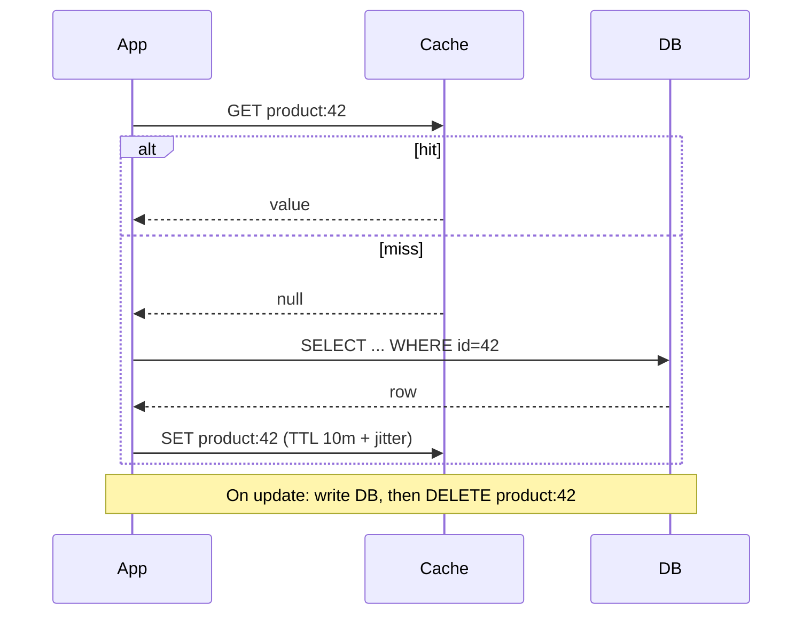
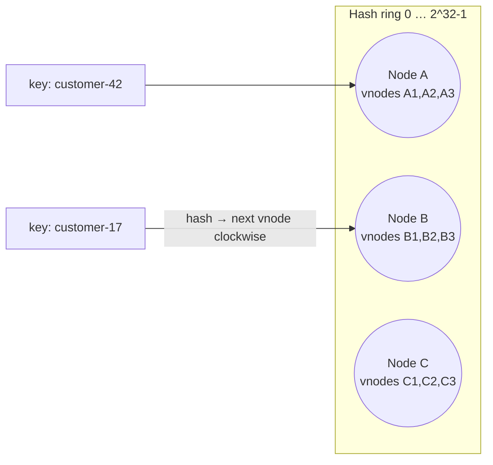

# Performance and Scalability

> **TL;DR** — Performance is how fast one request goes (latency) and how much work completes per unit time (throughput); scalability is how performance behaves as load or resources grow. Know the **latency numbers** (memory ≪ SSD ≪ network ≪ cross-region), measure **percentiles** not averages, find bottlenecks with **profiling** before optimizing, and remember **Amdahl's Law** and the **Universal Scalability Law**: serial parts and coordination cap scaling. Scale out with **stateless services**, **caching** (cache-aside by default, beware stampedes), **replication** for reads, and **sharding** (with **consistent hashing**) for writes. Kill **N+1** queries early.

---

## 1. Vocabulary

| Term | Meaning |
|---|---|
| **Latency** | Time to complete one operation (often measured at p50/p95/p99/p99.9) |
| **Response time** | Latency as seen by client = service time + queueing + network |
| **Throughput** | Operations per unit time (RPS, TPS, msgs/s) |
| **Bandwidth** | Max data rate of a channel |
| **Utilisation** | Fraction of time a resource is busy |
| **Saturation** | Degree of queued work a resource can't service |
| **Concurrency** | Number of in-flight requests |
| **Scalability** | Ability to handle increased load by adding resources |
| **Elasticity** | Ability to add/remove resources automatically in response to load |
| **Tail latency** | High percentiles (p99+) — dominate user experience in fan-out systems |

### Little's Law

`L = λ × W` — average number in system = arrival rate × average time in system.

Example: 200 req/s × 0.25 s average latency = 50 concurrent requests → size thread pools/connection pools accordingly.

### Queueing intuition

As utilisation ρ → 1, waiting time explodes (M/M/1: `W ∝ 1 / (1 − ρ)`). Run critical resources at ~60–70% to leave headroom for bursts.

```
latency
  │                                   ╱
  │                                  ╱
  │                               __╱
  │                        ____---
  │ ____________-----‾‾‾‾‾
  └───────────────────────────────────── utilisation
  0%           50%           80%   100%
```

### Tail at scale (Dean & Barroso)

If one request fans out to 100 servers and each has a 1% chance of a 1 s delay, **63%** of user requests will be slow (`1 − 0.99^100`). Mitigations: hedged requests, tied requests, reduce fan-out, timeouts, partial results.

---

## 2. Latency numbers every programmer should know

Originally Jeff Dean / Peter Norvig (circa 2010); orders of magnitude remain useful.

| Operation | Approx. latency | Relative |
|---|---|---|
| L1 cache reference | 0.5–1 ns | 1× |
| Branch mispredict | ~3–5 ns | |
| L2 cache reference | ~4–7 ns | ~10× |
| Mutex lock/unlock (uncontended) | ~15–25 ns | |
| Main memory reference | ~100 ns | ~100–200× |
| Compress 1 KB (fast codec, e.g. Snappy/LZ4) | ~1–2 µs | |
| Send 1 KB over 10 Gbps network | ~1 µs | |
| Read 4 KB randomly from NVMe SSD | ~20–100 µs | |
| Read 1 MB sequentially from memory | ~5–10 µs (modern) | |
| Round trip within same datacenter / AZ | ~0.5 ms (500 µs) | |
| Round trip across availability zones | ~1–2 ms | |
| Read 1 MB sequentially from SSD | ~50–200 µs (NVMe) to ~1 ms (SATA) | |
| Disk (HDD) seek | ~2–10 ms | |
| Read 1 MB sequentially from HDD | ~5–20 ms | |
| Round trip EU ↔ US East | ~80–100 ms | |
| Round trip EU ↔ Asia/Australia | ~150–300 ms | |
| TLS handshake (new connection, 1-RTT TLS 1.3) | +1 RTT | |

### Humanised scale (if 1 ns = 1 s)

| Operation | "Human" time |
|---|---|
| L1 cache | 1 s |
| Main memory | ~2 min |
| SSD random read | ~1–2 days |
| Same-DC round trip | ~6 days |
| Cross-Atlantic round trip | ~3 years |

### Design implications

- **Chatty network calls kill performance**: 50 sequential DB calls × 1 ms = 50 ms minimum.
- Batch, cache, colocate compute and data, use async and parallelism for independent calls.
- In-memory > local SSD > remote cache > remote DB > cross-region.

### Back-of-the-envelope estimation

| Quantity | Handy value |
|---|---|
| Seconds per day | 86,400 (~10^5) |
| 1 million req/day | ~12 req/s average; peak often 2–10× average |
| 1 billion req/month | ~400 req/s average |
| 1 KB × 1M | 1 GB |
| Powers of 2 | 2^10 ≈ 1 thousand (KB), 2^20 ≈ 1 million (MB), 2^30 ≈ 1 billion (GB), 2^40 ≈ TB |

```text
Example: B2B portal
- 2,000 active users, each 300 requests/day → 600k req/day → ~7 req/s avg, ~50 req/s peak
- Each order: 5 KB; 20k orders/day → 100 MB/day → ~36 GB/year (+ indexes ×2)
→ A single well-indexed PostgreSQL instance and 2 app instances are plenty. Don't shard.
```

---

## 3. Amdahl's Law and the Universal Scalability Law

### Amdahl's Law (Gene Amdahl, 1967)

Speedup with N processors when fraction `p` is parallelisable:

```
S(N) = 1 / ((1 − p) + p / N)
max speedup (N → ∞) = 1 / (1 − p)
```

| Parallel fraction p | N = 4 | N = 16 | N = 64 | N → ∞ |
|---|---|---|---|---|
| 50% | 1.6× | 1.9× | 2.0× | 2× |
| 90% | 3.1× | 6.4× | 8.8× | 10× |
| 95% | 3.5× | 9.1× | 15.4× | 20× |
| 99% | 3.9× | 13.9× | 39.3× | 100× |

**Lesson**: serial sections (single DB writer, global locks, a single queue consumer for ordering) cap scaling. Find and shrink them.

**Gustafson's Law**: with bigger problems, parallel part grows → scaled speedup is more optimistic; relevant for data processing.

### Universal Scalability Law (Neil Gunther)

```
C(N) = N / (1 + α(N − 1) + βN(N − 1))
α = contention (serialisation, queueing)  → Amdahl-like plateau
β = coherency (crosstalk: cache coherence, distributed coordination) → retrograde scaling
```

```
throughput
   │            ____
   │         _-‾    ‾-_        ← with β > 0, adding nodes eventually *reduces* throughput
   │       _‾          ‾-_
   │     _‾               ‾-
   │   _‾
   │ _‾
   └───────────────────────────── nodes (N)
```

**Lesson**: coordination (distributed locks, consensus, chatty replication, cache invalidation broadcasts) causes *negative* returns. Design for shared-nothing and partitioning. Fit USL to load-test data to predict capacity.

---

## 4. Scaling strategies

### Vertical vs horizontal

| | Vertical (scale up) | Horizontal (scale out) |
|---|---|---|
| How | Bigger machine (CPU, RAM, IOPS) | More machines/instances |
| Pros | Simple; no code changes; strong consistency easy | Near-linear capacity; fault tolerance; elasticity |
| Cons | Hardware ceiling; single point of failure; cost curve steep at top | Requires statelessness, partitioning, load balancing; distributed complexity |
| Typical | Databases (first resort), legacy apps | Stateless web/API tiers, workers, caches |

**Scale cube** (Abbott & Fisher, *The Art of Scalability*):
- **X-axis**: horizontal duplication (clones behind load balancer).
- **Y-axis**: functional decomposition (split by service/capability).
- **Z-axis**: data partitioning (shard by customer/tenant/region).

### Stateless services

- No in-process session or user state between requests → any instance can serve any request.
- Externalise state: database, distributed cache (Redis), object storage, token/cookie (signed).
- Avoid sticky sessions (they hurt load distribution and failover).
- Background jobs: use queues and idempotent workers; leader election only for true singletons.
- **12-Factor App** factors VI (processes are stateless) and IX (disposability: fast startup, graceful shutdown).

### Load balancing

| Algorithm | Notes |
|---|---|
| Round robin / weighted | Simple |
| Least connections / least outstanding requests | Better for variable request costs |
| Power of two random choices | Pick 2 at random, choose less loaded — excellent and cheap |
| Consistent hashing | Affinity for caches/stateful backends |
| Layer 4 vs Layer 7 | L4 (TCP) fast; L7 (HTTP) routing by path/header, TLS termination |

### Autoscaling

- Metrics: CPU, memory, RPS, queue length (KEDA), custom (p95 latency).
- Scale out fast, scale in slowly (cooldown).
- Pre-warm for known peaks (Monday morning order rush, season start).
- Watch downstream limits — scaling the API 10× can overload the DB/ERP.

---

## 5. Caching

### Where to cache

| Layer | Example | Notes |
|---|---|---|
| Browser | HTTP cache, Service Worker | `Cache-Control`, `ETag` |
| CDN / edge | Azure Front Door, Cloudflare, CloudFront | Static assets, cacheable GETs |
| Reverse proxy / gateway | NGINX, APIM, Varnish | Shared responses |
| Application (in-process) | `IMemoryCache`, LRU map | Fastest; per instance; inconsistency across instances |
| Distributed | Redis/Valkey, Memcached, `IDistributedCache`, .NET `HybridCache` | Shared across instances |
| Database | Buffer pool, query plan cache, materialised views | Automatic/DB-managed |

### Cache patterns

| Pattern | How | Pros | Cons |
|---|---|---|---|
| **Cache-aside** (lazy loading) | App reads cache; on miss reads DB and populates cache; on write updates DB and **invalidates** cache | Simple; only caches requested data; resilient to cache failure | Miss penalty; stale data window; stampede risk |
| **Read-through** | Cache library/provider loads from DB on miss | App code simpler | Needs cache-provider integration |
| **Write-through** | Writes go to cache, which synchronously writes to DB | Cache always fresh | Write latency; caches unread data |
| **Write-behind** (write-back) | Writes to cache; asynchronously flushed to DB | Fast writes; batching | Risk of data loss; complexity |
| **Write-around** | Writes go to DB only; cache populated on read | Avoids caching write-once data | Read miss after write |
| **Refresh-ahead** | Proactively refresh hot keys before expiry | Low latency for hot keys | Wasted refreshes |



```ts
// Cache-aside with stampede protection (single-flight per key, per instance) + TTL jitter
const inflight = new Map<string, Promise<unknown>>();

export async function getOrLoad<T>(key: string, load: () => Promise<T>, ttlSec = 600): Promise<T> {
  const cached = await redis.get(key);
  if (cached) return JSON.parse(cached) as T;

  if (inflight.has(key)) return inflight.get(key) as Promise<T>;
  const p = (async () => {
    try {
      const value = await load();
      const jitter = Math.floor(Math.random() * ttlSec * 0.1);
      await redis.set(key, JSON.stringify(value), { EX: ttlSec + jitter });
      return value;
    } finally {
      inflight.delete(key);
    }
  })();
  inflight.set(key, p);
  return p;
}
```

```csharp
// .NET 9 HybridCache: L1 in-memory + L2 distributed, built-in stampede protection
var product = await hybridCache.GetOrCreateAsync(
    $"product:{id}",
    async ct => await db.Products.AsNoTracking().FirstAsync(p => p.Id == id, ct),
    new HybridCacheEntryOptions { Expiration = TimeSpan.FromMinutes(10) },
    tags: ["products"]);
```

### Cache invalidation

> "There are only two hard things in Computer Science: cache invalidation and naming things." — Phil Karlton

| Strategy | Description |
|---|---|
| TTL / expiry | Simple bound on staleness; add **jitter** to avoid synchronized expiry |
| Explicit invalidation on write | Delete key after DB commit (delete, don't update — avoids race-written stale values) |
| Event-driven invalidation | Subscribe to change events/CDC; invalidate across services |
| Versioned keys | `product:42:v17` — new version = new key; old expire naturally |
| Tag-based | Invalidate groups (`HybridCache` tags, Next.js `revalidateTag`) |
| Write-through | Cache updated synchronously |

**Race condition**: read-miss → read DB (old) → concurrent write updates DB & deletes cache → first reader writes old value to cache. Mitigations: short TTLs, delayed double delete, versioning, lease tokens (Facebook memcache).

### Cache stampede (thundering herd / dog-piling)

When a hot key expires, many requests miss simultaneously and hammer the DB.

| Mitigation | How |
|---|---|
| **Request coalescing / single-flight** | Only one loader per key; others wait for its result |
| **Locking / leases** | Distributed lock per key (`SET key:lock NX PX 5000`); losers wait or serve stale |
| **Stale-while-revalidate** | Serve stale value while one request refreshes |
| **Probabilistic early expiration** (XFetch) | Refresh before expiry with probability increasing as expiry nears |
| **TTL jitter** | Spread expirations |
| **Pre-warming** | Load hot keys on deploy/startup |

### Caching pitfalls

- Caching without measuring hit ratio.
- Unbounded caches (memory leaks) — set size limits/eviction (LRU/LFU).
- Caching per-user data in shared caches without keying by user/tenant → data leaks.
- Cache as source of truth (unless designed for it).
- Large objects in Redis causing latency spikes; serialisation cost.

---

## 6. Replication

| Topology | Writes | Pros | Cons | Examples |
|---|---|---|---|---|
| **Single-leader** (primary/replica) | One leader | Simple; no write conflicts; read scaling | Leader bottleneck; failover complexity; replica lag | PostgreSQL streaming replication, SQL Server AGs, MySQL |
| **Multi-leader** | Several leaders (e.g., per region) | Local writes in each region; tolerates DC outage | Write conflicts need resolution | Multi-region Cosmos DB, BDR, CouchDB |
| **Leaderless** | Any replica (quorums) | High availability, no failover | Eventual consistency; read repair, anti-entropy | Cassandra, DynamoDB-style, Riak |

| Replication mode | Description | Trade-off |
|---|---|---|
| Synchronous | Leader waits for replica ack before commit | No data loss on failover (RPO 0); higher latency; availability depends on replica |
| Asynchronous | Leader commits immediately | Low latency; possible data loss; replica lag |
| Semi-synchronous | Wait for at least one replica | Balance |

**Replica lag anomalies** → read-your-writes violations (user saves, refreshes, data gone). Mitigate: read from leader for a short time after writes, sticky reads by session, wait for replica LSN, or design UI to show optimistic results.

---

## 7. Partitioning / sharding

Split data across nodes so each holds a subset (scales writes and storage).

| Strategy | How | Pros | Cons |
|---|---|---|---|
| **Range** | Key ranges per shard (A–F, G–M...) / time ranges | Efficient range scans | Hotspots (e.g., all new writes to latest time range) |
| **Hash** | `hash(key) mod N` or hash ranges | Even distribution | Range queries scatter; resharding with `mod N` moves almost all keys |
| **Consistent hashing** | Hash ring; keys map to next node clockwise | Adding/removing nodes moves ~1/N keys | Needs virtual nodes for balance |
| **Directory / lookup** | Lookup service maps key → shard | Flexible (move tenants individually) | Extra lookup; directory availability |
| **Geo / tenant-based** | Shard by region or tenant | Data residency; isolation | Uneven tenant sizes ("whales") |

### Choosing a shard key

- High cardinality, even distribution, present in most queries.
- Aligned with transactional boundaries (e.g., `tenant_id`, `customer_id`) so most transactions are single-shard.
- Avoid monotonically increasing keys for hash-less range sharding (hot last shard).

### Costs of sharding

- Cross-shard queries (scatter-gather), joins, and transactions are expensive or unavailable.
- Rebalancing, schema changes across shards, backups, operational complexity.
- **Shard late**: exhaust vertical scaling, read replicas, caching, archiving, and query tuning first. Consider managed distributed databases (Citus, Cosmos DB, Spanner, CockroachDB, Vitess) instead of DIY.

### Consistent hashing



- Each node placed at multiple positions (**virtual nodes**) for even distribution.
- Key → first node clockwise from `hash(key)`; replicas → next distinct nodes.
- Adding a node takes over only neighbouring ranges (~K/N keys move).
- Variants: **rendezvous (HRW) hashing**, **jump consistent hash** (Google), **Maglev hashing** (load balancers).
- Used in: Dynamo, Cassandra, Riak, Memcached clients (ketama), Envoy ring hash LB, CDNs.

```python
import bisect, hashlib

class ConsistentHashRing:
    def __init__(self, nodes: list[str], vnodes: int = 100):
        self._ring: list[tuple[int, str]] = []
        for n in nodes:
            for i in range(vnodes):
                self._ring.append((self._h(f"{n}#{i}"), n))
        self._ring.sort()
        self._keys = [h for h, _ in self._ring]

    @staticmethod
    def _h(s: str) -> int:
        return int.from_bytes(hashlib.md5(s.encode()).digest()[:8], "big")  # distribution, not security

    def node_for(self, key: str) -> str:
        i = bisect.bisect(self._keys, self._h(key)) % len(self._ring)
        return self._ring[i][1]

ring = ConsistentHashRing(["cache-a", "cache-b", "cache-c"])
assert ring.node_for("customer-17") == ring.node_for("customer-17")
```

---

## 8. The N+1 problem

Loading a list (1 query) then one query per item (N queries).

| Context | Fix |
|---|---|
| ORM (EF Core, Hibernate, SQLAlchemy, Prisma) | Eager loading (`Include`, `joinedload`/`selectinload`, `include`), projections (`Select`), split queries for large graphs |
| GraphQL resolvers | DataLoader batching per request |
| REST clients calling APIs per item | Batch endpoints (`GET /products?ids=1,2,3`), embed/expand |
| Microservices (API composition) | Batch calls, local read model / replicated data |
| Templates/views | Precompute view models |

```python
# SQLAlchemy 2.0
from sqlalchemy import select
from sqlalchemy.orm import selectinload

stmt = select(Order).options(selectinload(Order.lines)).where(Order.customer_id == cid)
orders = session.scalars(stmt).all()   # 2 queries total instead of 1 + N
```

```ts
// Prisma
const orders = await prisma.order.findMany({ where: { customerId }, include: { lines: true } });
```

**Detection**: query count per request in logs/APM (Application Insights dependency count, Sentry N+1 detection, EF Core logging, `nplusone` for Django/SQLAlchemy, Bullet for Rails), integration tests asserting max query counts.

---

## 9. Profiling and performance engineering

### Method

1. **Define goals** — SLOs with percentiles under specific load (from quality attribute scenarios).
2. **Measure** — production telemetry (APM, RUM), load tests in production-like env.
3. **Find the bottleneck** — USE method on resources, RED on services, flame graphs on code.
4. **Fix the biggest bottleneck only** — then re-measure (Theory of Constraints).
5. **Guard** — performance fitness functions in CI, alerting on regressions.

> "Premature optimization is the root of all evil" (Knuth) — the full quote continues: yet we should not pass up our opportunities in that critical 3%. Measure to find the 3%.

### Tools

| Area | Tools |
|---|---|
| .NET | `dotnet-trace`, `dotnet-counters`, `dotnet-dump`, PerfView, Visual Studio profiler, JetBrains dotTrace/dotMemory, BenchmarkDotNet |
| Node.js | `--cpu-prof`, `--inspect` + Chrome DevTools, clinic.js, 0x flame graphs |
| Python | cProfile, py-spy, Scalene, line_profiler, memray, pyinstrument |
| Browser | Chrome DevTools Performance, Lighthouse, WebPageTest |
| Databases | `EXPLAIN ANALYZE`, `pg_stat_statements`, SQL Server Query Store, Extended Events |
| Distributed | OpenTelemetry traces, Application Insights, Datadog, Grafana Tempo, Jaeger; continuous profiling (Pyroscope, Datadog, Parca) |
| Load testing | k6, Gatling, JMeter, Locust (Python), NBomber (.NET), Azure Load Testing, Artillery |

### Load test types

| Type | Purpose |
|---|---|
| Smoke | Sanity with minimal load |
| Load | Expected peak load; verify SLOs |
| Stress | Beyond peak; find breaking point and failure mode |
| Spike | Sudden surge; autoscaling behaviour |
| Soak / endurance | Hours at load; leaks, degradation |
| Breakpoint | Ramp until failure; capacity planning (fit USL) |

### Common hotspots in business apps

- N+1 queries, missing indexes, `SELECT *`, unbounded result sets.
- Synchronous calls to slow external systems (ERP, SOAP) in request path → cache/async.
- Serialization of huge object graphs; over-fetching.
- Excessive logging at debug level in production; sync logging to slow sinks.
- Thread pool starvation from sync-over-async (`.Result`, `.Wait()` in .NET).
- Lock contention; chatty distributed locks.
- GC pressure from allocations in hot loops (use pooling, `Span<T>`, streaming).
- Large frontend bundles and render-blocking resources (see [frontend-architecture.md](frontend-architecture.md)).

---

## Scalability checklist

- [ ] SLOs defined with percentiles and load levels
- [ ] Services stateless; sessions externalised
- [ ] Every query bounded (pagination, limits) and indexed
- [ ] No N+1 in hot paths (query counts monitored)
- [ ] Caching strategy per data type with invalidation and stampede protection
- [ ] Read replicas for read-heavy workloads (with lag-aware reads)
- [ ] Async processing for slow/batch work via queues
- [ ] Connection pools sized (Little's Law), timeouts set
- [ ] Load test for peak + headroom; autoscaling verified
- [ ] Downstream capacity (DB, ERP, third-party limits) considered
- [ ] Sharding plan documented, but deferred until needed

## Common mistakes / anti-patterns

- Optimising without profiling; micro-optimising cold code.
- Reporting averages; ignoring p99.
- Scaling app servers while the database is the bottleneck.
- Premature sharding / microservices "for scale".
- Sticky sessions and in-memory state blocking horizontal scale.
- Cache without invalidation story; caches masking slow queries until they expire together.
- Load testing in an environment unlike production (data volume, network, configs).

## Related

- [distributed-systems.md](distributed-systems.md) (consistency, resilience, backpressure), [data-architecture-for-applications.md](data-architecture-for-applications.md) (indexing, isolation), [frontend-architecture.md](frontend-architecture.md) (Core Web Vitals)
- Cloud scaling, autoscale, CDN, cost: [../06-cloud-architecture/README.md](../06-cloud-architecture/README.md)
- SRE, observability, load testing in CI: [../08-engineering/README.md](../08-engineering/README.md)

## References

- Latency numbers (Jonas Bonér gist, after Jeff Dean/Peter Norvig): https://gist.github.com/jboner/2841832
- Peter Norvig — Teach Yourself Programming in Ten Years (approximate timing table): https://norvig.com/21-days.html
- Colin Scott — Latency numbers by year (interactive): https://colin-scott.github.io/personal_website/research/interactive_latency.html
- Amdahl's law: https://en.wikipedia.org/wiki/Amdahl%27s_law · Gustafson's law: https://en.wikipedia.org/wiki/Gustafson%27s_law
- Neil Gunther — Universal Scalability Law: https://en.wikipedia.org/wiki/Neil_J._Gunther#Universal_Scalability_Law
- Little's law: https://en.wikipedia.org/wiki/Little%27s_law
- Dean & Barroso — The Tail at Scale (CACM, 2013): https://research.google/pubs/the-tail-at-scale/
- Brendan Gregg — USE Method: https://www.brendangregg.com/usemethod.html · Flame graphs: https://www.brendangregg.com/flamegraphs.html
- Google SRE book — Monitoring distributed systems (four golden signals): https://sre.google/sre-book/monitoring-distributed-systems/
- The Twelve-Factor App: https://12factor.net/
- Microsoft — Cache-Aside pattern: https://learn.microsoft.com/azure/architecture/patterns/cache-aside
- Microsoft — Sharding pattern: https://learn.microsoft.com/azure/architecture/patterns/sharding
- Microsoft — Caching guidance: https://learn.microsoft.com/azure/architecture/best-practices/caching
- Microsoft — HybridCache: https://learn.microsoft.com/aspnet/core/performance/caching/hybrid
- Cache stampede: https://en.wikipedia.org/wiki/Cache_stampede
- Consistent hashing: https://en.wikipedia.org/wiki/Consistent_hashing · Rendezvous hashing: https://en.wikipedia.org/wiki/Rendezvous_hashing
- Karger et al. — Consistent Hashing and Random Trees (1997)
- DeCandia et al. — Dynamo: Amazon's Highly Available Key-value Store (2007): https://www.allthingsdistributed.com/2007/10/amazons_dynamo.html
- Facebook — Scaling Memcache at Facebook (NSDI 2013): https://www.usenix.org/conference/nsdi13/technical-sessions/presentation/nishtala
- k6: https://grafana.com/docs/k6/latest/ · BenchmarkDotNet: https://benchmarkdotnet.org/
- Abbott & Fisher — *The Art of Scalability* (2nd ed., 2015)
- Brendan Gregg — *Systems Performance* (2nd ed., 2020)
- Martin Kleppmann — *Designing Data-Intensive Applications*
- Alex Xu — *System Design Interview* vol. 1–2
