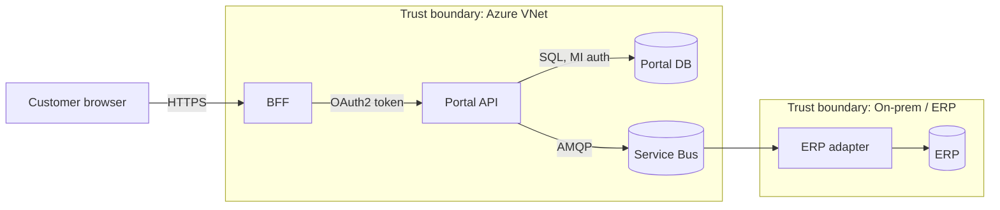
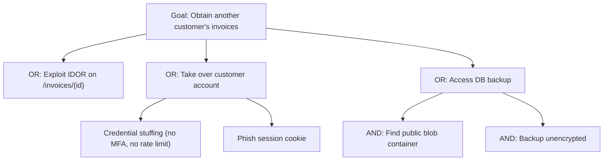

# Security Architecture

> **TL;DR** — Security is an architecture characteristic designed in, not bolted on. Threat-model early (STRIDE on data flow diagrams), use **OWASP Top 10** for awareness and **OWASP ASVS** as a verifiable requirements checklist. Apply **defense in depth**, **least privilege**, and **zero trust** (verify explicitly, assume breach). For identity, use **OAuth 2.0/2.1 + OIDC** with Authorization Code + PKCE; keep tokens out of the browser via a **BFF** where possible, and validate JWTs strictly. Store secrets in a vault, prefer workload identities over secrets, and secure the software supply chain (**SBOM**, **SLSA**, signing, dependency scanning).

---

## 1. Security principles

| Principle | Meaning | Architectural implication |
|---|---|---|
| **Defense in depth** | Multiple independent layers of controls | WAF + authN + authZ + input validation + encryption + monitoring |
| **Least privilege** | Minimum rights for minimum time | Scoped tokens, RBAC/ABAC, JIT admin, read-only DB users for read services |
| **Zero trust** | Never trust by network location; verify every request | Strong identity for users *and* workloads, mTLS, per-request authZ |
| **Secure by default** | Safe defaults; opt-in to risk | Deny-by-default policies, HTTPS-only, secure cookie flags |
| **Fail securely** | Errors don't open access | Default deny on authZ errors |
| **Separation of duties** | No single actor can complete sensitive operations | Four-eyes approval for payments, deploys |
| **Minimize attack surface** | Fewer endpoints, ports, features | Private endpoints, remove unused APIs |
| **Complete mediation** | Check every access | Authorization at every service, not only the gateway |
| **Economy of mechanism** | Keep security mechanisms simple | Use proven libraries, not custom crypto |
| **Open design** (Kerckhoffs) | Security not dependent on secrecy of design | — |
| **Psychological acceptability** | Usable security | SSO, passkeys |
| **Privacy by design** | Data minimisation, purpose limitation (GDPR Art. 25) | Pseudonymisation, retention policies |

(Saltzer & Schroeder, 1975, is the origin of several of these.)

### Zero trust (NIST SP 800-207; Microsoft/Google BeyondCorp)

Core tenets: verify explicitly (identity, device, location, risk), use least-privilege access (JIT/JEA), assume breach (segment, encrypt, monitor). Components: identity provider, policy engine/decision point (PDP), policy enforcement points (PEP), device posture, micro-segmentation, continuous monitoring.

---

## 2. OWASP Top 10

### OWASP Top 10:2021

| # | Category | Examples | Key controls |
|---|---|---|---|
| A01 | **Broken Access Control** | IDOR (`/orders/123` of another tenant), missing function-level checks, CORS misconfig, force browsing | Deny by default; server-side authZ per resource; tenant scoping in queries; tests for authZ |
| A02 | **Cryptographic Failures** | Plaintext data, weak algorithms (MD5/SHA1 for passwords), missing TLS | TLS 1.2+/1.3, encryption at rest, Argon2id/bcrypt/scrypt for passwords, key management |
| A03 | **Injection** (incl. XSS) | SQL, NoSQL, OS command, LDAP injection; XSS | Parameterised queries, ORM, output encoding, CSP, input validation |
| A04 | **Insecure Design** | Missing threat modelling, business logic flaws (no rate limit on voucher redemption) | Threat modelling, secure design patterns, abuse cases |
| A05 | **Security Misconfiguration** | Default creds, verbose errors, open storage buckets, XXE | Hardened baselines, IaC, config scanning |
| A06 | **Vulnerable and Outdated Components** | Unpatched libraries (Log4Shell) | SCA (Dependabot, Renovate, Snyk, OWASP Dependency-Check), SBOM |
| A07 | **Identification and Authentication Failures** | Credential stuffing, weak passwords, session fixation | MFA/passkeys, rate limiting, secure session management, standard IdP |
| A08 | **Software and Data Integrity Failures** | Unsigned updates, insecure deserialisation, CI/CD compromise | Signing, SLSA, verified dependencies, safe deserialisers |
| A09 | **Security Logging and Monitoring Failures** | No audit logs, no alerting | Audit logs, SIEM, alerting, incident response |
| A10 | **Server-Side Request Forgery (SSRF)** | Server fetches attacker-supplied URL → cloud metadata endpoint | Allow-lists, block internal ranges, network egress controls, IMDSv2 |

### OWASP Top 10:2025 update

The 2025 edition (released late 2025) reshuffles categories based on new data. Notable changes (verify against the official list):
- **Broken Access Control** remains #1 and absorbs SSRF.
- **Security Misconfiguration** rises to #2.
- **Software Supply Chain Failures** becomes a broader category (expanding "Vulnerable and Outdated Components").
- **Mishandling of Exceptional Conditions** is a new category (error handling, failing open).
- Injection, cryptographic failures, insecure design, authentication failures, integrity failures, and logging/alerting failures remain.

### Related OWASP lists

- **OWASP API Security Top 10 (2023)**: API1 Broken Object Level Authorization (BOLA), API2 Broken Authentication, API3 Broken Object Property Level Authorization (mass assignment/excessive data exposure), API4 Unrestricted Resource Consumption, API5 Broken Function Level Authorization, API6 Unrestricted Access to Sensitive Business Flows, API7 SSRF, API8 Security Misconfiguration, API9 Improper Inventory Management, API10 Unsafe Consumption of APIs.
- **OWASP Top 10 for LLM Applications** (prompt injection, sensitive information disclosure, supply chain, excessive agency...) — see [../07-data-ai-architecture/README.md](../07-data-ai-architecture/README.md).
- **OWASP Cheat Sheet Series** — practical guidance per topic.
- **OWASP SAMM** — software assurance maturity model for organisations.

---

## 3. OWASP ASVS (Application Security Verification Standard)

A catalog of testable security requirements. **Version 5.0** released May 2025 (4.0.3 was the long-standing previous version).

| Level | Target | Use |
|---|---|---|
| **L1** | Baseline; defends against easy, common attacks | All applications |
| **L2** | Standard; most applications handling sensitive data | Business apps, B2B portals, PII |
| **L3** | Advanced; high-value, high-assurance | Finance, healthcare, critical infra |

Chapters (v5.0) include: encoding and sanitization, validation and business logic, web frontend security, API and web service, file handling, authentication, session management, authorization, self-contained tokens, OAuth and OIDC, cryptography, secure communication, configuration, data protection, secure coding and architecture, security logging and error handling.

**How to use**: pick target level per app; turn relevant requirements into acceptance criteria / security user stories; map to tests (SAST/DAST/manual); track coverage. Pair with **OWASP MASVS** for mobile.

---

## 4. Threat modelling

> Four key questions (Threat Modeling Manifesto; Adam Shostack): **What are we working on? What can go wrong? What are we going to do about it? Did we do a good enough job?**

### Threat Modeling Manifesto (2020) — values

- A culture of finding and fixing design issues **over** checkbox compliance.
- People and collaboration **over** processes, methodologies, and tools.
- A journey of understanding **over** a security or privacy snapshot.
- Doing threat modelling **over** talking about it.
- Continuous refinement **over** a single delivery.

### Data flow diagram (DFD) basics

| Element | Symbol | Example |
|---|---|---|
| External entity | Rectangle | User, partner system |
| Process | Circle/rounded | API, function |
| Data store | Parallel lines | Database, blob |
| Data flow | Arrow | HTTPS request |
| **Trust boundary** | Dashed line | Internet ↔ DMZ ↔ internal; tenant boundaries |



### STRIDE (Microsoft; Kohnfelder & Garg)

| Threat | Violates | Example | Mitigations |
|---|---|---|---|
| **S**poofing | Authentication | Forged token; stolen API key | Strong authN, MFA, mTLS, signed tokens |
| **T**ampering | Integrity | Modify order price in request; alter message | Server-side recalculation, signatures/HMAC, TLS, DB constraints |
| **R**epudiation | Non-repudiation | User denies approving payment | Audit logs (tamper-evident), signatures, timestamps |
| **I**nformation disclosure | Confidentiality | IDOR leaks other customers' invoices; verbose errors | AuthZ, encryption, data minimisation, error handling |
| **D**enial of service | Availability | Expensive report endpoint hammered | Rate limits, quotas, pagination limits, autoscale, WAF |
| **E**levation of privilege | Authorization | Regular user calls admin endpoint; mass assignment of `role` | RBAC/ABAC checks, allow-list binding, least privilege |

**STRIDE-per-element**: processes are subject to all six; data stores to T, R (if logs), I, D; data flows to T, I, D; external entities to S, R.

### Other methods

| Method | Description | When |
|---|---|---|
| **DREAD** | Score risk: **D**amage, **R**eproducibility, **E**xploitability, **A**ffected users, **D**iscoverability (1–10 each) | Quick prioritisation; criticised as subjective — Microsoft stopped using it; prefer CVSS or simple likelihood × impact |
| **PASTA** (Process for Attack Simulation and Threat Analysis) | 7-stage risk-centric: 1 define objectives, 2 define technical scope, 3 application decomposition, 4 threat analysis, 5 vulnerability analysis, 6 attack modelling, 7 risk & impact analysis | Business-risk alignment; larger orgs |
| **Attack trees** (Bruce Schneier) | Root = attacker goal; children = ways to achieve (AND/OR nodes) with costs/probabilities | Deep analysis of specific goals |
| **LINDDUN** | Privacy threats: Linking, Identifying, Non-repudiation, Detecting, Data disclosure, Unawareness, Non-compliance | Privacy/GDPR-heavy systems |
| **OCTAVE** | Organisational risk assessment | Enterprise |
| **VAST** | Visual, agile, scalable; process & operational models | Scaling in large orgs |
| **Kill chain / MITRE ATT&CK** | Adversary tactics and techniques | Detection engineering |
| **Elevation of Privilege card game** | Gamified STRIDE | Team workshops |

#### Attack tree example



### Lightweight threat modelling in agile teams

1. Per epic/feature with new data flows or trust boundaries: 30–60 min session.
2. Draw/refresh the DFD (C4 container diagram + trust boundaries works).
3. Walk STRIDE per element/flow; capture threats as backlog items with owners.
4. Track as "threat model as code" (OWASP Threat Dragon, Microsoft Threat Modeling Tool, pytm, Threagile) in the repo.
5. Revisit on architectural change.

---

## 5. Identity: OAuth 2.0 / 2.1 and OpenID Connect

### Roles

| Role | Description |
|---|---|
| **Resource owner** | User who owns the data |
| **Client** | App requesting access (SPA, mobile, web app, service) |
| **Authorization server (AS)** | Issues tokens (Entra ID, Auth0/Okta, Keycloak, Duende IdentityServer, Cognito) |
| **Resource server (RS)** | API accepting access tokens |

**OAuth 2.0** = delegated **authorization** (access tokens). **OIDC** = **authentication** layer on top (ID token, UserInfo, discovery `/.well-known/openid-configuration`, standard claims).

### Flows (grant types)

| Flow | Use | Status |
|---|---|---|
| **Authorization Code + PKCE** | Web apps, SPAs, mobile, desktop — any user-facing client | ✅ Recommended for all clients (OAuth 2.1 mandates PKCE) |
| **Client Credentials** | Service-to-service (no user) | ✅ (prefer certificate/private-key JWT or workload identity over shared secrets) |
| **Device Authorization** (RFC 8628) | Input-constrained devices (TVs, CLIs) | ✅ |
| **Refresh token** | Obtain new access tokens | ✅ with rotation & reuse detection for public clients; sender-constrained where possible |
| **Token Exchange** (RFC 8693) | On-behalf-of, delegation across services | ✅ (Entra "OBO" flow similar) |
| **CIBA** | Decoupled authentication (approve on phone) | Niche |
| **Implicit** | Legacy SPAs (token in URL fragment) | ❌ Removed in OAuth 2.1 |
| **Resource Owner Password Credentials** | App collects user password | ❌ Removed in OAuth 2.1 |

### OAuth 2.1 (draft consolidating best practices)

- PKCE required for all authorization code flows.
- Implicit and password grants removed.
- Exact redirect URI matching.
- Bearer tokens not in query strings.
- Refresh tokens for public clients must be sender-constrained or one-time use (rotation).
- Aligns with **OAuth 2.0 Security Best Current Practice (RFC 9700, Jan 2025)**.

### Authorization Code + PKCE

```mermaid
sequenceDiagram
  participant U as User/Browser
  participant C as Client (BFF / app)
  participant AS as Authorization server
  participant RS as API
  C->>C: code_verifier = random; code_challenge = BASE64URL(SHA256(verifier))
  C->>U: Redirect to /authorize?response_type=code&client_id&redirect_uri&scope&state&code_challenge&code_challenge_method=S256
  U->>AS: Login + consent (MFA)
  AS->>U: Redirect to redirect_uri?code=...&state=...
  U->>C: code, state (verify state)
  C->>AS: POST /token (code, code_verifier, client auth if confidential)
  AS-->>C: access_token, id_token, refresh_token
  C->>RS: GET /orders (Authorization: Bearer access_token)
  RS-->>C: 200
```

### SPA security architecture options

| Option | Tokens in browser? | Recommendation |
|---|---|---|
| **BFF (Backend for Frontend)** — confidential client; browser gets HttpOnly, Secure, SameSite cookie; BFF proxies API calls with tokens | No | ✅ Preferred (IETF "OAuth 2.0 for Browser-Based Apps" draft) |
| **Token-mediating backend** — backend obtains tokens, gives access token to SPA | Access token only | Acceptable |
| **Browser-based OAuth client** — SPA is public client with PKCE, tokens in memory | Yes | Acceptable for lower risk; XSS = token theft |

Cookie settings: `HttpOnly; Secure; SameSite=Lax|Strict; Path=/; __Host-` prefix; plus CSRF protection (SameSite + anti-forgery header for state-changing requests).

### Scopes, claims, and authorization models

| Model | Description | Example |
|---|---|---|
| **Scopes** | What the *client* may do on behalf of user (coarse) | `orders.read`, `orders.write` |
| **RBAC** | Roles → permissions | `SalesManager` can approve discounts |
| **ABAC** | Policies on attributes (user, resource, environment) | `user.department == resource.department && time in business hours` |
| **ReBAC** | Relationship-based (Google Zanzibar) | "user is editor of folder containing document" — OpenFGA, SpiceDB, Permify |
| **Policy as code** | Externalised policies | OPA/Rego, Cedar (AWS Verified Permissions), Casbin |

Always enforce **resource-level** authorization in the service (BOLA/IDOR prevention): filter by tenant/owner in queries, not just check scopes.

```csharp
// ASP.NET Core resource-based authorization
public sealed class InvoiceOwnerHandler : AuthorizationHandler<OperationAuthorizationRequirement, Invoice>
{
    protected override Task HandleRequirementAsync(AuthorizationHandlerContext ctx,
        OperationAuthorizationRequirement req, Invoice invoice)
    {
        var customerId = ctx.User.FindFirst("customer_id")?.Value;
        if (customerId is not null && invoice.CustomerId == customerId) ctx.Succeed(req);
        return Task.CompletedTask;
    }
}
// In handler: var result = await auth.AuthorizeAsync(User, invoice, Operations.Read); if (!result.Succeeded) return Forbid();
```

---

## 6. JWT pitfalls

| Pitfall | Risk | Mitigation |
|---|---|---|
| Accepting `alg: none` | Forged tokens | Library configured with explicit allowed algorithms |
| Algorithm confusion (RS256 → HS256 using public key as HMAC secret) | Forged tokens | Pin algorithm per key; use well-maintained libraries |
| Not validating `iss`, `aud`, `exp`, `nbf` | Token from other app/tenant accepted | Validate all; `aud` = your API |
| Using ID token to call APIs | Wrong token type | APIs accept **access tokens** only; check `typ` (`at+jwt`, RFC 9068) |
| Long-lived access tokens | Stolen token valid for long | 5–15 min lifetime; refresh tokens with rotation |
| No revocation strategy | Can't kill compromised sessions | Short TTL, refresh revocation, token introspection for high-risk, deny-lists for `jti` |
| Sensitive data in payload | JWTs are only base64url-encoded (JWS) | Don't put PII/secrets; use JWE if needed |
| Storing in `localStorage` | XSS exfiltration | BFF + HttpOnly cookies, or in-memory |
| Weak HMAC secrets | Brute force | ≥ 256-bit random secrets; prefer asymmetric (RS256/ES256/EdDSA) |
| `kid`/`jku`/`x5u` header injection | Attacker-controlled keys | Only fetch keys from configured JWKS URI; ignore `jku` |
| Clock skew issues | Spurious failures or extended validity | Small leeway (≤ 60 s) |
| JWT as session replacement for everything | Logout/revocation complexity | Server-side sessions are fine for first-party web apps |
| Bearer token replay | Theft = access | Sender-constrained tokens: **DPoP** (RFC 9449) or mTLS-bound tokens (RFC 8705) |

```ts
// Node: strict JWT validation with jose
import { createRemoteJWKSet, jwtVerify } from "jose";

const JWKS = createRemoteJWKSet(new URL("https://login.example.com/.well-known/jwks.json"));

export async function verifyAccessToken(token: string) {
  const { payload } = await jwtVerify(token, JWKS, {
    issuer: "https://login.example.com/",
    audience: "api://orders",
    algorithms: ["RS256"],
    typ: "at+jwt",
    clockTolerance: 30,
  });
  return payload;
}
```

---

## 7. Secrets management

| Practice | Details |
|---|---|
| **No secrets in code/repos/images** | Pre-commit + CI secret scanning (gitleaks, GitHub secret scanning/push protection, trufflehog) |
| **Central vault** | Azure Key Vault, AWS Secrets Manager, GCP Secret Manager, HashiCorp Vault, Infisical |
| **Prefer identity over secrets** | Managed identities / workload identity federation (OIDC from GitHub Actions/Azure DevOps to cloud) — no stored credentials |
| **Short-lived, dynamic credentials** | Vault dynamic DB credentials; STS tokens |
| **Rotation** | Automated; support two active versions during rotation |
| **Least privilege access to secrets** | Per-app vault access policies/RBAC |
| **Encryption keys** | KMS/HSM; envelope encryption; key rotation; separate key admins from data admins |
| **Runtime injection** | Env vars from secret store, CSI secret store driver, config providers (`AddAzureKeyVault`) — avoid writing to disk/logs |
| **Kubernetes** | Native Secrets are only base64 — enable encryption at rest, use External Secrets Operator / Sealed Secrets / SOPS |
| **Audit** | Log secret access; alert on anomalies |

```csharp
// .NET: Key Vault config provider with managed identity (no secret to bootstrap)
builder.Configuration.AddAzureKeyVault(
    new Uri($"https://{builder.Configuration["KeyVaultName"]}.vault.azure.net/"),
    new DefaultAzureCredential());
```

---

## 8. Software supply chain security

| Control | Description |
|---|---|
| **SBOM** (Software Bill of Materials) | Machine-readable inventory of components: **SPDX** (ISO/IEC 5962) or **CycloneDX** (ECMA-424). Generate in CI (Syft, CycloneDX tools, `dotnet CycloneDX`, `npm sbom`) |
| **SCA** (software composition analysis) | Vulnerability & licence scanning (Dependabot, Renovate, Snyk, Trivy, Grype, OWASP Dependency-Track) |
| **SLSA** (Supply-chain Levels for Software Artifacts) | Framework (OpenSSF) with Build track levels L0–L3: L1 provenance exists; L2 hosted build platform + signed provenance; L3 hardened, isolated builds with unforgeable provenance |
| **Signing** | Sigstore (cosign, keyless with OIDC; Rekor transparency log), Notation; verify at deploy (admission policies) |
| **Provenance attestations** | in-toto / SLSA provenance (GitHub artifact attestations) |
| **Pinning & lock files** | Lock files committed; pin actions by SHA; private registries/proxies (Artifactory, Azure Artifacts) |
| **Dependency confusion / typosquatting** | Scoped packages, upstream source restrictions, package allow-lists |
| **CI/CD hardening** | Least-privilege tokens, OIDC to cloud, protected branches, required reviews, ephemeral runners |
| **OpenSSF Scorecard** | Assess open-source dependency hygiene |
| **VEX** | Vulnerability Exploitability eXchange — state whether a CVE actually affects you |
| **Regulation** | EU **Cyber Resilience Act** (vulnerability handling + SBOM obligations phasing in 2026–2027), US EO 14028, NIS2 for essential entities |

---

## 9. Security architecture checklist (application)

- [ ] Threat model exists (DFD with trust boundaries) and is updated with major changes
- [ ] ASVS target level chosen; requirements in backlog
- [ ] Central IdP; OIDC/OAuth with Auth Code + PKCE; MFA/passkeys for users; no custom password storage if avoidable
- [ ] BFF for SPAs or justified alternative
- [ ] Resource-level authorization in every service; tenant isolation tested
- [ ] Input validation at trust boundaries; parameterised queries; output encoding; CSP
- [ ] Security headers: HSTS, CSP, `X-Content-Type-Options`, `Referrer-Policy`, `frame-ancestors`
- [ ] TLS everywhere (incl. internal); encryption at rest; key management
- [ ] Secrets in vault; managed identities; no secrets in repo (scanning enforced)
- [ ] Rate limiting & resource limits (page sizes, upload sizes, query complexity)
- [ ] Audit logging of security-relevant events; centralised; alerting; no sensitive data in logs
- [ ] Dependency scanning + SBOM + signed artifacts; base images patched
- [ ] Network: private endpoints, segmentation, egress control (SSRF)
- [ ] Backups encrypted, tested restore; incident response runbook
- [ ] Privacy: data classification, retention, DPIA where needed (GDPR)

## Common mistakes / anti-patterns

- Authorization only in the UI or only at the gateway.
- Trusting client-supplied prices, roles, tenant IDs.
- Rolling your own crypto/auth.
- Tokens in `localStorage`; long-lived access tokens.
- Shared service accounts with admin rights across environments.
- Security review as a final gate instead of continuous practice.
- Logging tokens, passwords, or full PII.
- Ignoring transitive dependencies.
- Network perimeter as the only defence ("castle and moat").

## Related

- [api-design.md](api-design.md) (API gateway, webhooks HMAC), [architecture-styles.md](architecture-styles.md) (BFF), [distributed-systems.md](distributed-systems.md) (rate limiting)
- Cloud security, landing zones, network: [../06-cloud-architecture/README.md](../06-cloud-architecture/README.md)
- DevSecOps pipelines: [../08-engineering/README.md](../08-engineering/README.md)
- AI/LLM security: [../07-data-ai-architecture/README.md](../07-data-ai-architecture/README.md)

## References

- OWASP Top 10: https://owasp.org/Top10/
- OWASP Top 10:2021: https://owasp.org/Top10/2021/ (2025 edition linked from the main Top 10 page)
- OWASP API Security Top 10: https://owasp.org/API-Security/
- OWASP ASVS: https://owasp.org/www-project-application-security-verification-standard/
- OWASP Cheat Sheet Series: https://cheatsheetseries.owasp.org/
- OWASP Threat Modeling: https://owasp.org/www-community/Threat_Modeling
- OWASP Threat Dragon: https://owasp.org/www-project-threat-dragon/
- OWASP SAMM: https://owaspsamm.org/
- OWASP Top 10 for LLM Applications: https://genai.owasp.org/
- Threat Modeling Manifesto: https://www.threatmodelingmanifesto.org/
- STRIDE: https://en.wikipedia.org/wiki/STRIDE_model · DREAD: https://en.wikipedia.org/wiki/DREAD_(risk_assessment_model)
- Attack tree: https://en.wikipedia.org/wiki/Attack_tree
- LINDDUN: https://linddun.org/
- MITRE ATT&CK: https://attack.mitre.org/
- Microsoft Threat Modeling Tool: https://learn.microsoft.com/azure/security/develop/threat-modeling-tool
- NIST SP 800-207 Zero Trust Architecture: https://csrc.nist.gov/pubs/sp/800/207/final
- Microsoft Zero Trust: https://learn.microsoft.com/security/zero-trust/
- Defense in depth: https://en.wikipedia.org/wiki/Defense_in_depth_(computing) · Principle of least privilege: https://en.wikipedia.org/wiki/Principle_of_least_privilege
- OAuth 2.0 (RFC 6749): https://www.rfc-editor.org/rfc/rfc6749 · oauth.net: https://oauth.net/2/ · OAuth 2.1: https://oauth.net/2.1/
- RFC 7636 PKCE: https://www.rfc-editor.org/rfc/rfc7636
- RFC 9700 OAuth 2.0 Security BCP: https://www.rfc-editor.org/rfc/rfc9700
- RFC 9449 DPoP: https://www.rfc-editor.org/rfc/rfc9449
- RFC 9068 JWT Profile for Access Tokens: https://www.rfc-editor.org/rfc/rfc9068
- RFC 8725 JWT Best Current Practices: https://www.rfc-editor.org/rfc/rfc8725
- OpenID Connect: https://openid.net/developers/how-connect-works/
- OAuth 2.0 for Browser-Based Apps (IETF draft): https://datatracker.ietf.org/doc/draft-ietf-oauth-browser-based-apps/
- SLSA: https://slsa.dev/
- CycloneDX: https://cyclonedx.org/ · SPDX: https://spdx.dev/
- Sigstore: https://www.sigstore.dev/
- OpenSSF Scorecard: https://securityscorecards.dev/
- Adam Shostack — *Threat Modeling: Designing for Security* (2014)
- Loren Kohnfelder — *Designing Secure Software* (2021)
- Neil Madden — *API Security in Action* (2020)
