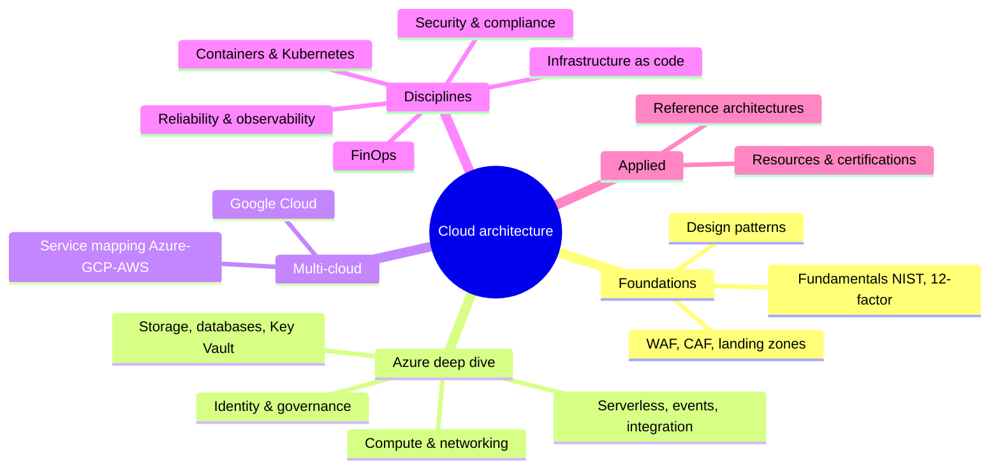

# 06 — Cloud Architecture

> **TL;DR** — Reference for designing, governing and operating cloud workloads, **Azure-first**, with Google Cloud as second platform and AWS for vocabulary mapping. Start with fundamentals and the frameworks (WAF, CAF, landing zones), then the Azure deep dives (identity & governance, compute & networking, data, integration), then cross-cutting disciplines (Kubernetes, IaC, reliability & observability, security & compliance, FinOps), and finish with reusable reference architectures. Cloud services change fast — every file flags items to *verify* against current docs.

---

## Map

## Files

| # | File | What's in it |
|---|---|---|
| 1 | [cloud-fundamentals.md](cloud-fundamentals.md) | NIST definition (5 characteristics, 3 service models, 4 deployment models), shared responsibility, IaaS/PaaS/SaaS/FaaS/CaaS, regions & zones, migration Rs (AWS & CAF), CapEx vs OpEx, 12-factor + 15-factor, CNCF cloud native |
| 2 | [architecture-frameworks-waf-caf.md](architecture-frameworks-waf-caf.md) | Azure Well-Architected 5 pillars with principles & checklists, CAF phases, Azure landing zones (MG hierarchy, platform vs app LZ, hub-spoke vs Virtual WAN), AWS 6 pillars, Google Cloud Architecture Framework |
| 3 | [cloud-design-patterns.md](cloud-design-patterns.md) | Full Azure cloud design pattern catalog with one-liners, grouped mind map, deep dives (retry, circuit breaker, queue load leveling, cache-aside, saga, strangler fig, stamps vs geode, valet key, throttling) |
| 4 | [azure-identity-governance.md](azure-identity-governance.md) | Resource hierarchy, Entra ID (app registrations vs enterprise apps, managed identities, Conditional Access, PIM, RBAC, B2B/B2C/External ID), Azure Policy, Blueprints → template specs/deployment stacks, tagging, CAF naming, M365/Intune/Power Platform |
| 5 | [azure-compute-networking.md](azure-compute-networking.md) | Compute decision tree (VMs, VMSS, App Service, Functions plans, Container Apps, AKS, ACI, Batch, SWA), VNet/NSG/ASG, private vs service endpoints, Private DNS, Firewall, App Gateway, Front Door, LB, Traffic Manager decision table, VPN/ExpressRoute, Bastion, Azure Arc |
| 6 | [azure-storage-databases.md](azure-storage-databases.md) | Blob tiers & redundancy (LRS…RA-GZRS), Azure SQL (DTU/vCore/serverless/Hyperscale), Managed Instance, PostgreSQL Flexible, Cosmos DB (RU, partition keys, 5 consistency levels), Redis, Key Vault, store selection |
| 7 | [serverless-event-driven-integration.md](serverless-event-driven-integration.md) | Events vs messages, Service Bus vs Event Grid vs Event Hubs vs Storage Queues, Functions & cold starts, Durable Functions 6 patterns with code, Logic Apps, API Management policies, AIS |
| 8 | [gcp-and-service-mapping.md](gcp-and-service-mapping.md) | GCP hierarchy, IAM, Cloud Run, GKE, App Engine, VPC/Shared VPC, Cloud Storage classes, Cloud SQL, Spanner, Firestore, BigQuery, Pub/Sub, Dataflow, Composer, Vertex AI, Cloud Build; full Azure ↔ GCP ↔ AWS mapping tables |
| 9 | [containers-kubernetes.md](containers-kubernetes.md) | Dockerfile best practices (multi-stage, distroless, non-root), K8s objects, Service types, Gateway API, probes, requests/limits & QoS, HPA/VPA/KEDA, Helm vs Kustomize, GitOps (Argo CD, Flux), service mesh, AKS specifics |
| 10 | [infrastructure-as-code.md](infrastructure-as-code.md) | Bicep vs ARM vs Terraform vs OpenTofu vs Pulumi, Terraform state/backends/modules/workspaces/drift, Bicep modules/what-if/AVM/deployment stacks, policy as code (OPA, Azure Policy), environment strategy, OIDC pipelines |
| 11 | [reliability-observability.md](reliability-observability.md) | SLI/SLO/SLA, error budgets & burn-rate alerts, nines table, composite SLA math, RTO/RPO, DR strategies cost/RTO table, multi-region patterns, chaos engineering, OpenTelemetry, RED/USE/Golden Signals, Azure Monitor, 10 KQL queries, alerting philosophy |
| 12 | [cloud-security-compliance.md](cloud-security-compliance.md) | Zero Trust, identity as perimeter, MCSB, CIS, Defender for Cloud, Sentinel, secrets, encryption & CMK, network isolation, DevSecOps, GDPR, NIS2, EU data residency, ISO 27001 basics |
| 13 | [finops-cost-management.md](finops-cost-management.md) | FinOps principles & phases, allocation & tagging, showback/chargeback, budgets, anomaly detection, usage & rate optimization (reservations vs savings plans vs spot, Hybrid Benefit, dev/test), KPIs, unit economics |
| 14 | [reference-architectures.md](reference-architectures.md) | Mermaid reference architectures: internal LOB app, data platform, B2B portal, integration platform (AIS), static site + API, RAG sketch; review checklist |
| 15 | [resources.md](resources.md) | Certification paths (AZ-900, AZ-104, AZ-305, AZ-400, AZ-500, GCP PCA, CKA…), official docs, books, practice ideas |

## Where to start for…

| Situation | Read |
|---|---|
| New to cloud / explaining to stakeholders | [Fundamentals](cloud-fundamentals.md) → [FinOps](finops-cost-management.md) |
| Setting up Azure for an organization | [WAF & CAF / landing zones](architecture-frameworks-waf-caf.md) → [Identity & governance](azure-identity-governance.md) → [Networking](azure-compute-networking.md) |
| Designing a new workload | [Reference architectures](reference-architectures.md) → [Patterns](cloud-design-patterns.md) → [WAF checklists](architecture-frameworks-waf-caf.md) |
| Choosing compute | [Compute decision tree](azure-compute-networking.md) → [Kubernetes](containers-kubernetes.md) |
| Choosing a database or messaging service | [Storage & databases](azure-storage-databases.md) → [Messaging decision table](serverless-event-driven-integration.md) |
| Migrating workloads | [Migration Rs](cloud-fundamentals.md) → [CAF](architecture-frameworks-waf-caf.md) |
| Translating between Azure, GCP, AWS | [Service mapping](gcp-and-service-mapping.md) |
| Setting SLOs or DR targets | [Reliability & observability](reliability-observability.md) |
| Security review / NIS2 / ISO 27001 | [Security & compliance](cloud-security-compliance.md) |
| Cloud bill too high | [FinOps](finops-cost-management.md) |
| Automating infrastructure | [IaC](infrastructure-as-code.md) |
| Exam preparation | [Resources & certifications](resources.md) |

## Related sections

| Section | Connection |
|---|---|
| [01 UX / UI](../01-ux-ui/README.md) | Front-end hosting and performance considerations |
| [02 Product management](../02-product-management/README.md) | Unit economics, product metrics feeding FinOps |
| [03 Project management](../03-project-management/README.md) | Migration programmes, wave planning |
| [04 Agile, Kanban, Scrum](../04-agile-kanban-scrum/README.md) | Platform team flow, error budgets as prioritization input |
| [05 Software architecture](../05-software-architecture/README.md) | Architecture styles, DDD, distributed systems, ADRs |
| [07 Data & AI architecture](../07-data-ai-architecture/README.md) | Lakehouse, Fabric, ML, RAG on cloud platforms |
| [08 Engineering](../08-engineering/README.md) | CI/CD, DORA, testing, Git |
| [09 Leadership, teams, facilitation](../09-leadership-teams-facilitation/README.md) | Platform teams, CCoE, Team Topologies |
| [10 Laws, principles, mental models](../10-laws-principles-mental-models/README.md) | Trade-off thinking, systems thinking |
| [11 Enterprise architecture & business](../11-enterprise-architecture-business/README.md) | TOGAF, ITIL 4, ISO 27001, NIS2 |

## Conventions in this section

- Azure names and SKUs as of late 2026; Microsoft renames services often (Azure AD → Entra ID, Cloud Functions → Cloud Run functions). Items marked *verify* are known to be in flux.
- Abbreviations: WAF = Well-Architected Framework **or** Web Application Firewall (context); ALZ = Azure landing zone; PE = private endpoint; MI = managed identity; MG = management group; LZ = landing zone.
- Code snippets are illustrative and minimal — pin versions and check current API versions before use.

## References

- Azure Architecture Center — https://learn.microsoft.com/azure/architecture/
- Azure Well-Architected Framework — https://learn.microsoft.com/azure/well-architected/
- Microsoft Cloud Adoption Framework — https://learn.microsoft.com/azure/cloud-adoption-framework/
- Google Cloud Architecture Framework — https://cloud.google.com/architecture/framework
- AWS Well-Architected — https://aws.amazon.com/architecture/well-architected/
- Knowledgebase root — [../README.md](../README.md)
