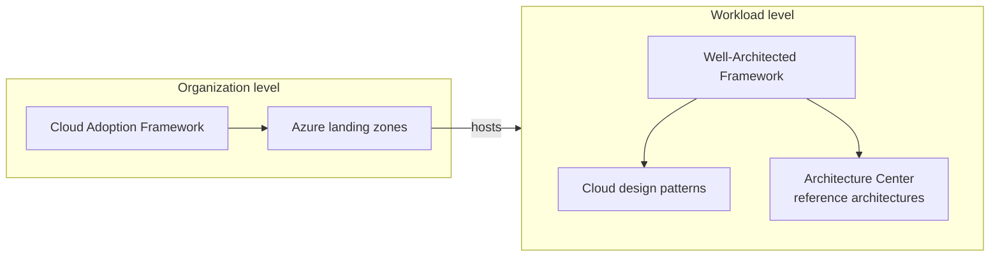
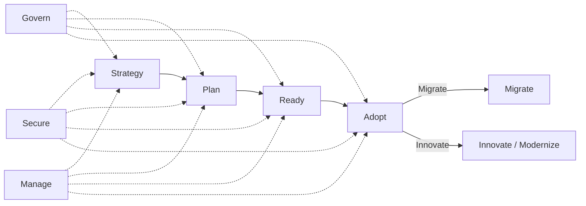
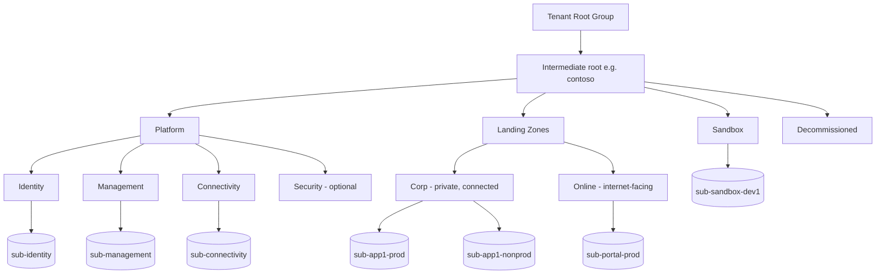
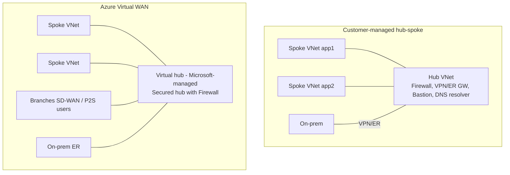

# Architecture Frameworks: Well-Architected, CAF & Landing Zones

> **TL;DR** — The **Azure Well-Architected Framework (WAF)** judges a *workload* against 5 pillars (Reliability, Security, Cost Optimization, Operational Excellence, Performance Efficiency). The **Cloud Adoption Framework (CAF)** guides the *organization* through Strategy → Plan → Ready → Adopt, with Govern, Secure, Manage running continuously. **Azure landing zones (ALZ)** are CAF's "Ready" output: a management-group hierarchy with policy, identity, networking and monitoring so application teams land on a governed platform. AWS has 6 Well-Architected pillars (adds Sustainability); Google's Architecture Framework has a similar pillar set.

---

## 1. Map of frameworks

| Framework | Scope | Main question | Tooling |
|---|---|---|---|
| Azure WAF | Workload | "Is this workload well designed?" | Well-Architected Review assessment, Azure Advisor, service guides |
| Microsoft CAF | Organization / portfolio | "How do we adopt cloud responsibly?" | Strategy/Plan templates, Governance benchmark, ALZ accelerators |
| Azure landing zones | Platform | "What does the target environment look like?" | ALZ Bicep / Terraform (AVM), portal accelerator |
| AWS Well-Architected | Workload | 6 pillars | AWS WA Tool, Lenses |
| Google Cloud Architecture Framework | Workload + org | Pillars + perspectives | Architecture Center |

---

## 2. Azure Well-Architected Framework

Five pillars. Each has **design principles**, a **design review checklist** (coded e.g. RE:01, SE:01, CO:01, OE:01, PE:01), **trade-offs** and **recommendations**. Service guides apply pillars to individual services.

### 2.1 Reliability (RE)

**Goal**: the workload meets its availability/recovery targets and recovers from failure.

Design principles:
- Design for **business requirements** (define targets per flow, not "five nines everywhere").
- Design for **resilience** (expect failure, isolate it, degrade gracefully).
- Design for **recovery** (tested backup/restore, DR).
- Design for **operations** (observability, failure detection, automation).
- **Keep it simple** (fewer moving parts, fewer failure modes).

Checklist highlights:
- [ ] RE:01 Simplicity and efficiency — avoid unnecessary components
- [ ] RE:02 Identify and rate **critical user and system flows**
- [ ] RE:03 **Failure mode analysis** (FMEA) per component and dependency
- [ ] RE:04 Define **reliability and recovery targets** (SLO, RTO, RPO) per flow
- [ ] RE:05 **Redundancy** at multiple layers (zones, regions as required)
- [ ] RE:06 **Scaling** strategy, timely and reliable
- [ ] RE:07 **Self-preservation / self-healing** (retries, circuit breakers, bulkheads, queues)
- [ ] RE:08 **Test** resiliency: chaos experiments, fault injection, load tests
- [ ] RE:09 **Business continuity & DR** plan, tested
- [ ] RE:10 **Health model** and monitoring

Trade-offs: redundancy ↑ cost; multi-region ↑ operational complexity; strong consistency ↓ availability.

### 2.2 Security (SE)

**Goal**: confidentiality, integrity, availability (CIA) of workload and data.

Design principles:
- Plan **security readiness** (adopt a baseline, e.g. MCSB, assign ownership).
- Design to protect **confidentiality** (least privilege, encryption, classification).
- Design to protect **integrity** (supply chain, signed artifacts, tamper detection).
- Design to protect **availability** (DDoS, rate limiting, resilient identity).
- **Sustain and evolve** security posture (threat modelling, continuous assessment).

Underpinned by **Zero Trust**: verify explicitly, use least-privilege access, assume breach.

Checklist highlights:
- [ ] SE:01 Security baseline aligned to compliance requirements
- [ ] SE:02 **Secure development lifecycle** (threat modelling, SAST/DAST, supply chain)
- [ ] SE:03 **Classify and label** data and flows
- [ ] SE:04 **Segmentation** — create boundaries (subscriptions, VNets, identities)
- [ ] SE:05 **Identity and access management** — Entra ID, managed identities, PIM, Conditional Access
- [ ] SE:06 **Network controls** — private endpoints, firewall, WAF, deny by default
- [ ] SE:07 **Encryption** at rest and in transit, key management
- [ ] SE:08 **Harden** resources (CIS, baselines, reduce surface)
- [ ] SE:09 **Secrets** protection (Key Vault, rotation, no secrets in code)
- [ ] SE:10 **Monitoring & threat detection** (Defender for Cloud, Sentinel)
- [ ] SE:11 **Testing** (pen tests, red teaming)
- [ ] SE:12 **Incident response** procedures

### 2.3 Cost Optimization (CO)

**Goal**: maximize value within budget, not minimize spend.

Design principles:
- Develop **cost-management discipline** (budgets, accountability, FinOps culture).
- Design with a **cost-efficiency mindset** (spend on what matters to the business).
- Design for **usage optimization** (use what you pay for; right tier, scale to demand).
- Design for **rate optimization** (reservations, savings plans, Hybrid Benefit, dev/test pricing).
- **Monitor and optimize over time**.

Checklist highlights:
- [ ] CO:01 Culture of financial responsibility
- [ ] CO:02 Cost model (estimate per environment, per flow)
- [ ] CO:03 Collect and review cost data (tags, cost exports)
- [ ] CO:04 Spending guardrails (budgets, policy, allowed SKUs)
- [ ] CO:05 Best rates from providers (commitments)
- [ ] CO:06 Align usage to billing increments
- [ ] CO:07 Component costs (remove unused, consolidate)
- [ ] CO:08 Environment costs (dev/test smaller, auto-shutdown)
- [ ] CO:09 Flow costs (prioritize spend on critical flows)
- [ ] CO:10 Data costs (tiering, lifecycle, retention)
- [ ] CO:11 Code costs (efficient code reduces compute)
- [ ] CO:12 Scaling costs (scale to zero, autoscale)
- [ ] CO:13 Personnel time (automation)
- [ ] CO:14 Consolidation (shared platform resources)

### 2.4 Operational Excellence (OE)

**Goal**: reliable, predictable, safe operations and change.

Design principles:
- Embrace **DevOps culture** (shared ownership, blameless learning).
- Establish **development standards** (code quality, branching, IaC).
- Evolve operations with **observability**.
- **Deploy with confidence** (automated, safe deployment practices, progressive exposure).
- **Automate for efficiency** (remove toil).
- Adopt **safe deployment practices** (small batches, rings, feature flags, rollback).

Checklist highlights:
- [ ] OE:01 DevOps culture, roles, RACI
- [ ] OE:02 Formalize operational tasks (runbooks)
- [ ] OE:03 Software ideation and planning practices
- [ ] OE:04 Tools and processes for quality (CI, tests)
- [ ] OE:05 **Infrastructure as code**
- [ ] OE:06 Workload supply chain (pipelines)
- [ ] OE:07 **Monitoring system**
- [ ] OE:08 **Incident management**
- [ ] OE:09 **Automation** of tasks
- [ ] OE:10 Automation design (idempotent, observable)
- [ ] OE:11 **Safe deployment practices**
- [ ] OE:12 Deployment failure mitigation (rollback, roll-forward)

### 2.5 Performance Efficiency (PE)

**Goal**: scale to meet demand efficiently.

Design principles:
- **Negotiate realistic performance targets**.
- **Design to meet capacity requirements** (right services, scale units).
- **Achieve and sustain performance** (load testing, monitoring).
- **Improve efficiency through optimization** (hot paths, caching, data design).

Checklist highlights:
- [ ] PE:01 Performance targets (latency percentiles, throughput)
- [ ] PE:02 Capacity planning
- [ ] PE:03 Select the right services
- [ ] PE:04 Collect performance data
- [ ] PE:05 **Scaling and partitioning**
- [ ] PE:06 **Performance testing**
- [ ] PE:07 Optimize code and infrastructure
- [ ] PE:08 Optimize data usage (indexes, partitioning, caching)
- [ ] PE:09 Prioritize critical flows
- [ ] PE:10 Optimize operational tasks (backups, indexing off-peak)
- [ ] PE:11 Respond to live performance issues
- [ ] PE:12 Continuously optimize

### 2.6 Pillar trade-off matrix

| Improving → affects | Reliability | Security | Cost | OpEx | Performance |
|---|---|---|---|---|---|
| **More redundancy** | ++ | − (more surface) | −− | − (complexity) | + |
| **Private networking everywhere** | ± | ++ | − | − | ± |
| **Aggressive caching** | + | − (stale/leaky data) | + | − | ++ |
| **Scale to zero / consumption** | − (cold start) | ± | ++ | + | − |
| **Multi-region active-active** | ++ | − | −−− | −− | + (latency) |

### 2.7 Using WAF in practice

1. Run the **Azure Well-Architected Review** assessment per workload (≈1–2 h workshop).
2. Feed findings into the backlog as tech debt with severity.
3. Review **Azure Advisor** recommendations (mapped to pillars, includes Advisor score).
4. Use **service guides** (e.g. "WAF for App Service") during design.
5. Record decisions as ADRs (see [Software architecture](../05-software-architecture/README.md)).
6. Repeat at major changes or yearly.

Workload types with specialised WAF guidance: mission-critical, AI workloads, SaaS, Azure Virtual Desktop, SAP, Oracle, HPC, IoT, sustainability.

---

## 3. Microsoft Cloud Adoption Framework (CAF)

| Phase | Purpose | Key outputs |
|---|---|---|
| **Strategy** | Why cloud? Motivations, business outcomes, financial considerations | Strategy and plan template, business case, motivations (cost, agility, innovation, compliance, DC exit) |
| **Plan** | Digital estate rationalization, skills, org alignment | Inventory (5 Rs per workload), skills readiness plan, cloud adoption plan (Azure DevOps template), roles (cloud center of excellence / platform team) |
| **Ready** | Prepare the environment | **Azure landing zone**, subscription vending, identity, network |
| **Adopt** | Migrate & innovate | Migration waves; modernization; new cloud-native workloads |
| **Govern** | Policies, compliance, cost guardrails | Governance benchmark, Azure Policy, cost management; disciplines: cost, security baseline, resource consistency, identity baseline, deployment acceleration |
| **Secure** | Security across the journey | Zero Trust alignment, security operations, MCSB |
| **Manage** | Operations baseline | Monitoring, backup, patching, BC/DR, operations management |

> CAF also contains scenario guidance (AI, analytics/data, hybrid & multi-cloud, SAP, AVD, HPC) — *verify current structure*; CAF navigation is reorganized periodically.

### 3.1 Organization roles (CAF)

| Function | Responsibility |
|---|---|
| **Cloud strategy team** | Business alignment, sponsorship |
| **Cloud adoption team(s)** | Migrate/build workloads |
| **Cloud center of excellence (CCoE) / platform team** | Landing zones, standards, self-service |
| **Cloud governance team** | Policies, compliance, cost |
| **Cloud security team** | Security posture, SOC |
| **Cloud operations team** | Run/manage |

In small-to-mid organizations these collapse into 1–2 teams; still name the *roles* so responsibility is explicit. See [Leadership & teams](../09-leadership-teams-facilitation/README.md) (Team Topologies: platform team).

---

## 4. Azure landing zones (ALZ)

### 4.1 Concepts

- **Landing zone**: subscription(s) pre-configured with policy, networking, identity, monitoring — where a workload "lands".
- **Platform landing zone**: shared services owned by the platform team (identity, connectivity, management).
- **Application landing zone**: subscription per workload (or per workload-environment) owned by an app team within guardrails.
- **Design areas** (8): Azure billing & Microsoft Entra tenant; Identity & access management; Resource organization; Network topology & connectivity; Security; Management; Governance; Platform automation & DevOps.
- **Design principles**: subscription democratization, policy-driven governance, single control and management plane, application-centric service model, align to Azure-native design and roadmap.

### 4.2 Management group hierarchy (ALZ reference)

| Management group | Purpose | Typical policies |
|---|---|---|
| Intermediate root | Org-wide guardrails | Allowed regions, required tags, Defender for Cloud on, diagnostic settings, deny classic resources |
| Platform / Identity | Domain controllers (if needed), Entra Domain Services | Deny public IP, require backup |
| Platform / Management | Log Analytics, Automation, Sentinel | |
| Platform / Connectivity | Hub VNet / vWAN, firewall, DNS, ExpressRoute/VPN gateways | DDoS protection |
| Landing Zones / Corp | Internal apps, connected to hub, no internet inbound | Deny public endpoints, deny public IP, require private DNS integration |
| Landing Zones / Online | Internet-facing apps | Require WAF in front, TLS minimums |
| Sandbox | Experiments, isolated from corp network | Budget caps, deny VNet peering to hub |
| Decommissioned | Subscriptions being cancelled | Deny all resource creation |

**Rules of thumb**

- Keep the hierarchy **flat** (3–4 levels). Management groups are for **policy and RBAC inheritance**, not for mirroring the org chart.
- **Subscription = unit of scale, isolation, billing and quota**. Separate prod and non-prod subscriptions per workload when budget/complexity allows; small orgs may use one subscription per environment shared by several small apps.
- Avoid assigning policy/RBAC at Tenant Root Group; use the intermediate root.
- Use **subscription vending** (automated: request → IaC → subscription with networking, budgets, RBAC).

### 4.3 Platform vs application landing zones

| Aspect | Platform LZ | Application LZ |
|---|---|---|
| Owner | Platform / central IT | Workload team |
| Contents | Hub network, firewall, DNS, gateways, Log Analytics, identity infra | App resources, spoke VNet, app Key Vault |
| Change cadence | Slow, controlled | Fast |
| RBAC | Platform engineers | App team as Owner/Contributor within policy (sometimes without network rights) |
| Deployed by | ALZ IaC (Bicep/Terraform accelerators) | Subscription vending + app pipelines |

### 4.4 Network topology: hub-spoke vs Virtual WAN

| Criterion | Hub-spoke (customer-managed) | Virtual WAN |
|---|---|---|
| Control | Full: UDRs, NVAs, custom routing | Less: Microsoft-managed hub routing |
| Scale | Fine for 1–2 regions, tens of spokes | Many regions, many branches, global transit |
| Branch connectivity (SD-WAN, many site-to-site) | Manual | Built-in, any-to-any |
| Transitive routing spoke↔spoke | Via firewall/NVA + UDRs | Native (routing intent) |
| Cost | Pay for hub components | vWAN hub hourly + data processing |
| Complexity | Higher operational, lower conceptual | Lower operational, opinionated |
| Good fit | Small–mid org, single region, few sites | Global enterprise, many branches, multi-region |

**Default for small–mid organizations**: hub-spoke in one primary region, Azure Firewall (Basic/Standard) or NVA in hub, VPN gateway to office/datacenter, Private DNS zones linked to hub, spokes peered to hub, default route (0.0.0.0/0) via firewall.

### 4.5 Deployment options

| Option | Notes |
|---|---|
| ALZ portal accelerator | Fast start, less repeatable |
| **ALZ Bicep** (AVM-based) | Modular Bicep; pipelines for GitHub/Azure DevOps |
| **ALZ Terraform** (AVM `avm-ptn-alz` pattern modules; older `caf-enterprise-scale` module being superseded) | Terraform-native orgs — *verify current module names* |
| ALZ IaC accelerator | Bootstraps state, identities, pipelines |
| "Start small and expand" | Begin with fewer components (no firewall, single region) then grow |

### 4.6 Landing-zone readiness checklist (small/mid org)

- [ ] Entra tenant hardened (MFA/Conditional Access, break-glass accounts, PIM)
- [ ] Billing: EA/MCA/CSP structure, billing scopes, cost owners
- [ ] Management group hierarchy + intermediate root
- [ ] Policy baseline assigned (allowed locations EU, tags, diagnostics, Defender plans)
- [ ] Naming & tagging standards published and enforced
- [ ] Hub network + IP plan (non-overlapping with on-prem; leave room)
- [ ] DNS: Private DNS zones for private endpoints, DNS Private Resolver for hybrid
- [ ] Connectivity to on-prem (VPN / ExpressRoute)
- [ ] Central Log Analytics workspace + diagnostic settings policy
- [ ] Backup policy & Recovery Services vault patterns
- [ ] Defender for Cloud + MCSB initiative
- [ ] IaC repo + pipeline with workload identity federation
- [ ] Subscription vending process documented
- [ ] Budgets and alerts per subscription

---

## 5. AWS Well-Architected Framework (6 pillars)

| Pillar | Focus | Notable design principles |
|---|---|---|
| **Operational Excellence** | Run and monitor, continuous improvement | Operations as code, small reversible changes, anticipate failure, learn from failures |
| **Security** | Protect data, systems, assets | Strong identity foundation, traceability, security at all layers, automate, protect data in transit/at rest |
| **Reliability** | Recover, meet demand | Auto-recover, test recovery, scale horizontally, stop guessing capacity, manage change via automation |
| **Performance Efficiency** | Use resources efficiently | Democratize advanced tech, go global in minutes, serverless, experiment more, mechanical sympathy |
| **Cost Optimization** | Avoid unnecessary cost | Cloud financial management, consumption model, measure efficiency, stop spending on undifferentiated heavy lifting, attribute expenditure |
| **Sustainability** (added 2021) | Minimize environmental impact | Understand impact, maximize utilization, use managed services, reduce downstream impact |

Tooling: AWS Well-Architected Tool, **Lenses** (Serverless, SaaS, ML, IoT, Financial Services…).

Azure equivalent of sustainability: WAF **sustainability workload guidance** and the Emissions Impact Dashboard; not a sixth pillar.

---

## 6. Google Cloud Architecture Framework

Google's framework (renamed/restructured over time as "Google Cloud Well-Architected Framework") is organised as pillars plus cross-pillar perspectives — *verify current naming*:

| Pillar | Focus |
|---|---|
| **Operational excellence** | Operational readiness, incident management, automation, continuous improvement |
| **Security, privacy and compliance** | Security by design, zero trust, shift-left, AI security, compliance |
| **Reliability** | User-focused SLOs, redundancy, horizontal scaling, observability, graceful degradation, postmortems |
| **Cost optimization** | Align spend to business value, FinOps culture, resource usage, continuous optimization |
| **Performance optimization** | Resource allocation, elasticity, modular design, monitoring |
| **Sustainability** | Region choice by carbon-free energy, efficient workloads |

Historical versions also had a **System design** pillar (foundation: resource hierarchy, regions, choosing services). Perspectives cover cross-cutting topics such as AI/ML and specific industries. Reliability guidance strongly follows Google SRE (SLOs, error budgets) — see [reliability-observability.md](reliability-observability.md).

---

## 7. Framework comparison

| Topic | Azure WAF | AWS WA | Google AF |
|---|---|---|---|
| Pillar count | 5 | 6 | 6 (+ perspectives) |
| Sustainability | Workload guidance | Pillar | Pillar |
| Org-level adoption | CAF (separate) | AWS CAF (separate) | Google Cloud Adoption Framework (separate) |
| Landing zone | ALZ | Control Tower / Landing Zone Accelerator | Enterprise foundations blueprint (Fabric FAST, Terraform) |
| Assessment tool | Well-Architected Review + Advisor | WA Tool | Architecture Center checklists, Active Assist |

---

## 8. When to use / when not

| Use | Don't |
|---|---|
| WAF review before go-live and annually | As a box-ticking audit with no backlog follow-up |
| CAF to structure a migration programme or first cloud steps | Implement every CAF artifact in a 50-person company |
| ALZ when >2 workloads or any regulated data | Full enterprise-scale ALZ with vWAN for a single app — use "start small" |
| Pillar trade-offs explicitly in ADRs | Maximize every pillar simultaneously |

## 9. Common mistakes

1. Designing management groups by department → constant moves on reorgs.
2. One giant subscription for everything (quota, RBAC and cost attribution pain).
3. Policies in `Deny` mode on day one without `Audit` phase → blocked teams, shadow IT.
4. IP address plan overlapping on-prem ranges → re-IP later is very expensive.
5. Platform team becomes a ticket queue; no self-service vending.
6. Ignoring "Manage" — no backup/patch/monitor baseline after migration.
7. Treating WAF as only a reliability exercise; cost and operations are equally weighted.

## References

- Azure Well-Architected Framework — https://learn.microsoft.com/azure/well-architected/
- WAF pillars: https://learn.microsoft.com/azure/well-architected/pillars
- Microsoft Cloud Adoption Framework — https://learn.microsoft.com/azure/cloud-adoption-framework/
- Azure landing zones — https://learn.microsoft.com/azure/cloud-adoption-framework/ready/landing-zone/
- Azure Architecture Center — https://learn.microsoft.com/azure/architecture/
- Azure Advisor — https://learn.microsoft.com/azure/advisor/
- Azure Verified Modules — https://azure.github.io/Azure-Verified-Modules/
- AWS Well-Architected — https://aws.amazon.com/architecture/well-architected/
- Google Cloud Architecture Framework — https://cloud.google.com/architecture/framework
- Google Cloud Architecture Center — https://cloud.google.com/architecture
- Related: [Enterprise architecture & business](../11-enterprise-architecture-business/README.md), [Software architecture](../05-software-architecture/README.md)
