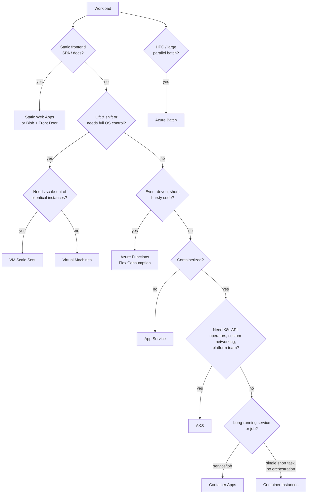
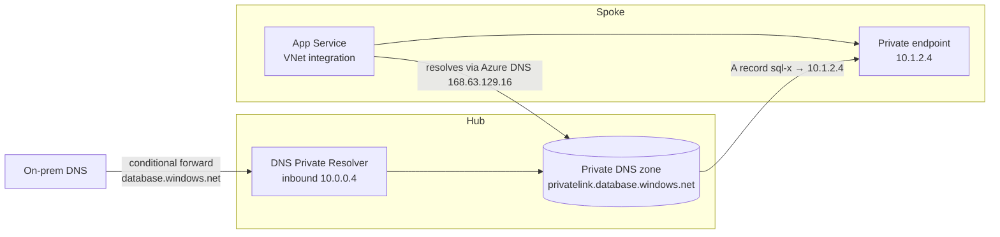
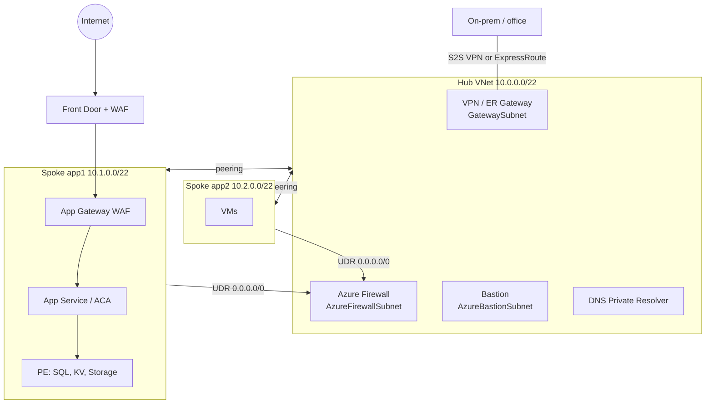

# Azure Compute & Networking

> **TL;DR** — Default compute ladder: **Static Web Apps / App Service / Functions / Container Apps** first, **AKS** when you need Kubernetes control or have a platform team, **VMs/VMSS** for lift-and-shift and OS-level needs. Networking: **hub-spoke VNets**, **private endpoints + Private DNS zones** for PaaS, **Azure Firewall** for egress/east-west, **Front Door** (global HTTP) or **Application Gateway** (regional HTTP) with WAF for ingress, **Load Balancer** for L4, **Bastion** instead of public RDP/SSH, **VPN/ExpressRoute** for hybrid. **Azure Arc** extends the control plane to on-prem and other clouds.

---

## 1. Compute options

### 1.1 Decision tree



### 1.2 Comparison

| Service | Model | Scale to zero | Max control | Ops burden | Best for | Avoid when |
|---|---|---|---|---|---|---|
| **Virtual Machines** | IaaS | No (deallocate manually / schedule) | Full OS | High (patch, backup, AV) | Legacy, COTS, SQL Server w/ special needs, domain controllers | You just need to run a web app |
| **VM Scale Sets** | IaaS | Autoscale to 0 possible | OS + image | Medium-high | Stateless farms, custom images, Flexible orchestration | Small single app |
| **App Service** | PaaS | No (plan always billed) | Runtime, slots | Low | Web apps/APIs (.NET, Java, Node, Python, PHP), containers | Non-HTTP workloads, heavy background processing |
| **Azure Functions** | FaaS | Yes (Consumption/Flex) | Triggers, bindings | Very low | Events, integrations, schedules, glue | Long-lived connections, very latency-sensitive w/o premium |
| **Container Apps** | Serverless containers (K8s + KEDA + Envoy + Dapr under the hood) | Yes | Containers, revisions, scale rules | Low | Microservices, APIs, workers, jobs, without K8s ops | Need K8s API/CRDs/operators |
| **AKS** | Managed K8s | Node pools min 0 (user pools); system pool ≥1 | Full K8s | High (upgrades, add-ons) | Platform teams, many services, portability, special networking | Small team, few apps |
| **Container Instances** | Single container groups | Per-second billing, no idle | Minimal | Low | Short tasks, CI agents, burst from AKS (virtual nodes) | Long-running production services with scaling |
| **Azure Batch** | Job scheduler on VM pools | Pools scale to 0 | Job/task model | Medium | HPC, rendering, large parallel compute | Web workloads |
| **Static Web Apps** | Static hosting + managed Functions API | n/a | Routes, auth | Very low | SPAs, Jamstack, docs | Server-side rendering heavy w/ complex backends (consider App Service) |
| **Azure Spring Apps** | Retiring (announced) | — | — | — | Migrate to Container Apps / AKS | — *verify* |
| **Azure VMware Solution** | Dedicated VMware SDDC | No | vSphere | Medium | Fast VMware DC exit (Relocate) | Greenfield |

### 1.3 Azure Functions hosting plans

| Plan | Scale | Cold start | VNet integration | Max execution | Billing | Notes |
|---|---|---|---|---|---|---|
| **Consumption** (classic) | Event-driven, to 0 | Yes | No | 5 min default, 10 max | Per execution + GB-s; free grant | Linux Consumption is legacy/retiring for new features — prefer Flex (*verify*) |
| **Flex Consumption** | Per-function scaling, fast, to 0; **always-ready** instances optional | Reduced (always-ready) | **Yes** | 30 min default, configurable unbounded-ish | Per-execution + always-ready baseline | Recommended serverless default (Linux) |
| **Premium (Elastic Premium EP1–EP3)** | Pre-warmed + elastic | No (pre-warmed) | Yes | Unbounded (60 min guaranteed) | Per core-second, min 1 instance always | Predictable latency, Windows support |
| **Dedicated (App Service plan)** | Manual/autoscale | No (Always On) | Yes | Unbounded | App Service plan price | Reuse spare App Service capacity |
| **Container Apps hosting** | KEDA | Configurable | Yes | — | Container Apps pricing | Functions in containers next to other microservices |

> Limits and plan names change; *verify current limits* in the Functions hosting docs.

### 1.4 App Service essentials

- **Plans** (tiers): Free/Shared (dev), Basic (no autoscale, no slots), **Standard**, **Premium v3/v4** (zones, more slots, better price/perf), **Isolated v2** (App Service Environment v3, single-tenant, internal).
- Features: deployment **slots** with swap (warm-up, zero-downtime), autoscale, **VNet integration** (outbound), **private endpoint** (inbound), Easy Auth (Entra login without code), managed certificates, health check, backups.
- **Zone redundancy**: Premium v3+ with ≥ 2–3 instances (*verify minimums*).
- Density: many apps per plan (compute resource consolidation) — watch noisy neighbours.

### 1.5 Container Apps essentials

- **Environment** = shared boundary (VNet, Log Analytics); **Consumption** profile (serverless) and **Dedicated workload profiles** (reserved compute, GPUs).
- **Revisions** (immutable snapshots) → traffic splitting for blue/green and canary.
- **Scale rules**: HTTP concurrency, CPU/memory, **KEDA scalers** (Service Bus, Event Hubs, Kafka, cron...).
- **Jobs**: manual, scheduled, event-driven.
- **Dapr** integration (service invocation, pub/sub, state), built-in Envoy ingress, managed identity, Key Vault secret references.

```bash
az containerapp up --name ca-api-prod-weu-001 --resource-group rg-app1-prod-weu-001 \
  --environment cae-app1-prod-weu-001 --image crcontoso.azurecr.io/api:1.4.2 \
  --ingress external --target-port 8080

az containerapp update -n ca-api-prod-weu-001 -g rg-app1-prod-weu-001 \
  --scale-rule-name sb-orders --scale-rule-type azure-servicebus \
  --scale-rule-metadata queueName=orders namespace=sbns-integration-prod messageCount=20 \
  --min-replicas 0 --max-replicas 20
```

### 1.6 VM essentials

| Topic | Guidance |
|---|---|
| Series | B (burstable dev/test), D (general), E (memory), F (compute), L (storage), M (SAP HANA), N (GPU); v5/v6 generations; AMD `a`, Arm `p` (Cobalt), local disk `d`, premium storage `s` |
| Availability | **Availability zones** (99.99% for 2+ VMs across zones) > availability sets (99.95%) > single VM w/ Premium SSD (99.9%) — *verify current SLA* |
| Disks | Standard HDD, Standard SSD, Premium SSD, **Premium SSD v2**, Ultra Disk; ZRS disks for zonal resilience |
| Operations | Azure Update Manager, Azure Monitor Agent + DCR, Azure Backup, Defender for Servers, Machine Configuration (guest policy) |
| Access | **Bastion** or JIT VM access — never open 3389/22 to internet |
| Cost | Reservations / savings plans, Hybrid Benefit (Windows Server, SQL Server, RHEL/SLES), auto-shutdown for dev, Spot for interruptible |

---

## 2. Networking

### 2.1 Building blocks

| Component | Layer | Purpose | Notes |
|---|---|---|---|
| **VNet** | L3 | Private address space in a region | Plan CIDR carefully, non-overlapping; regional |
| **Subnet** | L3 | Segment VNet | Azure reserves 5 IPs per subnet; some services need **delegated** or dedicated subnets (`AzureFirewallSubnet`, `GatewaySubnet`, `AzureBastionSubnet`, App Service integration, Container Apps) |
| **NSG** | L4 | Stateful allow/deny rules on subnet or NIC | Priority 100–4096; default rules allow VNet-VNet & outbound internet |
| **ASG** | — | Group NICs logically for NSG rules | `allow asg-web → asg-db :1433` instead of IPs |
| **UDR / route table** | L3 | Override system routes | Force 0.0.0.0/0 to firewall |
| **VNet peering** | L3 | Connect VNets (regional/global), non-transitive | Use hub with firewall or vWAN for transit; **Azure Virtual Network Manager** for at-scale connectivity & security admin rules |
| **NAT Gateway** | L3/4 | Scalable outbound SNAT with static IPs | Default outbound access for new VNets is being retired → explicit outbound needed (*verify date*) |
| **Service endpoint** | — | Optimized route to PaaS public endpoint from subnet; PaaS firewall allows that subnet | Free; PaaS keeps public IP; no on-prem access |
| **Private endpoint** | — | PaaS gets **private IP** in your subnet (Private Link) | Paid per hour + data; needs **Private DNS**; reachable from on-prem/peered VNets |
| **Private DNS zone** | DNS | Resolve `privatelink.*` names to private IPs | Link to VNets (hub); one zone per service type per org |
| **DNS Private Resolver** | DNS | Inbound/outbound endpoints for hybrid DNS | Replaces DNS forwarder VMs |
| **Azure Firewall** | L3–L7 | Stateful managed firewall: network/app rules, FQDN filtering, threat intel; Premium adds TLS inspection, IDPS | SKUs Basic / Standard / Premium; Firewall Manager + policies |
| **Application Gateway** | L7 regional | Reverse proxy, path routing, TLS termination, **WAF v2**, autoscaling, private frontend | v2 SKU; App Gateway for Containers for AKS |
| **Front Door** | L7 global | Anycast edge, CDN, global load balancing, WAF, Private Link origins | Standard / Premium (Premium = Private Link to origin, managed WAF rules, bot protection) |
| **Load Balancer** | L4 regional (global tier exists) | TCP/UDP load balancing, HA ports, outbound rules | Standard SKU (Basic retired) |
| **Traffic Manager** | DNS global | DNS-based routing: priority, weighted, performance, geographic | Any protocol; failover limited by DNS TTL |
| **VPN Gateway** | Hybrid | Site-to-site IPsec, point-to-site | VpnGw1–5 AZ SKUs; active-active |
| **ExpressRoute** | Hybrid | Private circuit via provider, 50 Mbps–100 Gbps | Not encrypted by default (use MACsec/IPsec over ER if needed); ER gateway; Global Reach |
| **Bastion** | Access | Browser/native-client RDP/SSH without public IPs | Developer (free, limited), Basic, Standard, Premium (session recording) |
| **DDoS Protection** | L3/L4 | Network Protection (per VNet plan) or IP Protection (per IP) | Basic infra protection always on |

### 2.2 Private endpoint vs service endpoint

| | Service endpoint | Private endpoint |
|---|---|---|
| IP of PaaS | Public | Private (in your subnet) |
| Reachable from on-prem/peered VNets | No (only from enabled subnet) | **Yes** |
| Data exfiltration protection | Limited (service endpoint policies for Storage) | Strong — mapped to specific resource instance |
| DNS changes | None | **Required** (privatelink zones) |
| Cost | Free | Hourly + per GB |
| Can disable public access entirely | No (public endpoint with network rules) | **Yes** (`publicNetworkAccess: Disabled`) |
| Recommendation | Legacy / cheap dev | **Default for production PaaS** |

**Private DNS pattern** (centralized):



Common zones: `privatelink.blob.core.windows.net`, `privatelink.file.core.windows.net`, `privatelink.vaultcore.azure.net`, `privatelink.database.windows.net`, `privatelink.postgres.database.azure.com`, `privatelink.documents.azure.com`, `privatelink.servicebus.windows.net`, `privatelink.azurewebsites.net`, `privatelink.azurecr.io`, `privatelink.azure-api.net`.

Pitfalls: creating duplicate zones per spoke (split-brain DNS); forgetting on-prem conditional forwarders; VNet integration without `WEBSITE_VNET_ROUTE_ALL`/route-all setting; custom DNS servers on VNet not forwarding to 168.63.129.16.

### 2.3 Load balancing decision table

| Need | Global or regional | HTTP(S)? | Service |
|---|---|---|---|
| Global web app, CDN, WAF, fastest failover, TLS at edge | Global | Yes | **Front Door** |
| Regional web app, WAF, private (internal) apps, path routing | Regional | Yes | **Application Gateway (WAF v2)** |
| Non-HTTP global failover (e.g. SMTP, custom TCP), or route to on-prem endpoints via DNS | Global | Any | **Traffic Manager** (DNS) or cross-region Load Balancer |
| TCP/UDP within region, VM/VMSS backends, HA ports for NVAs | Regional | No | **Load Balancer (Standard)** |
| API facade, auth, throttling, transformation | Either | Yes | **API Management** (behind App Gateway/Front Door) |
| Kubernetes ingress | Regional | Yes | App Gateway for Containers, NGINX/Envoy ingress, Gateway API |

Common combos:
- **Front Door → (Private Link) → App Service / Container Apps** — global public app.
- **Front Door → App Gateway (WAF) → AKS** — global + regional L7 (double WAF only if justified).
- **App Gateway (private frontend) → APIM (internal) → backends** — internal API platform.
- **Traffic Manager (priority) → two regional App Gateways** — DNS failover between regions.

### 2.4 Hub-spoke reference



IP plan tips: reserve a /16 (or more) per region for Azure; hub /22–/23; spokes sized by need (/24–/22); avoid 10.0.0.0/8 overlap with on-prem; document in IPAM (Azure Virtual Network Manager IPAM or spreadsheet).

### 2.5 NSG rule example (Bicep)

```bicep
resource nsg 'Microsoft.Network/networkSecurityGroups@2023-11-01' = {
  name: 'nsg-snet-app-prod-weu-001'
  location: location
  properties: {
    securityRules: [
      {
        name: 'Allow-AppGw-To-App-443'
        properties: {
          priority: 100
          direction: 'Inbound'
          access: 'Allow'
          protocol: 'Tcp'
          sourceAddressPrefix: '10.1.0.0/26'      // App Gateway subnet
          sourcePortRange: '*'
          destinationAddressPrefix: '*'
          destinationPortRange: '443'
        }
      }
      {
        name: 'Deny-All-Inbound'
        properties: {
          priority: 4096
          direction: 'Inbound'
          access: 'Deny'
          protocol: '*'
          sourceAddressPrefix: '*'
          sourcePortRange: '*'
          destinationAddressPrefix: '*'
          destinationPortRange: '*'
        }
      }
    ]
  }
}
```

Use **service tags** (`AzureLoadBalancer`, `GatewayManager`, `AzureFrontDoor.Backend`, `Storage.WestEurope`) instead of IP lists.

### 2.6 Hybrid connectivity

| Option | Bandwidth | SLA / resilience | Encryption | Cost | Fit |
|---|---|---|---|---|---|
| Point-to-site VPN | Per user | — | Yes (OpenVPN/IKEv2/SSTP), Entra auth | Low | Admins, small remote access (consider Entra Private Access / Global Secure Access instead) |
| Site-to-site VPN | Up to several Gbps aggregate (SKU) | Active-active, zone-redundant GW | IPsec | Low–medium | Small/mid orgs, offices |
| ExpressRoute | 50 Mbps–10 Gbps (100 Gbps Direct) | Redundant circuits, 99.95% | Not by default | Higher (circuit + provider + gateway) | Predictable latency, large data, regulated |
| ER + VPN backup | — | Highest | — | — | Critical hybrid |

### 2.7 Zero-trust network access alternatives

- **Microsoft Entra Private Access** (Global Secure Access, SSE) — ZTNA replacement for VPN to private apps.
- **Entra application proxy** — publish internal web apps with pre-auth.
- Bastion, JIT VM access, Azure Virtual Desktop / Windows 365 for admin workstations.

---

## 3. Azure Arc (hybrid & multi-cloud control plane)

| Arc capability | What it brings |
|---|---|
| **Arc-enabled servers** | On-prem / other-cloud servers as Azure resources: Policy (machine configuration), Update Manager, Defender for Servers, Azure Monitor Agent, RBAC, tags, extended security updates delivery |
| **Arc-enabled Kubernetes** | Any CNCF cluster: GitOps (Flux) config, Policy (Gatekeeper), Defender for Containers, monitoring |
| **Arc-enabled data services** | SQL Managed Instance, PostgreSQL on your K8s |
| **Arc-enabled SQL Server** | Inventory, licensing (PAYG via Azure), best-practice assessment, Defender for SQL |
| **Azure Local (formerly Azure Stack HCI)** | Hyperconverged on-prem infra managed via Arc |
| **Arc resource bridge / VMware / SCVMM** | Lifecycle of on-prem VMs from Azure |

When to use: single governance/security pane across hybrid estate; on-prem servers you will retain; ESU for legacy Windows Server; sovereign/edge needs. When not: if servers will be migrated within weeks (just migrate).

---

## 4. Common mistakes

1. Public IPs on VMs with RDP/SSH open; no Bastion/JIT.
2. Private endpoints created but DNS still resolves to public IP → traffic goes over internet or fails.
3. Overlapping IP ranges between VNets/on-prem → peering impossible.
4. Using App Service "Basic" for production (no slots/autoscale/zones).
5. AKS chosen for 2–3 apps with no platform team.
6. Front Door and App Gateway both with WAF in prevention mode and different rule sets → hard-to-debug blocks.
7. Traffic Manager failover expectations ignoring DNS TTL and client caching.
8. Forced tunnelling via firewall without allowing required platform FQDNs (AKS, App Service, Windows activation) → broken deployments.
9. Forgetting SNAT port exhaustion on outbound-heavy apps (use NAT Gateway, connection pooling).
10. Functions Consumption chosen for workload requiring VNet access or no cold start.

## References

- Compute decision tree — https://learn.microsoft.com/azure/architecture/guide/technology-choices/compute-decision-tree
- Load-balancing options — https://learn.microsoft.com/azure/architecture/guide/technology-choices/load-balancing-overview
- Azure Functions hosting options — https://learn.microsoft.com/azure/azure-functions/functions-scale
- Azure App Service — https://learn.microsoft.com/azure/app-service/
- Azure Container Apps — https://learn.microsoft.com/azure/container-apps/
- Azure Kubernetes Service — https://learn.microsoft.com/azure/aks/
- Azure Virtual Machines — https://learn.microsoft.com/azure/virtual-machines/
- Azure networking — https://learn.microsoft.com/azure/networking/
- Hub-spoke topology — https://learn.microsoft.com/azure/architecture/networking/architecture/hub-spoke
- Azure Private Link — https://learn.microsoft.com/azure/private-link/
- Private endpoint DNS configuration — https://learn.microsoft.com/azure/private-link/private-endpoint-dns
- Azure Firewall — https://learn.microsoft.com/azure/firewall/
- Azure Front Door — https://learn.microsoft.com/azure/frontdoor/
- Application Gateway — https://learn.microsoft.com/azure/application-gateway/
- ExpressRoute — https://learn.microsoft.com/azure/expressroute/
- Azure Bastion — https://learn.microsoft.com/azure/bastion/
- Azure Arc — https://learn.microsoft.com/azure/azure-arc/
- Related: [containers-kubernetes.md](containers-kubernetes.md), [serverless-event-driven-integration.md](serverless-event-driven-integration.md)
