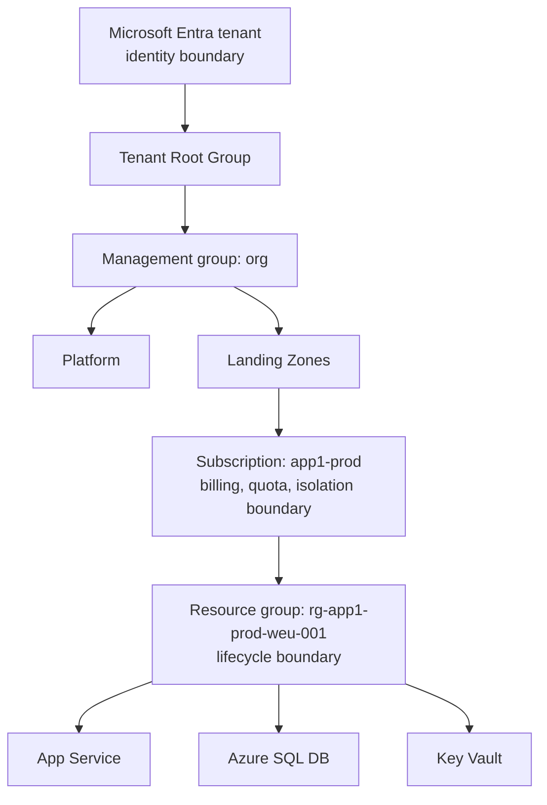
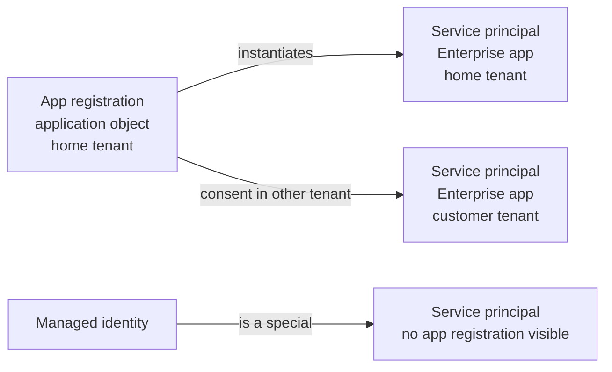

# Azure Identity & Governance

> **TL;DR** — Azure is organized as **Entra tenant → management groups → subscriptions → resource groups → resources**; RBAC and Policy inherit down that tree. Identity is the real perimeter: use **Entra ID** with Conditional Access, PIM and **managed identities** (no secrets). Govern with **Azure Policy initiatives** (audit first, then deny/deployIfNotExists), **consistent naming and tags**, and IaC-based **template specs / deployment stacks** (Blueprints is deprecated). For internal IT, the same tenant also runs Microsoft 365, Intune and Power Platform — govern them together.

---

## 1. Resource hierarchy



| Level | Boundary for | Limits / notes (*verify current limits*) |
|---|---|---|
| **Tenant** | Identity (users, groups, apps), M365 | One tenant per org is the norm; multi-tenant adds B2B friction |
| **Management group** | Policy + RBAC inheritance | Up to 6 levels of depth (excluding root and subscription); ~10,000 MGs per tenant |
| **Subscription** | Billing, quotas, RBAC, policy, blast radius | Billed via EA / MCA / CSP / PAYG; trusted to one tenant |
| **Resource group** | Lifecycle (deploy/delete together), RBAC scope | Resources in a RG can be in different regions; RG has metadata location; 800 resources per RG per type-ish limits |
| **Resource** | The actual service | Can have locks (`CanNotDelete`, `ReadOnly`) |

**Rules**

- Group resources in a RG by **shared lifecycle**, not by type ("rg-networking" for everything is an anti-pattern unless platform-owned).
- **Resource locks** on platform resources (hub VNet, Log Analytics, Key Vault prod) — but locks also block some operations (e.g. `ReadOnly` on storage blocks listing keys).
- Moving resources between RGs/subscriptions is possible for many, not all, types — design right first.

---

## 2. Microsoft Entra ID

### 2.1 Core objects

| Object | What it is | Notes |
|---|---|---|
| **Tenant** | Dedicated instance of Entra ID | Has a primary domain `contoso.onmicrosoft.com` + verified custom domains |
| **User** | Member or Guest (B2B) | Sync from AD via **Entra Connect Sync** or **Cloud Sync** |
| **Group** | Security / Microsoft 365 groups; assigned or **dynamic** membership | Use groups for RBAC assignments, never individuals |
| **App registration** | *Application object* — global definition of an app (in home tenant) | Defines redirect URIs, API permissions, app roles, secrets/certs, federated credentials |
| **Enterprise application** | *Service principal* — local instance of an app in a tenant | Where you assign users, consent, Conditional Access, SSO (SAML/OIDC) |
| **Managed identity** | Service principal whose credential Azure manages | System-assigned or user-assigned |
| **Administrative unit** | Scope to delegate admin of subset of users/devices | e.g. per country helpdesk |

### 2.2 App registration vs enterprise app vs service principal



- One app registration ↔ many service principals (one per tenant where used).
- **Gallery SaaS apps** (Salesforce, ServiceNow) appear only as enterprise apps in your tenant — the app object lives in the vendor's tenant.
- Workloads authenticating to Azure: prefer **managed identity** (inside Azure) or **workload identity federation** (GitHub Actions, Azure DevOps, Kubernetes, other clouds) — no secrets.
- If secrets unavoidable: certificates > client secrets; short expiry; stored in Key Vault; monitor expiry.

### 2.3 Managed identities

| | System-assigned | User-assigned |
|---|---|---|
| Lifecycle | Tied to the resource; deleted with it | Independent Azure resource |
| Sharing | One resource only | Many resources can share |
| Pre-provision RBAC before resource exists | No | **Yes** (good for IaC ordering) |
| Typical use | Single app needing Key Vault/Storage | Fleet of VMSS instances, AKS workloads, pre-authorized deployments, CMK on many resources |
| Tip | Simple default | Fewer role assignments, avoids RBAC propagation delays during deployment |

```bicep
// Grant a Web App's system-assigned identity "Key Vault Secrets User" on a vault
resource app 'Microsoft.Web/sites@2023-12-01' existing = { name: appName }
resource kv 'Microsoft.KeyVault/vaults@2023-07-01' existing = { name: kvName }

resource ra 'Microsoft.Authorization/roleAssignments@2022-04-01' = {
  name: guid(kv.id, app.id, '4633458b-17de-408a-b874-0445c86b69e6')
  scope: kv
  properties: {
    roleDefinitionId: subscriptionResourceId('Microsoft.Authorization/roleDefinitions', '4633458b-17de-408a-b874-0445c86b69e6') // Key Vault Secrets User
    principalId: app.identity.principalId
    principalType: 'ServicePrincipal'
  }
}
```

```csharp
// Code: DefaultAzureCredential picks managed identity in Azure, developer login locally
var client = new SecretClient(new Uri("https://kv-app1-prod.vault.azure.net/"), new DefaultAzureCredential());
```

### 2.4 Conditional Access (CA)

Policy = **assignments** (users/groups/workload identities, target resources, conditions: sign-in risk, user risk, device platform, location, client app) → **access controls** (block / grant with MFA, compliant device, hybrid joined, approved app, authentication strength, terms of use) + **session controls** (sign-in frequency, app-enforced restrictions, Defender for Cloud Apps).

Baseline policy set (small/mid org):

| # | Policy | Notes |
|---|---|---|
| 1 | Require MFA for all users | Exclude break-glass accounts only |
| 2 | Require phishing-resistant MFA for admins | Authentication strength: FIDO2/passkeys, Windows Hello, CBA |
| 3 | Block legacy authentication | IMAP/POP/basic auth |
| 4 | Require compliant or hybrid-joined device for M365 / sensitive apps | Needs Intune |
| 5 | Require MFA for Azure management | Target "Windows Azure Service Management API" / Microsoft Admin Portals |
| 6 | Block or require MFA from risky sign-ins | Needs Entra ID P2 (Identity Protection) |
| 7 | Block access from countries not used | Named locations |
| 8 | Guests: MFA + limited session | B2B |

Process: create in **report-only** → review sign-in logs / CA insights workbook → enable. Keep **2 break-glass accounts** (cloud-only, FIDO2 or long random password in safe, excluded from CA, alert on sign-in).

Licensing: CA requires **Entra ID P1** (included in M365 Business Premium, E3); risk-based CA and PIM need **P2** (E5 or add-on) — *verify current licensing*.

### 2.5 Privileged Identity Management (PIM)

- **Just-in-time** eligible role assignments (Entra roles, Azure resource roles, groups) with activation: MFA, justification, ticket number, approval, time limit (e.g. 1–8 h).
- Access reviews: periodic recertification of role holders and guests.
- Alerts: too many Global Admins, roles assigned outside PIM.
- Target: **zero standing privileged access**; ≤ 5 Global Administrators, all eligible not active (except break-glass).

### 2.6 Azure RBAC

Role assignment = **security principal** + **role definition** + **scope** (MG / subscription / RG / resource). Additive (union), except **deny assignments** (created by deployment stacks / managed apps).

| Built-in role | Can do | Notes |
|---|---|---|
| **Owner** | Everything incl. assign roles | Avoid standing; use PIM |
| **Contributor** | Manage all resources, cannot assign roles, cannot manage Blueprints/Policy assignments | Typical for deployment pipelines (scoped) |
| **Reader** | View | |
| **User Access Administrator** | Manage access | Pair with **conditions** to restrict which roles can be assigned |
| **Role Based Access Control Administrator** | Manage role assignments (not other perms), supports conditions | Preferred for delegation |
| Data plane: **Storage Blob Data Reader/Contributor/Owner** | Blob data access | Control-plane Contributor ≠ data access |
| **Key Vault Secrets User / Secrets Officer / Administrator** | Key Vault data plane in RBAC mode | Use RBAC model, not access policies |
| **Network Contributor**, **Virtual Machine Contributor**, **SQL DB Contributor** | Scoped service management | |
| **Monitoring Reader / Contributor**, **Log Analytics Reader** | Observability | |
| **Cost Management Reader / Contributor**, **Billing Reader** | FinOps | |
| **AcrPull / AcrPush** | Container registry | Assign AcrPull to AKS kubelet identity |

Entra roles (directory) are **separate** from Azure RBAC roles: Global Administrator, Privileged Role Administrator, Security Administrator, User Administrator, Application Administrator, Cloud Application Administrator, Conditional Access Administrator, Global Reader, etc. A Global Admin can **elevate** to User Access Administrator at root scope — audit this.

```bash
# Assign Contributor at RG scope to a group
az role assignment create --assignee-object-id <groupObjectId> --assignee-principal-type Group \
  --role "Contributor" --scope /subscriptions/<subId>/resourceGroups/rg-app1-prod-weu-001

# List role assignments including inherited
az role assignment list --scope /subscriptions/<subId> --include-inherited -o table
```

Custom roles: only when built-ins don't fit; define `Actions`, `NotActions`, `DataActions`, `AssignableScopes`.

### 2.7 External identities: B2B, B2C, External ID

| | B2B collaboration | Azure AD B2C (legacy) | Entra External ID (external tenant) |
|---|---|---|---|
| Users | Partners, suppliers as **guests** in your workforce tenant | Consumers / customers | Consumers and business customers |
| Tenant | Workforce tenant | Separate B2C tenant | Separate **external tenant** (CIAM) |
| Auth | Their own IdP (Entra, Google, email OTP, SAML/WS-Fed) | Local accounts, social, custom policies (IEF) | Local accounts, social, OIDC/SAML federation, user flows, custom branding |
| Status | Current | New customer sign-ups stopped (May 2025); supported for existing for years — *verify* | Strategic successor for customer identity |
| Use | Partner access to Teams/SharePoint/apps | Existing consumer apps | New customer-facing / B2B portal apps |

**B2B direct connect** = Teams shared channels across tenants (no guest object). **Cross-tenant access settings** control inbound/outbound B2B and trust of partner MFA/device claims. **Multi-tenant organizations** / cross-tenant sync for groups of companies.

---

## 3. Azure Policy

### 3.1 Concepts

| Concept | Description |
|---|---|
| **Policy definition** | JSON rule: `if` condition → `then` effect |
| **Initiative (policy set)** | Group of definitions, assigned together (e.g. MCSB, ISO 27001, CIS) |
| **Assignment** | Definition/initiative applied at scope (MG/sub/RG) with parameters, exclusions |
| **Exemption** | Waiver or mitigated, with expiry |
| **Remediation task** | Fixes existing non-compliant resources for `deployIfNotExists` / `modify` |
| **Compliance** | Evaluated on create/update and periodically (~24h); on-demand scan available |

### 3.2 Effects

| Effect | Behaviour | Typical use |
|---|---|---|
| `Audit` | Log non-compliance | First phase of any new rule |
| `AuditIfNotExists` | Audit if related resource missing | e.g. VM without backup |
| `Deny` | Block create/update | Allowed locations, deny public IP |
| `DenyAction` | Block specific actions (e.g. delete) | Protect critical resources |
| `DeployIfNotExists` (DINE) | Deploy related resource via managed identity | Diagnostic settings, Defender plans, private DNS records |
| `Modify` | Add/replace tags or properties | Inherit tags from RG, enforce TLS settings |
| `Append` | Add fields on request | Legacy; prefer Modify |
| `Manual` | Attest compliance manually | Regulatory controls |
| `Disabled` | Off | Parameterize effect |

### 3.3 Example: require a tag on resource groups

```json
{
  "mode": "All",
  "policyRule": {
    "if": {
      "allOf": [
        { "field": "type", "equals": "Microsoft.Resources/subscriptions/resourceGroups" },
        { "field": "[concat('tags[', parameters('tagName'), ']')]", "exists": "false" }
      ]
    },
    "then": { "effect": "[parameters('effect')]" }
  },
  "parameters": {
    "tagName": { "type": "String" },
    "effect":  { "type": "String", "allowedValues": ["Audit","Deny","Disabled"], "defaultValue": "Audit" }
  }
}
```

```bash
az policy assignment create --name require-costcenter-rg \
  --scope /providers/Microsoft.Management/managementGroups/mg-org \
  --policy <definitionId> --params '{"tagName":{"value":"CostCenter"},"effect":{"value":"Deny"}}'
```

### 3.4 Baseline policy set (small/mid org)

- [ ] Allowed locations (e.g. West Europe, North Europe, Sweden Central) + allowed RG locations
- [ ] Require tags on RGs; inherit tags from RG to resources (Modify)
- [ ] Deploy diagnostic settings to central Log Analytics (DINE; built-in initiatives exist per category)
- [ ] Microsoft cloud security benchmark initiative (default in Defender for Cloud)
- [ ] Deny public network access for PaaS in Corp landing zones (Storage, SQL, Key Vault)
- [ ] Storage: secure transfer, min TLS 1.2, deny anonymous blob access, disable shared key where possible
- [ ] Deny classic resources; allowed VM SKUs in sandbox
- [ ] Key Vault: soft delete + purge protection, RBAC model
- [ ] Configure private DNS zone records for private endpoints (DINE)
- [ ] Audit VMs without backup; enable Azure Monitor Agent / Update Manager

### 3.5 Blueprints deprecation → template specs & deployment stacks

Azure Blueprints (preview, never GA) is **deprecated** (retirement announced for July 2026 — *verify*). Migration path:

| Blueprint capability | Replacement |
|---|---|
| Artifacts (templates) | **Template specs** (versioned ARM/Bicep stored in Azure) or Git + pipelines |
| Policy/role assignments | Policy/RBAC in Bicep/Terraform |
| Locks (blueprint assignment locks) | **Deployment stacks** with `denySettings` (deny assignments) |
| Versioned assignment | Deployment stacks managed resources + `actionOnUnmanage` |

```bash
# Template spec: publish versioned Bicep
az ts create -g rg-platform-templates -n ts-storage-baseline -v 1.2.0 \
  --template-file storage.bicep

# Deployment stack at subscription scope with deny settings and clean-up of removed resources
az stack sub create --name stack-app1-baseline --location westeurope \
  --template-file main.bicep --parameters main.bicepparam \
  --deny-settings-mode denyWriteAndDelete \
  --action-on-unmanage deleteResources
```

---

## 4. Tagging strategy

### 4.1 Recommended tag set

| Tag | Example | Purpose | Enforce |
|---|---|---|---|
| `CostCenter` | `CC-4410` | Chargeback | Deny on RG |
| `Owner` | `team-finance-apps@contoso.com` | Accountability (use DL, not person) | Deny on RG |
| `Environment` | `prod` / `test` / `dev` / `sandbox` | Policies, cost split | Deny on RG |
| `Application` / `Workload` | `invoice-portal` | Grouping | Deny on RG |
| `BusinessCriticality` | `mission-critical` / `high` / `medium` / `low` | SLA, DR tiers | Audit |
| `DataClassification` | `public` / `internal` / `confidential` / `restricted` | Security controls | Audit |
| `ManagedBy` | `terraform` / `bicep` / `manual` | Drift / ownership | Audit |
| `EndDate` / `ExpiresOn` | `2026-12-31` | Sandbox cleanup | Audit |

**Rules**: tags are not inherited by default — use Policy `Modify` "Inherit a tag from the resource group"; tag names case-insensitive, values case-sensitive; limit 50 tags per resource; tags are visible broadly — never put secrets/PII in tags; not all resource types support tags or show them in cost data (*verify*). Cost Management supports **tag inheritance** setting for cost data.

---

## 5. Naming conventions (CAF)

Pattern: `<resource-type-abbr>-<workload>-<environment>-<region>-<instance>`

| Resource | CAF abbreviation | Example |
|---|---|---|
| Management group | `mg` | `mg-landingzones-corp` |
| Subscription | `sub` (often descriptive name) | `sub-invoice-prod` |
| Resource group | `rg` | `rg-invoice-prod-weu-001` |
| Virtual network | `vnet` | `vnet-hub-prod-weu-001` |
| Subnet | `snet` | `snet-app-prod-weu-001` |
| Network security group | `nsg` | `nsg-snet-app-prod-weu-001` |
| Application security group | `asg` | `asg-web-prod` |
| Private endpoint | `pep` | `pep-sql-invoice-prod` |
| Azure Firewall | `afw` | `afw-hub-prod-weu-001` |
| Application Gateway | `agw` | `agw-portal-prod-weu-001` |
| Front Door profile | `afd` | `afd-portal-prod` |
| Public IP | `pip` | `pip-agw-portal-prod-weu-001` |
| Virtual machine | `vm` | `vm-sql01-prod` (≤15 chars for Windows computer name) |
| VM scale set | `vmss` | `vmss-api-prod-weu-001` |
| App Service plan | `asp` | `asp-invoice-prod-weu-001` |
| Web app | `app` | `app-invoice-prod-weu-001` |
| Function app | `func` | `func-invoice-prod-weu-001` |
| Container app / environment | `ca` / `cae` | `ca-api-prod-weu-001` |
| AKS cluster | `aks` | `aks-platform-prod-weu-001` |
| Container registry | `cr` | `crcontosoprod` (alphanumeric only) |
| Storage account | `st` | `stinvoiceprodweu001` (3–24 lowercase alphanumeric, global unique) |
| Key Vault | `kv` | `kv-invoice-prod-weu` (3–24 chars, global unique) |
| Azure SQL server / DB | `sql` / `sqldb` | `sql-invoice-prod-weu-001` / `sqldb-invoice` |
| PostgreSQL flexible | `psql` | `psql-invoice-prod-weu-001` |
| Cosmos DB | `cosmos` | `cosmos-invoice-prod` |
| Service Bus namespace | `sbns` | `sbns-integration-prod-weu` |
| Event Hubs namespace | `evhns` | `evhns-telemetry-prod-weu` |
| Event Grid topic | `evgt` | `evgt-orders-prod` |
| API Management | `apim` | `apim-integration-prod-weu` |
| Logic App | `logic` | `logic-invoice-sync-prod` |
| Log Analytics workspace | `log` | `log-platform-prod-weu-001` |
| Application Insights | `appi` | `appi-invoice-prod-weu-001` |
| Managed identity | `id` | `id-invoice-prod-weu-001` |

Region short codes: pick one scheme and stick to it (`weu`, `neu`, `sdc` or `westeurope`). Respect per-resource rules (length, allowed chars, global uniqueness). Tools: **Azure Naming Tool**, Terraform `Azure/naming/azurerm` module, AVM naming conventions — *verify current CAF abbreviation list* (it is updated periodically).

---

## 6. Billing structures (briefly)

| Agreement | For | Notes |
|---|---|---|
| **PAYG / Microsoft Online Subscription Program** | Small, start | Credit card / invoice |
| **Microsoft Customer Agreement (MCA)** | Direct, most orgs | Billing account → billing profile → invoice section → subscriptions |
| **Enterprise Agreement (EA)** | Large, legacy | Being transitioned toward MCA-E for many |
| **CSP** | Via partner | Partner manages billing, sometimes support; check RBAC/limitations (e.g. some offers) |

Billing RBAC (billing account owner, invoice manager) is separate from Azure RBAC.

---

## 7. Microsoft 365, Intune & Power Platform for internal IT

### 7.1 Microsoft 365 essentials

| Area | What to set up |
|---|---|
| Licensing | M365 Business Premium (≤300 users) includes Entra ID P1, Intune, Defender for Business, Purview Information Protection basics; E3/E5 for larger — *verify current bundles* |
| Identity | Hybrid identity via Entra Connect / Cloud Sync, password hash sync (resilient, enables leaked credential detection), SSPR |
| Exchange Online | SPF, DKIM, DMARC (p=reject end state), Defender for Office 365 safe links/attachments |
| SharePoint/OneDrive/Teams | External sharing policy per site, sensitivity labels, guest expiration, Teams creation governance (group naming policy, expiration) |
| Purview | Sensitivity labels, DLP, retention policies, eDiscovery, audit log |
| Backup | M365 has retention, not true backup → Microsoft 365 Backup or third-party |
| Secure Score | Track and act on Microsoft Secure Score recommendations |

### 7.2 Intune (Endpoint management)

- Enrollment: **Windows Autopilot** (zero-touch), Apple Business Manager (ADE), Android Enterprise.
- **Compliance policies** (BitLocker, OS version, Defender, password) → feed Conditional Access "require compliant device".
- **Configuration profiles** / **Settings catalog**, security baselines, Windows Update rings / Autopatch, app deployment (Win32, Microsoft Store, LOB).
- **App protection policies** (MAM) for BYOD without enrollment.
- Endpoint privilege management, LAPS (Windows LAPS with Entra).
- Entra joined (cloud-native) preferred over hybrid joined for new devices.

### 7.3 Power Platform governance

| Topic | Practice |
|---|---|
| Environments | Default (personal productivity), Dev / Test / Prod per solution; **Managed Environments** for governance |
| DLP policies | Classify connectors: Business / Non-business / Blocked; tenant-wide baseline + environment-level |
| ALM | Solutions (managed in prod), pipelines in Power Platform or Azure DevOps/GitHub (Power Platform Build Tools) |
| Identity | Service principals / application users for automation; connection references; avoid personal connections in prod flows |
| CoE Starter Kit | Inventory, maker onboarding, orphan cleanup |
| Dataverse | Security roles, business units; environment backups |
| Integration | Custom connectors behind APIM; on-premises data gateway (cluster for HA) |
| Licensing | Per user / per app / pay-as-you-go billing via Azure subscription — *verify* |

---

## 8. When to use / when not

| Do | Avoid |
|---|---|
| Managed identities for every Azure-to-Azure call | Client secrets in app settings |
| Workload identity federation for CI/CD | Long-lived SP secrets in pipeline variables |
| Groups + PIM for RBAC | Direct user assignments, permanent Owner |
| Policy audit → deny lifecycle | Deny-first rollouts |
| Single workforce tenant | Separate tenants per department "for isolation" |
| External ID for customers | Customers as guests in workforce tenant at scale |

## 9. Common mistakes

1. Global Admin used for daily work; no break-glass accounts or untested ones.
2. Confusing Entra roles and Azure RBAC; giving Global Admin to "fix Azure permissions".
3. Contributor on subscription for pipelines (too broad); combine with scoped RBAC + Policy.
4. Key Vault access policies instead of RBAC; no purge protection.
5. Expired app registration secrets breaking integrations — no monitoring.
6. Tags enforced only on resources, not RGs (or vice versa) — inconsistent cost data.
7. Naming that encodes things that change (team names, project codes) in non-renameable resources.
8. Power Platform default environment with no DLP — business data flowing to personal connectors.
9. Guests never reviewed; stale B2B accounts with access to SharePoint.

## References

- Microsoft Entra documentation — https://learn.microsoft.com/entra/
- Conditional Access — https://learn.microsoft.com/entra/identity/conditional-access/
- Privileged Identity Management — https://learn.microsoft.com/entra/id-governance/privileged-identity-management/
- Managed identities — https://learn.microsoft.com/entra/identity/managed-identities-azure-resources/
- Azure RBAC — https://learn.microsoft.com/azure/role-based-access-control/
- Azure built-in roles — https://learn.microsoft.com/azure/role-based-access-control/built-in-roles
- Azure Policy — https://learn.microsoft.com/azure/governance/policy/
- Management groups — https://learn.microsoft.com/azure/governance/management-groups/
- Deployment stacks — https://learn.microsoft.com/azure/azure-resource-manager/bicep/deployment-stacks
- Template specs — https://learn.microsoft.com/azure/azure-resource-manager/templates/template-specs
- CAF naming and tagging — https://learn.microsoft.com/azure/cloud-adoption-framework/ready/azure-best-practices/resource-naming
- CAF resource abbreviations — https://learn.microsoft.com/azure/cloud-adoption-framework/ready/azure-best-practices/resource-abbreviations
- Microsoft Intune — https://learn.microsoft.com/mem/intune/
- Power Platform admin & governance — https://learn.microsoft.com/power-platform/admin/
- Microsoft 365 documentation — https://learn.microsoft.com/microsoft-365/
- Related: [cloud-security-compliance.md](cloud-security-compliance.md), [Enterprise architecture & business](../11-enterprise-architecture-business/README.md)
