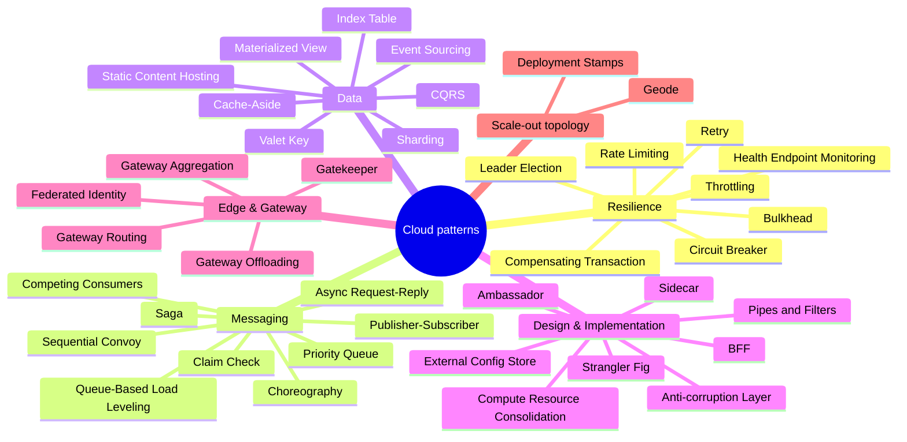
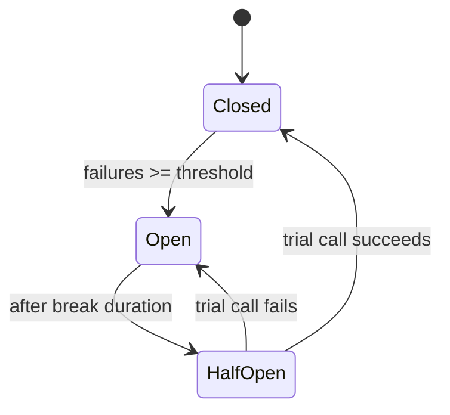
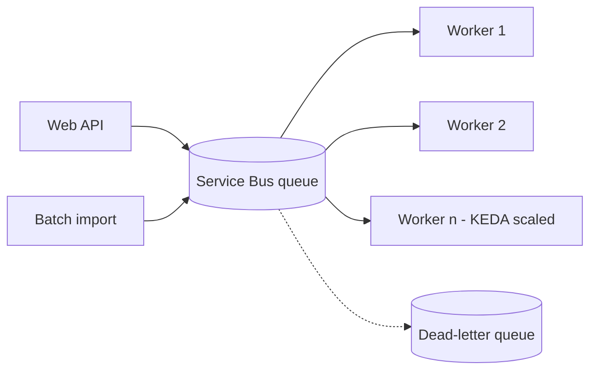
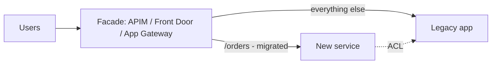

# Cloud Design Patterns

> **TL;DR** — The Azure Architecture Center catalogs ~40 patterns for distributed cloud systems, each tied to WAF pillars. Most real systems combine a handful: **Retry + Circuit breaker + Bulkhead** (resilience), **Queue-based load leveling + Competing consumers** (throughput), **Cache-aside + Static content hosting** (performance), **Gateway routing/offloading + Federated identity** (edge), **Strangler fig + Anti-corruption layer** (modernization), **Saga / Compensating transaction** (distributed consistency).

---

## 1. Full catalog (one-liners)

| Pattern | Problem it solves | One-liner | Primary pillars | Azure building blocks |
|---|---|---|---|---|
| **Ambassador** | Client-side cross-cutting concerns in legacy apps | Out-of-process helper proxy that handles retries, TLS, monitoring for a client | Reliability, Security | Sidecar container, Dapr |
| **Anti-corruption layer** | New system polluted by legacy semantics | Translation façade between subsystems with different models | OpEx | APIM, Functions, adapter service |
| **Asynchronous Request-Reply** | Long-running backend behind HTTP | Return 202 + status URL; client polls or gets callback | Performance | Durable Functions HTTP API, Service Bus |
| **Backends for Frontends (BFF)** | One API serving divergent clients | Separate backend per frontend type (web, mobile) | Performance, OpEx | APIM, App Service/Container Apps |
| **Bulkhead** | One failing dependency exhausts all resources | Isolate resources (pools, instances) per consumer/dependency | Reliability | Separate App Service plans, connection pools, K8s namespaces with quotas |
| **Cache-Aside** | Repeated reads of slow data store | Load into cache on demand; invalidate on write | Performance | Azure Cache for Redis / Azure Managed Redis |
| **Choreography** | Central orchestrator is a bottleneck | Services react to events, no central coordinator | OpEx, Performance | Event Grid, Service Bus topics |
| **Circuit Breaker** | Repeated calls to a failing service | Fail fast after threshold; half-open probe to recover | Reliability | Polly / Microsoft.Extensions.Resilience, Resilience4j, APIM circuit breaker, service mesh |
| **Claim Check** | Large payloads in messages | Store payload in blob; send reference token in message | Reliability, Cost | Blob Storage + Service Bus/Event Grid |
| **Compensating Transaction** | Undo eventually consistent multi-step work | Run inverse operations to roll back completed steps | Reliability | Durable Functions, Logic Apps |
| **Competing Consumers** | Throughput on a queue | Many consumers process messages from one channel concurrently | Reliability, Performance | Service Bus queues, KEDA scaling |
| **Compute Resource Consolidation** | Many under-utilized compute units | Pack multiple tasks/components into one unit | Cost | App Service plan density, AKS node bin-packing |
| **CQRS** | Read and write models conflict | Separate command (write) and query (read) models | Performance | Cosmos DB change feed → read store, SQL read replicas |
| **Deployment Stamps** | Scale/tenant isolation, regional rollout | Deploy multiple independent copies (stamps/scale units) of the full stack | Reliability, Performance | Bicep/Terraform per stamp, Front Door routing |
| **Edge Workload Configuration** | Config of many edge devices | Centralize config for heterogeneous edge workloads | OpEx | IoT Hub, Azure Arc |
| **Event Sourcing** | Need full history / audit, temporal queries | Persist state as append-only sequence of events | Performance, Reliability | Cosmos DB, Event Hubs, EventStoreDB |
| **External Configuration Store** | Config scattered in deployment packages | Central config store read at runtime | OpEx | Azure App Configuration, Key Vault |
| **Federated Identity** | Each app manages its own credentials | Delegate authentication to an external IdP | Security | Entra ID, External ID, OIDC/SAML |
| **Gatekeeper** | Exposing trusted hosts to clients | Dedicated host that validates/sanitizes requests before passing on | Security | Application Gateway WAF, APIM, Front Door |
| **Gateway Aggregation** | Chatty clients calling many services | Gateway fans out and aggregates into one response | Performance | APIM, GraphQL, BFF |
| **Gateway Offloading** | Shared concerns duplicated in services | Offload TLS, auth, rate limiting to gateway | OpEx, Security | APIM, App Gateway, Front Door |
| **Gateway Routing** | Clients need to know many endpoints | Single endpoint routes by path/host to services | OpEx | APIM, App Gateway, Ingress / Gateway API |
| **Geode** | Global low-latency active-active | Deploy backends in many regions, each serves any request; globally distributed data | Reliability, Performance | Front Door + Cosmos DB multi-region writes |
| **Health Endpoint Monitoring** | Know whether a service works | Expose health endpoints checked by external tools | Reliability, OpEx | App Service health check, K8s probes, Front Door/Traffic Manager probes, App Insights availability tests |
| **Index Table** | Queries on non-key fields in NoSQL | Maintain secondary index tables | Performance | Table Storage, Cosmos DB (or rely on indexing policy) |
| **Leader Election** | Coordinate among instances | Elect one instance to coordinate; failover if it dies | Reliability | Blob lease, K8s lease objects, ZooKeeper/etcd |
| **Materialized View** | Expensive query over normalized/partitioned data | Precompute views optimized for queries | Performance | Cosmos DB change feed, Synapse/Fabric, SQL indexed views |
| **Messaging Bridge** | Integrate incompatible messaging systems | Bridge component connecting two messaging systems | Cost, OpEx | Logic Apps, Functions |
| **Pipes and Filters** | Monolithic processing steps | Decompose processing into reusable filter stages connected by pipes | Reliability | Functions + queues, Data Factory, Durable Functions |
| **Priority Queue** | Some requests more urgent | Separate queues/priority so high-priority processed first | Reliability, Performance | Multiple Service Bus queues, different consumer counts |
| **Publisher-Subscriber** | Broadcast events to many consumers | Publish to topic; subscribers receive asynchronously | Reliability, Performance | Service Bus topics, Event Grid |
| **Quarantine** | External assets of unknown quality | Validate artifacts before consumption | Security, OpEx | Container image scanning, Defender, ACR quarantine |
| **Queue-Based Load Leveling** | Bursty load overwhelms backend | Buffer with a queue so backend processes at its own rate | Reliability, Cost | Storage Queues, Service Bus |
| **Rate Limiting** | Throttled downstream service | Control own request rate to avoid exceeding target's limits | Reliability | Token bucket in client, queue with controlled consumers |
| **Retry** | Transient faults | Retry with exponential backoff + jitter, bounded | Reliability | SDK retry policies, Polly |
| **Saga** | Distributed transactions across services | Sequence of local transactions with compensations; orchestration or choreography | Reliability | Durable Functions, Service Bus, Logic Apps |
| **Scheduler Agent Supervisor** | Coordinate distributed actions that may fail | Scheduler runs steps, agents call services, supervisor monitors & recovers | Reliability | Durable Functions, Logic Apps |
| **Sequential Convoy** | Ordered processing per group without blocking all | Process related messages in order, unrelated in parallel | Reliability | Service Bus **sessions** |
| **Sharding** | Single data store limits | Horizontally partition data into shards | Performance, Reliability | Cosmos DB partitions, Elastic Database tools, Citus (PostgreSQL elastic clusters) |
| **Sidecar** | Cross-cutting features in heterogeneous apps | Co-locate helper container with the app | OpEx | K8s sidecars, Dapr, Container Apps sidecars |
| **Static Content Hosting** | Serving static files from compute | Serve from storage/CDN | Cost, Performance | Static Web Apps, Blob static website + Front Door |
| **Strangler Fig** | Big-bang rewrite risk | Incrementally replace legacy functionality behind a façade | Reliability, OpEx | APIM/Front Door/App Gateway routing |
| **Throttling** | Protect own service from overload | Limit consumption by tenant/user; reject or degrade | Reliability, Cost | APIM `rate-limit-by-key`, `quota-by-key` |
| **Valet Key** | Clients upload/download large data via your app | Give client a restricted time-bound token to the store | Security, Cost | Blob SAS (prefer user-delegation SAS) |

> Pattern list is maintained by Microsoft; new patterns get added. Verify on the patterns index.

---

## 2. Patterns grouped by concern



---

## 3. Deep dives on the most-used patterns

### 3.1 Retry

- Retry only **transient** faults (HTTP 408, 429, 500, 502, 503, 504; timeouts; connection resets). Never 400/401/403/404.
- **Exponential backoff with jitter**: `delay = min(cap, base * 2^attempt) * random(0.5, 1.0)`.
- Respect `Retry-After` headers (429/503).
- Retries must be **idempotent** (idempotency keys for POST).
- Only retry at **one layer** — retries at client, gateway and service multiply (3×3×3 = 27 calls).
- Azure SDKs have built-in retry policies; don't wrap them blindly.

```csharp
// .NET 8+ Microsoft.Extensions.Http.Resilience (Polly v8 under the hood)
builder.Services.AddHttpClient<OrdersClient>()
    .AddStandardResilienceHandler(); // retry + circuit breaker + timeouts + rate limiter
```

### 3.2 Circuit breaker



- Combine with **fallback** (cached data, default response, degraded mode).
- Expose breaker state as a metric; alert on prolonged open state.
- Per-dependency breakers (don't share one breaker for all downstreams).

### 3.3 Queue-based load leveling + competing consumers



Checklist:
- [ ] Idempotent consumers (at-least-once delivery)
- [ ] Dead-letter handling + alerting + replay process
- [ ] Max delivery count and lock duration tuned to processing time
- [ ] Scale consumers on queue length (KEDA, Functions scale controller)
- [ ] Poison message handling
- [ ] Ordering need? → sessions (Sequential Convoy)

### 3.4 Cache-aside

```text
read(key):
  v = cache.get(key)
  if v is null:
     v = db.read(key)
     cache.set(key, v, ttl)
  return v

write(key, v):
  db.write(key, v)
  cache.delete(key)   # invalidate, don't update (avoids race)
```

Pitfalls: cache stampede (use locking / early refresh), stale data (TTL), caching per-user sensitive data under shared keys, treating cache as source of truth.

### 3.5 Saga (orchestration vs choreography)

| Aspect | Orchestration | Choreography |
|---|---|---|
| Coordinator | Central (Durable Functions orchestrator, Logic App) | None — services react to events |
| Visibility | Easy to trace whole flow | Harder; needs distributed tracing |
| Coupling | Orchestrator knows all participants | Services know events only |
| Fit | Complex flows, many steps, compensations | Simple flows, few participants |

Compensations must be idempotent and **semantic** (refund, cancel reservation) — you cannot "roll back" an email.

### 3.6 Strangler fig



Steps: put façade in front (no behaviour change) → migrate one capability → route → retire legacy part → repeat. Pair with **anti-corruption layer** so the new domain model stays clean.

### 3.7 Deployment stamps vs geode

| | Deployment Stamps | Geode |
|---|---|---|
| Unit | Full independent copy (app + data) per stamp | Regional backends sharing a global data layer |
| Data | Partitioned per stamp (tenant → stamp mapping) | Globally replicated (multi-write) |
| Use | Multi-tenant SaaS, blast-radius control, regulatory isolation | Global low-latency active-active |
| Routing | Tenant directory / Front Door | Latency-based routing (Front Door) |

### 3.8 Valet key (Blob SAS)

```bash
# User-delegation SAS (signed with Entra credentials, not account key) - 1h write to a single blob
az storage blob generate-sas \
  --account-name stuploadsprodweu --container-name uploads --name "invoice-123.pdf" \
  --permissions cw --expiry 2026-10-10T10:00Z \
  --auth-mode login --as-user --https-only -o tsv
```

Rules: shortest expiry, narrowest scope (blob not container), HTTPS only, prefer user-delegation SAS, disable shared key access where possible, validate uploaded content asynchronously (Quarantine pattern / Defender for Storage malware scanning).

### 3.9 Throttling / rate limiting in API Management

```xml
<inbound>
  <base />
  <rate-limit-by-key calls="100" renewal-period="60"
      counter-key="@(context.Subscription?.Key ?? context.Request.IpAddress)" />
  <quota-by-key calls="100000" renewal-period="2592000"
      counter-key="@(context.Subscription.Id)" />
</inbound>
```

---

## 4. Choosing patterns — quick decision table

| Symptom / requirement | Pattern(s) |
|---|---|
| Intermittent 503s from dependency | Retry (+ jitter), Circuit breaker |
| One slow dependency takes down whole app | Bulkhead, Timeouts, Circuit breaker |
| Spiky load, backend can't scale fast | Queue-based load leveling, Competing consumers |
| Reads dominate, DB CPU high | Cache-aside, Materialized view, CQRS, read replicas |
| Large file upload through API | Valet key, Claim check |
| Multi-service business transaction | Saga, Compensating transaction |
| Ordered processing per customer | Sequential convoy (sessions) |
| Legacy replacement | Strangler fig + Anti-corruption layer |
| Many microservices, one public endpoint | Gateway routing/offloading/aggregation |
| Mobile + web need different payloads | BFF |
| Multi-tenant SaaS growth beyond one deployment | Deployment stamps |
| Global users, low latency, active-active | Geode |
| Background singleton job across replicas | Leader election (or platform scheduler) |
| Long HTTP operation | Async request-reply |

---

## 5. Common mistakes

1. Retrying non-idempotent operations → duplicate orders/payments.
2. Retry storms: no jitter, retries at every layer, no circuit breaker.
3. Using a cache as the system of record.
4. Event sourcing for CRUD apps — large complexity, little benefit.
5. CQRS everywhere; apply only to bounded contexts that need it.
6. Choreography with dozens of services and no tracing → "event spaghetti".
7. Ignoring dead-letter queues until they hold millions of messages.
8. Gateway aggregation that becomes a new monolith with business logic.
9. SAS tokens with long expiry, account-level scope, or account keys in clients.

## Related

- [Software architecture](../05-software-architecture/README.md) — GoF, enterprise integration patterns, DDD
- [serverless-event-driven-integration.md](serverless-event-driven-integration.md) — messaging services and Durable Functions
- [reliability-observability.md](reliability-observability.md)

## References

- Azure Architecture Center: Cloud design patterns — https://learn.microsoft.com/azure/architecture/patterns/
- Azure Architecture Center — https://learn.microsoft.com/azure/architecture/
- Microsoft, Transient fault handling — https://learn.microsoft.com/azure/architecture/best-practices/transient-faults
- Martin Fowler, StranglerFigApplication — https://martinfowler.com/bliki/StranglerFigApplication.html
- Martin Fowler, CircuitBreaker — https://martinfowler.com/bliki/CircuitBreaker.html
- Martin Fowler, CQRS — https://martinfowler.com/bliki/CQRS.html
- Hohpe & Woolf, *Enterprise Integration Patterns* — https://www.enterpriseintegrationpatterns.com/
- Michael Nygard, *Release It!* (2nd ed., Pragmatic Bookshelf, 2018)
- Wikipedia: Exponential backoff — https://en.wikipedia.org/wiki/Exponential_backoff
