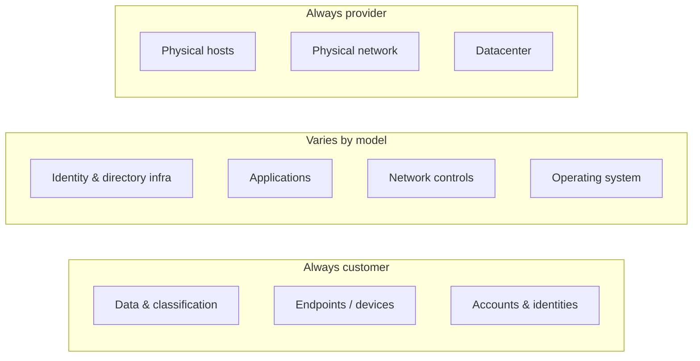
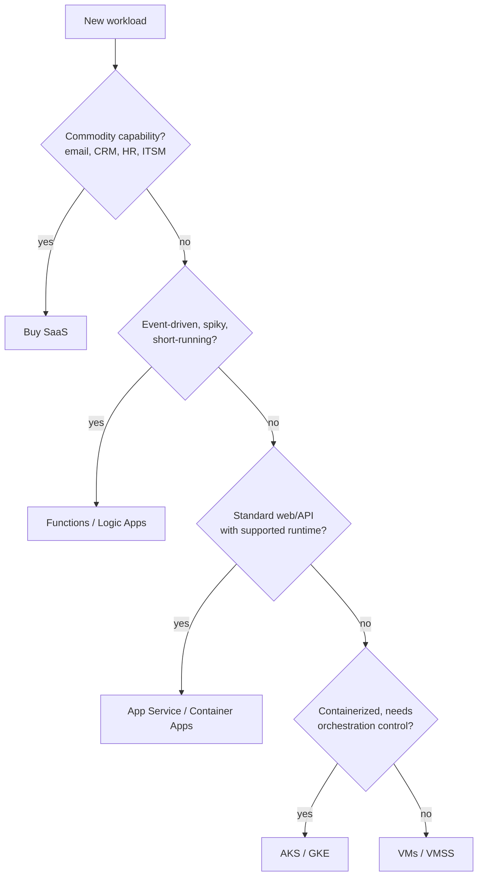

# Cloud Fundamentals

> **TL;DR** — Cloud = on-demand, self-service, elastic, metered, network-accessed pooled resources (NIST SP 800-145). Pick the highest abstraction (SaaS > PaaS/serverless > containers > IaaS) that meets your constraints, because every step down shifts more of the shared-responsibility burden onto you. Migrate per workload using the R-strategies, design apps as twelve/fifteen-factor, and treat cost as a design variable (OpEx is elastic only if your architecture is).

---

## 1. NIST definition (SP 800-145)

NIST SP 800-145 (2011) is still the canonical vocabulary. It defines **5 essential characteristics, 3 service models, 4 deployment models**.

### 1.1 Five essential characteristics

| # | Characteristic | Meaning | Architectural implication |
|---|---|---|---|
| 1 | **On-demand self-service** | Consumer provisions compute/storage without human interaction with the provider | API-first; everything scriptable → IaC |
| 2 | **Broad network access** | Capabilities available over the network via standard mechanisms | Identity + network security become the perimeter |
| 3 | **Resource pooling** | Multi-tenant pooled resources, location independence (region/zone at most) | Noisy neighbours, data residency questions, isolation tiers (dedicated hosts) |
| 4 | **Rapid elasticity** | Scale out/in quickly, seemingly unlimited capacity | Design stateless, horizontally scalable components; quotas still exist |
| 5 | **Measured service** | Metering, monitoring, reporting of usage | Pay-per-use → FinOps, tagging, showback |

### 1.2 Three service models (NIST) + common extensions

| Model | You manage | Provider manages | Azure examples | GCP | AWS |
|---|---|---|---|---|---|
| **IaaS** | OS, runtime, middleware, app, data | Physical, network, virtualization | Virtual Machines, VMSS, Managed Disks | Compute Engine | EC2 |
| **CaaS** (extension) | Containers, orchestration config, app | Control plane (managed K8s), nodes partly | AKS, Container Apps, ACI | GKE, Cloud Run | EKS, ECS, Fargate |
| **PaaS** | App code, data, config | OS, patching, runtime, scaling infra | App Service, Azure SQL, Cosmos DB | App Engine, Cloud SQL | Elastic Beanstalk, RDS |
| **FaaS** (extension) | Functions + triggers | Everything else incl. scaling to zero | Azure Functions, Logic Apps | Cloud Run functions | Lambda |
| **SaaS** | Data, identities, configuration | Entire application | Microsoft 365, Dynamics 365 | Google Workspace | WorkMail, QuickSight |

> NIST only defines IaaS/PaaS/SaaS. CaaS, FaaS, DBaaS, "XaaS" are industry extensions.

### 1.3 Four deployment models

| Model | Definition | Typical use |
|---|---|---|
| **Public cloud** | Provider-owned, open to general public | Default for most new workloads |
| **Private cloud** | Exclusive use by one organization (on-prem or hosted) | Regulatory, latency, sovereignty, existing investments (Azure Stack HCI/Local, VMware) |
| **Community cloud** | Shared by organizations with common concerns | Government clouds, sector clouds (e.g. healthcare) |
| **Hybrid cloud** | Two or more distinct infrastructures bound by technology enabling portability | On-prem + Azure via ExpressRoute/VPN, Azure Arc |

Related, non-NIST terms: **multi-cloud** (more than one public provider, often by acquisition rather than design), **sovereign cloud** (EU data boundary, local operators), **edge** (compute close to data/users).

---

## 2. Shared responsibility model

| Responsibility | On-prem | IaaS | PaaS | SaaS |
|---|---|---|---|---|
| Information & data | Customer | Customer | Customer | Customer |
| Devices (mobile, PC) | Customer | Customer | Customer | Customer |
| Accounts & identities | Customer | Customer | Customer | Customer |
| Identity & directory infrastructure | Customer | Customer | Shared | Shared |
| Applications | Customer | Customer | Shared | Provider |
| Network controls | Customer | Customer | Shared | Provider |
| Operating system | Customer | Customer | Provider | Provider |
| Physical hosts / network / datacenter | Customer | Provider | Provider | Provider |

**Key takeaways**

- Data, identities and endpoints are **never** offloaded. A misconfigured public blob container is your breach, not Microsoft's.
- "Shared" means you configure, the provider implements (e.g. PaaS network: provider gives Private Link, you must use it).
- Backups of SaaS data (M365, Salesforce) are often your responsibility — native retention ≠ backup.
- Map the model to controls with the Microsoft cloud security benchmark (see [cloud-security-compliance.md](cloud-security-compliance.md)).

---

## 3. Choosing the abstraction level

Rule of thumb: **go as high as possible, drop down only for a concrete reason** (OS-level dependency, licensing, kernel tuning, unsupported runtime, extreme cost at steady scale, portability mandate). See [azure-compute-networking.md](azure-compute-networking.md) for the detailed Azure compute decision tree.

---

## 4. Regions, availability zones, geographies

| Concept | Azure | GCP | AWS |
|---|---|---|---|
| Geography / data residency boundary | Geography (e.g. Europe, Germany) | Multi-region (EU, US) | — (Region is the boundary) |
| Region | Region (e.g. West Europe = NL, North Europe = IE, Sweden Central) | Region (europe-west4 = NL) | Region (eu-west-1 = IE) |
| Isolated datacenter(s) within region | Availability Zone (typically 3) | Zone (a, b, c) | Availability Zone |
| Region pair for DR | **Region pairs** (e.g. West Europe ↔ North Europe); newer regions may be non-paired | No pairs; choose yourself | No pairs |
| Edge | Front Door / CDN PoPs | Cloud CDN PoPs | CloudFront edge |

**Design notes**

- **Zonal vs zone-redundant**: a *zonal* resource is pinned to one zone (e.g. VM in zone 1); a *zone-redundant* resource is spread automatically by the platform (ZRS storage, zone-redundant SQL, App Service with zone redundancy).
- Inter-zone latency is typically < 2 ms round trip; inter-region tens of ms. Synchronous replication across regions is generally impractical.
- Not all services or SKUs exist in all regions. Check product availability per region before committing (*verify current status*).
- Region pairs: sequential platform updates, prioritized recovery, GRS replication target. Newer Azure regions without a pair rely on zones + customer-chosen DR region.
- Data residency ≠ data sovereignty. Residency is *where* data is stored; sovereignty includes *who* can be compelled to access it (see EU Data Boundary, sovereign cloud offerings).

---

## 5. Migration strategies (the "Rs")

### 5.1 AWS 7 Rs (originally Gartner 5 Rs → AWS 6 Rs → 7 Rs)

| R | What | Effort | Benefit | Typical trigger |
|---|---|---|---|---|
| **Retire** | Decommission | Lowest | Removes cost and risk | Duplicate/unused apps (often 10–20% of a portfolio) |
| **Retain** | Keep on-prem for now | None | Defers | Recent hardware investment, compliance, not ready |
| **Rehost** ("lift & shift") | Move VMs as-is | Low | Fast DC exit | Datacenter contract end |
| **Relocate** | Move hypervisor-level (e.g. VMware → Azure VMware Solution) | Low | Fastest for VMware estates | VMware-heavy estate |
| **Replatform** ("lift, tinker & shift") | Minor changes to use managed services (SQL → Azure SQL MI) | Medium | Reduced ops | Low-hanging fruit |
| **Repurchase** | Move to SaaS | Medium | Commodity outsourced | CRM, HR, ITSM |
| **Refactor / Re-architect** | Redesign for cloud-native | High | Maximum agility/scale | Business-critical, differentiating |

### 5.2 Microsoft CAF migration strategies

| CAF term | Equivalent | Description |
|---|---|---|
| **Retire** | Retire | Remove workloads no longer needed |
| **Rehost** | Rehost | Move to IaaS without code changes |
| **Replatform** | Replatform | Move to PaaS with minimal changes (newer CAF wording) |
| **Refactor** | Refactor | Code changes to fit cloud patterns, same architecture |
| **Rearchitect** | Re-architect | Modify architecture (e.g. monolith → microservices) |
| **Rebuild** | Rebuild | Rewrite from scratch with cloud-native tech |
| **Replace** | Repurchase | Adopt SaaS |
| **Retain** | Retain | Keep on-premises / hybrid (Azure Arc for management) |

> CAF wording changes over time — *verify current terms* in the Adopt/Migrate section of CAF.

### 5.3 Migration wave planning checklist

- [ ] Discover: inventory (Azure Migrate appliance, CMDB, dependency mapping)
- [ ] Assess: sizing, readiness, cost estimate, licensing (Hybrid Benefit eligibility)
- [ ] Classify each workload: business criticality, data classification, RTO/RPO, R-strategy
- [ ] Group into waves by dependency clusters (apps that talk a lot move together)
- [ ] Landing zone ready (identity, network, policy, monitoring) — see [architecture-frameworks-waf-caf.md](architecture-frameworks-waf-caf.md)
- [ ] Pilot wave with low-risk workload; refine runbooks
- [ ] Test migration → user acceptance → cutover → hypercare → decommission source
- [ ] Optimize after move (right-size, reservations) — rehosted VMs are usually oversized

**Common mistakes**: lift-and-shift without right-sizing (cost shock); ignoring dependency maps (broken integrations, latency on chatty DB connections across hybrid links); migrating without a landing zone; forgetting licensing; no decommissioning (paying twice).

---

## 6. Cloud economics

### 6.1 CapEx vs OpEx

| Aspect | CapEx (on-prem) | OpEx (cloud) |
|---|---|---|
| Spending | Upfront, depreciated over 3–5 years | Pay-as-you-go, expensed monthly |
| Capacity | Bought for peak + growth margin | Matches demand (if architected elastically) |
| Risk | Over/under-provisioning, stranded assets | Bill surprises, lack of governance |
| Agility | Weeks–months to procure | Minutes |
| Tax/accounting | Depreciation | Operating expense (commitments can blur this) |
| Ownership of decisions | Central procurement | Every engineer is a buyer → needs FinOps |

### 6.2 TCO components (on-prem side often forgotten)

- Hardware + refresh cycle, maintenance contracts
- Datacenter: power, cooling, space, physical security
- Licensing (OS, DB, virtualization — e.g. VMware cost changes)
- Staff time: patching, hardware swaps, capacity planning
- DR site, backup infrastructure
- Opportunity cost of slow provisioning

### 6.3 Economic principles of cloud

- **Elasticity value** ∝ variance of demand. Flat 24/7 workloads gain little from pay-per-use; use commitments (reservations / savings plans).
- **Economies of scale** are the provider's; you get them only via managed services.
- **Unit economics**: track cost per business unit (per order, per user, per GB processed). See [finops-cost-management.md](finops-cost-management.md).
- **Cost is an architectural quality attribute** (WAF Cost Optimization pillar).
- Data **egress** and cross-region traffic are the classic hidden costs; ingress is usually free.

---

## 7. The Twelve-Factor App

Source: [12factor.net](https://12factor.net/) (Heroku, 2011). Still the baseline for cloud-ready apps.

| # | Factor | Rule | Azure/GCP practice |
|---|---|---|---|
| I | **Codebase** | One codebase tracked in VCS, many deploys | One repo (or monorepo path) per deployable; same artifact to dev/test/prod |
| II | **Dependencies** | Explicitly declare and isolate dependencies | `package.json`/lockfiles, container images; never rely on system packages |
| III | **Config** | Store config in the environment | App settings, Key Vault references, App Configuration; no config in code |
| IV | **Backing services** | Treat backing services as attached resources | DB/queue/cache swappable via URL/connection; use managed identities instead of secrets |
| V | **Build, release, run** | Strictly separate build and run stages | CI builds immutable image; CD combines image + config into release |
| VI | **Processes** | Execute app as one or more stateless processes | Session state in Redis/DB, not memory; files in Blob |
| VII | **Port binding** | Export services via port binding | Container listens on `$PORT`; platform routes |
| VIII | **Concurrency** | Scale out via the process model | Scale instances/replicas (HPA, KEDA, App Service scale-out) |
| IX | **Disposability** | Fast startup, graceful shutdown | Handle SIGTERM, idempotent consumers, small images |
| X | **Dev/prod parity** | Keep dev, staging, prod as similar as possible | Same IaC modules per env, containers locally, same backing services type |
| XI | **Logs** | Treat logs as event streams | Write to stdout; platform ships to Log Analytics / Cloud Logging |
| XII | **Admin processes** | Run admin/management tasks as one-off processes | Container Apps jobs, K8s Jobs, migrations in pipeline |

### 7.1 Beyond the Twelve-Factor App (15 factors)

Kevin Hoffman's *Beyond the Twelve-Factor App* (O'Reilly/Pivotal, 2016) revises and adds:

| Added / changed | Meaning |
|---|---|
| **API first** | Design the contract before implementation; enables parallel work and consumers (OpenAPI) |
| **Telemetry** | Metrics, traces, health, business events — beyond logs (→ OpenTelemetry) |
| **Authentication & authorization** | Security is a factor: every endpoint secured (OAuth2/OIDC, RBAC) |
| Revised: *One codebase, one application* | Shared code goes into libraries, not shared repos of multiple apps |
| Revised: *Dependency management*, *Design/build/release/run*, *Configuration, credentials and code* | Stronger emphasis on credentials as config, design stage |
| Revised: *Logs*, *Disposability*, *Backing services*, *Environment parity*, *Administrative processes*, *Port binding*, *Stateless processes*, *Concurrency* | Same intent, modernised |

---

## 8. Cloud native

### 8.1 CNCF definition (paraphrased)

Cloud-native technologies let organizations build and run **scalable applications in modern, dynamic environments** (public, private, hybrid). Representative techniques: **containers, service meshes, microservices, immutable infrastructure, declarative APIs**. These enable **loosely coupled systems that are resilient, manageable, and observable**, combined with **robust automation** so engineers can make high-impact changes frequently and predictably with minimal toil. (Source: CNCF TOC definition on GitHub.)

### 8.2 Cloud-native properties checklist

- [ ] Containerized or serverless, immutable artifacts
- [ ] Declarative infrastructure (IaC) and GitOps
- [ ] Stateless compute; state in managed services
- [ ] Horizontal scale, autoscaling on load signals
- [ ] Health endpoints, graceful degradation, retries with backoff
- [ ] Observability built in (OpenTelemetry)
- [ ] Automated CI/CD with progressive delivery
- [ ] Identity-based security (workload identity, no long-lived secrets)
- [ ] Designed for failure (zones, timeouts, circuit breakers)

### 8.3 When *not* to go fully cloud-native

- Small internal app with a handful of users → App Service + Azure SQL is cloud-native enough; Kubernetes adds cost and toil.
- Team without container/K8s skills and no platform team.
- Vendor packaged software only supported on Windows VMs.
- Steady-state, compute-heavy workloads where reserved VMs are cheaper and simpler.

---

## 9. Key concepts glossary

| Term | Definition |
|---|---|
| **Control plane vs data plane** | Control plane = management APIs (ARM, create/configure); data plane = using the resource (read blob, query DB). Different RBAC and availability characteristics |
| **Quota / limit** | Per-subscription/region caps (vCPU per family, public IPs). Request increases ahead of go-live |
| **SKU / tier** | Sized offering (Basic/Standard/Premium); features (zones, private link) often tier-gated |
| **Immutable infrastructure** | Replace instead of patch; images versioned |
| **Pets vs cattle** | Named, hand-nursed servers vs identical replaceable instances |
| **Blast radius** | Scope of impact of a failure or compromise; limit via subscriptions, cells, stamps |
| **Noisy neighbour** | Other tenants' load affecting you on shared infra |
| **Egress** | Outbound data transfer — charged |
| **Landing zone** | Pre-configured, governed environment to host workloads |

---

## 10. Common mistakes

1. Treating cloud as "someone else's datacenter" — rehost everything, never modernize, pay more than on-prem.
2. No governance on day one: no naming, tagging, policy, budgets → sprawl.
3. Assuming the provider backs up your data / SaaS data.
4. Ignoring egress, logging ingestion and cross-region replication costs.
5. Single-zone deployments for "production".
6. Picking Kubernetes for a CRUD app with three users.
7. Hard-coding config and secrets (violating factor III).
8. Equating multi-cloud with resilience — usually it doubles complexity for marginal benefit.
9. Not checking regional availability of services/SKUs before design sign-off.

---

## Related sections

- [Software architecture](../05-software-architecture/README.md) — styles, DDD, distributed systems
- [Data & AI architecture](../07-data-ai-architecture/README.md)
- [Engineering](../08-engineering/README.md) — CI/CD, DORA
- [Enterprise architecture & business](../11-enterprise-architecture-business/README.md) — ITIL, ISO 27001, NIS2

## References

- NIST SP 800-145, *The NIST Definition of Cloud Computing* — https://csrc.nist.gov/pubs/sp/800/145/final
- Microsoft, Shared responsibility in the cloud — https://learn.microsoft.com/azure/security/fundamentals/shared-responsibility
- Microsoft Cloud Adoption Framework — https://learn.microsoft.com/azure/cloud-adoption-framework/
- Azure reliability documentation (regions & zones) — https://learn.microsoft.com/azure/reliability/
- AWS Well-Architected — https://aws.amazon.com/architecture/well-architected/
- The Twelve-Factor App — https://12factor.net/
- Kevin Hoffman, *Beyond the Twelve-Factor App* (O'Reilly, 2016)
- CNCF Cloud Native Definition — https://github.com/cncf/toc/blob/main/DEFINITION.md
- Wikipedia: Cloud computing — https://en.wikipedia.org/wiki/Cloud_computing
- Wikipedia: Total cost of ownership — https://en.wikipedia.org/wiki/Total_cost_of_ownership
