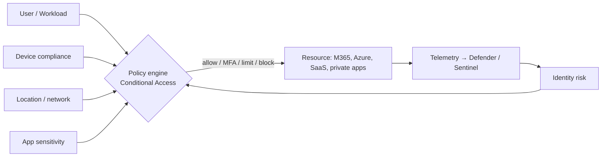
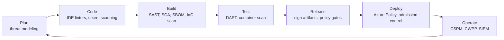

# Cloud Security & Compliance

> **TL;DR** — Apply **Zero Trust** (verify explicitly, least privilege, assume breach) with **identity as the primary perimeter**. Baseline everything against the **Microsoft cloud security benchmark (MCSB)** and CIS benchmarks via Defender for Cloud. Eliminate secrets (managed identities, federation), encrypt at rest and in transit (platform keys by default, **CMK** only when required), isolate networks (private endpoints, deny-by-default), embed security in the pipeline (**DevSecOps**), and detect/respond with **Defender XDR + Sentinel**. In the EU, map controls to **GDPR**, **NIS2** and **ISO/IEC 27001**, and decide data residency explicitly.

---

## 1. Zero Trust

| Principle | Meaning | Azure controls |
|---|---|---|
| **Verify explicitly** | Authenticate & authorize on all available signals: identity, device, location, risk, workload | Entra ID, Conditional Access, device compliance (Intune), risk-based policies, Continuous Access Evaluation |
| **Use least-privilege access** | JIT/JEA, risk-based adaptive policies, data protection | PIM, Azure RBAC at narrow scope, custom roles, access reviews, Purview labels |
| **Assume breach** | Minimize blast radius, segment, end-to-end encryption, analytics for detection | Subscriptions/VNets segmentation, private endpoints, Azure Firewall, Defender XDR, Sentinel |

Zero Trust pillars (Microsoft): identities, endpoints, applications, data, infrastructure, network (+ visibility/automation/orchestration).



### 1.1 Identity as the perimeter

- Network location no longer implies trust (remote work, SaaS, APIs).
- Strong authentication: **phishing-resistant MFA** (passkeys/FIDO2, Windows Hello for Business, certificate-based auth).
- Workload identities: managed identities, workload identity federation, **Conditional Access for workload identities** (P1/Workload ID premium — *verify*).
- Protect the control plane: Azure management only via CA-protected identities from compliant devices / privileged access workstations.
- Monitor identity: Entra ID Protection, Defender for Identity (on-prem AD), sign-in/audit logs to Log Analytics.

---

## 2. Security baselines & benchmarks

### 2.1 Microsoft cloud security benchmark (MCSB)

Successor to Azure Security Benchmark; multi-cloud (Azure, AWS, GCP) control set mapped to CIS Controls, NIST SP 800-53, PCI DSS. Default initiative in **Defender for Cloud** (regulatory compliance dashboard). MCSB v2 is in rollout — *verify current version*.

Control domains:

| Code | Domain |
|---|---|
| NS | Network security |
| IM | Identity management |
| PA | Privileged access |
| DP | Data protection |
| AM | Asset management |
| LT | Logging and threat detection |
| IR | Incident response |
| PV | Posture and vulnerability management |
| ES | Endpoint security |
| BR | Backup and recovery |
| DS | DevOps security |
| GS | Governance and strategy |
| (AI) | AI security — newer versions add AI controls (*verify*) |

Each service has a **security baseline** (MCSB applied per service: what is supported, default, customer responsibility).

### 2.2 CIS benchmarks

- **CIS Microsoft Azure Foundations Benchmark**, CIS Google Cloud Platform Foundation Benchmark, CIS AWS Foundations, CIS Kubernetes/AKS/GKE, CIS OS benchmarks (Windows Server, Ubuntu), CIS Microsoft 365 Foundations.
- Levels: **Level 1** (practical, low impact) and **Level 2** (defense in depth, may affect functionality).
- Available as Azure Policy initiatives / Defender regulatory standards, and as hardened images (CIS Hardened Images in Marketplace).
- **CIS Controls v8** (18 controls, Implementation Groups IG1–IG3) — useful prioritization framework for small/mid orgs (IG1 = "essential cyber hygiene").

### 2.3 Other frameworks

| Framework | Scope |
|---|---|
| NIST CSF 2.0 | Govern, Identify, Protect, Detect, Respond, Recover |
| NIST SP 800-53 | Control catalog (US federal, widely reused) |
| ISO/IEC 27001 / 27002 / 27017 / 27018 | ISMS, controls, cloud controls, PII in public cloud |
| SOC 2 | Trust services criteria (US-centric attestations) |
| PCI DSS v4 | Card data |
| BSI C5 | German cloud criteria |
| ENS | Spanish national security scheme |

---

## 3. Defender for Cloud & Sentinel

### 3.1 Defender for Cloud (CNAPP)

| Capability | Plans | What it does |
|---|---|---|
| **CSPM (Foundational)** | Free | Secure score, MCSB recommendations, asset inventory |
| **Defender CSPM** | Paid | Attack path analysis, cloud security explorer (graph), agentless scanning, data-aware posture, DevOps security, governance rules, regulatory compliance |
| **Defender for Servers** P1/P2 | Paid | Defender for Endpoint integration, vulnerability assessment, JIT VM access, FIM, agentless scanning |
| **Defender for Containers** | Paid | Image vulnerability scanning, K8s runtime threat detection, posture |
| **Defender for Storage** | Paid | Malware scanning on upload, sensitive data threat detection, activity anomalies |
| **Defender for Databases** (SQL, OSS DBs, Cosmos) | Paid | Threat detection, vulnerability assessment |
| **Defender for App Service, Key Vault, Resource Manager, DNS, APIs** | Paid | Workload-specific threat detection |
| **Defender for AI services** | Paid | Prompt injection / jailbreak detection for AI workloads — *verify* |
| Multicloud connectors | — | AWS, GCP accounts/projects, GitHub/Azure DevOps/GitLab |

Operational loop: **Secure score** → prioritized recommendations → assign owners & due dates (governance rules) → remediate (often via Policy) → exemptions with justification → re-measure.

### 3.2 Microsoft Sentinel (SIEM + SOAR)

| Component | Description |
|---|---|
| Data connectors | Entra ID, M365, Defender XDR, Azure Activity, firewalls (CEF/Syslog via AMA), AWS CloudTrail, GCP, third parties |
| Analytics rules | Scheduled KQL, NRT, Microsoft security (incident creation from Defender), Fusion (ML multistage), anomaly |
| Incidents | Correlated alerts; investigation graph |
| Hunting | KQL hunting queries, notebooks, bookmarks |
| Workbooks | Dashboards |
| **Automation rules & playbooks** (Logic Apps) | SOAR: enrich, notify, isolate, block |
| UEBA | User/entity behaviour analytics |
| Content hub | Solutions per data source (rules, workbooks, parsers) |
| Unified SecOps portal | Sentinel + Defender XDR in the Defender portal (Azure-portal Sentinel experience being retired — *verify timeline*) |

Cost control: free ingestion for some Microsoft sources (Azure Activity, Office 365 audit, Defender alerts), **commitment tiers**, Basic/Auxiliary log tables for high-volume low-value logs (firewall, NSG flow), **data lake** tier, DCR transformations to filter noise.

```kusto
// Sentinel analytic: role assignment of Owner outside PIM
AzureActivity
| where OperationNameValue =~ "MICROSOFT.AUTHORIZATION/ROLEASSIGNMENTS/WRITE" and ActivityStatusValue == "Success"
| extend props = parse_json(Properties)
| where tostring(props.requestbody) has "8e3af657-a8ff-443c-a75c-2fe8c4bcb635"   // Owner role definition id
| project TimeGenerated, Caller, CallerIpAddress, _ResourceId
```

---

## 4. Secrets management

Hierarchy of preference:
1. **No secret**: managed identity / workload identity federation / Entra auth to data services.
2. **Short-lived tokens** issued on demand (OIDC, user-delegation SAS).
3. **Secrets in Key Vault**, referenced at runtime (Key Vault references, CSI driver), rotated automatically.
4. Never: secrets in code, config files in Git, container images, pipeline YAML, tags, or chat.

Controls:
- [ ] Secret scanning in repos (GitHub Advanced Security / GHAS for Azure DevOps, gitleaks) + push protection
- [ ] Expiry dates on all secrets/certs; Event Grid near-expiry alerts
- [ ] Disable local/key auth where possible: Storage shared key, Cosmos `disableLocalAuth`, Service Bus/Event Hubs SAS, ACR admin user, SQL auth (Entra-only)
- [ ] App registration credential policies (max lifetime, no secrets — certificates/federation only)
- [ ] Break-glass credentials stored offline/sealed with dual control

---

## 5. Encryption

| Layer | Default on Azure | Options |
|---|---|---|
| **At rest – platform** | AES-256 encryption with **Microsoft-managed keys (PMK)** for Storage, SQL (TDE), Cosmos, disks — always on | — |
| **At rest – customer-managed keys (CMK)** | Off | Keys in Key Vault / Managed HSM; you control rotation & revocation; requires purge protection, managed identity access |
| **Infrastructure / double encryption** | Off | Second layer with separate key (Storage, disks) |
| **Encryption at host** | Off | VM temp disk & cache encryption |
| **Confidential computing** (in use) | — | Confidential VMs (AMD SEV-SNP, Intel TDX), confidential containers, Always Encrypted with secure enclaves |
| **In transit – external** | TLS 1.2+ enforced on most services; TLS 1.3 increasingly | Min TLS policies; HSTS; managed certs |
| **In transit – internal** | Azure encrypts traffic between datacenters (MACsec) | mTLS (service mesh), IPsec over ExpressRoute, MACsec on ER Direct |
| **Application level** | — | Always Encrypted (SQL), client-side encryption (Storage SDK), field-level encryption |

**CMK — when to use / when not**

| Use CMK when | Avoid when |
|---|---|
| Regulation/contract explicitly requires customer key control (e.g. financial, public sector) | "Because it sounds more secure" — operational risk (key deletion = data loss, outages on Key Vault access issues) |
| Crypto-shredding requirement (revoke key to render data unreadable) | Small team without key lifecycle process |
| Separation of duties between data admins and key admins | Services don't support CMK in your tier |

Key lifecycle: generation (HSM), rotation policy (e.g. yearly, auto), backup (Managed HSM security domain!), access (RBAC: Key Vault Crypto Service Encryption User for service identities), revocation, destruction, logging.

---

## 6. Network isolation

Layers (defense in depth):

1. **Edge**: Front Door / App Gateway with WAF (OWASP CRS / Microsoft Default Rule Set, bot protection), DDoS Protection.
2. **Perimeter/egress**: Azure Firewall with FQDN allow-lists, TLS inspection where justified (Premium), threat intel deny.
3. **Segmentation**: hub-spoke, spoke per workload; NSGs deny by default; ASGs; Azure Virtual Network Manager **security admin rules** (org-wide enforced rules).
4. **PaaS**: private endpoints, `publicNetworkAccess: Disabled`, Network Security Perimeter (for PaaS-to-PaaS — *verify GA*).
5. **Kubernetes**: private cluster, network policies (default deny), egress via firewall.
6. **Admin access**: Bastion, JIT, PAWs, no public management ports.

**Data exfiltration** considerations: private endpoints bound to specific resources, firewall egress control, Storage service endpoint policies, Defender for Storage, Purview DLP, Conditional Access session controls (Defender for Cloud Apps).

---

## 7. DevSecOps



| Stage | Practice | Tools (examples) |
|---|---|---|
| Design | Threat modeling (STRIDE), security requirements, data classification | Microsoft Threat Modeling Tool, OWASP Threat Dragon |
| Code | Secure coding standards, pre-commit secret scanning | gitleaks, IDE plugins |
| Build | **SAST**, **SCA** (dependencies, licenses), **SBOM**, IaC scanning | CodeQL / GHAS, Dependabot, Trivy, Checkov, Syft |
| Test | **DAST**, API fuzzing | OWASP ZAP, Burp |
| Artifact | Sign images/packages, provenance (**SLSA**), registry scanning | Notation, cosign, GitHub artifact attestations |
| Deploy | Policy as code, admission control, least-privilege pipeline identity | Azure Policy, Gatekeeper/Kyverno, environment approvals |
| Run | CSPM, runtime protection, vulnerability management, pen tests | Defender for Cloud, Sentinel |
| Supply chain | Pin actions by SHA, protected branches, required reviews, 2FA | GitHub/Azure DevOps settings, OpenSSF Scorecard |

**Defender for Cloud DevOps security** connects GitHub/Azure DevOps/GitLab to surface code & IaC findings and map code-to-cloud.

---

## 8. EU regulation & compliance

> Not legal advice. *Verify current regulatory status* with legal/compliance.

### 8.1 GDPR (EU 2016/679)

| Principle / obligation | Cloud architecture implication |
|---|---|
| Lawfulness, purpose limitation, data minimization | Collect only needed fields; separate purposes; avoid copying PII into logs/analytics |
| Storage limitation | Retention policies, lifecycle deletion, log retention limits |
| Integrity & confidentiality (Art. 32) | Encryption, access control, pseudonymization, backups, testing |
| Data subject rights (access, erasure, portability) | Locate personal data (Purview data map), deletion workflows incl. backups strategy |
| Privacy by design & default (Art. 25) | Defaults private; DPIAs for high-risk processing |
| Processor agreements (Art. 28) | Microsoft Products and Services DPA; sub-processor lists |
| International transfers (Ch. V) | EU-US Data Privacy Framework, SCCs; EU Data Boundary reduces transfers |
| Breach notification (Art. 33) | 72 h to supervisory authority → detection + incident process |
| Records of processing (Art. 30) | Inventory of systems/data flows |

### 8.2 NIS2 (Directive (EU) 2022/2555)

- Applies to **essential** and **important** entities in many sectors (energy, transport, health, digital infrastructure, ICT service management/MSPs, manufacturing, food, waste, public administration…), typically medium and large companies (≥ 50 employees or > €10 M turnover), some regardless of size. Transposed into national law (status varies per member state).
- **Art. 21 risk-management measures** (minimum): risk analysis & IS policies; incident handling; business continuity (backup, DR, crisis management); **supply chain security**; security in acquisition/development/maintenance incl. vulnerability handling; effectiveness assessment; cyber hygiene & training; **cryptography/encryption**; HR security, access control, asset management; **MFA**, secured communications.
- **Reporting** (Art. 23): early warning within **24 h**, incident notification within **72 h**, final report within **1 month**.
- **Management accountability**: management bodies approve measures, must be trained, can be held liable.
- Cloud mapping: CAF Govern/Secure + MCSB + Defender for Cloud regulatory dashboards, Sentinel for detection/reporting timelines, Azure Backup/ASR for continuity, supplier assessments of SaaS/MSPs.
- Related EU acts: **DORA** (financial sector ICT resilience, applies from Jan 2025), **Cyber Resilience Act** (products with digital elements), **EU AI Act**, **Data Act** (cloud switching/portability).

### 8.3 Data residency & sovereignty (EU)

| Concept | Notes |
|---|---|
| Region selection | Deploy in EU regions; enforce with Policy "Allowed locations" |
| Non-regional services | Some services are global (Entra ID, Front Door, some AI) — check where data is stored/processed |
| **EU Data Boundary** | Microsoft commitment to store and process customer data and pseudonymized personal data for EU/EFTA customers within the EU for core cloud services (completed phases 2023–2025 — *verify scope*) |
| Sovereign offerings | Microsoft Cloud for Sovereignty / Sovereign Public Cloud & Private Cloud (EU), national partner clouds (e.g. Bleu in France, Delos in Germany) — *verify status* |
| Customer Lockbox | Approve Microsoft engineer access to data |
| Confidential computing & CMK/HSM | Technical controls against provider access |
| Geo-replication | GRS pairs stay within geography for EU pairs (e.g. West Europe ↔ North Europe), but verify for each region |
| AI services | Data zone deployments (EU data zone) for Azure OpenAI — *verify* |

### 8.4 ISO/IEC 27001 basics

- **ISMS** standard (2022 edition): context, leadership, planning (risk assessment & treatment), support, operation, performance evaluation (internal audit, management review), improvement — PDCA.
- **Annex A** (2022): **93 controls** in 4 themes — Organizational (37), People (8), Physical (14), Technological (34). New controls include threat intelligence, information security for use of cloud services (5.23), ICT readiness for business continuity, data masking, data leakage prevention, monitoring activities, web filtering, secure coding, configuration management, information deletion.
- **Statement of Applicability (SoA)**: which controls apply and why.
- Certification: Stage 1 (documentation) + Stage 2 (implementation) audits, 3-year cycle with surveillance audits. Transition from 2013 version ended Oct 2025.
- Cloud providers' certifications (Microsoft ISO 27001/27017/27018/27701) cover **their** part of shared responsibility; your ISMS covers yours. Download audit reports from the **Service Trust Portal**.
- See [Enterprise architecture & business](../11-enterprise-architecture-business/README.md) for ISMS process detail.

---

## 9. Security architecture checklist (Azure workload)

**Identity**
- [ ] Entra-only auth for apps & data services; managed identities; no shared keys
- [ ] Conditional Access with phishing-resistant MFA for admins; PIM for privileged roles
- [ ] App roles/scopes validated in APIs; tokens validated (issuer, audience, signature)

**Network**
- [ ] Private endpoints for PaaS; public access disabled (Corp)
- [ ] WAF in prevention mode for internet-facing apps
- [ ] Egress via firewall; NSGs deny-by-default; no public management ports

**Data**
- [ ] Classification & labeling; encryption at rest (PMK or CMK by requirement), TLS 1.2+
- [ ] Backups immutable/soft-deleted, restore tested
- [ ] Logs free of PII/secrets

**Operations**
- [ ] Defender for Cloud plans enabled per resource type; secure score tracked
- [ ] Diagnostic logs to central workspace; Sentinel rules for privilege changes, key access anomalies
- [ ] Incident response runbooks; NIS2/GDPR reporting timelines rehearsed

**Supply chain**
- [ ] SAST/SCA/IaC scans in CI; signed images; pinned dependencies
- [ ] Pipeline identities federated, least privilege, environment approvals

## 10. Common mistakes

1. MFA "for everyone except service accounts" — legacy auth and shared admin accounts as the breach path.
2. Over-privileged pipeline service principals (Owner at subscription).
3. Private endpoints added but public access left enabled.
4. CMK everywhere without key lifecycle → self-inflicted outages.
5. Sentinel ingesting everything into Analytics tier → cost explosion; nobody triaging incidents.
6. Defender recommendations ignored — secure score as vanity metric.
7. Assuming Microsoft's ISO certificate makes you compliant.
8. GDPR erasure ignoring backups, logs, analytics copies.
9. No supplier inventory/assessment for NIS2 supply-chain obligations.

## References

- Microsoft Zero Trust — https://learn.microsoft.com/security/zero-trust/
- Microsoft cloud security benchmark — https://learn.microsoft.com/security/benchmark/azure/
- Microsoft Defender for Cloud — https://learn.microsoft.com/azure/defender-for-cloud/
- Microsoft Sentinel — https://learn.microsoft.com/azure/sentinel/
- Azure security documentation — https://learn.microsoft.com/azure/security/
- Azure encryption overview — https://learn.microsoft.com/azure/security/fundamentals/encryption-overview
- Microsoft Service Trust Portal — https://servicetrust.microsoft.com/
- CIS Benchmarks — https://www.cisecurity.org/cis-benchmarks
- CIS Controls — https://www.cisecurity.org/controls
- NIST Cybersecurity Framework — https://www.nist.gov/cyberframework
- NIST SP 800-207 Zero Trust Architecture — https://csrc.nist.gov/pubs/sp/800/207/final
- OWASP Top 10 — https://owasp.org/www-project-top-ten/
- SLSA — https://slsa.dev/
- ISO/IEC 27001 — https://www.iso.org/standard/27001
- Wikipedia: General Data Protection Regulation — https://en.wikipedia.org/wiki/General_Data_Protection_Regulation
- Wikipedia: NIS2 Directive — https://en.wikipedia.org/wiki/NIS2_Directive
- Wikipedia: ISO/IEC 27001 — https://en.wikipedia.org/wiki/ISO/IEC_27001
- Related: [azure-identity-governance.md](azure-identity-governance.md), [Software architecture — security](../05-software-architecture/README.md), [Enterprise architecture & business](../11-enterprise-architecture-business/README.md)
