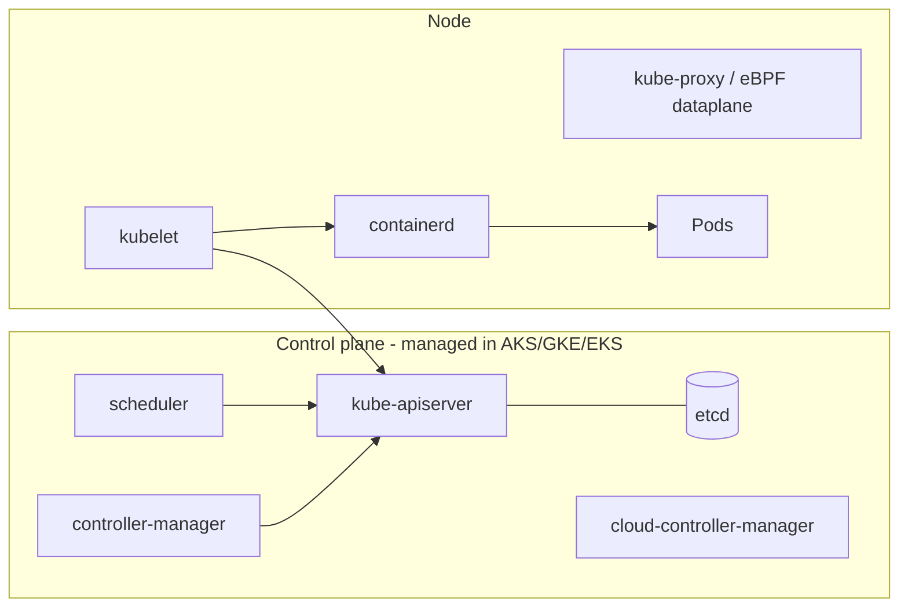
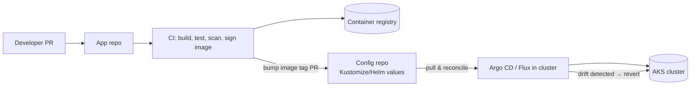

# Containers & Kubernetes

> **TL;DR** — Build small, reproducible, non-root images with **multi-stage** builds and **distroless/minimal** bases; scan and sign them. Kubernetes runs them declaratively: **Deployments** for stateless, **StatefulSets** for stable identity/storage, **DaemonSets** per node, **Jobs/CronJobs** for batch; expose via **Services** and **Ingress / Gateway API**; configure with **ConfigMaps/Secrets** (prefer external secret stores); always set **requests/limits** and **probes**; scale with **HPA/VPA/KEDA**. Package with **Helm** or **Kustomize**, deploy with **GitOps** (Argo CD / Flux). Add a service mesh only when you need mTLS/traffic policy at scale.

---

## 1. Docker / OCI image best practices

### 1.1 Checklist

- [ ] **Multi-stage build**: compile in SDK image, copy artifacts into minimal runtime image
- [ ] **Minimal base**: distroless, chiseled (Ubuntu), Alpine (musl caveats), `scratch` for static binaries
- [ ] **Pin versions** (tag + digest `@sha256:`) for reproducibility; rebuild regularly for patches
- [ ] **Non-root user** (`USER 10001`), read-only root filesystem where possible
- [ ] **One process per container**; handle `SIGTERM`; use an init (`tini`) if spawning children
- [ ] **Layer ordering**: dependencies first (cacheable), source last
- [ ] `.dockerignore` (exclude `.git`, `node_modules`, secrets, test data)
- [ ] **No secrets in images** (build secrets via `--secret` mounts, not `ARG`/`ENV`)
- [ ] `HEALTHCHECK` for plain Docker; K8s uses probes instead
- [ ] Labels (OCI annotations: source, revision, version)
- [ ] **Scan** (Trivy, Grype, Defender for Containers, ACR/Artifact Registry scanning) and **SBOM** (Syft, `docker buildx --sbom`)
- [ ] **Sign** (Notation / Sigstore cosign) and verify at deploy (Ratify, Kyverno, Binary Authorization)
- [ ] Multi-arch builds (amd64 + arm64) if using Arm nodes (cheaper)

### 1.2 Example: .NET multi-stage to chiseled non-root

```dockerfile
# syntax=docker/dockerfile:1
FROM mcr.microsoft.com/dotnet/sdk:9.0 AS build
WORKDIR /src
COPY *.csproj ./
RUN dotnet restore
COPY . .
RUN dotnet publish -c Release -o /app /p:UseAppHost=false

FROM mcr.microsoft.com/dotnet/aspnet:9.0-noble-chiseled AS runtime
WORKDIR /app
COPY --from=build /app .
USER app
ENV ASPNETCORE_HTTP_PORTS=8080
EXPOSE 8080
ENTRYPOINT ["dotnet", "Api.dll"]
```

### 1.3 Example: Node/TypeScript to distroless

```dockerfile
FROM node:22-bookworm-slim AS build
WORKDIR /app
COPY package*.json ./
RUN npm ci
COPY . .
RUN npm run build && npm prune --omit=dev

FROM gcr.io/distroless/nodejs22-debian12:nonroot
WORKDIR /app
COPY --from=build /app/node_modules ./node_modules
COPY --from=build /app/dist ./dist
EXPOSE 8080
CMD ["dist/server.js"]
```

### 1.4 Example: Go static binary to scratch/distroless

```dockerfile
FROM golang:1.23 AS build
WORKDIR /src
COPY go.* ./
RUN go mod download
COPY . .
RUN CGO_ENABLED=0 go build -trimpath -ldflags="-s -w" -o /out/app ./cmd/app

FROM gcr.io/distroless/static-debian12:nonroot
COPY --from=build /out/app /app
ENTRYPOINT ["/app"]
```

### 1.5 Registries

- **ACR** (Azure): Basic/Standard/Premium (Premium: geo-replication, private endpoints, content trust, zone redundancy); **ACR Tasks** for builds & base image patching; artifact cache; anonymous pull off; AKS pulls via **AcrPull** on kubelet identity.
- **Artifact Registry** (GCP), **ECR** (AWS).
- Retention policies for untagged manifests; promote images between registries (dev → prod) via import, not rebuild.

---

## 2. Kubernetes architecture



Declarative model: you submit **desired state** (YAML manifests) → controllers reconcile actual state continuously.

---

## 3. Core objects

| Object | Purpose | Key fields / notes |
|---|---|---|
| **Pod** | Smallest deployable unit: 1+ containers sharing network & volumes | Ephemeral; never create bare pods in prod |
| **ReplicaSet** | Keeps N pod replicas | Managed by Deployment |
| **Deployment** | Stateless apps, rolling updates, rollback | `strategy: RollingUpdate (maxSurge, maxUnavailable)` |
| **StatefulSet** | Stable network ID (`pod-0`), ordered rollout, per-pod PVC (`volumeClaimTemplates`) | Databases, Kafka, ZooKeeper — prefer managed services in cloud |
| **DaemonSet** | One pod per (selected) node | Log/metrics agents, CNI, CSI drivers |
| **Job** | Run to completion (`completions`, `parallelism`, `backoffLimit`) | Migrations, batch |
| **CronJob** | Scheduled Jobs | `concurrencyPolicy: Forbid`, `startingDeadlineSeconds` |
| **Service** | Stable virtual IP/DNS for a set of pods (label selector) | Types below |
| **Ingress** | L7 HTTP routing to Services via an ingress controller | Being superseded by Gateway API for new designs |
| **Gateway API** | `GatewayClass`, `Gateway`, `HTTPRoute`, `GRPCRoute`… role-oriented, expressive (header matching, traffic splitting) | GA core since v1.0 (2023) |
| **ConfigMap** | Non-secret config as env vars or files | Changes don't restart pods automatically (use hash annotations / Reloader) |
| **Secret** | Base64-encoded (not encrypted!) sensitive data | Enable etcd encryption (KMS); prefer **Secrets Store CSI Driver** / External Secrets Operator with Key Vault |
| **PersistentVolume (PV)** | Storage resource in cluster | Provisioned dynamically via StorageClass |
| **PersistentVolumeClaim (PVC)** | Request for storage by a pod | Access modes RWO / ROX / RWX / RWOP |
| **StorageClass** | Provisioner + parameters (Azure Disk Premium ZRS, Azure Files) | `volumeBindingMode: WaitForFirstConsumer` for zonal disks |
| **Namespace** | Scope for names, RBAC, quotas, network policies | Per team/app/env |
| **ServiceAccount** | Pod identity in K8s; federate to cloud identity (Entra Workload ID, GKE Workload Identity) | `automountServiceAccountToken: false` when unused |
| **NetworkPolicy** | Pod-level L3/L4 allow rules (needs supporting CNI: Azure CNI + Cilium, Calico) | Default-deny per namespace |
| **ResourceQuota / LimitRange** | Cap namespace consumption / default requests-limits | Multi-tenancy guardrails |
| **PodDisruptionBudget** | Min available during voluntary disruptions (node upgrades) | Essential for safe AKS upgrades |
| **HPA / VPA** | Autoscale replicas / resource requests | See §5 |
| **CRD / Operator** | Extend API with custom resources + controllers | cert-manager, CloudNativePG, Strimzi |

### 3.1 Service types

| Type | Exposes | Use |
|---|---|---|
| **ClusterIP** (default) | Internal virtual IP | Service-to-service |
| **NodePort** | Port on every node (30000–32767) | Rarely directly; underlying LB plumbing |
| **LoadBalancer** | Cloud L4 load balancer (public or internal via annotation) | Non-HTTP or ingress controller exposure |
| **ExternalName** | DNS CNAME to external name | Alias to external DB |
| **Headless** (`clusterIP: None`) | DNS records per pod | StatefulSets, client-side discovery |

```yaml
# Internal LoadBalancer on AKS
apiVersion: v1
kind: Service
metadata:
  name: api-internal
  annotations:
    service.beta.kubernetes.io/azure-load-balancer-internal: "true"
spec:
  type: LoadBalancer
  selector: { app: api }
  ports: [{ port: 80, targetPort: 8080 }]
```

### 3.2 Production-ready Deployment

```yaml
apiVersion: apps/v1
kind: Deployment
metadata:
  name: api
  namespace: orders
  labels: { app: api }
spec:
  replicas: 3
  revisionHistoryLimit: 5
  strategy:
    type: RollingUpdate
    rollingUpdate: { maxSurge: 25%, maxUnavailable: 0 }
  selector:
    matchLabels: { app: api }
  template:
    metadata:
      labels: { app: api, azure.workload.identity/use: "true" }
    spec:
      serviceAccountName: api
      securityContext:
        runAsNonRoot: true
        seccompProfile: { type: RuntimeDefault }
      topologySpreadConstraints:
        - maxSkew: 1
          topologyKey: topology.kubernetes.io/zone
          whenUnsatisfiable: ScheduleAnyway
          labelSelector: { matchLabels: { app: api } }
      containers:
        - name: api
          image: crcontoso.azurecr.io/orders/api:1.4.2@sha256:abc...
          ports: [{ containerPort: 8080 }]
          env:
            - name: ASPNETCORE_ENVIRONMENT
              value: Production
          envFrom:
            - configMapRef: { name: api-config }
          resources:
            requests: { cpu: 250m, memory: 256Mi }
            limits:   { memory: 512Mi }        # CPU limit often omitted to avoid throttling
          startupProbe:
            httpGet: { path: /health/startup, port: 8080 }
            failureThreshold: 30
            periodSeconds: 2
          readinessProbe:
            httpGet: { path: /health/ready, port: 8080 }
            periodSeconds: 5
          livenessProbe:
            httpGet: { path: /health/live, port: 8080 }
            periodSeconds: 10
            failureThreshold: 3
          securityContext:
            allowPrivilegeEscalation: false
            readOnlyRootFilesystem: true
            capabilities: { drop: ["ALL"] }
---
apiVersion: policy/v1
kind: PodDisruptionBudget
metadata: { name: api, namespace: orders }
spec:
  minAvailable: 2
  selector: { matchLabels: { app: api } }
```

### 3.3 Gateway API example

```yaml
apiVersion: gateway.networking.k8s.io/v1
kind: HTTPRoute
metadata: { name: orders, namespace: orders }
spec:
  parentRefs: [{ name: public-gw, namespace: infra }]
  hostnames: ["api.contoso.com"]
  rules:
    - matches: [{ path: { type: PathPrefix, value: /orders } }]
      backendRefs:
        - { name: api-v1, port: 80, weight: 90 }
        - { name: api-v2, port: 80, weight: 10 }   # canary
```

---

## 4. Probes, requests and limits

### 4.1 Probes

| Probe | Question | On failure | Pitfall |
|---|---|---|---|
| **startupProbe** | Has the app finished starting? | Keeps liveness/readiness disabled until success; kills after threshold | Missing → liveness kills slow-starting apps |
| **readinessProbe** | Can it serve traffic now? | Removed from Service endpoints (no restart) | Checking downstream DBs in readiness can remove *all* pods during a DB blip — be deliberate |
| **livenessProbe** | Is it deadlocked / irrecoverable? | Container restarted | Never check dependencies in liveness → restart storms |

Health endpoint design: `/health/live` = process OK only; `/health/ready` = can serve (warm caches, critical deps); keep cheap and unauthenticated on internal port.

### 4.2 Requests, limits and QoS

| Setting | Effect |
|---|---|
| **CPU request** | Scheduling + guaranteed share (CFS weight) |
| **CPU limit** | Hard throttling (CFS quota) → latency spikes; many teams omit CPU limits for latency-sensitive services |
| **Memory request** | Scheduling |
| **Memory limit** | Exceed → **OOMKilled**; set limit ≥ realistic peak |

| QoS class | Condition | Eviction priority |
|---|---|---|
| **Guaranteed** | requests = limits for CPU and memory, all containers | Last evicted |
| **Burstable** | Some requests set | Middle |
| **BestEffort** | No requests/limits | First evicted |

Right-size with VPA recommendations, Goldilocks, or Azure Monitor container insights; enforce with LimitRange + policy.

---

## 5. Autoscaling

| Autoscaler | Scales | Signal | Notes |
|---|---|---|---|
| **HPA** | Pod replicas | CPU/memory utilization vs requests, custom/external metrics | Requires requests; `behavior` for stabilization windows |
| **VPA** | Pod requests/limits | Historical usage | Modes Off (recommend), Initial, Auto/Recreate; don't combine with HPA on same CPU/memory metric |
| **KEDA** | Replicas incl. **to zero** | Event sources: Service Bus, Event Hubs, Kafka, Prometheus, cron, HTTP (add-on) | AKS add-on; Container Apps uses it internally |
| **Cluster Autoscaler** | Nodes | Pending pods / underutilization | Per node pool min/max |
| **Node Auto-Provisioning (Karpenter)** | Nodes with right-sized VM SKUs | Pending pods | AKS NAP / AKS Automatic; EKS Karpenter |

```yaml
apiVersion: autoscaling/v2
kind: HorizontalPodAutoscaler
metadata: { name: api, namespace: orders }
spec:
  scaleTargetRef: { apiVersion: apps/v1, kind: Deployment, name: api }
  minReplicas: 3
  maxReplicas: 30
  metrics:
    - type: Resource
      resource: { name: cpu, target: { type: Utilization, averageUtilization: 65 } }
  behavior:
    scaleDown: { stabilizationWindowSeconds: 300 }
---
apiVersion: keda.sh/v1alpha1
kind: ScaledObject
metadata: { name: worker, namespace: orders }
spec:
  scaleTargetRef: { name: worker }
  minReplicaCount: 0
  maxReplicaCount: 50
  triggers:
    - type: azure-servicebus
      metadata: { queueName: orders, namespace: sbns-integration-prod, messageCount: "20" }
      authenticationRef: { name: keda-workload-identity }
```

---

## 6. Packaging: Helm vs Kustomize

| | Helm | Kustomize |
|---|---|---|
| Approach | Templating (Go templates) + values + chart packaging + release tracking | Template-free overlays/patches on plain YAML |
| Distribution | Charts in OCI registries / repos | Git directories |
| Strength | Third-party software, parameterization, dependencies | Environment overlays for own apps, readability |
| Weakness | Template complexity, "YAML in strings" | Less suited for complex parameterization |
| Built into kubectl | No | Yes (`kubectl apply -k`) |

```text
k8s/
  base/                 deployment.yaml, service.yaml, kustomization.yaml
  overlays/
    dev/kustomization.yaml    (replicas: 1, image tag dev)
    prod/kustomization.yaml   (replicas: 3, HPA, PDB)
```

```yaml
# overlays/prod/kustomization.yaml
apiVersion: kustomize.config.k8s.io/v1beta1
kind: Kustomization
resources: [../../base, hpa.yaml, pdb.yaml]
namespace: orders
images:
  - name: crcontoso.azurecr.io/orders/api
    newTag: "1.4.2"
patches:
  - target: { kind: Deployment, name: api }
    patch: |-
      - op: replace
        path: /spec/replicas
        value: 3
```

Common combo: Helm for third-party (ingress-nginx, cert-manager, external-secrets), Kustomize for own apps; or Helm + Kustomize post-render.

---

## 7. GitOps

Principles (OpenGitOps): **declarative**, **versioned & immutable**, **pulled automatically**, **continuously reconciled**.



| | **Argo CD** | **Flux** |
|---|---|---|
| UI | Rich web UI, app visualization | CLI-first (UIs via Weave GitOps/Headlamp plugins) |
| Model | `Application`, `ApplicationSet` (multi-cluster generators), projects | Toolkit controllers: `GitRepository`, `Kustomization`, `HelmRelease`, image automation |
| Multi-tenancy | AppProjects, SSO/RBAC | K8s RBAC, namespaces |
| Azure integration | Self-installed (Argo CD extension for AKS — *verify*) | **AKS / Arc GitOps extension** (Flux v2) managed by Azure |
| Progressive delivery | Argo Rollouts | Flagger |

Benefits: audit trail = Git history, easy rollback (`git revert`), no cluster credentials in CI, drift correction. Secrets: never plain in Git — use External Secrets Operator / Secrets Store CSI with Key Vault, or SOPS / Sealed Secrets.

---

## 8. Service mesh

| Capability | Mesh provides |
|---|---|
| Security | Automatic **mTLS** between services, identity-based authorization policies |
| Traffic management | Retries, timeouts, circuit breaking, traffic splitting (canary), fault injection |
| Observability | Uniform L7 metrics, tracing headers |

| Mesh | Notes |
|---|---|
| **Istio** (sidecar or **ambient** mode) | Most features; AKS **Istio-based service mesh add-on** |
| **Linkerd** | Simple, lightweight, Rust micro-proxy |
| **Cilium** service mesh | eBPF-based, sidecar-less; AKS Azure CNI powered by Cilium |
| Open Service Mesh | Retired (AKS add-on deprecated) |

**When to use**: many services (> ~20), zero-trust mTLS mandate, multiple teams needing consistent traffic policy. **When not**: few services; app-level resilience libraries + network policies suffice; team can't operate it (mesh upgrades are real work). Dapr is complementary (app-level building blocks), not a mesh.

---

## 9. AKS specifics

| Topic | Guidance |
|---|---|
| Tiers | Free (no SLA), **Standard** (uptime SLA, more scale), Premium (LTS) |
| **AKS Automatic** | Opinionated, managed node provisioning, best-practice defaults — good starting point |
| Networking | **Azure CNI Overlay** (pod CIDR separate from VNet — conserves IPs) or Azure CNI with Cilium dataplane; kubenet retiring |
| Identity | Entra ID integration + Azure RBAC for K8s; local accounts disabled; **Workload Identity** (federated credentials on user-assigned MI) |
| Node pools | System pool (critical add-ons, ≥ 3 nodes across zones) + user pools; Spot pools for batch; Arm64 pools |
| Ingress | Application Gateway for Containers, App Routing add-on (managed NGINX), Istio gateway |
| Upgrades | Auto-upgrade channels (patch / stable / node-image), **planned maintenance windows**, PDBs, surge settings; K8s minor version support ~12 months — stay current |
| Security | Private cluster or API server VNet integration + authorized IPs, Defender for Containers, Azure Policy (Gatekeeper) add-on, image cleaner |
| Observability | Container insights, managed Prometheus + Managed Grafana |
| Backup | Azure Backup for AKS (Velero-based) |
| Cost | Cluster autoscaler/NAP, right-sized requests, Spot, reservations for baseline nodes, AKS cost analysis add-on (OpenCost) |

```bash
az aks create -g rg-platform-prod-weu -n aks-platform-prod-weu-001 \
  --tier standard --network-plugin azure --network-plugin-mode overlay --network-dataplane cilium \
  --enable-oidc-issuer --enable-workload-identity --enable-aad --enable-azure-rbac --disable-local-accounts \
  --zones 1 2 3 --node-count 3 --enable-cluster-autoscaler --min-count 3 --max-count 6 \
  --auto-upgrade-channel patch --node-os-upgrade-channel NodeImage \
  --attach-acr crcontosoprod
```

---

## 10. When to use Kubernetes / when not

| Use K8s when | Don't when |
|---|---|
| Many services, multiple teams, platform team exists | 1–5 services, small team → Container Apps / App Service / Cloud Run |
| Need operators, custom scheduling, GPUs at scale, service mesh | Want scale-to-zero simplicity |
| Portability / hybrid (Arc, on-prem) is a real requirement | Portability is hypothetical |
| Mixed workloads (batch + services) consolidated for cost | No one owns upgrades every few months |

## 11. Common mistakes

1. No requests/limits → noisy neighbours, evictions, useless HPA.
2. Liveness probes checking databases → cascading restarts.
3. `latest` tags; mutable images in production.
4. Secrets in Git or plain K8s Secrets without encryption/external store.
5. Single-zone node pools; no PDBs → downtime during upgrades.
6. Running databases in-cluster without operator maturity or need.
7. Falling 2+ minor versions behind → forced upgrades, unsupported clusters.
8. `kubectl apply` from laptops in prod instead of GitOps/pipeline.
9. No NetworkPolicies — flat network inside the cluster.
10. Over-sized IP ranges consumption with legacy Azure CNI → subnet exhaustion (use Overlay).

## References

- Kubernetes documentation — https://kubernetes.io/docs/
- Kubernetes concepts — https://kubernetes.io/docs/concepts/
- Configure liveness, readiness and startup probes — https://kubernetes.io/docs/tasks/configure-pod-container/configure-liveness-readiness-startup-probes/
- Horizontal Pod Autoscaling — https://kubernetes.io/docs/tasks/run-application/horizontal-pod-autoscale/
- Gateway API — https://gateway-api.sigs.k8s.io/
- KEDA — https://keda.sh/
- Helm — https://helm.sh/docs/
- Kustomize — https://kustomize.io/
- Argo CD — https://argo-cd.readthedocs.io/
- Flux — https://fluxcd.io/
- OpenGitOps principles — https://opengitops.dev/
- Istio — https://istio.io/latest/docs/
- Linkerd — https://linkerd.io/
- Docker build best practices — https://docs.docker.com/build/building/best-practices/
- Distroless images — https://github.com/GoogleContainerTools/distroless
- AKS documentation — https://learn.microsoft.com/azure/aks/
- AKS baseline architecture — https://learn.microsoft.com/azure/architecture/reference-architectures/containers/aks/baseline-aks
- CNCF Landscape — https://landscape.cncf.io/
- Related: [infrastructure-as-code.md](infrastructure-as-code.md), [Engineering — CI/CD](../08-engineering/README.md)
