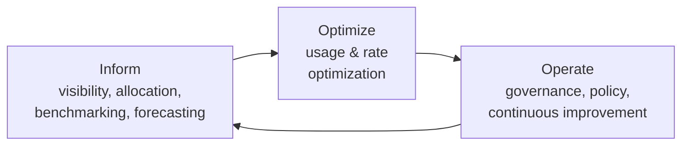

# FinOps & Cloud Cost Management

> **TL;DR** — FinOps is the operating model that makes engineering, finance and business **jointly accountable** for cloud value. Cycle through **Inform** (visibility, allocation via tags, showback) → **Optimize** (usage: right-size, schedule, autoscale, tier; rate: reservations, savings plans, Hybrid Benefit, spot, dev/test pricing) → **Operate** (budgets, policies, KPIs, unit economics, continuous improvement). Commit only to the stable baseline; make variable load elastic. Measure **cost per business unit**, not just total spend.

---

## 1. FinOps Foundation framework

### 1.1 Principles

1. **Teams need to collaborate** — finance, engineering, product, procurement work together in near real time.
2. **Business value drives technology decisions** — unit economics and value metrics over raw spend.
3. **Everyone takes ownership for their technology usage** — accountability pushed to the edge (engineers own cost as an efficiency metric).
4. **FinOps data should be accessible, timely, and accurate** — fast feedback loops.
5. **FinOps should be enabled centrally** — a central team drives best practices, rate optimization, tooling.
6. **Take advantage of the variable cost model of the cloud** — agile planning, right-sizing, just-in-time.

(Wording paraphrased; principles revised in 2024/2025 framework updates — *verify current wording*.)

### 1.2 Phases



| Phase | Questions | Activities |
|---|---|---|
| **Inform** | Who spends what, on what, and why? | Tagging/allocation, cost exports, dashboards, showback, forecasts, anomaly detection |
| **Optimize** | Where can we use less or pay less? | Right-sizing, idle cleanup, scheduling, storage tiering, commitments, licensing |
| **Operate** | How do we keep it that way? | Budgets, policies, KPIs, automation, FinOps reviews, culture |

### 1.3 Domains & capabilities (framework structure)

| Domain | Example capabilities |
|---|---|
| Understand usage & cost | Data ingestion (FOCUS), allocation, reporting & analytics, anomaly management |
| Quantify business value | Planning & estimating, forecasting, budgeting, KPIs & benchmarking, unit economics |
| Optimize usage & cost | Architecting for cloud, workload optimization, rate optimization, licensing & SaaS, cloud sustainability |
| Manage the FinOps practice | FinOps practice operations, policy & governance, education & enablement, invoicing & chargeback, tools & services, onboarding workloads, intersecting frameworks |

**Maturity model**: Crawl → Walk → Run per capability (don't aim for "Run" everywhere).

**FOCUS** (FinOps Open Cost & Usage Specification): common billing data schema across providers — Azure Cost Management exports support FOCUS format.

**Personas**: FinOps practitioner, engineering, finance, product/business owners, procurement, leadership.

---

## 2. Inform: visibility & allocation

### 2.1 Tagging for cost

See tag set in [azure-identity-governance.md](azure-identity-governance.md#4-tagging-strategy). Cost-specific notes:
- Allocation hierarchy: **subscription/project** (strongest, always present) > **resource group** > **tags**.
- Enable **tag inheritance** in Cost Management (applies subscription/RG tags to usage records).
- Measure **tag coverage** (% of spend tagged) — target > 95%.
- **Cost allocation rules** to split shared costs (hub network, Log Analytics, AKS cluster) by percentage or proportional to spend.
- Untaggable/shared costs: support plans, marketplace, reservations purchase — allocate by rule.

### 2.2 Showback vs chargeback

| | Showback | Chargeback |
|---|---|---|
| Mechanism | Report costs to teams | Actually bill internal cost centers |
| Effort | Low | High (accounting integration, disputes) |
| Behavior change | Awareness | Strong accountability |
| Prerequisite | Tagging, reports | Accurate allocation, shared-cost model, finance process |
| Recommendation | Start here | Move here once allocation accuracy is trusted |

### 2.3 Azure Cost Management tooling

| Tool | Use |
|---|---|
| Cost analysis | Views by service, RG, tag, meter; amortized vs actual cost |
| **Budgets** | Per scope (MG, subscription, RG) with alert thresholds (actual & forecast) → action groups (email, automation) |
| **Cost anomaly alerts** | ML-based daily anomaly detection per subscription |
| **Exports** | Daily/monthly to Storage (CSV/Parquet, **FOCUS**), feed Power BI / Fabric |
| **FinOps toolkit** (Microsoft, open source) | FinOps hubs (data pipeline + Power BI/ADX), workbooks (optimization, governance), Bicep modules — *verify current components* |
| Azure Advisor (cost) | Right-size/shutdown VMs, reservation recommendations, idle resources |
| Pricing calculator, TCO calculator | Estimates |
| Retail Prices API | Programmatic price lookup |

```bicep
// Monthly subscription budget: 80% actual + 100% forecast alerts
targetScope = 'subscription'
param actionGroupId string
resource budget 'Microsoft.Consumption/budgets@2023-11-01' = {
  name: 'bud-sub-invoice-prod'
  properties: {
    category: 'Cost'
    amount: 2000
    timeGrain: 'Monthly'
    timePeriod: { startDate: '2026-10-01' }
    notifications: {
      actual80: { enabled: true, operator: 'GreaterThan', threshold: 80, thresholdType: 'Actual', contactEmails: ['finops@contoso.com'] }
      forecast100: { enabled: true, operator: 'GreaterThan', threshold: 100, thresholdType: 'Forecasted', contactGroups: [actionGroupId] }
    }
  }
}
```

Note: budgets **alert**, they don't stop spending (except spending limits on some credit-based subscriptions). Use automation (action group → Function/Logic App) to scale down or stop non-prod.

### 2.4 Cost anomaly detection

- Native: Cost Management anomaly alerts (subscription scope), GCP Billing anomaly detection, AWS Cost Anomaly Detection.
- Custom: daily exported cost → KQL `series_decompose_anomalies()` per service/tag.

```kusto
// Exported cost data in ADX / Fabric Eventhouse (FOCUS columns)
Costs
| where ChargePeriodStart > ago(60d)
| summarize Daily = sum(BilledCost) by bin(ChargePeriodStart, 1d), ServiceName
| make-series Spend = sum(Daily) on ChargePeriodStart step 1d by ServiceName
| extend (anomalies, score, baseline) = series_decompose_anomalies(Spend, 2.5)
| mv-expand ChargePeriodStart to typeof(datetime), Spend to typeof(double), anomalies to typeof(int)
| where anomalies == 1
```

Typical anomaly causes: logging verbosity change, runaway autoscale, forgotten load test, data egress, new SKU in wrong region, crypto-mining after credential leak.

---

## 3. Optimize: usage

| Lever | Action | Typical saving |
|---|---|---|
| **Eliminate waste** | Delete unattached disks, orphaned public IPs, old snapshots, idle App Service plans, empty AKS node pools, stopped-but-not-deallocated VMs | 5–15% of spend in unmanaged estates |
| **Right-size** | Downsize VMs/DBs based on P95 utilization (Advisor, Azure Monitor); move to newer generations (v5/v6, AMD, Arm) | 20–40% per resource |
| **Schedule** | Auto-shutdown dev/test VMs nights/weekends (≈ 65% fewer hours), scale non-prod to zero, pause Fabric/Synapse/Databricks | Up to 70% on non-prod |
| **Autoscale** | Scale out/in with demand; scale to zero (Functions, Container Apps, serverless SQL) | Varies |
| **Storage tiering** | Lifecycle to cool/cold/archive; delete old backups; right redundancy (LRS for re-creatable data) | 30–80% on storage |
| **Log hygiene** | Basic/Auxiliary log tables, DCR filtering, sampling in App Insights, retention tuning, daily cap (careful) | Often large — logging is a top-3 cost in many estates |
| **Architecture** | PaaS over IaaS, consolidate App Service plans, serverless for spiky, caching to reduce DB tier, CDN to cut egress | Structural |
| **Data transfer** | Keep chatty components in same region/zone, private endpoints vs NAT costs, CDN, compress | Varies |

Right-sizing heuristic: if P95 CPU < 40% and memory < 50% over 30 days → one size down; validate with load test for critical workloads.

---

## 4. Optimize: rate

### 4.1 Commitment and discount options (Azure)

| Option | Commitment | Flexibility | Discount (indicative) | Best for |
|---|---|---|---|---|
| **Pay-as-you-go** | None | Full | 0% | Variable, short-lived |
| **Azure Reservations** | 1 or 3 years, specific SKU family/region (instance size flexibility within series) | Exchange/refund within limits (policy changing — *verify*) | Up to ~72% (VMs), also SQL, Cosmos, Storage, App Service, Redis, Databricks, etc. | Stable, predictable resources |
| **Azure savings plan for compute** | 1 or 3 years, **$/hour** spend commitment | Any region/SKU across VMs, App Service Premium v3, Functions Premium, Container Apps, AKS nodes, Dedicated Hosts… | Up to ~65% | Stable spend but changing SKUs/regions |
| **Spot VMs** | None; can be evicted (30 s notice) | — | Up to ~90% | Batch, CI agents, stateless fault-tolerant, AKS spot pools |
| **Azure Hybrid Benefit** | Existing Windows Server / SQL Server licenses with Software Assurance (or subscriptions); RHEL/SLES | — | Windows VMs ~40%; SQL vCore significant (license component removed) | Microsoft-licensed estates |
| **Dev/Test pricing** | Visual Studio subscribers; Enterprise Dev/Test or Pay-As-You-Go Dev/Test subscription offers | Non-production only | No Windows/SQL license charges, discounted rates on some services | Non-prod subscriptions |
| **Free tiers / grants** | — | — | — | Functions, Cosmos free tier, App Service F1 |
| **MACC / enterprise discounts** | Contractual spend commitment | — | Negotiated | Larger orgs |

**Reservations vs savings plans**

| | Reservation | Savings plan |
|---|---|---|
| Discount depth | Higher | Slightly lower |
| Scope | Specific service + SKU family + region | Compute services, any region |
| Coverage beyond compute | Yes (SQL, Cosmos, storage, etc.) | Compute only |
| Ideal | Static long-lived workloads | Modernizing / shifting workloads |
| Ordering when both apply | Reservation applied first | Then savings plan |

**Commitment strategy**

1. Optimize usage **first** (don't reserve waste).
2. Commit to the **baseline** (e.g. the minimum steady usage over last 30–60 days), not the peak.
3. Start with ~60–80% coverage of baseline; ladder purchases monthly/quarterly instead of one big buy.
4. Track **utilization** (target > 95%) and **coverage**; centralize purchasing (shared scope) to maximize utilization.
5. Use Advisor reservation/savings plan recommendations as input, not gospel.

### 4.2 Cross-cloud equivalents

| Azure | GCP | AWS |
|---|---|---|
| Reservations | Resource-based committed use discounts | Reserved Instances |
| Savings plan for compute | Spend-based (flexible) CUDs | Compute Savings Plans |
| — | **Sustained use discounts** (automatic on some VM families) | — |
| Spot VMs | Spot VMs | Spot Instances |
| Azure Hybrid Benefit | BYOL on sole-tenant nodes | BYOL / License Manager |

---

## 5. Operate: governance & KPIs

### 5.1 Guardrails

- [ ] Budgets on every subscription (forecast + actual alerts) and on key RGs
- [ ] Policy: allowed VM SKUs (esp. sandbox), allowed regions, deny expensive SKUs (GPU, M-series) without exemption
- [ ] Mandatory cost tags (deny on RG)
- [ ] Sandbox subscriptions with expiry and auto-cleanup
- [ ] Auto-shutdown policy (DINE) for dev VMs
- [ ] Monthly FinOps review per product team (15–30 min): top movers, anomalies, recommendations
- [ ] Commitment management cadence (monthly)
- [ ] Cost estimate in architecture reviews and PRs (Infracost / pricing calculator)

### 5.2 KPIs

| KPI | Formula / meaning | Target (indicative) |
|---|---|---|
| Tag/allocation coverage | Allocated spend / total spend | > 95% |
| Commitment coverage | Committed-eligible usage covered / eligible usage | 70–90% of baseline |
| Commitment utilization | Used commitment / purchased | > 95% |
| Effective savings rate (ESR) | Savings from rate optimization / on-demand equivalent cost | Track trend |
| Waste % | Idle/unused spend / total | < 5% |
| Forecast accuracy | abs(Actual − Forecast) / Actual | < 10–15% variance |
| Unit cost | Cost / business unit | Trending down as volume grows |
| Non-prod share | Non-prod spend / total | Context-dependent; often 20–35% |

### 5.3 Unit economics

`Unit cost = Total cost attributable to product / Business driver volume`

| Product | Driver | Unit metric |
|---|---|---|
| B2B portal | Active customers | € per active customer per month |
| Integration platform | Messages processed | € per 1,000 messages |
| Data platform | Data processed / reports | € per TB processed, € per dashboard user |
| AI assistant | Conversations / tokens | € per conversation, € per 1M tokens |
| Internal LOB app | Employees using | € per user per month |

Unit economics separates **growth** (good spend) from **inefficiency** (bad spend): total cost up 30% with unit cost down 10% is healthy.

---

## 6. Architecture cost patterns

| Pattern | Cost effect |
|---|---|
| Serverless/scale-to-zero for spiky or low traffic | Pay per use; watch high-volume steady loads (can be pricier than reserved) |
| Queue-based load leveling | Size backend for average, not peak |
| Cache-aside / CDN | Reduce DB tier and egress |
| Static content hosting | Cheapest web hosting |
| Compute resource consolidation | Higher density (App Service plans, AKS bin-packing) |
| Data lifecycle & partition pruning | Lower storage and query cost (BigQuery bytes scanned, Fabric CU) |
| Multi-tenant shared infrastructure (with stamps) | Lower cost per tenant |
| Event-driven over polling | Fewer executions |

**Cost traps**: NAT/firewall data processing charges, cross-zone/region transfer, private endpoint per-GB, Log Analytics ingestion, App Insights without sampling, Premium SKUs left in dev, idle Fabric capacity, AKS system pool overprovisioned, public IPv4 charges, snapshot sprawl, Defender plans on non-prod, unused reservations.

---

## 7. AI/LLM cost notes

- Token-based billing (input/output/cached tokens) vs provisioned throughput units (PTU) — PTU reservations for steady high volume.
- Optimize prompts (shorter context), caching (prompt caching, semantic cache in APIM), smaller models for routing/classification, batch APIs for offline work.
- Track cost per conversation/feature via APIM token metrics. See [Data & AI architecture](../07-data-ai-architecture/README.md).

## 8. Common mistakes

1. Buying 3-year reservations before right-sizing → locking in waste.
2. Tagging policy without enforcement → 40% "unallocated".
3. Treating FinOps as finance-only reporting; engineers never see costs.
4. Budgets with emails to a shared mailbox nobody reads.
5. Ignoring log ingestion and egress until month-end.
6. Daily cap on Log Analytics silently dropping security logs.
7. Dev/test subscriptions on production pricing offers.
8. Hybrid Benefit eligible licenses not applied.
9. Chasing 5% savings with high engineering effort while a 30% architectural saving is ignored.

## References

- FinOps Foundation — https://www.finops.org/
- FinOps Framework — https://www.finops.org/framework/
- FOCUS specification — https://focus.finops.org/
- Azure Cost Management + Billing — https://learn.microsoft.com/azure/cost-management-billing/
- Azure Reservations — https://learn.microsoft.com/azure/cost-management-billing/reservations/
- Azure savings plan for compute — https://learn.microsoft.com/azure/cost-management-billing/savings-plan/
- Azure Hybrid Benefit — https://azure.microsoft.com/pricing/hybrid-benefit/
- Azure pricing calculator — https://azure.microsoft.com/pricing/calculator/
- Microsoft FinOps toolkit — https://github.com/microsoft/finops-toolkit
- WAF Cost Optimization pillar — https://learn.microsoft.com/azure/well-architected/cost-optimization/
- CAF: Govern / cost management — https://learn.microsoft.com/azure/cloud-adoption-framework/govern/
- Google Cloud cost management — https://cloud.google.com/cost-management
- AWS Cloud Financial Management — https://aws.amazon.com/aws-cost-management/
- J.R. Storment & Mike Fuller, *Cloud FinOps* (O'Reilly, 2nd ed. 2023)
- Related: [Enterprise architecture & business](../11-enterprise-architecture-business/README.md), [Product management — metrics](../02-product-management/README.md)
