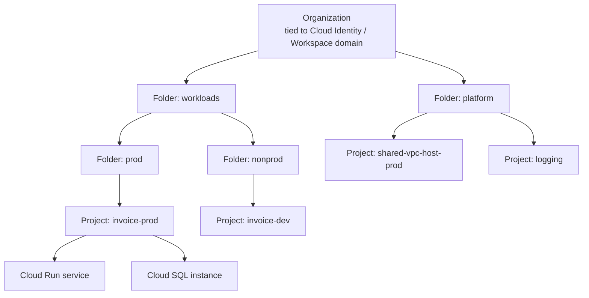

# Google Cloud & Azure ↔ GCP ↔ AWS Service Mapping

> **TL;DR** — GCP organizes resources as **Organization → Folders → Projects → resources**, with IAM policies inherited down the tree; the **project** is the unit of billing, quota and API enablement. Its standout differentiators: **global VPC** (one network spans all regions), **Shared VPC**, **BigQuery** (serverless warehouse), **Cloud Run** (serverless containers), **GKE** (Autopilot), **Spanner** (globally consistent SQL) and **Vertex AI**. The mapping table at the end translates services across Azure, GCP and AWS — names map approximately, never feature-for-feature.

---

## 1. GCP resource hierarchy



| Level | Purpose | Azure analogy |
|---|---|---|
| **Organization** | Root, linked to a Cloud Identity / Google Workspace domain | Tenant root management group |
| **Folder** | Group projects, inherit IAM & org policies, nestable (up to 10 levels) | Management group |
| **Project** | Billing, quotas, APIs, IAM boundary; has **project ID** (immutable, global unique), name, number | Subscription + resource group |
| **Resource** | Service instance | Resource |
| **Labels** | Key-value metadata for cost/filtering | Tags |
| **Tags** (resource manager tags) | Governance-oriented, used in IAM conditions and firewall policies | Tags + ABAC |
| **Billing account** | Pays for projects (linked many-to-one) | Billing profile |

**Organization policies** (constraints, e.g. `constraints/gcp.resourceLocations`, `iam.disableServiceAccountKeyCreation`, `compute.vmExternalIpAccess`) ≈ Azure Policy (deny-focused; **custom constraints** with CEL).

Landing zone: **Enterprise foundations blueprint** (Terraform) / Cloud Foundation Fabric (FAST) — folder structure, Shared VPC, central logging, org policies.

---

## 2. IAM

| Concept | Description |
|---|---|
| **Principal** | Google account, service account, Google group, Workspace/Cloud Identity domain, `allUsers`, workforce/workload identity pool principals |
| **Role** | Collection of permissions: **basic** (Owner/Editor/Viewer — avoid), **predefined** (`roles/storage.objectViewer`), **custom** |
| **Allow policy** | Bindings of principals to roles on a resource; inherited down the hierarchy (union) |
| **Deny policy** | Explicit deny overriding allows |
| **IAM Conditions** | CEL expressions (time, resource name, tags) |
| **Service account** | Identity for workloads; avoid **keys** — use attached SAs, **Workload Identity Federation** (external), **Workload Identity for GKE** |
| **Workforce Identity Federation** | Use external IdP (e.g. Entra ID) for console/gcloud access without Cloud Identity sync |
| **Privileged Access Manager** | JIT elevated access (≈ PIM) |
| **VPC Service Controls** | Perimeters around Google APIs to prevent data exfiltration (no Azure 1:1 — closest: private endpoints + network policies) |

```bash
gcloud projects add-iam-policy-binding invoice-prod \
  --member="group:invoice-devs@example.com" --role="roles/run.developer"

# Workload identity federation from GitHub Actions (no SA keys)
gcloud iam workload-identity-pools create github --location=global
gcloud iam workload-identity-pools providers create-oidc gh \
  --location=global --workload-identity-pool=github \
  --issuer-uri="https://token.actions.githubusercontent.com" \
  --attribute-mapping="google.subject=assertion.sub,attribute.repository=assertion.repository" \
  --attribute-condition="assertion.repository_owner=='example-org'"
```

Entra ID as IdP for Google Cloud: SAML SSO + provisioning to Cloud Identity, or Workforce Identity Federation.

---

## 3. Compute & containers

| Service | Model | Notes |
|---|---|---|
| **Compute Engine** | VMs | Machine families E2/N2/N4/C3/C4/M3/A3 (GPU), custom machine types, **sustained use discounts** (automatic), committed use discounts, Spot VMs, live migration during maintenance |
| **Managed instance groups (MIG)** | VM autoscaling groups | Regional MIGs across zones, autohealing |
| **GKE Standard** | Managed K8s, you manage nodes | Node pools, regional clusters |
| **GKE Autopilot** | Managed K8s, Google manages nodes, pay per pod resources | Recommended default; hardened; less node-level control |
| **Cloud Run (services)** | Serverless containers (Knative-based), scale to zero, request- or instance-based billing | HTTP/gRPC/WebSockets; concurrency per instance (default 80); min instances to avoid cold starts; direct VPC egress |
| **Cloud Run jobs** | Run-to-completion containers | Batch, parallel tasks |
| **Cloud Run functions** (formerly Cloud Functions 2nd gen) | FaaS on Cloud Run infra | Triggers via HTTP + **Eventarc** |
| **App Engine** | Original PaaS: Standard (sandboxed runtimes, scale to zero) / Flexible (containers on VMs) | Legacy-ish; prefer Cloud Run for new work |
| **Batch** | Managed batch jobs | |
| **Google Cloud VMware Engine** | VMware SDDC | ≈ Azure VMware Solution |

Cloud Run ≈ Azure Container Apps (closest), App Engine ≈ App Service, GKE ≈ AKS, Cloud Run functions ≈ Azure Functions.

```bash
gcloud run deploy invoice-api --image europe-west4-docker.pkg.dev/invoice-prod/apps/api:1.4.2 \
  --region europe-west4 --service-account invoice-api@invoice-prod.iam.gserviceaccount.com \
  --no-allow-unauthenticated --min-instances 1 --max-instances 20 --concurrency 80 \
  --set-secrets DB_PASSWORD=db-password:latest
```

---

## 4. Networking

| Concept | GCP | Azure difference |
|---|---|---|
| VPC | **Global** resource; subnets are **regional** | Azure VNet is regional — need peering/vWAN for multi-region |
| Firewall | VPC firewall rules / **network firewall policies** (hierarchical at org/folder) with network tags or service accounts as targets | NSGs + Azure Firewall |
| **Shared VPC** | Host project owns VPC; service projects attach and deploy into its subnets | ≈ hub VNet shared by spokes, but spokes don't own networks |
| VPC peering | Non-transitive | Same |
| **Network Connectivity Center** | Hub-and-spoke for VPCs and hybrid | ≈ Virtual WAN |
| **Private Service Connect** | Private endpoints to Google APIs/services and producer services | ≈ Private Link / private endpoints |
| **Private Google Access** | VMs without external IP reach Google APIs | ≈ service endpoints |
| Cloud Load Balancing | **Global external Application LB** (anycast), regional LBs, proxy/passthrough Network LBs | Front Door / App Gateway / Load Balancer |
| Cloud Armor | WAF + DDoS at LB | Front Door/App Gateway WAF + DDoS Protection |
| Cloud CDN / Media CDN | CDN | Front Door |
| Cloud NAT | Managed outbound NAT | NAT Gateway |
| Cloud DNS | Public/private zones, DNS peering, forwarding | Azure DNS / Private DNS / Private Resolver |
| Hybrid | Cloud VPN (HA VPN 99.99%), Cloud Interconnect (Dedicated/Partner), Cross-Cloud Interconnect | VPN Gateway / ExpressRoute |
| IAP | **Identity-Aware Proxy**: zero-trust access to apps and TCP (SSH/RDP) | ≈ Entra app proxy / Private Access + Bastion |

---

## 5. Storage & databases

| Service | Type | Notes |
|---|---|---|
| **Cloud Storage** | Object | Buckets; location types **region / dual-region / multi-region**; classes below; **Autoclass**; uniform bucket-level access; object versioning, retention locks |
| **Persistent Disk / Hyperdisk** | Block | Zonal or regional (synchronous replication across 2 zones) |
| **Filestore** | NFS | |
| **Cloud SQL** | Managed MySQL/PostgreSQL/SQL Server | Enterprise / Enterprise Plus editions; HA (regional), read replicas, cross-region replicas |
| **AlloyDB** | PostgreSQL-compatible, high-performance (columnar engine) | Analytics + OLTP, AI integration |
| **Spanner** | Globally distributed, strongly consistent relational (TrueTime) | 99.999% multi-region SLA; GoogleSQL & PostgreSQL dialects; scales horizontally |
| **Firestore** | Serverless document DB (Native mode / Datastore mode) | Real-time listeners, mobile/web SDKs; ≈ Cosmos DB NoSQL (simpler) |
| **Bigtable** | Wide-column, HBase API | Time-series, IoT, huge throughput; ≈ Cosmos DB Cassandra / Table at scale |
| **Memorystore** | Redis / Valkey / Memcached | ≈ Azure Managed Redis |

### 5.1 Cloud Storage classes

| Class | Minimum storage duration | Typical access | Azure analogue |
|---|---|---|---|
| **Standard** | None | Hot / frequently accessed | Hot |
| **Nearline** | 30 days | ~once per month | Cool |
| **Coldline** | 90 days | ~once per quarter | Cold |
| **Archive** | 365 days | < once per year; **online (ms latency)** unlike Azure Archive | Archive (but Azure Archive is offline) |

All classes share the same API and millisecond latency — differences are price and retrieval fees. *Verify current pricing.*

---

## 6. Data, analytics & AI

| Service | What | Azure analogue |
|---|---|---|
| **BigQuery** | Serverless data warehouse; separates storage & compute; on-demand (per TB scanned) or **editions** (slot-based capacity); BigQuery ML, BI Engine, Omni, BigLake (open table formats incl. Iceberg) | Fabric Warehouse / Synapse; Databricks SQL |
| **Pub/Sub** | Global messaging: topics + subscriptions (pull/push/export to BigQuery/GCS), at-least-once, ordering keys, exactly-once delivery option, dead-letter topics, retention up to 31 days | Service Bus topics + Event Hubs (blend) |
| **Pub/Sub Lite** | Zonal, cheaper partitioned | Deprecated — *verify* |
| **Managed Service for Apache Kafka** | Managed Kafka | Event Hubs Kafka endpoint / HDInsight Kafka |
| **Dataflow** | Managed **Apache Beam** (unified batch & streaming), autoscaling, templates | Stream Analytics + Data Factory data flows / Databricks / Fabric |
| **Dataproc** | Managed Spark/Hadoop (also serverless Spark) | HDInsight / Databricks / Fabric Spark |
| **Cloud Composer** | Managed **Apache Airflow** (orchestration) | Data Factory / Fabric Data pipelines; Managed Airflow in ADF |
| **Dataform** | SQL transformations (dbt-like) in BigQuery | dbt on Fabric/Synapse |
| **Datastream** | Serverless CDC to BigQuery/GCS | Fabric mirroring / ADF CDC |
| **Dataplex** / **Data Catalog** | Data governance, lakes, catalog, lineage | Microsoft Purview |
| **Looker / Looker Studio** | BI semantic layer / free dashboards | Power BI |
| **Vertex AI** | Unified ML platform: training, pipelines (Kubeflow), feature store, model registry, endpoints; **Model Garden**, Gemini models, Agent Builder/Agent Engine, Vector Search | Azure Machine Learning + Azure AI Foundry (Azure OpenAI) |
| **Gemini / Generative AI on Vertex** | Foundation model APIs | Azure OpenAI / Foundry Models |
| **Document AI, Vision, Speech, Translation** | Pre-built AI | Azure AI services (Document Intelligence, Vision, Speech, Translator) |

```sql
-- BigQuery: partitioned + clustered table to minimize bytes scanned
CREATE TABLE sales.orders
PARTITION BY DATE(order_ts)
CLUSTER BY customer_id AS
SELECT * FROM staging.orders_raw;

-- Always filter on partition column
SELECT customer_id, SUM(amount) FROM sales.orders
WHERE DATE(order_ts) BETWEEN '2026-09-01' AND '2026-09-30'
GROUP BY customer_id;
```

See [Data & AI architecture](../07-data-ai-architecture/README.md) for platform design.

---

## 7. DevOps & operations on GCP

| Service | What | Azure analogue |
|---|---|---|
| **Cloud Build** | Serverless CI/CD builds (`cloudbuild.yaml`), private pools | Azure Pipelines / GitHub Actions |
| **Artifact Registry** | Container images + language packages (npm, Maven, Python, apt) with vulnerability scanning | ACR + Azure Artifacts |
| **Cloud Deploy** | Managed continuous delivery to GKE/Cloud Run (promotion, canary) | Azure Pipelines environments / GitHub environments |
| **Binary Authorization** | Deploy-time attestation policy for images | Azure Policy + image signing (Notation/Ratify) |
| **Cloud Logging / Monitoring / Trace / Profiler** (Google Cloud Observability) | Logs, metrics, traces, continuous profiling; Managed Service for Prometheus | Azure Monitor (Log Analytics, Metrics, App Insights), Managed Prometheus |
| **Infrastructure Manager** | Managed Terraform | Deployment stacks / Terraform Cloud |
| **Config Connector / Config Sync** | K8s-native resource management / GitOps | ASO (Azure Service Operator), Flux on AKS |
| **Security Command Center** | CSPM, threat detection | Defender for Cloud |
| **Secret Manager / Cloud KMS / Cloud HSM** | Secrets, keys | Key Vault / Managed HSM |
| **Assured Workloads / Sovereign controls** | Compliance & data residency controls | EU Data Boundary, Azure sovereign offerings |
| **Active Assist / Recommender** | Cost/security/perf recommendations | Azure Advisor |

```yaml
# cloudbuild.yaml — build, push, deploy to Cloud Run
steps:
  - name: gcr.io/cloud-builders/docker
    args: ["build", "-t", "europe-west4-docker.pkg.dev/$PROJECT_ID/apps/api:$SHORT_SHA", "."]
  - name: gcr.io/cloud-builders/docker
    args: ["push", "europe-west4-docker.pkg.dev/$PROJECT_ID/apps/api:$SHORT_SHA"]
  - name: gcr.io/google.com/cloudsdktool/cloud-sdk
    entrypoint: gcloud
    args: ["run", "deploy", "api", "--image", "europe-west4-docker.pkg.dev/$PROJECT_ID/apps/api:$SHORT_SHA", "--region", "europe-west4"]
images: ["europe-west4-docker.pkg.dev/$PROJECT_ID/apps/api:$SHORT_SHA"]
```

---

## 8. Azure ↔ GCP ↔ AWS service mapping

> Approximate equivalents. Feature sets, SLAs and pricing models differ — validate per use case. Names change frequently (*verify current names*).

### 8.1 Organization, identity & governance

| Capability | Azure | GCP | AWS |
|---|---|---|---|
| Top-level container | Entra tenant + management groups | Organization + folders | AWS Organizations + OUs |
| Billing/isolation unit | Subscription | Project | Account |
| Logical grouping | Resource group | (Project / labels) | (Tags / resource groups) |
| Workforce identity | Microsoft Entra ID | Cloud Identity / Workforce Identity Federation | IAM Identity Center |
| Customer identity (CIAM) | Entra External ID | Identity Platform | Cognito |
| Workload identity | Managed identities, workload identity federation | Service accounts, Workload Identity Federation | IAM roles, IRSA / EKS Pod Identity |
| Access control | Azure RBAC | IAM allow/deny policies | IAM policies |
| JIT privileged access | Entra PIM | Privileged Access Manager | IAM Identity Center + temporary elevated access |
| Policy guardrails | Azure Policy | Organization Policy | SCPs, AWS Config rules |
| Landing zone | Azure landing zones (ALZ) | Enterprise foundations blueprint | Control Tower / Landing Zone Accelerator |
| Resource inventory/query | Azure Resource Graph | Cloud Asset Inventory | AWS Config / Resource Explorer |
| Hybrid control plane | Azure Arc | GKE Enterprise (Anthos) | Systems Manager / EKS Anywhere / Outposts |

### 8.2 Compute & containers

| Capability | Azure | GCP | AWS |
|---|---|---|---|
| VMs | Virtual Machines | Compute Engine | EC2 |
| VM autoscaling group | VM Scale Sets | Managed instance groups | Auto Scaling groups |
| PaaS web hosting | App Service | App Engine | Elastic Beanstalk |
| Serverless containers | Container Apps | Cloud Run | App Runner, ECS on Fargate |
| Managed Kubernetes | AKS (incl. Automatic) | GKE (Standard/Autopilot) | EKS (incl. Auto Mode) |
| Single container run | Container Instances | Cloud Run jobs | Fargate task |
| FaaS | Azure Functions | Cloud Run functions | Lambda |
| Batch / HPC | Azure Batch, CycleCloud | Batch | AWS Batch, ParallelCluster |
| Static site hosting | Static Web Apps | Firebase Hosting / GCS + CDN | Amplify Hosting / S3 + CloudFront |
| VMware | Azure VMware Solution | Google Cloud VMware Engine | VMware Cloud on AWS (Broadcom-managed — *verify*) |
| Container registry | Azure Container Registry | Artifact Registry | ECR |

### 8.3 Storage

| Capability | Azure | GCP | AWS |
|---|---|---|---|
| Object storage | Blob Storage | Cloud Storage | S3 |
| Archive object | Blob Archive tier | Archive class | S3 Glacier Deep Archive |
| Data lake | ADLS Gen2 / OneLake | Cloud Storage + BigLake | S3 + Lake Formation |
| Block storage | Managed Disks | Persistent Disk / Hyperdisk | EBS |
| File shares (SMB/NFS) | Azure Files, NetApp Files | Filestore, NetApp Volumes | EFS, FSx |
| Hybrid storage | Azure File Sync, Data Box | Transfer Appliance | Storage Gateway, Snowball |
| Backup | Azure Backup | Backup and DR Service | AWS Backup |

### 8.4 Databases

| Capability | Azure | GCP | AWS |
|---|---|---|---|
| Managed SQL Server | Azure SQL DB / Managed Instance | Cloud SQL for SQL Server | RDS for SQL Server |
| Managed PostgreSQL | Database for PostgreSQL Flexible | Cloud SQL / AlloyDB | RDS / Aurora PostgreSQL |
| Managed MySQL | Database for MySQL Flexible | Cloud SQL | RDS / Aurora MySQL |
| Global relational | (SQL Hyperscale geo-replicas, Cosmos DB) | Spanner | Aurora Global / Aurora DSQL |
| Document NoSQL | Cosmos DB (NoSQL/Mongo) | Firestore | DynamoDB, DocumentDB |
| Wide column | Cosmos DB for Cassandra, Managed Instance for Apache Cassandra | Bigtable | Keyspaces |
| In-memory | Azure Managed Redis | Memorystore | ElastiCache, MemoryDB |
| Graph | Cosmos DB Gremlin | (Spanner Graph) | Neptune |
| Time series | Data Explorer | Bigtable / BigQuery | Timestream |
| DB migration | Azure Database Migration Service | Database Migration Service | DMS |

### 8.5 Messaging & integration

| Capability | Azure | GCP | AWS |
|---|---|---|---|
| Enterprise queue/broker | Service Bus | Pub/Sub (+ Cloud Tasks) | SQS / Amazon MQ |
| Pub/sub topics | Service Bus topics, Event Grid | Pub/Sub | SNS |
| Event routing | Event Grid | Eventarc | EventBridge |
| Streaming ingestion | Event Hubs | Pub/Sub, Managed Kafka | Kinesis Data Streams, MSK |
| Simple queue | Storage Queues | Cloud Tasks | SQS |
| Workflow / orchestration | Logic Apps, Durable Functions | Workflows, Application Integration | Step Functions |
| API gateway / management | API Management | Apigee, API Gateway | API Gateway |
| B2B / EDI | Logic Apps Integration Account | Apigee / Application Integration | B2B Data Interchange |

### 8.6 Analytics & AI

| Capability | Azure | GCP | AWS |
|---|---|---|---|
| Data warehouse | Fabric Warehouse, Synapse dedicated SQL | BigQuery | Redshift |
| Unified analytics SaaS | Microsoft Fabric | BigQuery + Dataplex (no 1:1) | (SageMaker Unified Studio) |
| Spark | Databricks, Fabric/Synapse Spark, HDInsight | Dataproc, Databricks | EMR, Glue, Databricks |
| ETL / orchestration | Data Factory / Fabric pipelines | Dataflow, Cloud Composer, Data Fusion | Glue, MWAA, Step Functions |
| Stream processing | Stream Analytics, Fabric Real-Time Intelligence | Dataflow | Managed Service for Apache Flink |
| BI | Power BI | Looker | QuickSight |
| Data governance | Microsoft Purview | Dataplex | DataZone, Lake Formation |
| ML platform | Azure Machine Learning, AI Foundry | Vertex AI | SageMaker AI |
| Foundation models | Azure OpenAI / Foundry Models | Vertex AI (Gemini, Model Garden) | Bedrock |
| Search / RAG retrieval | Azure AI Search | Vertex AI Search, Vector Search | Kendra, OpenSearch, Bedrock Knowledge Bases |
| Document extraction | Document Intelligence | Document AI | Textract |
| Speech / vision / translation | Azure AI Speech/Vision/Translator | Speech-to-Text, Vision AI, Translation | Transcribe, Rekognition, Translate |

### 8.7 Networking

| Capability | Azure | GCP | AWS |
|---|---|---|---|
| Virtual network | VNet (regional) | VPC (global) | VPC (regional) |
| Hub-and-spoke service | Virtual WAN | Network Connectivity Center | Transit Gateway / Cloud WAN |
| Shared network across units | Hub-spoke peering | Shared VPC | RAM-shared subnets |
| Private service access | Private Link / private endpoints | Private Service Connect | PrivateLink / VPC endpoints |
| Global L7 LB + CDN | Front Door | Global external Application LB + Cloud CDN | CloudFront + Global Accelerator |
| Regional L7 LB | Application Gateway | Regional Application LB | ALB |
| L4 LB | Load Balancer | Network LB | NLB |
| DNS LB | Traffic Manager | Cloud DNS routing policies | Route 53 |
| WAF | Azure WAF (Front Door/App Gateway) | Cloud Armor | AWS WAF |
| DDoS | DDoS Protection | Cloud Armor | Shield |
| Managed firewall | Azure Firewall | Cloud NGFW | Network Firewall |
| NAT | NAT Gateway | Cloud NAT | NAT Gateway |
| Site-to-site VPN | VPN Gateway | Cloud VPN | Site-to-Site VPN |
| Dedicated link | ExpressRoute | Cloud Interconnect | Direct Connect |
| Bastion / ZT access | Bastion, Entra Private Access | IAP | Systems Manager Session Manager, Verified Access |

### 8.8 Security

| Capability | Azure | GCP | AWS |
|---|---|---|---|
| Secrets / keys | Key Vault, Managed HSM | Secret Manager, Cloud KMS, Cloud HSM | Secrets Manager, KMS, CloudHSM |
| CSPM / CWPP | Defender for Cloud | Security Command Center | Security Hub, GuardDuty, Inspector |
| SIEM / SOAR | Microsoft Sentinel | Google Security Operations (Chronicle) | Security Lake + partners (OpenSearch) |
| Data exfiltration perimeter | Private endpoints, network policies | VPC Service Controls | VPC endpoint policies, SCPs |
| Certificate mgmt | Key Vault certificates | Certificate Manager | ACM |
| DLP / data classification | Purview | Sensitive Data Protection | Macie |

### 8.9 Monitoring, IaC & DevOps

| Capability | Azure | GCP | AWS |
|---|---|---|---|
| Metrics & logs | Azure Monitor, Log Analytics | Cloud Monitoring, Cloud Logging | CloudWatch |
| APM / tracing | Application Insights | Cloud Trace, Profiler | X-Ray, CloudWatch Application Signals |
| Managed Prometheus/Grafana | Azure Monitor managed Prometheus, Azure Managed Grafana | Managed Service for Prometheus | Amazon Managed Prometheus, Managed Grafana |
| Audit log | Activity log | Cloud Audit Logs | CloudTrail |
| Native IaC | ARM / Bicep | Infrastructure Manager (Terraform), Deployment Manager (legacy) | CloudFormation, CDK |
| CI/CD | Azure DevOps, GitHub Actions | Cloud Build, Cloud Deploy | CodePipeline, CodeBuild |
| Recommendations | Azure Advisor | Active Assist | Trusted Advisor, Compute Optimizer |
| Cost management | Cost Management + Billing | Cloud Billing reports, FinOps hub | Cost Explorer, Budgets, CUR |
| Commitments | Reservations, savings plan | Committed use discounts (resource/spend-based), sustained use discounts | Reserved Instances, Savings Plans |
| Spot compute | Spot VMs | Spot VMs | EC2 Spot |

---

## 9. Concept differences that bite during translation

| Topic | Azure | GCP | AWS |
|---|---|---|---|
| VNet scope | Regional | Global | Regional |
| Sustained-use discount | No (reservations/savings plan) | Automatic on Compute Engine | No |
| Archive retrieval | Offline (hours) | Online (ms) | Glacier tiers: minutes–hours |
| Resource grouping | Resource groups are mandatory | Projects | Optional resource groups/tags |
| Identity origin | Entra (same as M365) | Cloud Identity / Workspace | IAM (+ Identity Center) |
| Region pairs | Yes (legacy concept) | No | No |
| Default SLA thinking | Per resource, zones/regions | Per service, regional/multi-regional | Per service |

## 10. Common mistakes

1. Using basic roles (Owner/Editor) in GCP projects.
2. Downloading service account keys instead of workload identity federation.
3. Expecting Azure-like per-region VNets in GCP — designing many VPCs unnecessarily.
4. BigQuery `SELECT *` on unpartitioned tables with on-demand pricing → big bills.
5. Cloud Run with min instances 0 for latency-sensitive APIs (cold starts).
6. Treating the mapping table as feature-equivalence during migrations.

## References

- Google Cloud documentation — https://cloud.google.com/docs
- Resource hierarchy — https://cloud.google.com/resource-manager/docs/cloud-platform-resource-hierarchy
- IAM overview — https://cloud.google.com/iam/docs/overview
- Cloud Run — https://cloud.google.com/run/docs
- GKE — https://cloud.google.com/kubernetes-engine/docs
- Cloud Storage classes — https://cloud.google.com/storage/docs/storage-classes
- BigQuery — https://cloud.google.com/bigquery/docs
- Pub/Sub — https://cloud.google.com/pubsub/docs
- Spanner — https://cloud.google.com/spanner/docs
- Vertex AI — https://cloud.google.com/vertex-ai/docs
- Shared VPC — https://cloud.google.com/vpc/docs/shared-vpc
- Google Cloud Architecture Framework — https://cloud.google.com/architecture/framework
- Azure for AWS professionals — https://learn.microsoft.com/azure/architecture/aws-professional/
- Azure for Google Cloud professionals — https://learn.microsoft.com/azure/architecture/gcp-professional/
- Related: [Data & AI architecture](../07-data-ai-architecture/README.md)
