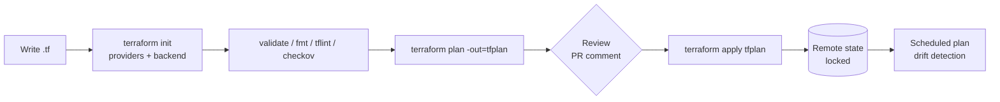
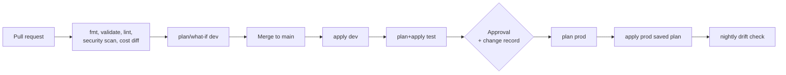

# Infrastructure as Code (IaC)

> **TL;DR** — Define every environment declaratively, store it in Git, deploy it only via pipelines with workload identity federation, preview every change (**`terraform plan`** / **`az deployment what-if`**), and detect drift. On Azure, choose **Bicep** (Azure-only, no state file, day-0 support for new APIs) or **Terraform/OpenTofu** (multi-cloud, state, huge ecosystem); both have **Azure Verified Modules (AVM)**. **Pulumi** suits teams wanting general-purpose languages. Enforce guardrails with **policy as code** (Azure Policy, OPA/Conftest, Checkov). Keep environments structurally identical and differ only in parameters.

---

## 1. Tool comparison

| | **Bicep** | **ARM JSON** | **Terraform** | **OpenTofu** | **Pulumi** |
|---|---|---|---|---|---|
| Language | DSL (transpiles to ARM) | JSON | HCL | HCL (Terraform fork, MPL) | TypeScript, Python, Go, C#, Java, YAML |
| Clouds | Azure (+ Microsoft Graph extension, K8s extension) | Azure | Any (providers) | Any (Terraform-compatible providers) | Any |
| State | None (ARM is the state) | None | **State file** (remote backend) | State file (supports client-side **state encryption**) | State (Pulumi Cloud or self-managed backend) |
| Preview | `what-if` | `what-if` | `plan` | `plan` | `preview` |
| New Azure features | Day 0 (any API version) | Day 0 | Via `azurerm` release (or `azapi` provider day 0) | Same | Azure Native provider (generated, near day 0) |
| Drift detection | what-if / deployment stacks | — | `plan` / `-refresh-only` | Same | `refresh` |
| Delete removed resources | Deployment stacks (`actionOnUnmanage`) or complete mode (RG) | Complete mode | Yes (state-based) | Yes | Yes |
| Licensing | MIT | — | **BSL 1.1** since v1.6 (2023) | MPL 2.0 (Linux Foundation) | Apache 2.0 (engine) |
| Module registry | Bicep public registry (AVM), private via ACR / template specs | Template specs | Terraform Registry (AVM), private registries | OpenTofu registry | Pulumi Registry |
| Best for | Azure-only orgs, platform teams on Azure | Generated/legacy | Multi-cloud, existing Terraform skills | Same, open-source requirement | Developer-heavy teams, complex logic |

**Decision heuristic**: Azure-only and small team → **Bicep + deployment stacks**. Multi-cloud (Azure + GCP) or existing HashiCorp skills → **Terraform/OpenTofu** with `azurerm` + `azapi`. Strong preference for real programming languages, testing with unit frameworks → **Pulumi**. Avoid mixing two tools on the same resources.

---

## 2. Terraform

### 2.1 Workflow



| Command | Purpose |
|---|---|
| `terraform init` | Download providers/modules, configure backend |
| `terraform fmt -recursive` / `validate` | Style and syntax |
| `terraform plan -out=tfplan` | Compute diff between config, state and real infra |
| `terraform apply tfplan` | Apply exactly the reviewed plan |
| `terraform plan -refresh-only` | Detect drift without changing infra |
| `terraform import` / `import {}` blocks | Bring existing resources under management |
| `moved {}` / `removed {}` blocks | Refactor addresses / forget resources without destroy |
| `terraform state list / show / mv / rm` | State surgery (last resort) |
| `terraform test` | Native testing framework (`.tftest.hcl`) |
| `terraform destroy` | Tear down (protect prod with `prevent_destroy`) |

### 2.2 State & backends

State maps config to real resource IDs; contains **secrets in plaintext** (e.g. generated passwords, keys) → treat as sensitive.

```hcl
terraform {
  required_version = ">= 1.9"
  required_providers {
    azurerm = { source = "hashicorp/azurerm", version = "~> 4.0" }
    azapi   = { source = "azure/azapi",       version = "~> 2.0" }
  }
  backend "azurerm" {
    resource_group_name  = "rg-tfstate-prod-weu"
    storage_account_name = "sttfstateprodweu001"
    container_name       = "tfstate"
    key                  = "invoice/prod.tfstate"
    use_azuread_auth     = true        # data-plane RBAC, no account keys
    use_oidc             = true        # workload identity federation from CI
  }
}

provider "azurerm" {
  features {}
  subscription_id = var.subscription_id   # required in azurerm 4.x
}
```

Backend best practices:
- [ ] Remote backend with **locking** (Azure Blob lease, GCS, S3 + native lockfile/DynamoDB, HCP Terraform)
- [ ] Storage account: versioning + soft delete, private endpoint, RBAC (`Storage Blob Data Contributor` for pipeline identity only), no public access
- [ ] **One state per environment per component** (small blast radius, fast plans): e.g. `network/prod`, `app/prod`
- [ ] Never commit `.tfstate`; never edit state by hand
- [ ] Read other states via `terraform_remote_state` sparingly — prefer data sources or explicit outputs passed via pipeline

### 2.3 Modules

```text
infra/
  modules/
    app-service/        main.tf variables.tf outputs.tf versions.tf README.md
  envs/
    dev/   main.tf  terraform.tfvars  backend.tf
    test/  ...
    prod/  ...
```

```hcl
module "app" {
  source  = "Azure/avm-res-web-site/azurerm"     # Azure Verified Module
  version = "~> 0.x"                              # pin; check registry for current version
  name                = "app-invoice-${var.env}-weu-001"
  resource_group_name = azurerm_resource_group.this.name
  location            = var.location
  kind                = "webapp"
  os_type             = "Linux"
  service_plan_resource_id = module.plan.resource_id
  managed_identities  = { system_assigned = true }
  tags                = local.tags
}
```

Module rules: small and composable; inputs validated (`validation {}` blocks); outputs minimal; pin versions (`~>`); semantic versioning; README with examples; no provider blocks inside reusable modules.

### 2.4 Workspaces vs directories

| Approach | Pros | Cons |
|---|---|---|
| **CLI workspaces** (`terraform workspace new prod`) | One config, multiple states | Same backend/credentials for all envs; easy to apply to wrong env; hidden differences |
| **Directory per environment** (recommended for most) | Explicit, separate backends & credentials, env-specific differences visible | Some duplication (mitigated by modules) |
| **HCP Terraform workspaces** | Different concept: a workspace = state + variables + runs + policies | SaaS cost; licensing |
| **Terragrunt** | DRY backends/inputs across many stacks | Extra tool |
| **Terraform Stacks** | Native multi-deployment orchestration (HCP) | Newer — *verify status* |

### 2.5 Drift

Sources: portal hotfixes, other automation, Azure Policy `modify`/`deployIfNotExists`, platform-managed properties.

- Scheduled `terraform plan -detailed-exitcode` (exit 2 = changes) → alert.
- Restrict write access: humans get Reader in prod; changes only via pipeline; PIM for break-glass.
- `lifecycle { ignore_changes = [tags["CreatedOn"]] }` for known platform-managed attributes (don't overuse).
- Deployment stacks deny settings (Bicep) prevent out-of-band edits.

### 2.6 Testing & quality

| Tool | Purpose |
|---|---|
| `terraform validate`, `tflint` (+ azurerm ruleset) | Syntax & provider-aware lint |
| **Checkov**, **Trivy (tfsec)**, KICS | Security misconfiguration scanning |
| **Conftest / OPA**, Sentinel (HCP), **Azure Policy** | Policy as code |
| `terraform test`, Terratest | Unit/integration tests |
| Infracost | Cost diff in PRs |
| pre-commit-terraform | Local hooks |

---

## 3. Bicep / ARM

### 3.1 Essentials

```bicep
// main.bicep — deploy at resource group scope
targetScope = 'resourceGroup'

@allowed(['dev', 'test', 'prod'])
param env string
param location string = resourceGroup().location
param tags object

var suffix = '${env}-weu-001'

module plan 'br/public:avm/res/web/serverfarm:0.4.0' = {   // AVM from public registry (check latest version)
  name: 'plan'
  params: {
    name: 'asp-invoice-${suffix}'
    location: location
    skuName: env == 'prod' ? 'P1v3' : 'B1'
    zoneRedundant: env == 'prod'
    tags: tags
  }
}

module site 'br/public:avm/res/web/site:0.12.0' = {
  name: 'site'
  params: {
    name: 'app-invoice-${suffix}'
    location: location
    kind: 'app,linux'
    serverFarmResourceId: plan.outputs.resourceId
    managedIdentities: { systemAssigned: true }
    httpsOnly: true
    tags: tags
  }
}

output appHostname string = site.outputs.defaultHostname
```

```bicep
// main.prod.bicepparam
using 'main.bicep'
param env = 'prod'
param tags = {
  Environment: 'prod'
  Application: 'invoice'
  CostCenter: 'CC-4410'
  Owner: 'team-finance-apps@contoso.com'
}
```

```bash
az bicep build --file main.bicep                       # lint + transpile
az deployment group what-if -g rg-invoice-prod-weu-001 \
  --template-file main.bicep --parameters main.prod.bicepparam
az deployment group create  -g rg-invoice-prod-weu-001 \
  --template-file main.bicep --parameters main.prod.bicepparam
```

### 3.2 Scopes and deployment modes

| Scope | Command | Typical content |
|---|---|---|
| Tenant | `az deployment tenant` | Management groups |
| Management group | `az deployment mg` | Policy definitions/assignments, RBAC |
| Subscription | `az deployment sub` | Resource groups, budgets, policy, subscription-level RBAC |
| Resource group | `az deployment group` | Workload resources |

Modes: **Incremental** (default — add/update, never delete) vs **Complete** (RG only — deletes resources not in template; risky). Modern alternative: **deployment stacks** — track managed resources, `actionOnUnmanage` (detach/delete), `denySettings` to protect.

### 3.3 Bicep features worth knowing

- **Modules** (local, registry `br:`, template spec `ts:`), loops (`[for x in list: ...]`), conditions (`if (env == 'prod')`), `existing` keyword.
- **User-defined types** and **user-defined functions**; `@secure()` params; `getSecret()` from Key Vault for module params.
- **`.bicepparam`** files; `bicepconfig.json` for linter rules and registry aliases.
- **Extensions**: Microsoft Graph (create app registrations/groups), Kubernetes (preview — *verify*).
- **Azure Verified Modules (AVM)**: resource modules (`avm/res/...`), pattern modules (`avm/ptn/...`), utility modules; consistent interfaces (diagnostics, locks, RBAC, private endpoints, CMK built in), maintained by Microsoft for Bicep **and** Terraform.
- Decompile existing ARM: `az bicep decompile`; export from portal is a starting point only.

### 3.4 what-if caveats

- "Noise": some properties show changes that won't happen (improving over time).
- Doesn't evaluate Policy `deny` fully or runtime failures (quotas, name conflicts).
- Always review in PR (post what-if output as comment).

---

## 4. Pulumi (briefly)

```typescript
import * as resources from "@pulumi/azure-native/resources";
import * as storage from "@pulumi/azure-native/storage";

const rg = new resources.ResourceGroup("rg-invoice-dev");
const sa = new storage.StorageAccount("stinvoicedev", {
  resourceGroupName: rg.name,
  sku: { name: storage.SkuName.Standard_ZRS },
  kind: storage.Kind.StorageV2,
  allowBlobPublicAccess: false,
  minimumTlsVersion: storage.MinimumTlsVersion.TLS1_2,
});
export const accountName = sa.name;
```

Strengths: loops/abstractions in real languages, unit testing with mocks, Automation API (IaC embedded in apps/platform portals), **stacks** per environment, ESC for secrets/config. Watch: unconstrained code can become unreadable infrastructure; state backend needed.

---

## 5. Policy as code

| Layer | Tool | When it runs |
|---|---|---|
| Pre-commit / PR | Checkov, Trivy, tflint, PSRule for Azure, Conftest (OPA/Rego on plan JSON) | Before merge |
| Plan time | HCP Terraform Sentinel / OPA, Spacelift policies | Before apply |
| Deploy time (platform) | **Azure Policy** (deny/modify/DINE), GCP Org Policy, AWS SCPs | Every ARM request, regardless of tool |
| Runtime (K8s) | **OPA Gatekeeper** (Azure Policy for AKS), **Kyverno** | Admission control |
| Continuous | Defender for Cloud / Azure Policy compliance | Periodic |

```rego
# Conftest policy on `terraform show -json tfplan > plan.json`
package main

deny contains msg if {
  rc := input.resource_changes[_]
  rc.type == "azurerm_storage_account"
  rc.change.after.allow_nested_items_to_be_public == true
  msg := sprintf("%s: public blob access must be disabled", [rc.address])
}

deny contains msg if {
  rc := input.resource_changes[_]
  rc.change.after.tags.CostCenter == null
  rc.change.actions[_] == "create"
  msg := sprintf("%s: missing CostCenter tag", [rc.address])
}
```

```bash
terraform plan -out tfplan && terraform show -json tfplan > plan.json
conftest test plan.json --policy policy/
```

**PSRule for Azure**: rule-based checks of Bicep/ARM against WAF best practices — good fit for Bicep pipelines.

Defense in depth: shift-left checks give fast feedback; **Azure Policy remains the authoritative guardrail** because it applies to portal/CLI/any tool.

---

## 6. Environment strategy

### 6.1 Principles

- **Same code, different parameters**: dev/test/prod use identical modules; differences in `.tfvars`/`.bicepparam` (SKU, instance counts, zone redundancy).
- **Separate subscriptions** (or at least RGs) per environment; separate state & pipeline identities with least privilege per env.
- **Promote artifacts, not rebuilds**: same container image digest / package flows dev → test → prod.
- **Ephemeral environments** per PR for apps (cheap with Container Apps / namespaces), torn down automatically.
- **Production parity** for things that matter: networking model (private endpoints), identity, policies. Cheaper SKUs OK; architecture differences are not.

### 6.2 Pipeline pattern



### 6.3 Pipeline identity (no secrets)

```yaml
# GitHub Actions: OIDC to Azure (workload identity federation)
permissions:
  id-token: write
  contents: read
jobs:
  plan:
    runs-on: ubuntu-latest
    environment: prod            # federated credential subject: repo:org/repo:environment:prod
    steps:
      - uses: actions/checkout@v4
      - uses: azure/login@v2
        with:
          client-id: ${{ vars.AZURE_CLIENT_ID }}
          tenant-id: ${{ vars.AZURE_TENANT_ID }}
          subscription-id: ${{ vars.AZURE_SUBSCRIPTION_ID }}
      - uses: hashicorp/setup-terraform@v3
      - run: terraform init && terraform plan -out tfplan
        env:
          ARM_USE_OIDC: "true"
          ARM_CLIENT_ID: ${{ vars.AZURE_CLIENT_ID }}
          ARM_TENANT_ID: ${{ vars.AZURE_TENANT_ID }}
          ARM_SUBSCRIPTION_ID: ${{ vars.AZURE_SUBSCRIPTION_ID }}
```

Azure DevOps: **service connection with workload identity federation** (default for new ARM connections). Separate identities for plan (Reader + state access) vs apply (Contributor-scoped) where practical.

### 6.4 Repository layouts

| Layout | Fit |
|---|---|
| IaC in app repo (`/infra`) | App-owned resources; app team autonomy |
| Platform repo (landing zone, hub, policies) | Platform team |
| Module repo(s) / registry | Shared building blocks, versioned |
| Config repo for GitOps | Kubernetes desired state |

---

## 7. When to use / when not

| Situation | Recommendation |
|---|---|
| Any production resource | IaC, always |
| Quick experiment in sandbox | Portal/CLI fine — then codify or delete |
| Azure-only, want least moving parts | Bicep + deployment stacks + AVM |
| Multi-cloud or GCP + Azure | Terraform / OpenTofu |
| Licensing concern over BSL | OpenTofu |
| Platform engineering w/ self-service portal | Pulumi Automation API, Terraform + Backstage, or Azure Deployment Environments |
| Resources managed inside K8s by GitOps | Azure Service Operator / Crossplane (consider carefully) |

## 8. Common mistakes

1. Secrets in `.tfvars` committed to Git; state with secrets on an open storage account.
2. One gigantic state for everything → slow plans, huge blast radius, lock contention.
3. Workspaces for envs with shared credentials → applying to prod by accident.
4. Unpinned provider/module versions → surprise breaking changes.
5. Portal hotfixes never back-ported → drift and "works in prod only".
6. `ignore_changes = all` to silence drift.
7. ARM complete mode on shared RGs → deleted resources.
8. Treating `what-if`/`plan` as optional; auto-approve in prod without saved plan.
9. Reinventing modules instead of using AVM.
10. Mixing Bicep and Terraform on the same resources.

## References

- Terraform documentation — https://developer.hashicorp.com/terraform
- Terraform backends (azurerm) — https://developer.hashicorp.com/terraform/language/backend/azurerm
- Terraform modules — https://developer.hashicorp.com/terraform/language/modules
- Terraform state — https://developer.hashicorp.com/terraform/language/state
- AzureRM provider — https://registry.terraform.io/providers/hashicorp/azurerm/latest/docs
- OpenTofu — https://opentofu.org/docs/
- Bicep documentation — https://learn.microsoft.com/azure/azure-resource-manager/bicep/
- Bicep what-if — https://learn.microsoft.com/azure/azure-resource-manager/bicep/deploy-what-if
- Deployment stacks — https://learn.microsoft.com/azure/azure-resource-manager/bicep/deployment-stacks
- Azure Verified Modules — https://azure.github.io/Azure-Verified-Modules/
- PSRule for Azure — https://azure.github.io/PSRule.Rules.Azure/
- Pulumi documentation — https://www.pulumi.com/docs/
- Open Policy Agent — https://www.openpolicyagent.org/docs/latest/
- Conftest — https://www.conftest.dev/
- Checkov — https://www.checkov.io/
- Workload identity federation (Entra) — https://learn.microsoft.com/entra/workload-id/workload-identity-federation
- Wikipedia: Infrastructure as code — https://en.wikipedia.org/wiki/Infrastructure_as_code
- Related: [Engineering — CI/CD & DORA](../08-engineering/README.md), [architecture-frameworks-waf-caf.md](architecture-frameworks-waf-caf.md)
