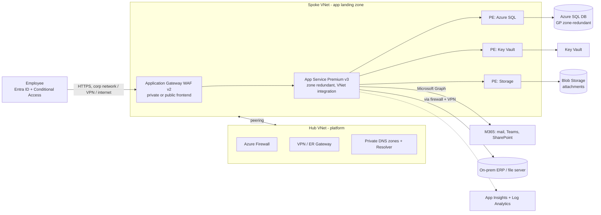
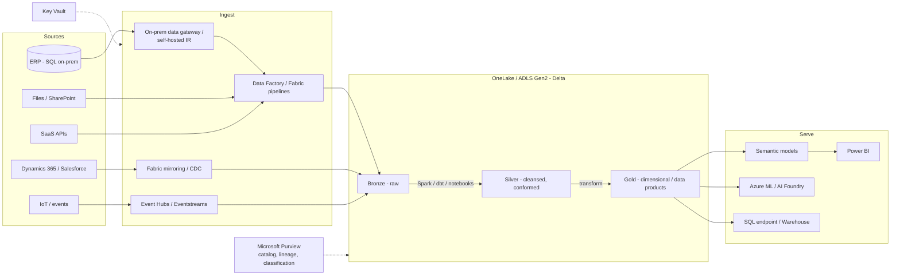
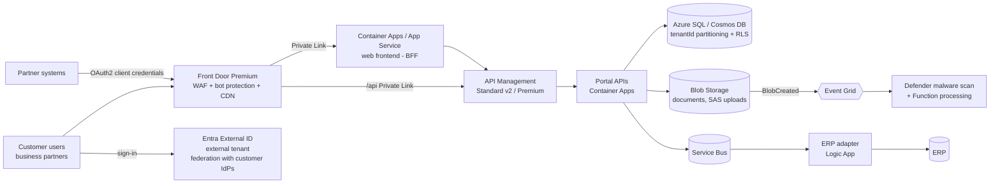
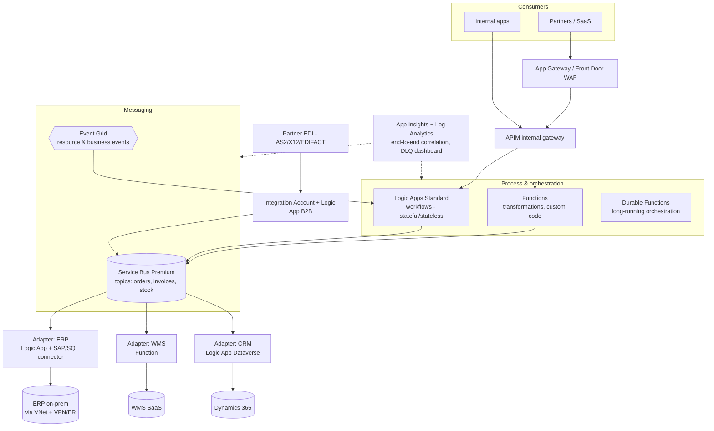
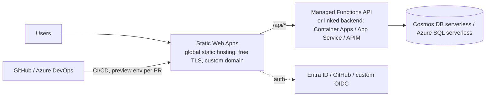
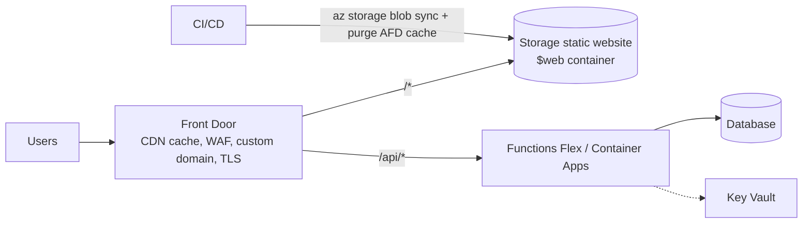
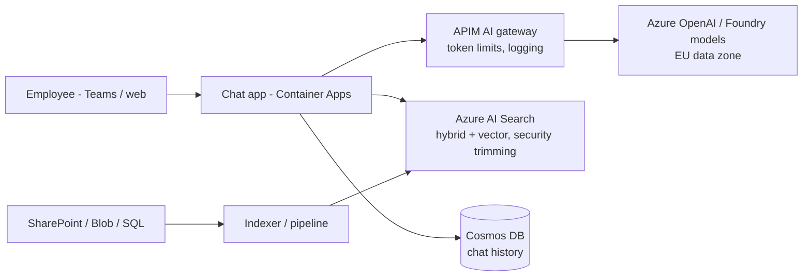

# Reference Architectures

> **TL;DR** — Five reusable Azure blueprints for common needs: (1) **internal line-of-business app** (App Service/Container Apps + Azure SQL, private networking, Entra SSO), (2) **data platform** (medallion lakehouse on Fabric or Databricks + ADLS, Purview governance), (3) **B2B portal** (Front Door + WAF, External ID, APIM, multi-tenant data), (4) **integration platform** (AIS: APIM + Logic Apps + Service Bus + Functions + Event Grid), (5) **static site + API** (Static Web Apps or Blob/Front Door + Functions/Container Apps). Each lists components, flows, key decisions, a "small" vs "scaled" variant and pitfalls. Prices and SKUs are illustrative — *verify current pricing/limits*.

---

## 0. Common foundation (applies to all)

- Deployed into an **application landing zone** (spoke subscription) under the ALZ hierarchy — see [architecture-frameworks-waf-caf.md](architecture-frameworks-waf-caf.md).
- **IaC** (Bicep/Terraform with AVM) + CI/CD with workload identity federation — see [infrastructure-as-code.md](infrastructure-as-code.md).
- **Managed identities** for all service-to-service auth; Key Vault for unavoidable secrets.
- **Diagnostics** to central Log Analytics; Application Insights via OpenTelemetry.
- **Tags**: Application, Environment, Owner, CostCenter, BusinessCriticality, DataClassification.
- **Budgets** + anomaly alerts per subscription.

---

## 1. Internal line-of-business (LOB) application

**Scenario**: web app for employees (e.g. approvals, inventory, HR request handling), 50–5,000 users, Entra SSO, data in SQL, integrates with M365 and an on-prem system.

| Component | Choice | Why |
|---|---|---|
| Identity | Entra ID SSO (Easy Auth or MSAL), app roles for authorization, Conditional Access requiring compliant device | Users already in Entra; no passwords to manage |
| Compute | App Service (P0v3/P1v3) or Container Apps | Lowest ops; slots for zero-downtime deploys |
| Data | Azure SQL Database GP (serverless for dev/test) | Relational, familiar, PITR backups |
| Files | Blob Storage, user-delegation SAS for downloads | Valet key |
| Network | Private endpoints, App Gateway WAF (public frontend with CA, or private frontend for VPN/ZTNA-only access) | Data not exposed publicly |
| Integration | Graph API with managed identity / app permissions scoped (e.g. `Sites.Selected`); on-prem via VPN or Service Bus + on-prem worker | Least privilege |
| Ops | App Insights, availability tests, alerts on 5xx and SLO burn | |

**Key decisions**
- *Public vs private ingress*: modern zero-trust approach = public endpoint protected by Entra + Conditional Access + WAF (simpler for remote users); traditional = private only (needs VPN/Private Access).
- *App Service vs Container Apps*: App Service if code-based .NET/Java/Node with no container need; Container Apps if you already ship containers or need jobs/workers.
- *Power Apps alternative*: for simple forms/workflows on Dataverse/SharePoint, Power Platform may be faster — but watch licensing, ALM, and complexity ceiling.

| Variant | Small (≤ 200 users, Tier 2) | Scaled (critical, Tier 1) |
|---|---|---|
| Compute | App Service B1/P0v3 single instance (no zone SLA) | P1v3 × 3 zone redundant, autoscale |
| DB | SQL GP serverless 1–2 vCore | GP/BC zone redundant + failover group to paired region |
| Ingress | App Service with access restrictions + Easy Auth | App Gateway WAF / Front Door Premium + Private Link |
| DR | Backup & restore (geo-restore + IaC) | Warm standby in secondary region |

**Pitfalls**: Graph permissions too broad (`Sites.ReadWrite.All`); hard-coded on-prem connection strings; no slots → downtime on deploy; skipping WAF because "it's internal".

---

## 2. Data platform (analytics & AI)

**Scenario**: consolidate ERP, CRM, files and SaaS data into a governed lakehouse for BI (Power BI) and ML/AI.

| Layer | Options | Notes |
|---|---|---|
| Platform | **Microsoft Fabric** (SaaS, capacity-based F SKUs) or **Azure Databricks + ADLS Gen2** (PaaS, more control) or Synapse (legacy path) | Fabric for M365/Power BI-centric small–mid orgs; Databricks for heavy engineering/ML, multi-cloud |
| Ingestion | Data Factory / Fabric Data pipelines, mirroring (SQL, Cosmos, Snowflake), Event Hubs/Eventstreams for streaming | Self-hosted IR / on-prem gateway for on-prem sources (HA cluster) |
| Storage format | **Delta Lake** (Parquet + transaction log) in medallion layers | Open format, time travel |
| Transform | Spark notebooks, dbt, SQL, Dataflows Gen2 | Version-controlled, tested |
| Serve | Direct Lake semantic models, Warehouse SQL, APIs | |
| Governance | Purview (catalog, sensitivity labels, lineage), workspace/domain design, RLS/OLS | Data products per domain (data mesh-lite) |
| Security | Private endpoints / managed VNets / trusted workspace access, Entra groups for workspace roles | |

**Key decisions**: Fabric vs Databricks; centralized vs domain-oriented ownership; batch vs streaming needs; capacity sizing and pause/resume schedules (Fabric F SKU billed while running; reservations for steady use); dev/test/prod workspaces with deployment pipelines + Git integration.

**Pitfalls**: building gold layer without business definitions; one shared capacity throttled by a rogue notebook; no data quality checks (use expectations/tests); copying PII into every layer; ignoring CU consumption monitoring.

Deep dive: [Data & AI architecture](../07-data-ai-architecture/README.md).

---

## 3. B2B customer / partner portal

**Scenario**: external business customers log in to view orders, invoices, upload documents, and call APIs. Multi-tenant (many customer companies), internet-facing, Tier 1.

| Concern | Design |
|---|---|
| Identity | **Entra External ID** (external tenant): local accounts + federation (customer Entra/SAML) — or B2B guests in workforce tenant if few partners and M365 collaboration needed |
| Authorization | Tenant (customer org) claim in token → enforce in API and DB (row-level security / partition key `tenantId`) |
| Edge | Front Door Premium (WAF managed rules, rate limiting, geo filtering), Private Link to origins |
| API exposure | APIM products per partner tier; OAuth2 client credentials for M2M; quotas |
| Uploads | Valet key (user-delegation SAS) direct to Blob, malware scan before use (Quarantine pattern) |
| Backend integration | Async via Service Bus to ERP — portal stays up when ERP is down (queue-based load leveling) |
| Multi-tenancy | Shared app + shared DB with tenant column (small), DB-per-tenant / elastic pool (isolation), **deployment stamps** for large/regulatory tenants |
| Compliance | GDPR: DPA with customers, data retention, audit logs; EU regions |

| Variant | Small | Scaled |
|---|---|---|
| Edge | Front Door Standard + App Service access restrictions | Front Door Premium + Private Link |
| API | APIM Basic v2 / Consumption | APIM Standard v2 / Premium multi-region |
| Data | Azure SQL with RLS | Cosmos DB (hierarchical PK `tenantId/userId`) or stamps |
| DR | Zone redundant + backup | Active-passive multi-region with Front Door failover |

**Pitfalls**: tenant isolation only in UI; partner integrations calling ERP synchronously; customers as guests in workforce tenant at scale (licensing/governance mess); no rate limiting per tenant (noisy neighbour).

---

## 4. Integration platform (Azure Integration Services)

**Scenario**: replace point-to-point integrations / legacy ESB (BizTalk end of support) between ERP, CRM, WMS, e-commerce, banks and partners (EDI).

| Principle | Implementation |
|---|---|
| **Decouple** systems via canonical messages on topics | Service Bus topics + subscriptions with filters per consumer |
| **API-led layers** | System APIs (wrap ERP/CRM), process APIs (orchestration), experience APIs (per consumer) in APIM |
| **Adapters as anti-corruption layers** | One adapter per system; translates canonical ↔ system model |
| **Reliability** | Peek-lock, retries, DLQ, idempotent adapters, duplicate detection, sessions for ordering per entity |
| **Observability** | Correlation id (W3C traceparent) through APIM → Logic Apps → Service Bus → adapters; business tracking dashboard (message status per order) |
| **Security** | Private endpoints, VNet-integrated Logic Apps Standard, managed identities to Service Bus/Storage, APIM OAuth |
| **Ops** | Replay tool for DLQ, alerting on DLQ depth and failed runs, runbooks per interface |
| **Delivery** | Interfaces as code: Logic Apps Standard projects + APIOps + Bicep, versioned schemas |

**Choosing per interface**: real-time request/response → APIM + Logic App/Function; fire-and-forget → Service Bus; high-volume telemetry → Event Hubs; reacting to Azure resource events → Event Grid; file-based legacy → Blob + Event Grid + Logic App; scheduled batch → Logic App recurrence / Data Factory.

**Pitfalls**: rebuilding a monolithic ESB in one huge Logic App; synchronous chains across 4 systems; no ownership of canonical model; Logic Apps Consumption at high volume (cost); missing message replay capability.

---

## 5. Static site + API

**Scenario**: marketing site, documentation, SPA (React/Vue) with a light API (forms, search, user data).

### 5.1 Option A — Azure Static Web Apps (simplest)

- Free/Standard plans; Standard adds custom auth providers, SLA, linked backends, private endpoint.
- PR preview environments built in.
- Routing/auth rules in `staticwebapp.config.json`.

### 5.2 Option B — Blob static website + Front Door + Functions/Container Apps

- More control (WAF rules, caching rules, multi-origin, rules engine), good for high-traffic or multi-region API.
- Remember cache purge on deploy; long cache for hashed assets, short for `index.html`.

| Criterion | SWA | Blob + Front Door |
|---|---|---|
| Setup effort | Minimal | Moderate |
| WAF | Via Front Door integration (Standard plan) | Native |
| API hosting | Managed Functions or linked backend | Any |
| Preview environments | Built in | Build yourself |
| Cost at low traffic | Free–low | Front Door base fee |
| Fit | SPAs, docs, small business sites | Enterprise, high traffic, complex routing |

**GCP equivalent**: Firebase Hosting / Cloud Storage + Cloud CDN + Cloud Run. **AWS**: Amplify Hosting / S3 + CloudFront + Lambda.

**Pitfalls**: API keys in front-end bundles; CORS `*` with credentials; no cache-busting; SEO needs SSR (consider Next.js on App Service/Container Apps or SWA hybrid rendering — *verify support*).

---

## 6. Bonus: RAG / AI assistant on internal data (sketch)

Key points: security trimming by user groups (ACL in index), grounding with citations, content safety, evaluation (groundedness, relevance), cost per conversation. Details in [Data & AI architecture](../07-data-ai-architecture/README.md).

---

## 7. Architecture review checklist (use for any of the above)

- [ ] Business requirements: users, flows, SLO, RTO/RPO, data classification, compliance
- [ ] WAF pillars reviewed; trade-offs recorded as ADRs
- [ ] Identity: who authenticates how; authorization model; no secrets
- [ ] Network: ingress path, egress path, private endpoints, DNS
- [ ] Data: store choice justified, backup/restore tested, retention
- [ ] Resilience: zones, retries, timeouts, queueing, DR strategy
- [ ] Observability: SLIs, dashboards, alerts with runbooks, tracing across async hops
- [ ] Cost: estimate per environment, unit cost metric, budgets
- [ ] Operations: IaC, CI/CD, environments, ownership, on-call
- [ ] Security: threat model, WAF, Defender plans, pen test plan

## 8. Common mistakes

1. Copying the "scaled" variant for a 50-user app — cost and complexity without benefit.
2. Copying the "small" variant for a Tier 1 system — no zones, no DR.
3. Synchronous coupling to on-prem systems from internet-facing portals.
4. Skipping the landing zone foundation — each app invents its own networking/DNS.
5. Reference architectures used without adapting to real NFRs.

## References

- Azure Architecture Center — https://learn.microsoft.com/azure/architecture/
- Azure Architecture Center: browse architectures — https://learn.microsoft.com/azure/architecture/browse/
- Baseline App Service web application — https://learn.microsoft.com/azure/architecture/web-apps/app-service/architectures/baseline-zone-redundant
- Basic enterprise integration — https://learn.microsoft.com/azure/architecture/reference-architectures/enterprise-integration/basic-enterprise-integration
- Azure Static Web Apps — https://learn.microsoft.com/azure/static-web-apps/
- Microsoft Fabric — https://learn.microsoft.com/fabric/
- Azure Databricks — https://learn.microsoft.com/azure/databricks/
- Microsoft Entra External ID — https://learn.microsoft.com/entra/external-id/
- Azure API Management — https://learn.microsoft.com/azure/api-management/
- Multitenant solutions on Azure — https://learn.microsoft.com/azure/architecture/guide/multitenant/overview
- Google Cloud Architecture Center — https://cloud.google.com/architecture
- AWS Architecture Center — https://aws.amazon.com/architecture/
- Related: [Software architecture](../05-software-architecture/README.md), [Data & AI architecture](../07-data-ai-architecture/README.md), [Enterprise architecture & business](../11-enterprise-architecture-business/README.md)
