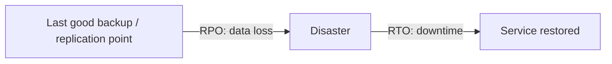
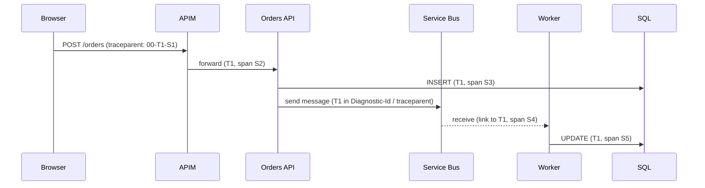

# Reliability & Observability

> **TL;DR** — Reliability starts with **user-centric SLIs**, explicit **SLOs** (internal targets) below contractual **SLAs**, and an **error budget** that trades reliability against change velocity. Composite availability **multiplies** across serial dependencies and improves with **redundancy** (`1 − Π(1 − Aᵢ)`). Pick a DR strategy (backup & restore → pilot light → warm standby → active-active) by **RTO/RPO and cost**, and test it. Observability = **metrics, logs, traces (+ profiles)** via **OpenTelemetry**, analyzed with **RED/USE/Golden Signals**, alerting on **symptoms and SLO burn rate**, not on every CPU spike. On Azure: Azure Monitor, Log Analytics (KQL), Application Insights.

---

## 1. SLI, SLO, SLA, error budget

| Term | Definition | Example |
|---|---|---|
| **SLI** (indicator) | Quantitative measure of service level, ideally ratio of good events / valid events | % of HTTP requests to `/checkout` returning non-5xx within 500 ms |
| **SLO** (objective) | Target for an SLI over a window | 99.9% over rolling 28 days |
| **SLA** (agreement) | Contract with consequences (credits) if missed | 99.5% monthly or service credit |
| **Error budget** | `1 − SLO` — allowed unreliability | 0.1% of requests ≈ 40 min of full outage per 28 days |

Rules:
- SLA < SLO < (achievable) — keep internal SLO stricter than external SLA.
- SLIs measured as close to the user as possible (load balancer logs, synthetic tests, RUM), not CPU.
- Few SLOs per service (2–4): availability, latency, freshness (data pipelines), correctness.
- 100% is the wrong target — users can't distinguish 99.99% from 100% through their own unreliable networks, and it freezes change.

**Error budget policy** (agree upfront):
- Budget remaining → ship features, run experiments.
- Budget exhausted → freeze risky releases, prioritize reliability work, postmortems for budget-burning incidents.
- Single incident consuming > 20% of budget → mandatory postmortem.

### 1.1 SLI types by service type

| Service type | SLIs |
|---|---|
| Request-driven (API, web) | Availability, latency (p50/p95/p99), quality (degraded responses) |
| Pipeline / batch | Freshness, correctness, coverage, throughput |
| Storage | Durability, availability, latency |
| Event processing | End-to-end lag, DLQ rate |

### 1.2 Burn-rate alerting (multi-window, multi-burn-rate)

Burn rate = rate of budget consumption relative to SLO (1 = exactly exhausting budget at window end).

| Severity | Long window | Short window | Burn rate | Budget consumed when fires |
|---|---|---|---|---|
| Page | 1 h | 5 min | 14.4 | 2% |
| Page | 6 h | 30 min | 6 | 5% |
| Ticket | 3 d | 6 h | 1 | 10% |

(From the Google SRE Workbook, for a 30-day window.)

---

## 2. Availability "nines"

| Availability | Per year | Per month (30.44 d) | Per week | Per day |
|---|---|---|---|---|
| 90% | 36.5 days | 73.0 h | 16.8 h | 2.4 h |
| 99% | 3.65 days | 7.31 h | 1.68 h | 14.4 min |
| 99.5% | 1.83 days | 3.65 h | 50.4 min | 7.2 min |
| 99.9% | 8.77 h | 43.8 min | 10.1 min | 1.44 min |
| 99.95% | 4.38 h | 21.9 min | 5.04 min | 43.2 s |
| 99.99% | 52.6 min | 4.38 min | 1.01 min | 8.64 s |
| 99.995% | 26.3 min | 2.19 min | 30.2 s | 4.32 s |
| 99.999% | 5.26 min | 26.3 s | 6.05 s | 0.86 s |

Formula: `downtime = (1 − A) × period`.

Reality check: achieving 99.99% means detection + mitigation within ~4 minutes per month — impossible with human-only response; requires automated failover.

---

## 3. Composite SLA math

### 3.1 Serial dependencies (all must work)

`A_total = A₁ × A₂ × … × Aₙ`

Example (illustrative SLAs — *verify current published SLAs*):

| Component | SLA |
|---|---|
| App Service (Standard+) | 99.95% |
| Azure SQL Database (GP, zone-redundant) | 99.995% |
| Azure Cache for Redis Standard | 99.9% |

`0.9995 × 0.99995 × 0.999 = 0.99845` → **≈ 99.85%** (≈ 66 min/month). Composite is always lower than the weakest component.

### 3.2 Parallel redundancy (any one suffices)

`A_total = 1 − Π(1 − Aᵢ)`; for n identical: `1 − (1 − A)ⁿ`

- Two independent 99.9% instances: `1 − 0.001² = 0.999999` (99.9999%) — **only if failures are independent** (they often aren't: shared region, shared config, shared deployment).

### 3.3 Multi-region with global router

Two regional stacks at 99.85% behind Front Door (99.99%):

`A = 0.9999 × (1 − (1 − 0.9985)²) = 0.9999 × 0.99999775 ≈ 0.99989` → **≈ 99.99%**

### 3.4 Fallback paths

If a dependency failure can be absorbed (cache fallback, queue buffering), it is removed from the serial chain for that flow — architecture beats SLA shopping.

### 3.5 Caveats

- SLAs are financial commitments (service credits), not engineering guarantees.
- Many services have **no SLA on free/basic tiers** or require configuration (≥2 instances, zones).
- Your code, deployments and config changes are the most common outage causes — not the platform.

---

## 4. RTO, RPO and DR strategies

| Term | Meaning |
|---|---|
| **RTO** (Recovery Time Objective) | Max acceptable time to restore service after disruption |
| **RPO** (Recovery Point Objective) | Max acceptable data loss measured in time |
| **MTTR / MTTD / MTBF** | Mean time to recover / detect / between failures |
| **WRT** | Work recovery time — verifying and catching up after restore |
| **MTD** | Maximum tolerable downtime (business) ≥ RTO + WRT |



### 4.1 DR strategies

| Strategy | Description | RTO | RPO | Relative cost | Azure implementation |
|---|---|---|---|---|---|
| **Backup & restore** | Backups in secondary region; rebuild infra via IaC when needed | Hours–days | Hours (backup frequency) | $ | Azure Backup (GRS/cross-region restore), SQL geo-restore, GRS storage, IaC to redeploy |
| **Pilot light** | Core data replicated live; minimal or no compute in DR region; scale up on failover | 10s of min – hours | Minutes | $$ | SQL failover group / geo-replica, GRS/GZRS storage, IaC + scale-out on failover |
| **Warm standby** | Scaled-down but fully functional copy running in DR | Minutes | Seconds–minutes | $$$ | Smaller App Service/AKS in secondary, Front Door/Traffic Manager priority routing, async DB replication |
| **Multi-site active-active** | Full capacity in 2+ regions serving traffic | Near zero (seconds) | Near zero (depends on data replication) | $$$$ | Front Door, Cosmos DB multi-region writes, stateless app stamps, conflict handling |

Additionally **zone redundancy** (within region) handles the most common infrastructure failures at low cost — do this first.

### 4.2 Tiering workloads

| Tier | Example | RTO | RPO | Strategy |
|---|---|---|---|---|
| Tier 0 – mission critical | Payment, production control | < 15 min | ≈ 0 | Zones + active-active or warm standby |
| Tier 1 – business critical | ERP, customer portal | < 4 h | < 15 min | Zones + pilot light / warm standby |
| Tier 2 – important | Internal LOB apps | < 24 h | < 4 h | Zones + backup & restore (IaC) |
| Tier 3 – non-critical | Dev, reporting sandboxes | Days | 24 h | Backup only |

### 4.3 Azure Site Recovery & backup

- **Azure Site Recovery (ASR)**: VM replication (Azure→Azure, on-prem→Azure), recovery plans with scripts, test failover without impact. RPO seconds–minutes.
- **Azure Backup**: VMs, SQL/SAP HANA in VMs, Files, Blobs, Disks, AKS, PostgreSQL; **immutable vaults**, soft delete, multi-user authorization (Resource Guard), cross-region restore.
- **Backup ≠ DR**: backup protects against corruption/deletion/ransomware; DR protects against site loss. Need both.

### 4.4 DR plan checklist

- [ ] Business impact analysis per workload (tier, RTO, RPO, dependencies)
- [ ] Documented runbook: who declares disaster, steps, DNS/traffic switching, data reconciliation, failback
- [ ] IaC deploys DR region reproducibly
- [ ] Secrets, certificates, DNS, identity dependencies available in DR region
- [ ] Quota/capacity in DR region confirmed (capacity reservations for critical VMs)
- [ ] **Regular DR drills** (at least yearly; test failover for ASR quarterly)
- [ ] Backups restore-tested; immutable copies for ransomware
- [ ] Communication plan

---

## 5. Multi-region patterns

| Pattern | Description | Data approach | Complexity |
|---|---|---|---|
| **Active-passive (cold/warm)** | Secondary takes traffic only on failover | Async replication; RPO > 0 | Medium |
| **Active-active, read local / write primary** | All regions serve reads; writes routed to primary | Read replicas, Cosmos single-write | Medium-high |
| **Active-active multi-write** | All regions accept writes | Cosmos multi-region writes, conflict resolution, CRDTs | High |
| **Deployment stamps / cells** | Independent stacks, tenant pinned to stamp | Per-stamp data | High (ops), excellent blast-radius control |
| **Geode** | Any region serves any user; global data | Globally replicated store | High |

Considerations: data residency (EU-only pairs), latency for synchronous dependencies, failover automation vs manual decision (avoid flapping), DNS TTLs, session affinity, idempotent writes on retry after failover, cost doubling.

---

## 6. Resilience engineering

### 6.1 Health checks & health model

- Shallow vs deep health endpoints (see [containers-kubernetes.md](containers-kubernetes.md) probes).
- **Health model**: map components → user flows → overall health (healthy / degraded / unhealthy); dashboards per flow (Azure Monitor health models / workbooks).
- External synthetic monitoring: Application Insights **standard availability tests** from multiple regions.

### 6.2 Chaos engineering

Principles (principlesofchaos.org): define steady state → hypothesize it continues → introduce real-world events (server failure, latency, dependency outage) → try to disprove hypothesis → minimize blast radius → run in production eventually, automate continuously.

| Tool | Notes |
|---|---|
| **Azure Chaos Studio** | Service-direct faults (Cosmos failover, AKS Chaos Mesh, NSG rules, VM shutdown, zone down) and agent-based faults (CPU, memory, network latency) |
| Chaos Mesh / LitmusChaos | Kubernetes-native |
| AWS FIS, Gremlin | Other platforms |
| **Load testing**: Azure Load Testing (JMeter/Locust), k6 | Combine with chaos for realistic conditions |

Experiment template: *Hypothesis*: "If zone 1 fails, checkout availability stays ≥ 99.5% and p95 < 800 ms." *Method*: Chaos Studio zone-down on VMSS + AKS node pool for 15 min. *Abort*: SLO burn rate > 14.4. *Learnings*: backlog items.

### 6.3 Failure mode analysis (FMEA-lite)

| Component | Failure mode | Effect | Detection | Mitigation |
|---|---|---|---|---|
| Azure SQL | Primary unavailable / failover | Writes fail 30–60 s | Connection errors, App Insights dependency failures | Retry with backoff, zone redundancy, failover group |
| Service Bus | Throttling | Producer latency | 429 / ServerBusy | Premium MUs, client retry |
| Entra ID | Token issuance outage | New logins fail | Sign-in errors | Token caching, longer-lived sessions (CAE) |
| Region | Full outage | Total | Front Door probes | DR strategy |
| Deployment | Bad release | Errors spike | SLO burn alert | Canary, auto-rollback, feature flags |

---

## 7. Observability fundamentals

### 7.1 Signals

| Signal | What | Cardinality / cost | Use |
|---|---|---|---|
| **Metrics** | Numeric time series (counters, gauges, histograms) | Cheap, aggregated | Alerting, dashboards, trends |
| **Logs** | Timestamped events (structured JSON) | Expensive at volume | Debugging, audit, forensics |
| **Traces** | Causally linked spans across services (trace id, span id) | Medium; sample | Latency breakdown, dependency mapping |
| **Profiles** (4th pillar) | Continuous CPU/memory profiling | Medium | Code-level performance |
| Events / RUM | Business events, real user monitoring | — | Product & UX insight |

Observability ≠ monitoring: monitoring answers known questions (dashboards/alerts); observability lets you ask **new** questions of high-cardinality data without shipping new code.

### 7.2 OpenTelemetry (OTel)

- CNCF standard: **API + SDKs + semantic conventions + OTLP protocol + Collector**.
- Signals: traces (stable), metrics (stable), logs (stable in most SDKs), profiles (in development).
- **W3C Trace Context** (`traceparent` header) for propagation; baggage for key-values.
- **Collector**: receivers → processors (batch, tail sampling, attribute redaction) → exporters (Azure Monitor, Prometheus, Grafana, Datadog...). Vendor-neutral.
- Azure: **Azure Monitor OpenTelemetry Distro** (.NET, Java, Node, Python) sends to Application Insights; AKS managed Prometheus.

```csharp
// .NET: Azure Monitor OpenTelemetry Distro
builder.Services.AddOpenTelemetry().UseAzureMonitor(); // reads APPLICATIONINSIGHTS_CONNECTION_STRING
```

```yaml
# OTel Collector: tail sampling keeps errors and slow traces, 10% of the rest
processors:
  tail_sampling:
    decision_wait: 10s
    policies:
      - { name: errors, type: status_code, status_code: { status_codes: [ERROR] } }
      - { name: slow,   type: latency,     latency: { threshold_ms: 1000 } }
      - { name: sample, type: probabilistic, probabilistic: { sampling_percentage: 10 } }
```

### 7.3 Methods

| Method | For | Signals |
|---|---|---|
| **RED** (Tom Wilkie) | Request-driven services | **R**ate, **E**rrors, **D**uration |
| **USE** (Brendan Gregg) | Resources (CPU, memory, disk, network, pools) | **U**tilization, **S**aturation, **E**rrors |
| **Four Golden Signals** (Google SRE) | User-facing systems | **Latency** (separate success/failure), **Traffic**, **Errors**, **Saturation** |

### 7.4 Structured logging

```json
{"timestamp":"2026-10-10T09:21:33.120Z","level":"Error","message":"Payment authorization failed",
 "service.name":"checkout-api","service.version":"1.4.2","deployment.environment":"prod",
 "trace_id":"4bf92f3577b34da6a3ce929d0e0e4736","span_id":"00f067aa0ba902b7",
 "order_id":"ord-123","customer_tier":"gold","error.type":"GatewayTimeout","duration_ms":3021}
```

Rules: JSON, consistent field names (OTel semantic conventions), include trace/span ids, log **events not prose**, no PII/secrets (or mask), log levels meaningful (Error = actionable), sample verbose logs, set retention by table/tier.

### 7.5 Distributed tracing



Propagate context through messaging (message properties), not just HTTP. Use span links for batch consumers. Sample intelligently (head sampling for volume, tail sampling for errors).

---

## 8. Azure Monitor stack

| Component | Role |
|---|---|
| **Azure Monitor Metrics** | Platform metrics (93 days), custom metrics; metric alerts |
| **Log Analytics workspace** | Central log store queried with **KQL**; table plans **Analytics / Basic / Auxiliary** (cost tiers), retention up to 12 years (archive) |
| **Application Insights** (workspace-based) | APM: requests, dependencies, exceptions, traces, availability tests, Application Map, live metrics, smart detection |
| **Diagnostic settings** | Route resource logs/metrics to Log Analytics, Storage, Event Hubs (enforce via Policy) |
| **Azure Monitor Agent (AMA) + Data Collection Rules (DCR)** | VM/Arc server log & perf collection with filtering/transformations (replaces legacy MMA agent, retired Aug 2024) |
| **Container insights + Managed Prometheus + Managed Grafana** | Kubernetes observability |
| **Workbooks / dashboards** | Visualization |
| **Alerts + Action groups** | Metric, log search, activity log, Resource Health, Service Health alerts → email/SMS/webhook/ITSM/Logic App/Function |
| **Service Health / Resource Health** | Platform incident & planned maintenance notifications — always configure Service Health alerts |
| **Change Analysis** | What changed before the incident |

Workspace design: one central workspace per region/environment for small-mid orgs (simpler querying, Sentinel on same or separate); separate when data residency, RBAC or cost attribution demands. Use **resource-context RBAC** so app teams see their own logs.

### 8.1 KQL examples

```kusto
// 1. Failure rate and p95 latency per operation, last 24h (App Insights, workspace-based)
AppRequests
| where TimeGenerated > ago(24h)
| summarize total = count(), failed = countif(Success == false),
            p95_ms = percentile(DurationMs, 95) by OperationName
| extend failure_pct = round(100.0 * failed / total, 2)
| order by failure_pct desc
```

```kusto
// 2. SLI: availability of checkout API per 5-minute bin (non-5xx and < 500 ms = good)
AppRequests
| where TimeGenerated > ago(7d) and Name startswith "POST /checkout"
| summarize good = countif(toint(ResultCode) < 500 and DurationMs < 500), total = count() by bin(TimeGenerated, 5m)
| extend sli = 100.0 * good / total
| render timechart
```

```kusto
// 3. Top exceptions with sample message
AppExceptions
| where TimeGenerated > ago(1d)
| summarize count(), any(OuterMessage) by ProblemId, AppRoleName
| top 10 by count_
```

```kusto
// 4. Slow dependencies (SQL, HTTP, Service Bus)
AppDependencies
| where TimeGenerated > ago(1h)
| summarize calls = count(), p95 = percentile(DurationMs, 95), failures = countif(Success == false)
          by Type, Target
| order by p95 desc
```

```kusto
// 5. End-to-end trace for one operation
union AppRequests, AppDependencies, AppExceptions, AppTraces
| where OperationId == "4bf92f3577b34da6a3ce929d0e0e4736"
| project TimeGenerated, Type, Name, DurationMs, Success, Message
| order by TimeGenerated asc
```

```kusto
// 6. VMs that stopped sending heartbeats
Heartbeat
| summarize LastSeen = max(TimeGenerated) by Computer
| where LastSeen < ago(15m)
```

```kusto
// 7. Kubernetes pods restarting (Container insights)
KubePodInventory
| where TimeGenerated > ago(1h)
| summarize Restarts = max(PodRestartCount) by Namespace, Name
| where Restarts > 3
| order by Restarts desc
```

```kusto
// 8. Who deleted resources? (Activity log)
AzureActivity
| where TimeGenerated > ago(7d)
| where OperationNameValue endswith "/DELETE" and ActivityStatusValue == "Success"
| project TimeGenerated, Caller, ResourceGroup, _ResourceId
```

```kusto
// 9. Log ingestion cost drivers: GB per table last 30 days
Usage
| where TimeGenerated > ago(30d) and IsBillable == true
| summarize GB = sum(Quantity) / 1024 by DataType
| order by GB desc
```

```kusto
// 10. Failed sign-ins by user and reason (Entra logs in workspace)
SigninLogs
| where TimeGenerated > ago(1d) and ResultType != "0"
| summarize attempts = count() by UserPrincipalName, ResultDescription, IPAddress
| where attempts > 10
```

KQL operator cheat sheet: `where`, `project`, `extend`, `summarize … by`, `bin()`, `join kind=inner|leftouter`, `union`, `top`, `order by`, `render`, `parse`, `extract`, `mv-expand`, `make-series`, `series_decompose_anomalies()`, `let`, `materialize()`.

---

## 9. Alerting philosophy

1. **Alert on symptoms users feel** (SLO burn, error rate, latency), not on causes (CPU 80%) — causes go to dashboards.
2. Every page must be **actionable, urgent, and real**; otherwise ticket or delete.
3. Include **runbook link**, dashboard link, context (dimensions) in the alert.
4. Route by **severity**: Sev0/1 page on-call; Sev2/3 tickets; info → dashboards.
5. Use **dynamic thresholds** for seasonal metrics; static for hard limits (disk full).
6. Deduplicate and correlate (one incident, not 50 alerts); use alert processing rules for maintenance windows.
7. Review alert noise monthly: target < 2 pages per on-call shift; tune or remove flapping alerts.
8. Always: **Service Health alerts**, **budget alerts**, **certificate/secret expiry alerts**, **backup failure alerts**, **DLQ alerts**.

```bash
# Metric alert: HTTP 5xx on a Web App > 10 in 5 minutes
az monitor metrics alert create -n "app-invoice-prod-5xx" -g rg-invoice-prod-weu-001 \
  --scopes $(az webapp show -n app-invoice-prod-weu-001 -g rg-invoice-prod-weu-001 --query id -o tsv) \
  --condition "total Http5xx > 10" --window-size 5m --evaluation-frequency 1m --severity 1 \
  --action /subscriptions/<sub>/resourceGroups/rg-monitor/providers/microsoft.insights/actionGroups/ag-oncall
```

## 10. Incident management & postmortems

- Roles: incident commander, communications lead, ops/subject experts, scribe.
- Severity matrix tied to user impact and SLOs.
- **Blameless postmortem**: timeline, impact (minutes, users, budget consumed), root/contributing causes (5 whys, not "human error"), what went well, action items with owners and dates.
- Track MTTD, MTTR, change failure rate (DORA — see [Engineering](../08-engineering/README.md)).

## 11. Common mistakes

1. SLOs set by what the system currently achieves, not by user needs.
2. Assuming component SLAs add up to your app's availability.
3. Multi-region "DR" that was never failed over.
4. Backups in the same subscription/region with the same admin credentials (ransomware deletes both).
5. Liveness checks that probe dependencies; health endpoints that always return 200.
6. Logging everything at Debug into Analytics tier → huge bill; no sampling in App Insights.
7. Alerts on CPU with no runbook; alert fatigue; on-call ignoring pages.
8. Trace context lost at message boundaries.
9. No Service Health alerts — learning about Azure incidents from users.

## References

- Google SRE books (SRE book, SRE Workbook) — https://sre.google/books/
- Azure Well-Architected — Reliability — https://learn.microsoft.com/azure/well-architected/reliability/
- Azure reliability documentation — https://learn.microsoft.com/azure/reliability/
- Azure SLAs — https://www.microsoft.com/licensing/docs/view/Service-Level-Agreements-SLA-for-Online-Services
- Azure Site Recovery — https://learn.microsoft.com/azure/site-recovery/
- Azure Backup — https://learn.microsoft.com/azure/backup/
- Azure Chaos Studio — https://learn.microsoft.com/azure/chaos-studio/
- Principles of Chaos Engineering — https://principlesofchaos.org/
- Azure Monitor — https://learn.microsoft.com/azure/azure-monitor/
- Application Insights OpenTelemetry — https://learn.microsoft.com/azure/azure-monitor/app/opentelemetry-overview
- KQL reference — https://learn.microsoft.com/azure/data-explorer/kusto/query/
- OpenTelemetry — https://opentelemetry.io/docs/
- W3C Trace Context — https://www.w3.org/TR/trace-context/
- USE method (Brendan Gregg) — https://www.brendangregg.com/usemethod.html
- Wikipedia: High availability — https://en.wikipedia.org/wiki/High_availability
- Wikipedia: Disaster recovery — https://en.wikipedia.org/wiki/Disaster_recovery
- Related: [Laws, principles, mental models](../10-laws-principles-mental-models/README.md), [Engineering](../08-engineering/README.md)
