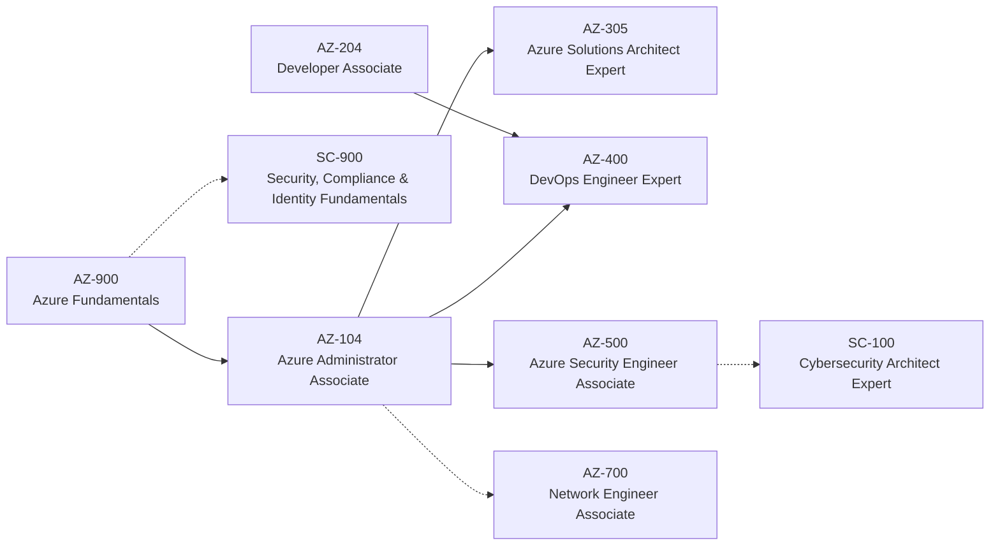

# Resources & Certification Paths

> **TL;DR** — Official docs (Azure Architecture Center, WAF, CAF, Google Cloud Architecture Framework, AWS Well-Architected) are the primary sources. Certification path for an Azure-focused architect: **AZ-900 → AZ-104 → AZ-305**, then specialize with **AZ-400** (DevOps), **AZ-500** (security), and add **Google Professional Cloud Architect** for multi-cloud. Exams are renewed and retired regularly — *verify current exam codes and objectives* before studying.

---

## 1. Certification paths

### 1.1 Microsoft

| Exam | Certification | Level | Focus | Prereq for expert |
|---|---|---|---|---|
| **AZ-900** | Azure Fundamentals | Fundamentals | Cloud concepts, core services, pricing, SLAs, governance | Optional |
| **AZ-104** | Azure Administrator Associate | Associate | Identities & governance, storage, compute, networking, monitoring/backup | Required for AZ-305 Expert |
| **AZ-305** | Azure Solutions Architect Expert | Expert | Design identity/governance/monitoring, data storage, business continuity, infrastructure | AZ-104 |
| **AZ-400** | DevOps Engineer Expert | Expert | Processes, source control, pipelines, security & compliance, instrumentation | AZ-104 **or** AZ-204 |
| **AZ-500** | Azure Security Engineer Associate | Associate | Identity & access, networking security, compute/storage/database security, Defender for Cloud, Sentinel | — |
| AZ-204 | Azure Developer Associate | Associate | App development on Azure | — |
| AZ-700 | Network Engineer Associate | Associate | Hybrid networking, routing, private access | — |
| SC-100 | Cybersecurity Architect Expert | Expert | Zero Trust, security strategy | One of SC-200/SC-300/AZ-500/MS-102 |
| SC-300 | Identity and Access Administrator | Associate | Entra ID deep dive | — |
| DP-600 / DP-700 | Fabric Analytics Engineer / Fabric Data Engineer | Associate | Microsoft Fabric | — |
| AI-102 | Azure AI Engineer Associate | Associate | Azure AI services, Foundry | — |
| MS-102 | Microsoft 365 Administrator Expert | Expert | M365 tenant, security, compliance | — |
| MD-102 | Endpoint Administrator | Associate | Intune, Windows | — |

Notes:
- Microsoft role-based certifications are renewed **annually** via a free online assessment on Microsoft Learn.
- Microsoft Applied Skills (scenario-based credentials) complement certifications.
- *Verify current exam codes* — Microsoft retires/replaces exams (e.g. AZ-303/304 → AZ-305).

### 1.2 Google Cloud

| Certification | Level | Focus |
|---|---|---|
| Cloud Digital Leader | Foundational | Business value of cloud |
| Associate Cloud Engineer | Associate | Deploy & operate |
| **Professional Cloud Architect (PCA)** | Professional | Design, plan, security & compliance, technical & business processes, reliability; includes **case studies** |
| Professional Cloud DevOps Engineer | Professional | SRE, CI/CD, observability |
| Professional Cloud Security Engineer | Professional | Security |
| Professional Data Engineer | Professional | BigQuery, Dataflow, pipelines |
| Professional Machine Learning Engineer | Professional | Vertex AI, MLOps |

Valid for 2 years (Professional); recertification by exam.

### 1.3 AWS (for mapping knowledge)

| Certification | Level |
|---|---|
| Cloud Practitioner | Foundational |
| Solutions Architect – Associate | Associate |
| Solutions Architect – Professional | Professional |
| DevOps Engineer – Professional | Professional |
| Security – Specialty | Specialty |

### 1.4 Vendor-neutral

| Certification | Body | Focus |
|---|---|---|
| CKA / CKAD / CKS | CNCF / Linux Foundation | Kubernetes admin / developer / security |
| HashiCorp Terraform Associate | HashiCorp | Terraform |
| FinOps Certified Practitioner | FinOps Foundation | FinOps |
| CCSP | ISC2 | Cloud security |
| TOGAF | The Open Group | Enterprise architecture — see [Enterprise architecture & business](../11-enterprise-architecture-business/README.md) |

### 1.5 Study approach

1. Read the official **skills outline / study guide** for the exam.
2. Work through the **Microsoft Learn** learning paths / Google Cloud Skills Boost.
3. Hands-on labs in a sandbox subscription with budget alerts.
4. Practice assessments (Microsoft Learn provides free practice assessments for many exams).
5. For AZ-305/PCA: practice designing end-to-end (use reference architectures in this section), justify trade-offs.

---

## 2. Primary documentation

### 2.1 Microsoft Azure

| Resource | URL |
|---|---|
| Azure documentation | https://learn.microsoft.com/azure/ |
| Azure Architecture Center | https://learn.microsoft.com/azure/architecture/ |
| Well-Architected Framework | https://learn.microsoft.com/azure/well-architected/ |
| Cloud Adoption Framework | https://learn.microsoft.com/azure/cloud-adoption-framework/ |
| Azure landing zones | https://learn.microsoft.com/azure/cloud-adoption-framework/ready/landing-zone/ |
| Cloud design patterns | https://learn.microsoft.com/azure/architecture/patterns/ |
| Technology choices (compute, data, messaging) | https://learn.microsoft.com/azure/architecture/guide/technology-choices/compute-decision-tree |
| Azure reliability | https://learn.microsoft.com/azure/reliability/ |
| Azure updates (service changes, retirements) | https://azure.microsoft.com/updates/ |
| Azure pricing calculator | https://azure.microsoft.com/pricing/calculator/ |
| Azure Verified Modules | https://azure.github.io/Azure-Verified-Modules/ |
| Bicep | https://learn.microsoft.com/azure/azure-resource-manager/bicep/ |
| Microsoft Entra | https://learn.microsoft.com/entra/ |
| Microsoft cloud security benchmark | https://learn.microsoft.com/security/benchmark/azure/ |
| Zero Trust guidance | https://learn.microsoft.com/security/zero-trust/ |
| Microsoft Learn credentials | https://learn.microsoft.com/credentials/ |
| Azure Charts (community overview of services, SLAs) | https://azurecharts.com/ |

### 2.2 Google Cloud

| Resource | URL |
|---|---|
| Google Cloud documentation | https://cloud.google.com/docs |
| Architecture Framework | https://cloud.google.com/architecture/framework |
| Architecture Center | https://cloud.google.com/architecture |
| Certifications | https://cloud.google.com/learn/certification |
| Professional Cloud Architect | https://cloud.google.com/learn/certification/cloud-architect |

### 2.3 AWS

| Resource | URL |
|---|---|
| AWS Well-Architected | https://aws.amazon.com/architecture/well-architected/ |
| AWS Architecture Center | https://aws.amazon.com/architecture/ |
| AWS Certification | https://aws.amazon.com/certification/ |

### 2.4 Cloud native, Kubernetes, IaC

| Resource | URL |
|---|---|
| Kubernetes docs | https://kubernetes.io/docs/ |
| CNCF | https://www.cncf.io/ |
| CNCF Landscape | https://landscape.cncf.io/ |
| Gateway API | https://gateway-api.sigs.k8s.io/ |
| Helm | https://helm.sh/docs/ |
| Argo CD | https://argo-cd.readthedocs.io/ |
| Flux | https://fluxcd.io/ |
| Terraform | https://developer.hashicorp.com/terraform |
| OpenTofu | https://opentofu.org/ |
| Pulumi | https://www.pulumi.com/docs/ |
| Open Policy Agent | https://www.openpolicyagent.org/ |
| The Twelve-Factor App | https://12factor.net/ |

### 2.5 Reliability, observability, FinOps, security

| Resource | URL |
|---|---|
| Google SRE books (free online) | https://sre.google/books/ |
| OpenTelemetry | https://opentelemetry.io/docs/ |
| Principles of Chaos Engineering | https://principlesofchaos.org/ |
| FinOps Foundation | https://www.finops.org/ |
| FinOps Framework | https://www.finops.org/framework/ |
| FOCUS spec | https://focus.finops.org/ |
| CIS Benchmarks | https://www.cisecurity.org/cis-benchmarks |
| NIST SP 800-145 (cloud definition) | https://csrc.nist.gov/pubs/sp/800/145/final |
| NIST SP 800-207 (Zero Trust) | https://csrc.nist.gov/pubs/sp/800/207/final |
| OWASP | https://owasp.org/ |

---

## 3. Books

| Book | Author(s) | Why |
|---|---|---|
| *Site Reliability Engineering* & *The Site Reliability Workbook* | Google (Beyer et al.) | SLOs, error budgets, on-call, postmortems — free online |
| *Cloud FinOps* (2nd ed.) | J.R. Storment, Mike Fuller | FinOps practice |
| *Kubernetes Up & Running* (3rd ed.) | Burns, Beda, Hightower, Evenson | K8s fundamentals |
| *Terraform: Up & Running* (3rd ed.) | Yevgeniy Brikman | IaC patterns |
| *Infrastructure as Code* (2nd ed.) | Kief Morris | IaC principles beyond tools |
| *Release It!* (2nd ed.) | Michael Nygard | Stability patterns |
| *Designing Data-Intensive Applications* | Martin Kleppmann | Data systems, consistency, replication |
| *Observability Engineering* | Majors, Fong-Jones, Miranda | Modern observability |
| *Team Topologies* | Skelton, Pais | Platform teams — see [Leadership & teams](../09-leadership-teams-facilitation/README.md) |
| *Fundamentals of Software Architecture* | Richards, Ford | Architecture characteristics — see [Software architecture](../05-software-architecture/README.md) |
| *Beyond the Twelve-Factor App* | Kevin Hoffman | 15 factors |
| *Accelerate* | Forsgren, Humble, Kim | DORA metrics — see [Engineering](../08-engineering/README.md) |

---

## 4. Staying current

- **Azure Updates** feed and retirement notices (Service Health → Health advisories in your subscriptions).
- Azure Friday, Microsoft Mechanics, John Savill's Technical Training (YouTube) — practical deep dives and exam prep.
- Azure Architecture Center "What's new".
- Google Cloud blog, AWS Architecture Blog.
- CNCF / KubeCon talks.
- FinOps Foundation community calls & State of FinOps report.

---

## 5. Hands-on practice ideas

1. Deploy a mini landing zone (MG hierarchy, policies, hub-spoke) with ALZ Bicep in a sandbox tenant.
2. Build the internal LOB reference architecture end to end with private endpoints and Front Door/App Gateway.
3. Implement Durable Functions patterns (fan-out/fan-in, human interaction).
4. Set SLOs and burn-rate alerts on a sample API with App Insights + KQL.
5. Run a Chaos Studio zone-down experiment.
6. Create a FinOps dashboard from cost exports (FOCUS) in Power BI.
7. Port a small app to Cloud Run + Cloud SQL on GCP and compare with Container Apps.
8. Write Conftest policies against a Terraform plan.

## References

- Microsoft Learn credentials — https://learn.microsoft.com/credentials/
- Google Cloud certifications — https://cloud.google.com/learn/certification
- AWS certification — https://aws.amazon.com/certification/
- CNCF certifications (training) — https://www.cncf.io/training/certification/
- FinOps Foundation (training & certification) — https://www.finops.org/
- Section index: [README.md](README.md)
