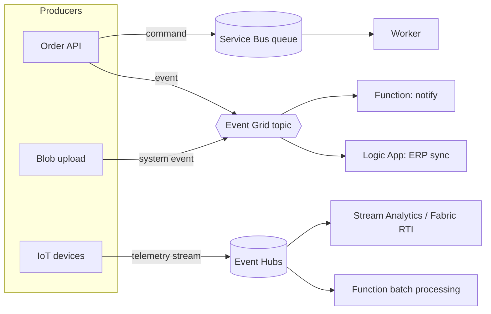
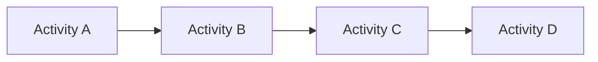
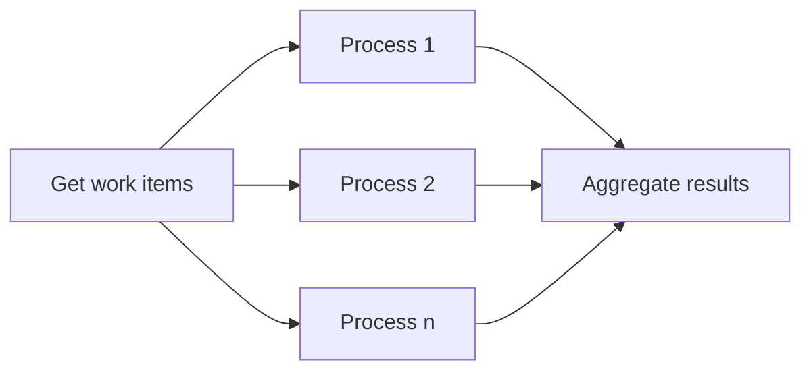
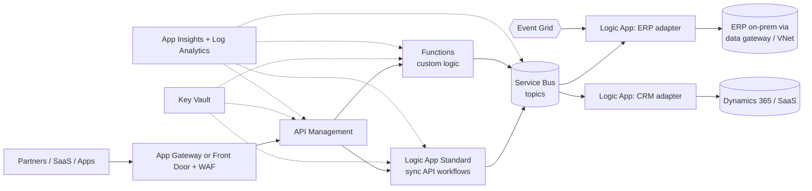

# Serverless, Event-Driven Architecture & Integration (Azure)

> **TL;DR** — Distinguish **messages** (commands with intent, must be processed — Service Bus / Storage Queues) from **events** (facts — discrete notifications via Event Grid, or streams of telemetry via Event Hubs). Use **Functions** for code glue, **Logic Apps** for connector-heavy workflows, **Durable Functions** for stateful orchestrations (chaining, fan-out/fan-in, async HTTP, monitor, human interaction, aggregator), and **API Management** as the governed front door. Together these form Azure Integration Services (AIS). Design for at-least-once delivery: idempotency, dead-lettering, and observability are non-negotiable.

---

## 1. Event-driven architecture concepts

| Concept | Description |
|---|---|
| **Event** | A fact that something happened (`OrderPlaced`). Publisher doesn't care who listens |
| **Message / command** | A request to do something (`ShipOrder`). Sender expects a specific receiver to handle it |
| **Discrete event** | Notification, individually actionable (blob created) |
| **Event stream** | Continuous series analyzed in aggregate (telemetry, clickstream) |
| **Event notification vs event-carried state transfer** | Thin event (id → callback) vs fat event (full state) |
| **Delivery semantics** | At-most-once, **at-least-once** (most cloud brokers), exactly-once (only within limited scopes, e.g. transactional processing) |
| **Ordering** | Usually per partition/session only |
| **Idempotency** | Processing the same message twice yields same outcome — dedupe by message id / business key |
| **Outbox pattern** | Write state + event in the same DB transaction; relay publishes → avoids dual-write inconsistency |
| **Schema** | CloudEvents spec for envelope; schema registry (Event Hubs schema registry) for payload evolution |



---

## 2. Messaging services decision table

| Criterion | **Service Bus** | **Event Grid** | **Event Hubs** | **Storage Queues** |
|---|---|---|---|---|
| Type | Enterprise message broker | Event routing (pub/sub, push & pull) | Big-data streaming / event ingestion (Kafka-compatible) | Simple queue |
| Pattern | Queues, topics/subscriptions | Topics, system topics, domains, namespaces (MQTT, pull delivery) | Partitioned log, consumer groups | Queue |
| Payload | Up to 256 KB (Standard), 100 MB (Premium) | 1 MB (billed per 64 KB) | 1 MB (Standard/Premium), larger in Dedicated | 64 KB |
| Ordering | FIFO via **sessions** | No | Per partition | No (best-effort) |
| Delivery | Pull (peek-lock), at-least-once; duplicate detection | Push w/ retry (24 h, exponential) + dead-letter to blob; pull delivery | Pull; consumer tracks offset (checkpoint) | Pull, visibility timeout |
| Transactions | Yes (within namespace) | No | No | No |
| Dead-letter | Built-in DLQ | Blob dead-letter | N/A (retain & replay) | Poison queue (Functions) |
| Retention / replay | Until consumed (TTL) | No retention (24 h retry) | 1–7 days (Standard), up to 90 (Premium/Dedicated), Capture to storage | 7 days default (configurable, up to infinite) |
| Throughput | Thousands–tens of thousands msg/s (Premium MU) | Millions events/s | Millions events/s (TU/PU/CU) | ~2000 msg/s per queue |
| Filtering | SQL/correlation filters on subscriptions | Advanced filters on event type/subject/data | None (consumer side) | None |
| Protocol | AMQP 1.0, HTTPS, JMS 2.0 (Premium) | HTTPS, MQTT (namespaces), CloudEvents | AMQP, **Kafka**, HTTPS | HTTPS |
| Private networking | Premium | Yes (namespaces / private endpoints for topics) | Standard+ | Yes |
| Cost | Std per-op; Premium per MU | Per operation (cheap) | Per TU/PU + ingress | Very cheap |
| Use when | Business transactions, commands, workflows, ordering, dedupe, transactions | Reacting to state changes in Azure resources or apps; fan-out notifications; serverless triggers | Telemetry, logs, clickstream, CDC streams, Kafka replacement | Simple background work, cost-sensitive, huge backlog |

**Rules of thumb**
- "Is losing this a business problem?" → **Service Bus**.
- "Something changed, who cares?" → **Event Grid**.
- "Lots of data points per second, analyzed in aggregate?" → **Event Hubs**.
- "Simple, cheap, ≤ 64 KB, no frills" → **Storage Queues**.
- Combine: Event Grid notifies Blob created → Function enqueues command on Service Bus → worker processes.

### 2.1 Service Bus essentials

- Tiers: Basic (queues only), Standard (topics, shared), **Premium** (dedicated messaging units, VNet/private endpoints, zone redundancy, geo-disaster recovery & geo-replication, large messages).
- **Peek-lock**: receive → process → `Complete`; failure → `Abandon` → redelivered; after `MaxDeliveryCount` → **DLQ**.
- **Sessions**: FIFO + exclusive per session id (Sequential Convoy).
- **Duplicate detection** window by `MessageId`.
- **Scheduled messages**, **deferral**, **auto-forwarding**, **TTL**.
- Use managed identity with `Azure Service Bus Data Sender/Receiver` roles; disable SAS keys (`disableLocalAuth`).

### 2.2 Event Hubs essentials

- Partitions (parallelism unit; count fixed at creation for Standard), consumer groups (independent readers), checkpointing in Blob.
- Tiers: Basic, Standard (TUs, auto-inflate), Premium (PUs), Dedicated (CUs).
- **Capture** → Avro/Parquet into ADLS for cold path.
- **Kafka endpoint** — existing Kafka clients connect by config change.

### 2.3 Event Grid essentials

- **System topics** (Azure resource events: Storage, Resource groups, Key Vault, ACR...), **custom topics**, **domains** (multi-tenant topics), **namespaces** (MQTT broker + pull delivery).
- Subscriptions with filters (event types, subject begins/ends with, advanced filters), retry policy, dead-letter destination.
- Handlers: Functions, Logic Apps, Service Bus, Event Hubs, Storage Queue, webhooks (validated handshake).
- Schema: Event Grid schema or **CloudEvents 1.0** (prefer CloudEvents for interoperability).

---

## 3. Azure Functions

### 3.1 Programming model

- **Triggers** (one per function): HTTP, Timer, Service Bus, Event Hubs, Event Grid, Blob (prefer Event Grid–based blob trigger), Queue, Cosmos DB change feed, Kafka, RabbitMQ, SQL, Durable.
- **Bindings** (input/output): declarative access to storage, Cosmos, Service Bus etc.
- Languages: C# (**isolated worker model** — in-process retires Nov 2026), JavaScript/TypeScript, Python, Java, PowerShell, custom handlers (Go, Rust).

```csharp
// .NET isolated worker: Service Bus trigger with Cosmos output
public class OrderProcessor(ILogger<OrderProcessor> log)
{
    [Function(nameof(OrderProcessor))]
    [CosmosDBOutput("sales", "orders", Connection = "Cosmos")]
    public Order Run([ServiceBusTrigger("orders", Connection = "ServiceBus")] Order order)
    {
        log.LogInformation("Processing {OrderId}", order.Id);
        return order with { Status = "Accepted" };
    }
}
```

Connection settings with managed identity: `ServiceBus__fullyQualifiedNamespace = sbns-x.servicebus.windows.net` (no connection string).

### 3.2 Cold starts

| Cause | Mitigation |
|---|---|
| Scale from zero: allocate instance, load runtime, load code | Flex Consumption **always-ready instances**, Premium pre-warmed instances, Dedicated with Always On |
| Large deployment package / many dependencies | Trim dependencies, run from package, ReadyToRun (.NET), smaller container images |
| Heavy startup code (DI graph, DB connections) | Lazy init, static/shared clients (`HttpClient`, `CosmosClient` singletons) |
| Language runtime | .NET isolated/Node/Python typically faster than Java w/o tuning; consider Native AOT where supported |
| VNet integration | Flex/Premium handle better than legacy |
| Infrequent traffic | Timer "keep-warm" pings are a hack; prefer always-ready |

Typical cold start: sub-second to several seconds — *measure for your stack*.

### 3.3 Serverless design rules

- Functions should be **short, stateless, idempotent**.
- Do not call functions from functions over HTTP synchronously — use queues or Durable.
- Watch **connection exhaustion** (SNAT): reuse clients.
- Set `maxConcurrentCalls`, batch sizes, `host.json` concurrency; protect downstream DBs (rate limiting).
- Use **dynamic concurrency** where available.
- Observability: Application Insights with OpenTelemetry; correlate across triggers (`traceparent` propagated in Service Bus / Event Hubs properties).

### 3.4 Serverless across clouds

| Capability | Azure | GCP | AWS |
|---|---|---|---|
| Functions | Azure Functions | Cloud Run functions (formerly Cloud Functions) | Lambda |
| Serverless containers | Container Apps | Cloud Run | App Runner / Fargate |
| Workflow orchestration | Durable Functions, Logic Apps | Workflows | Step Functions |
| Event router | Event Grid | Eventarc | EventBridge |
| Queue/broker | Service Bus, Storage Queues | Pub/Sub, Cloud Tasks | SQS, SNS, Amazon MQ |
| Streaming | Event Hubs | Pub/Sub, Managed Kafka | Kinesis, MSK |
| API gateway | API Management | API Gateway, Apigee | API Gateway |

---

## 4. Durable Functions

Extension that adds **stateful orchestrations** (event-sourced history in storage backend: Azure Storage, Netherite, MSSQL, or **Durable Task Scheduler** managed backend — *verify*). Orchestrator code must be **deterministic** (no `DateTime.Now`, random, direct I/O — use `context.CurrentUtcDateTime`, activities for I/O).

Function types: **Client** (starts/queries), **Orchestrator** (workflow), **Activity** (unit of work), **Entity** (durable actor-like state).

### 4.1 Pattern 1 — Function chaining



```csharp
[Function(nameof(ChainOrchestrator))]
public static async Task<string> ChainOrchestrator([OrchestrationTrigger] TaskOrchestrationContext ctx)
{
    var x = await ctx.CallActivityAsync<string>("Validate", ctx.GetInput<string>());
    var y = await ctx.CallActivityAsync<string>("Enrich", x);
    var z = await ctx.CallActivityAsync<string>("Persist", y);
    return await ctx.CallActivityAsync<string>("Notify", z);
}
```

### 4.2 Pattern 2 — Fan-out / fan-in



```csharp
var items = await ctx.CallActivityAsync<string[]>("GetFiles", null);
var tasks = items.Select(i => ctx.CallActivityAsync<long>("ProcessFile", i));
long[] sizes = await Task.WhenAll(tasks);
await ctx.CallActivityAsync("SaveTotal", sizes.Sum());
```

### 4.3 Pattern 3 — Async HTTP API

Client starts orchestration, returns **202 Accepted** with `statusQueryGetUri`; client polls until `Completed`. Built-in via `CreateCheckStatusResponseAsync`. (Implements Asynchronous Request-Reply pattern.)

### 4.4 Pattern 4 — Monitor

Flexible recurring polling loop until condition met or timeout (replaces fixed timers):

```csharp
var expiry = ctx.CurrentUtcDateTime.AddHours(6);
while (ctx.CurrentUtcDateTime < expiry)
{
    var status = await ctx.CallActivityAsync<string>("CheckJobStatus", jobId);
    if (status == "Done") { await ctx.CallActivityAsync("Alert", jobId); break; }
    await ctx.CreateTimer(ctx.CurrentUtcDateTime.AddMinutes(5), CancellationToken.None);
}
```

### 4.5 Pattern 5 — Human interaction

Wait for an external event (approval) with timeout + escalation:

```csharp
await ctx.CallActivityAsync("RequestApproval", request);
using var cts = new CancellationTokenSource();
var timeout = ctx.CreateTimer(ctx.CurrentUtcDateTime.AddHours(72), cts.Token);
var approval = ctx.WaitForExternalEvent<bool>("ApprovalEvent");
if (approval == await Task.WhenAny(approval, timeout)) { cts.Cancel(); await ctx.CallActivityAsync("Process", approval.Result); }
else { await ctx.CallActivityAsync("Escalate", request); }
```

Raise event from outside: `client.RaiseEventAsync(instanceId, "ApprovalEvent", true)`.

### 4.6 Pattern 6 — Aggregator (stateful entities)

Durable **entities** accumulate events over time into a single addressable state (e.g. counter per device, shopping cart). Operations are serialized per entity — no concurrency bugs.

```csharp
public class Counter : TaskEntity<int>
{
    public void Add(int amount) => State += amount;
    public int Get() => State;
    [Function(nameof(Counter))]
    public static Task Run([EntityTrigger] TaskEntityDispatcher d) => d.DispatchAsync<Counter>();
}
```

### 4.7 Durable gotchas

- Non-deterministic orchestrator code → replay failures.
- Large inputs/outputs bloat history → pass references (Claim Check).
- Versioning: changing orchestrator code with in-flight instances breaks replay → side-by-side versions or drain.
- Eternal orchestrations: use `ContinueAsNew` to truncate history.
- Storage backend costs/throughput at scale → consider Durable Task Scheduler / Netherite.

---

## 5. Logic Apps

| | **Consumption** | **Standard** |
|---|---|---|
| Hosting | Multi-tenant, per-action billing | Single-tenant (App Service–like plan, Workflow Standard WS1–3) or containers/hybrid (Arc) |
| Workflows per resource | 1 | Many (stateful + **stateless**) |
| Networking | Limited (ISE retired) | VNet integration, private endpoints |
| Built-in connectors | Fewer | Built-in (in-process) connectors for Service Bus, SQL, Blob, SAP etc.; plus managed connectors |
| Dev experience | Portal designer | VS Code, local debug, CI/CD as app |
| Use | Low-volume, occasional automations | Enterprise integration, private networking, predictable cost at volume |

Logic Apps vs Functions vs Power Automate:

| Need | Choose |
|---|---|
| Many SaaS/enterprise connectors, low code, visual monitoring, B2B (EDI X12/EDIFACT/AS2 via Integration Account) | **Logic Apps** |
| Custom code, complex logic, high performance | **Functions** |
| Business-user self-service automations in M365 | **Power Automate** |
| Long-running code-first workflows | **Durable Functions** |

---

## 6. API Management (APIM)

### 6.1 Components

- **Gateway** (data plane): proxies requests, applies **policies**.
- **Management plane**: APIs, products, subscriptions, named values (Key Vault-backed), backends.
- **Developer portal**: docs, try-it, self-service subscription keys.
- **Self-hosted gateway**: container on-prem/other clouds (hybrid).
- **Workspaces**: federated API management for multiple teams.

### 6.2 Tiers (*verify current SKUs*)

| Tier | VNet | SLA | Notes |
|---|---|---|---|
| Consumption | No (outbound limited) | 99.95% | Serverless, per-call; no developer portal; cold start |
| Developer | Yes (injection) | None | Non-production only |
| Basic / Standard | No (classic) | 99.95% | |
| **Basic v2 / Standard v2** | Standard v2: VNet integration (outbound) + private endpoint (inbound) | 99.95% | Fast provisioning, modern default for many |
| Premium (classic) | VNet injection (internal/external), multi-region, zones | 99.99% | Enterprise, multi-region |
| Premium v2 | VNet injection | — | *verify GA* |

### 6.3 Common policies

```xml
<policies>
  <inbound>
    <base />
    <!-- Validate Entra ID JWT -->
    <validate-azure-ad-token tenant-id="{{tenant-id}}">
      <client-application-ids><application-id>{{client-app-id}}</application-id></client-application-ids>
      <required-claims><claim name="roles" match="any"><value>Orders.Read</value></claim></required-claims>
    </validate-azure-ad-token>
    <rate-limit-by-key calls="60" renewal-period="60" counter-key="@(context.Request.Headers.GetValueOrDefault("Authorization",""))" />
    <!-- Call backend with APIM's managed identity -->
    <authentication-managed-identity resource="api://orders-backend" />
    <set-backend-service backend-id="orders-backend-pool" />
    <cache-lookup vary-by-developer="false" vary-by-developer-groups="false" downstream-caching-type="none" />
  </inbound>
  <backend><base /></backend>
  <outbound>
    <base />
    <cache-store duration="60" />
    <set-header name="X-Powered-By" exists-action="delete" />
  </outbound>
  <on-error><base /></on-error>
</policies>
```

Also: CORS, IP filtering, mock responses, transformation (XML↔JSON, `set-body` Liquid), backend pools & circuit breaker, **AI gateway** policies (token limits, semantic caching, load balancing across Azure OpenAI endpoints, token metrics).

### 6.4 APIM design checklist

- [ ] Products & subscriptions model (internal, partner, public)
- [ ] OAuth2/JWT validation; subscription keys alone are not authentication
- [ ] Backends protected (private endpoint / IP restriction / managed identity auth)
- [ ] Versioning (`/v1`, header, query) & revisions for non-breaking changes
- [ ] APIOps: APIs and policies in Git, deployed via pipeline (Bicep/Terraform/APIOps toolkit)
- [ ] Diagnostics to App Insights (sampling!) and Log Analytics
- [ ] WAF in front for internet exposure (App Gateway / Front Door)

---

## 7. Azure Integration Services (AIS) reference



Principles: **API-led** (system/process/experience APIs), canonical messages on the bus, adapters per system (anti-corruption), dead-letter monitoring dashboard, correlation id end-to-end, replay tooling. See [reference-architectures.md](reference-architectures.md).

---

## 8. Common mistakes

1. Using Event Grid for commands that must not be lost (no persistence beyond 24 h retries without dead-letter config).
2. Using Event Hubs as a work queue (no per-message ack; consumers manage offsets).
3. Non-idempotent consumers under at-least-once delivery.
4. Ignoring DLQs; no alerting on DLQ count.
5. Synchronous chains of HTTP functions → cascading timeouts, double billing.
6. Functions Consumption hammering a SQL DB with 200 instances → connection exhaustion.
7. Durable orchestrator doing I/O directly; breaking replay with code changes.
8. APIM Developer tier in production; subscription keys treated as authentication.
9. Logic Apps Consumption at high volume → surprising per-action costs; Standard is cheaper at scale.
10. Big payloads in messages instead of Claim Check.

## References

- Compare Azure messaging services — https://learn.microsoft.com/azure/event-grid/compare-messaging-services
- Azure Service Bus — https://learn.microsoft.com/azure/service-bus-messaging/
- Azure Event Grid — https://learn.microsoft.com/azure/event-grid/
- Azure Event Hubs — https://learn.microsoft.com/azure/event-hubs/
- Azure Functions — https://learn.microsoft.com/azure/azure-functions/
- Durable Functions overview (patterns) — https://learn.microsoft.com/azure/azure-functions/durable/durable-functions-overview
- Azure Logic Apps — https://learn.microsoft.com/azure/logic-apps/
- Azure API Management — https://learn.microsoft.com/azure/api-management/
- APIM policy reference — https://learn.microsoft.com/azure/api-management/api-management-policies
- Event-driven architecture style — https://learn.microsoft.com/azure/architecture/guide/architecture-styles/event-driven
- CloudEvents — https://cloudevents.io/
- Enterprise Integration Patterns — https://www.enterpriseintegrationpatterns.com/
- Related: [cloud-design-patterns.md](cloud-design-patterns.md), [Software architecture](../05-software-architecture/README.md)
