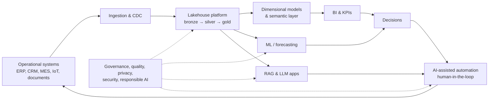

# 07 — Data & AI Architecture

> **TL;DR** — This section covers the full path from operational data to decisions and automation: data architecture paradigms, dimensional modelling, the modern data stack, Microsoft Fabric and Power BI, data quality and governance (incl. GDPR and the EU AI Act), SQL and Python depth, analytics and KPI design, ML and MLOps, and LLM/GenAI architecture (prompting, RAG, agents, evaluation, security, responsible AI), plus reference architectures and a curated resource list.

---

## Files in this section

| # | File | One-line description |
|---|---|---|
| 1 | [data-architecture-fundamentals.md](data-architecture-fundamentals.md) | OLTP vs OLAP, Inmon vs Kimball, lake/lakehouse, medallion, data mesh & fabric, Lambda/Kappa, ETL/ELT, batch/streaming, CDC, DAMA wheel, data lifecycle |
| 2 | [dimensional-modeling.md](dimensional-modeling.md) | Kimball 4-step process, fact types, dimension types, SCD 0–7, bus matrix, surrogate keys, Data Vault 2.0, OBT, 3NF, semantic layer, ERP modelling patterns |
| 3 | [modern-data-stack.md](modern-data-stack.md) | Ingestion (Fivetran, Airbyte, ADF), dbt in depth, orchestration (Airflow, Dagster, Prefect), Parquet/Delta/Iceberg/Hudi, query engines, reverse ETL |
| 4 | [microsoft-fabric-power-bi.md](microsoft-fabric-power-bi.md) | OneLake, Lakehouse vs Warehouse, Data Factory, Real-Time Intelligence, Direct Lake, storage modes, DAX basics, RLS/OLS, ALM |
| 5 | [data-quality-governance.md](data-quality-governance.md) | Governance roles, DQ dimensions, observability pillars, data contracts, MDM styles, catalog & lineage, classification, PII, GDPR, EU AI Act |
| 6 | [sql-patterns.md](sql-patterns.md) | Window functions, CTEs, recursive CTEs, dedup, gaps-and-islands, idempotent loads, MERGE, query plans, indexing, partitioning, clustering |
| 7 | [python-data-stack.md](python-data-stack.md) | pandas, Polars, DuckDB, PySpark, SQLAlchemy, pydantic, notebooks vs pipelines, robust API ingestion |
| 8 | [analytics-bi-kpis.md](analytics-bi-kpis.md) | KPI design template, metric trees, operational formulas, dashboard design, self-service BI governance, decision intelligence |
| 9 | [ml-fundamentals-mlops.md](ml-fundamentals-mlops.md) | Learning types, bias–variance, splits & CV, leakage, metrics, feature engineering, forecasting, MLOps maturity, feature store, registry, drift |
| 10 | [llm-fundamentals-prompting.md](llm-fundamentals-prompting.md) | Transformers, tokens, context windows, sampling, prompt techniques, structured output, prompting vs RAG vs fine-tuning, LoRA, cost/latency, hallucinations |
| 11 | [rag-architecture.md](rag-architecture.md) | RAG pipeline, parsing, chunking, embeddings, vector stores, hybrid search + RRF, reranking, query rewriting, GraphRAG, RAG security & evaluation |
| 12 | [ai-agents-automation.md](ai-agents-automation.md) | Workflows vs agents, Anthropic patterns, tool use, ReAct, multi-agent, MCP, document AI, human-in-the-loop automation design |
| 13 | [llm-evaluation-security-responsible-ai.md](llm-evaluation-security-responsible-ai.md) | Golden datasets, LLM-as-judge, RAGAS, guardrails, OWASP Top 10 for LLM Apps, prompt injection defence, Microsoft RAI, NIST AI RMF, ISO/IEC 42001 |
| 14 | [reference-architectures.md](reference-architectures.md) | Mermaid blueprints: Fabric lakehouse, ERP-to-BI, RAG over documents, AI process automation, streaming IoT/telemetry |
| 15 | [resources.md](resources.md) | Books, docs, papers, blogs, and learning paths |

---

## How the pieces fit

| Stage | Read |
|---|---|
| Design the platform | 1, 3, 4, 14 |
| Model the data | 2, 6 |
| Make it trustworthy | 5 |
| Turn data into decisions | 8, 9 |
| Add language AI | 10, 11, 12, 13 |
| Go deeper | 15 |

---

## Quick decision guide

| Question | Short answer | Details |
|---|---|---|
| Warehouse or lakehouse? | Lakehouse with open table formats unless team is SQL-only and data is purely structured | [fundamentals](data-architecture-fundamentals.md#2-storage-paradigms) |
| ETL or ELT? | ELT (with small in-flight "t" for PII/secrets) | [fundamentals](data-architecture-fundamentals.md#41-etl-vs-elt) |
| Batch or streaming? | Batch unless a decision changes with minutes-old data | [fundamentals](data-architecture-fundamentals.md#42-batch-vs-streaming) |
| Star schema or Data Vault? | Star for consumption always; Data Vault in between only with many sources/high audit needs | [dimensional modelling](dimensional-modeling.md) |
| SCD type? | Type 1 for corrections, Type 2 for history that matters; avoid tracking everything | [SCD](dimensional-modeling.md#5-slowly-changing-dimensions-scd-types-07) |
| Import, DirectQuery, or Direct Lake? | Direct Lake on Fabric gold tables; Import elsewhere; DirectQuery only for real-time needs | [Fabric & Power BI](microsoft-fabric-power-bi.md#32-storage-modes) |
| Measure or calculated column? | Measure, unless you need to slice by it — then compute upstream | [Fabric & Power BI](microsoft-fabric-power-bi.md#34-measures-vs-calculated-columns) |
| pandas, Polars, DuckDB, or Spark? | < GBs: pandas/Polars/DuckDB; 100s GB+: Spark | [Python](python-data-stack.md) |
| Prompting, RAG, or fine-tuning? | Prompt → RAG/tools → fine-tune only for proven gaps or cost | [LLM fundamentals](llm-fundamentals-prompting.md#4-adapting-models-prompting-vs-rag-vs-fine-tuning) |
| Workflow or agent? | Workflow when steps are known; agent only for open-ended tasks with verifiable feedback | [agents](ai-agents-automation.md) |
| How much human oversight? | Size by reversibility × impact × confidence | [HITL](ai-agents-automation.md#7-human-in-the-loop-hitl-automation-design) |

---

## Glossary (selected)

| Term | Definition |
|---|---|
| ACID | Atomicity, consistency, isolation, durability — transactional guarantees |
| Bus matrix | Grid of business processes × conformed dimensions; integration roadmap |
| CDC | Change data capture — incremental capture of inserts/updates/deletes |
| Conformed dimension | Dimension shared identically across fact tables |
| Context window | Max tokens an LLM can process per request (input + output) |
| Data contract | Producer–consumer agreement on schema, semantics, quality, SLAs |
| Data product | Data shared as a product: owned, documented, discoverable, trustworthy |
| Direct Lake | Power BI storage mode reading Delta tables in OneLake without import refresh |
| Drift | Change in data or relationships degrading model performance |
| Embedding | Vector representation of meaning used for similarity search |
| Grain | What one row of a fact table represents |
| Hybrid search | Combining keyword (BM25) and vector retrieval |
| Idempotent | Re-running produces the same result |
| LLM-as-judge | Using an LLM to grade outputs against a rubric |
| LoRA | Parameter-efficient fine-tuning via low-rank adapters |
| MCP | Model Context Protocol — open standard connecting AI apps to tools/data |
| Medallion | Bronze/silver/gold quality layering in a lakehouse |
| OneLake | Fabric's single tenant-wide data lake |
| Prompt injection | Untrusted input that manipulates an LLM's instructions |
| RAG | Retrieval-augmented generation |
| Reranker | Model rescoring retrieved candidates for relevance |
| RLS | Row-level security |
| SCD | Slowly changing dimension |
| Semantic layer | Central definitions of entities, relationships, metrics for all tools |
| STP | Straight-through processing — automated without human touch |
| Surrogate key | Meaningless warehouse-generated key |

---

## Related sections

- [01 — UX/UI](../01-ux-ui/README.md) — dashboard and AI-interface design
- [02 — Product management](../02-product-management/README.md) — data/AI products, metrics, OKRs
- [03 — Project management](../03-project-management/README.md) — delivering data platform programmes
- [04 — Agile, Kanban, Scrum](../04-agile-kanban-scrum/README.md) — iterative delivery of data products
- [05 — Software architecture](../05-software-architecture/README.md) — integration, events, ADRs
- [06 — Cloud architecture](../06-cloud-architecture/README.md) — Azure landing zones, security, networking
- [08 — Engineering](../08-engineering/README.md) — testing, CI/CD, code quality
- [09 — Leadership, teams & facilitation](../09-leadership-teams-facilitation/README.md) — data culture, change management
- [10 — Laws, principles & mental models](../10-laws-principles-mental-models/README.md) — Goodhart, Conway, Gall
- [11 — Enterprise architecture & business](../11-enterprise-architecture-business/README.md) — capability maps, business cases

## References

- Kimball Group: https://www.kimballgroup.com/
- DAMA International: https://www.dama.org/cpages/body-of-knowledge
- Data Mesh principles (Martin Fowler's site): https://martinfowler.com/articles/data-mesh-principles.html
- dbt documentation: https://docs.getdbt.com/
- Microsoft Fabric: https://learn.microsoft.com/fabric/
- Power BI: https://learn.microsoft.com/power-bi/
- Delta Lake: https://delta.io/ · Apache Iceberg: https://iceberg.apache.org/
- Anthropic — Building effective agents: https://www.anthropic.com/research/building-effective-agents
- Model Context Protocol: https://modelcontextprotocol.io/
- OWASP Top 10 for LLM Applications: https://owasp.org/www-project-top-10-for-large-language-model-applications/
- NIST AI RMF: https://www.nist.gov/itl/ai-risk-management-framework
- Full list: [resources.md](resources.md)
