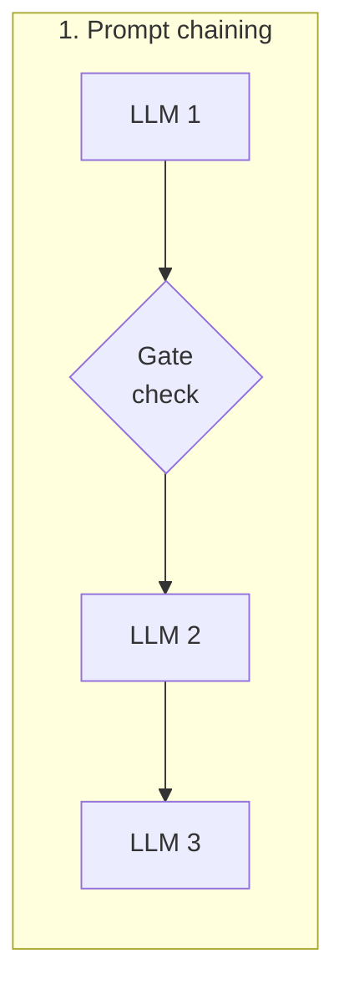
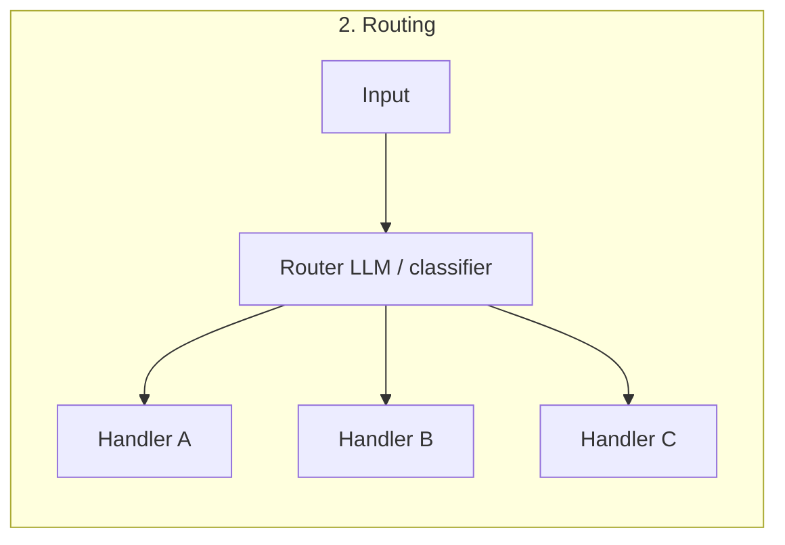
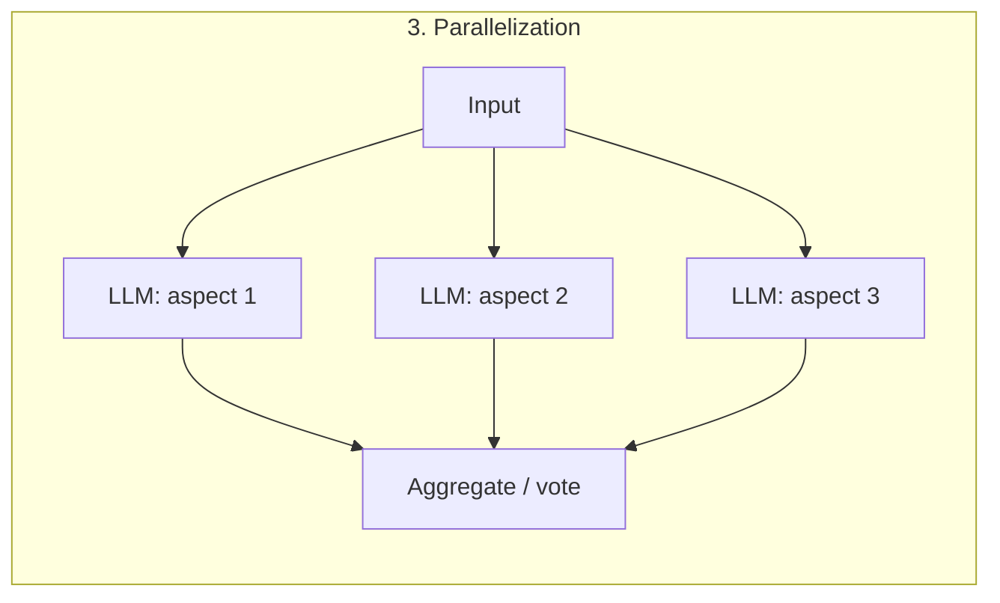
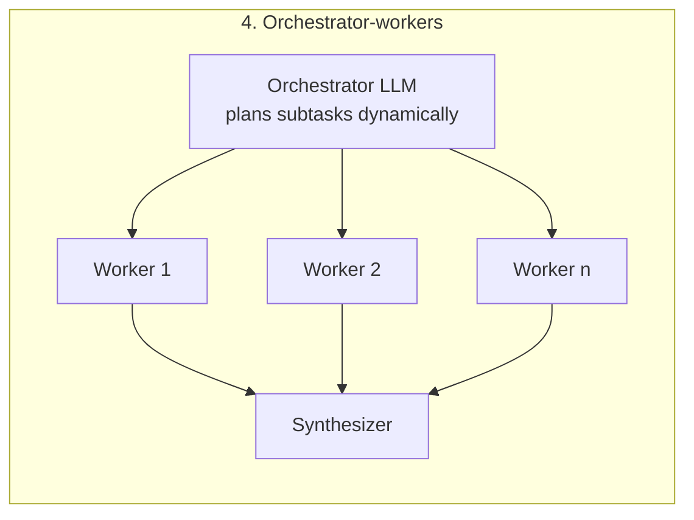
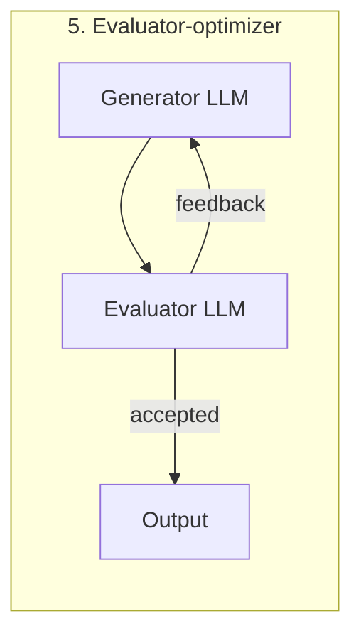
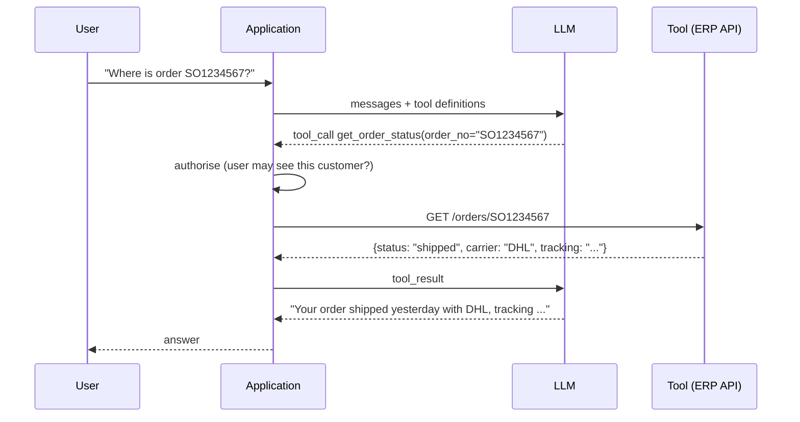
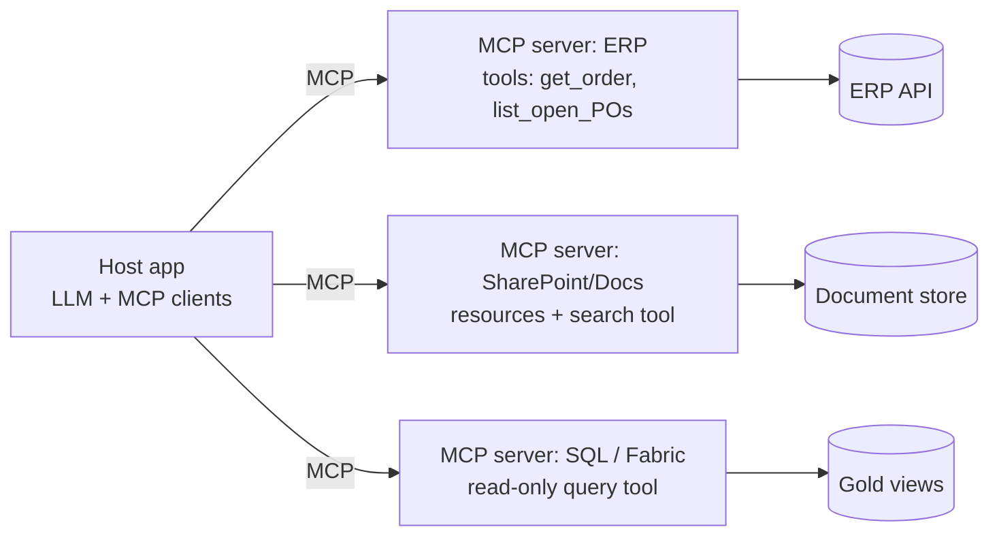
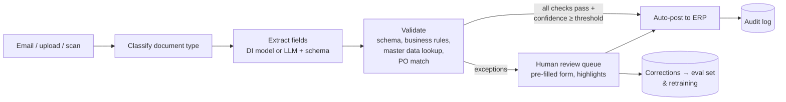

# AI Agents, Tool Use & AI-Assisted Process Automation

> **TL;DR** — Start with the simplest thing that works: a single LLM call with good context, then a fixed **workflow** (prompt chaining, routing, parallelization, orchestrator-workers, evaluator-optimizer), and only then an **autonomous agent** (LLM in a loop choosing tools) when the path truly cannot be predetermined. Tools are APIs with clear contracts; the **Model Context Protocol (MCP)** standardises how they are exposed. In business automation, combine deterministic code, document AI, and LLM judgement, with **human-in-the-loop** gates sized to risk, full audit logging, and least-privilege tool access.

---

## 1. Workflows vs agents

Following Anthropic's "Building effective agents" (Dec 2024):

| | Workflow | Agent |
|---|---|---|
| Control flow | Predefined code paths orchestrating LLM calls and tools | LLM dynamically directs its own process and tool use in a loop |
| Predictability | High | Lower |
| Cost/latency | Lower, bounded | Higher, variable |
| Best for | Well-defined tasks with known steps | Open-ended problems, unpredictable number of steps |
| Testing | Unit-test each step | Scenario/trajectory evals, sandboxing |

Building block: the **augmented LLM** — an LLM with retrieval, tools, and memory.

### 1.1 Workflow patterns







| Pattern | Description | When | Business example |
|---|---|---|---|
| **Prompt chaining** | Sequence of calls, each processing the previous output; optional programmatic gates | Task decomposes cleanly into fixed steps; trade latency for accuracy | Extract invoice fields → validate against PO (code) → draft exception email |
| **Routing** | Classify input and send to specialised prompt/model/tool | Distinct categories handled better separately; also cost routing (easy → small model) | Customer-service inbox: order status / complaint / quote request / spam |
| **Parallelization** — *sectioning* | Independent subtasks run concurrently | Speed; separate concerns (e.g. guardrail check in parallel with answer) | Review a contract: liability, payment terms, termination clauses in parallel |
| **Parallelization** — *voting* | Same task several times, aggregate | Higher confidence | 3 classifiers vote on whether a supplier email indicates a delay |
| **Orchestrator-workers** | Central LLM breaks down task dynamically, delegates, synthesises | Subtasks not known in advance | Research a supplier: orchestrator decides which sources/tools to query |
| **Evaluator-optimizer** | One LLM generates, another evaluates with criteria, loop | Clear evaluation criteria, iterative refinement adds value | Translating technical documentation; drafting customer replies against a tone/policy rubric |
| **Autonomous agent** | LLM loop: plan → act (tool) → observe → repeat until done/stop condition | Open-ended, many steps, trusted environment, ground-truth feedback from tools | Coding agents; data investigation agent querying multiple systems |

Core advice from the article: keep it simple, prefer transparency (show planning steps), and invest heavily in the **agent–computer interface (ACI)**: tool documentation, parameter names, examples, error messages, poka-yoke (make mistakes hard).

---

## 2. Tool use / function calling

The model receives tool definitions (name, description, JSON schema of parameters); it emits a structured tool call; **your code executes it** and returns the result; the model continues.



Tool definition example (generic JSON schema):

```json
{
  "name": "get_open_purchase_orders",
  "description": "Returns open purchase order lines for one supplier, including confirmed and requested delivery dates. Use when the user asks about expected deliveries or delays from a supplier. Does not return closed orders.",
  "input_schema": {
    "type": "object",
    "properties": {
      "supplier_no": {"type": "string", "description": "ERP supplier number, e.g. 'S000123'. Look it up with find_supplier if only a name is known."},
      "due_before": {"type": "string", "format": "date", "description": "Only lines due before this date (YYYY-MM-DD). Optional."}
    },
    "required": ["supplier_no"]
  }
}
```

Tool design checklist:
- [ ] Clear, distinct names and descriptions stating **when to use / not use**.
- [ ] Few, well-scoped tools (consolidate instead of 40 overlapping endpoints).
- [ ] Inputs validated server-side (pydantic); helpful error messages the model can act on.
- [ ] Outputs concise, relevant fields only (token budget), paginated, with IDs for follow-ups.
- [ ] **Authorisation in the tool layer using the end user's identity** — not the model's judgement.
- [ ] Read vs write tools separated; writes require confirmation or approval policy.
- [ ] Idempotency keys for write actions; timeouts; rate limits.
- [ ] Every call logged (who, what, args, result, trace id).

---

## 3. Agent loop, ReAct, planning

**ReAct** (Reason + Act, Yao et al. 2022): interleave reasoning traces with actions and observations: *Thought → Action → Observation → Thought → ... → Final answer*. Modern tool-calling APIs and reasoning models implement this natively.

Minimal agent loop (pseudo-Python):

```python
def run_agent(goal: str, tools: dict, max_steps: int = 15, budget_eur: float = 0.50):
    messages = [system_prompt(), {"role": "user", "content": goal}]
    cost = 0.0
    for step in range(max_steps):
        resp = llm.chat(messages, tools=tool_schemas(tools))
        cost += resp.cost
        if resp.stop_reason != "tool_use":
            return resp.text                                  # final answer
        results = []
        for call in resp.tool_calls:
            if requires_approval(call):
                approval = request_human_approval(call)        # HITL gate
                if not approval.granted:
                    results.append(tool_result(call.id, "Rejected by user: " + approval.reason))
                    continue
            try:
                out = tools[call.name](**validate(call))
            except ToolError as e:
                out = f"ERROR: {e}"                            # let the model recover
            results.append(tool_result(call.id, out))
            audit_log(step, call, out)
        messages += [resp.as_message(), *results]
        if cost > budget_eur:
            return escalate("Budget exceeded", messages)
    return escalate("Max steps reached", messages)
```

Planning approaches: plan-then-execute (explicit plan, then steps; re-plan on failure), ReAct (incremental), tree search / reflection (Reflexion), to-do lists in context (agent maintains a task list), sub-agents for isolated contexts.

**Memory**:
| Type | Implementation |
|---|---|
| Short-term (working) | Conversation/context window; summarisation/compaction when long |
| Long-term semantic | Vector/keyword store of facts, user preferences |
| Episodic | Logs of past runs/outcomes |
| Procedural | Instructions, skills, playbooks loaded on demand |

Stopping conditions: task complete, max steps, max cost/time, repeated failure, human stop, low confidence → escalate.

---

## 4. Multi-agent systems

| Topology | Description | Pros | Cons |
|---|---|---|---|
| Single agent + many tools | One loop | Simplest, coherent context | Context bloat with many tools |
| Orchestrator + sub-agents (supervisor) | Lead agent delegates to specialised sub-agents with own context/tools, receives condensed results | Parallelism, context isolation, specialisation | Token cost multiplies; coordination errors |
| Handoffs / swarm | Agents pass control to each other | Natural for routing conversations | Hard to debug |
| Sequential pipeline of agents | Fixed order | Predictable | Basically a workflow |
| Debate / critic | Agents critique each other | Quality on reasoning tasks | Cost |

Guidance: multi-agent helps for **breadth-first, parallelisable** tasks (research, broad search) and context isolation; it hurts for tightly coupled tasks needing shared context. Expect several × the tokens of a single agent. Frameworks (as of 2026, verify): Microsoft Agent Framework (successor combining Semantic Kernel and AutoGen), Azure AI Foundry Agent Service, Copilot Studio, LangGraph, OpenAI Agents SDK, Claude Agent SDK, CrewAI, PydanticAI, Google ADK. Agent-to-agent protocol: **A2A** (Google-originated, Linux Foundation).

---

## 5. Model Context Protocol (MCP)

Open protocol (introduced by Anthropic, Nov 2024; now widely adopted across vendors and governed under the Linux Foundation's Agentic AI Foundation — verify) standardising how AI applications connect to tools and data — "USB-C for AI apps".

| Concept | Description |
|---|---|
| **Host** | The AI application (Claude Desktop/Code, VS Code/GitHub Copilot, Copilot Studio, custom app) |
| **Client** | Connector inside the host, one per server connection |
| **Server** | Exposes capabilities: **tools** (model-invoked functions), **resources** (readable data/context, app-controlled), **prompts** (user-invoked templates) |
| Client features | Sampling (server asks host LLM to generate), roots, elicitation (server asks user for input) |
| Transports | stdio (local process), Streamable HTTP (remote; replaced HTTP+SSE) |
| Protocol | JSON-RPC 2.0, capability negotiation, versioned spec |
| Auth | OAuth 2.1-based authorisation for remote servers |



Minimal Python server (official SDK, FastMCP style):

```python
from mcp.server.fastmcp import FastMCP

mcp = FastMCP("erp-orders")

@mcp.tool()
def get_order_status(order_no: str) -> dict:
    """Return status, ship date and carrier for a sales order (e.g. 'SO1234567')."""
    order = erp_client.get_order(order_no)          # authorisation enforced in erp_client
    return {"status": order.status, "shipped_on": order.ship_date, "carrier": order.carrier}

if __name__ == "__main__":
    mcp.run()          # stdio by default; use streamable HTTP for remote deployment
```

MCP security considerations: treat third-party servers as untrusted code; **tool poisoning** (malicious descriptions with hidden instructions), rug-pull updates, confused-deputy/token passthrough issues, over-broad scopes, data exfiltration via combined tools ("lethal trifecta": private data + untrusted content + external communication). Mitigations: allow-list servers, pin versions, review tool descriptions, least-privilege OAuth scopes, per-user auth, human confirmation for sensitive actions, gateway/proxy with logging (e.g. API Management in front of MCP servers).

---

## 6. AI document processing

Typical in operational companies: supplier invoices, order confirmations, delivery notes, certificates (CoC/CoA), customs documents, customer POs (PDF/email), quality reports.

### 6.1 Options

| Approach | Description | Strengths | Weaknesses |
|---|---|---|---|
| **Azure AI Document Intelligence** prebuilt models | Invoice, receipt, ID, business card, tax forms, contracts, etc. | Fast start, confidence scores, bounding boxes | Fixed schema; custom fields limited |
| Document Intelligence **layout** + **custom models** | Custom extraction (template/neural) and classification trained on labelled samples | Precise per document type, confidence per field | Labelling effort, per-layout training |
| Azure **Content Understanding** | Generative-AI-based analyzers with schema definitions across docs/images/audio/video | Flexible schema, less labelling | Newer; verify regions/pricing |
| **Multimodal LLM** with structured output | Send page images/PDF + JSON schema | Very flexible, handles varied layouts, reasoning (e.g. "which line is freight?") | Fewer native confidence scores, cost, must validate |
| Hybrid | OCR/layout → LLM for interpretation → rules for validation | Best accuracy/cost balance | More components |

### 6.2 Pipeline



Validation layer examples (deterministic code, not the LLM):
- Supplier exists (VAT/IBAN match against master data; IBAN change → always human review — fraud risk).
- Three-way match: PO ↔ goods receipt ↔ invoice within tolerance (price ±2%, qty exact).
- Totals: Σ lines + VAT = invoice total; VAT rate valid for country.
- Duplicate check: same supplier + invoice number + amount.
- Dates plausible.

Measure **straight-through processing (STP) rate**, field-level accuracy, exception rate by reason, handling time, and cost per document.

---

## 7. Human-in-the-loop (HITL) automation design

### 7.1 Autonomy levels

| Level | Description | Example |
|---|---|---|
| 0 Manual | Human does everything | |
| 1 Assist | AI suggests/drafts; human decides and acts | Draft reply to customer complaint |
| 2 Approve | AI prepares action; human approves before execution | Expedite PO request prepared, buyer clicks approve |
| 3 Exception-based | AI acts automatically when confident and low-risk; humans handle exceptions | Invoices matching PO auto-posted; others queued |
| 4 Monitor | AI acts; humans audit samples and metrics | Auto-categorising tickets, weekly audit |
| 5 Autonomous | No routine human involvement | Rare in business processes with financial/legal impact |

### 7.2 Choosing the gate — risk matrix

| | Reversible, low impact | Irreversible or high impact |
|---|---|---|
| **High confidence** | Automate, sample audits | Approve (one-click) or automate with strict limits (amount caps) |
| **Low confidence** | Automate with easy undo, or queue | Human decides; AI assists |

Rules of thumb:
- Gates by **amount thresholds** (e.g. auto-approve < €1,000), **novelty** (new supplier/customer), **policy flags** (bank detail change), **model confidence**.
- GDPR Art. 22: decisions with legal/similarly significant effects on individuals need meaningful human involvement (not rubber-stamping).
- Design the review UI for speed: show source document with highlighted extractions, reasons, diff vs expected; keyboard shortcuts; capture corrections as labelled data.
- Measure **override rate** — too low may mean rubber-stamping (automation bias), too high means the model isn't useful.
- Kill switch and fallback to manual process.

### 7.3 Automation architecture building blocks (Microsoft ecosystem)

| Need | Options |
|---|---|
| Event triggers (email, file, form) | Power Automate, Logic Apps, Event Grid, Fabric Activator |
| Orchestration with retries/state | Logic Apps, Durable Functions, Fabric pipelines, Temporal |
| LLM calls | Azure OpenAI / Foundry models via API Management (AI gateway: quotas, logging, load balancing) |
| Document AI | Azure AI Document Intelligence / Content Understanding |
| Human tasks | Teams Approvals / adaptive cards, Power Apps review UI, ERP workflow |
| Agents | Copilot Studio, Foundry Agent Service, custom code |
| Write to ERP | ERP APIs (OData), Dataverse, RPA (Power Automate desktop) only as last resort |
| Audit & monitoring | Application Insights, Log Analytics, Fabric Eventhouse |

See [reference-architectures.md](reference-architectures.md) for the end-to-end diagram.

---

## 8. Agent evaluation and operations

- **Trajectory evals**: did the agent call the right tools with right args in a sensible order? Final-state checks (was the correct ERP record updated?).
- Success rate, steps per task, cost and latency per task, escalation rate, human override rate.
- Sandboxed environments with fake/test ERP data for eval runs.
- Tracing every step (OpenTelemetry GenAI semantic conventions; Foundry tracing; Langfuse).
- Canary/shadow mode: agent proposes, humans act; compare before enabling autonomy.
- Regression suite updated with each production incident.

## When to use agents / when not

| Use an agent | Use a workflow or plain code |
|---|---|
| Steps unpredictable, exploration needed | Steps known → workflow |
| Tools give reliable feedback (tests, query results) | No way to verify progress |
| Errors are cheap or sandboxed | Irreversible high-impact actions without review |
| Value justifies higher cost/latency | High-volume low-margin tasks → single call/small model |

## Common mistakes

- Building a "multi-agent framework" before a single prompt works.
- Letting the LLM decide authorisation ("only show data the user may see").
- Vague tool descriptions; too many overlapping tools.
- No step/cost limits → runaway loops.
- Write actions without idempotency or confirmation.
- Connecting untrusted MCP servers with broad tokens.
- No audit trail of AI-initiated actions.
- Measuring demo success instead of production STP/override rates.
- Ignoring the change-management side: people must trust and adopt the workflow (see [Leadership & facilitation](../09-leadership-teams-facilitation/README.md)).

## References

- Anthropic — Building effective agents: https://www.anthropic.com/research/building-effective-agents
- Anthropic engineering blog (agents, context engineering, tool design): https://www.anthropic.com/engineering
- Model Context Protocol: https://modelcontextprotocol.io/
- MCP specification and SDKs (GitHub): https://github.com/modelcontextprotocol
- Yao et al. — ReAct: Synergizing Reasoning and Acting in Language Models (2022): https://arxiv.org/abs/2210.03629
- Shinn et al. — Reflexion (2023): https://arxiv.org/abs/2303.11366
- Schick et al. — Toolformer (2023): https://arxiv.org/abs/2302.04761
- Azure AI Document Intelligence: https://learn.microsoft.com/azure/ai-services/document-intelligence/
- Azure AI Foundry: https://learn.microsoft.com/azure/ai-foundry/
- Microsoft Copilot Studio: https://learn.microsoft.com/microsoft-copilot-studio/
- Power Automate: https://learn.microsoft.com/power-automate/
- LangGraph: https://langchain-ai.github.io/langgraph/
- OWASP Top 10 for LLM Applications (LLM06 Excessive Agency): https://owasp.org/www-project-top-10-for-large-language-model-applications/
- Sibling: [llm-fundamentals-prompting.md](llm-fundamentals-prompting.md), [rag-architecture.md](rag-architecture.md), [llm-evaluation-security-responsible-ai.md](llm-evaluation-security-responsible-ai.md), [analytics-bi-kpis.md](analytics-bi-kpis.md); [Software architecture](../05-software-architecture/README.md)
