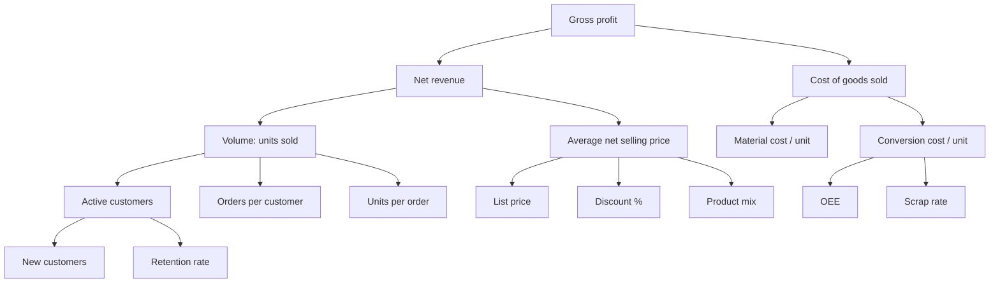
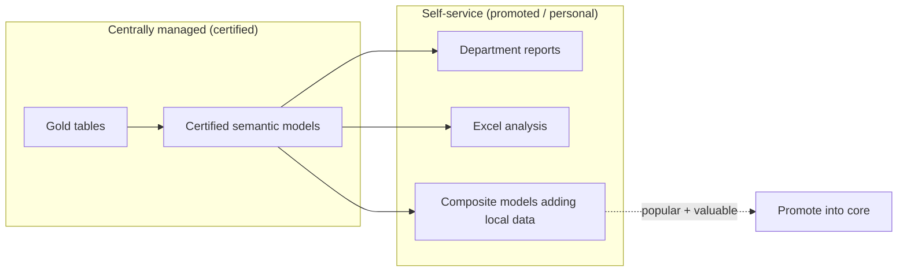
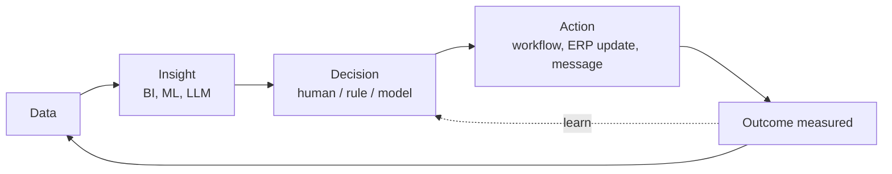

# Analytics, BI, KPI Design & Decision Intelligence

> **TL;DR** — Analytics exists to change decisions and actions. Start from the decision, derive the metric, then the data. Design KPIs with explicit definitions, owners, targets, and counter-metrics; organise them in a metric tree linking operational drivers to business outcomes. Design dashboards for a specific audience and question (overview → filter → detail). Govern self-service with a certified core (shared semantic models) and a free-but-labelled periphery. Decision intelligence closes the loop: data → insight → decision → action → measured outcome, increasingly automated with ML and LLMs under human oversight.

---

## 1. Analytics maturity ladder

| Level | Question | Techniques | Example (operations) |
|---|---|---|---|
| Descriptive | What happened? | Reports, dashboards, aggregations | Last month's OTIF was 91% |
| Diagnostic | Why did it happen? | Drill-down, segmentation, root cause, statistics | OTIF dropped due to supplier X late deliveries |
| Predictive | What will happen? | Forecasting, ML classification | 18% of next week's orders at risk of late delivery |
| Prescriptive | What should we do? | Optimisation, simulation, recommendation | Expedite 12 purchase orders; reallocate stock from DC2 |
| Automated / autonomous | Do it automatically | Rules engines, ML + workflow, AI agents with HITL | System raises expedite requests; planner approves |

Value grows with each level, but only if the lower levels are trusted. Most organisations get more value from fixing descriptive trust (one definition of revenue) than from jumping to AI.

---

## 2. KPI design

### 2.1 Terminology

| Term | Meaning |
|---|---|
| Metric | Any quantified measure (e.g. number of orders) |
| KPI | A metric critical to a strategic/operational objective, with a target |
| KRI | Key risk indicator (e.g. % stock older than 12 months) |
| North Star Metric | Single metric best capturing value delivered to customers (product orgs) |
| Leading indicator | Predicts future outcomes, actionable now (quotes sent, pipeline coverage, schedule adherence) |
| Lagging indicator | Measures outcome after the fact (revenue, EBIT, customer churn) |
| Input vs output metric | Inputs are controllable drivers; outputs are results |
| Counter-metric (guardrail) | Prevents gaming (speed ↔ quality, inventory ↔ service level) |

### 2.2 KPI definition template (store in glossary/catalog)

| Field | Example |
|---|---|
| Name | On-Time-In-Full (OTIF) % |
| Business question | Do we deliver what customers ordered, when promised? |
| Definition | Share of order lines delivered complete on or before the confirmed delivery date |
| Formula | `COUNT(lines where shipped_qty >= ordered_qty AND delivery_date <= confirmed_date) / COUNT(lines due in period)` |
| Grain & time attribution | Order line; period by confirmed delivery date |
| Inclusions/exclusions | Excludes intercompany, samples, cancelled lines; partial deliveries count as not-in-full |
| Dimensions | Customer, item group, warehouse, carrier, week |
| Target & thresholds | Target 95%; amber < 93%; red < 90% |
| Owner | Head of Logistics |
| Steward | Supply chain analyst |
| Data source | `gold.fct_order_fulfilment` (certified semantic model "Supply Chain") |
| Refresh | Daily 06:00 |
| Counter-metrics | Premium freight cost %, inventory days |
| Actions on red | Daily root-cause review; escalate supplier performance |
| Version / change log | v2 (2026-03): confirmed date instead of requested date |

### 2.3 Quality criteria for KPIs
- **SMART** (specific, measurable, achievable, relevant, time-bound) target.
- **Actionable**: someone can influence it and knows how.
- **Understandable**: a manager can explain it in one sentence.
- **Comparable** over time and across units (normalised: per FTE, per order, %).
- **Few**: 3–7 KPIs per role/team; more is a report, not a scorecard.
- **Balanced**: financial + customer + process + people (Balanced Scorecard perspectives).
- **Gaming-resistant**: Goodhart's law — "when a measure becomes a target, it ceases to be a good measure". Pair with counter-metrics. See [Laws & mental models](../10-laws-principles-mental-models/README.md).

### 2.4 OKRs vs KPIs
KPIs monitor the health of ongoing operations (business-as-usual); OKRs (Objectives & Key Results) drive change in a time-box. Key results often move a KPI ("raise OTIF from 91% to 95% by Q2"). See [Product management](../02-product-management/README.md).

---

## 3. Metric trees (driver trees)

A metric tree decomposes an output metric into its mathematical or causal drivers so that teams see how their input metrics contribute.



Types of edges:
- **Mathematical** (identity): Revenue = Volume × Price; OEE = Availability × Performance × Quality.
- **Causal / correlational** (hypothesis): Retention ← On-time delivery, Complaint resolution time. Validate with data; label as hypothesis.

How to build:
1. Start from the top business outcome (gross profit, cash, customer satisfaction).
2. Decompose mathematically as far as possible (each level sums or multiplies to parent).
3. At the leaves, add operational input metrics that teams control.
4. Assign an owner per node.
5. Implement each node as a certified measure; enable variance analysis (price/volume/mix bridge).
6. Review in business rhythm (weekly ops, monthly business review).

Price-Volume-Mix (PVM) variance — simplified, two-period:
```
Volume effect = (Q1_total − Q0_total) × P0_avg
Mix effect    = Σ (Q1_i − Q1_total × share0_i) × P0_i   (shift between products)
Price effect  = Σ (P1_i − P0_i) × Q1_i
```
(Several conventions exist — agree with Finance on one and document it.)

Common operational formulas:

| KPI | Formula |
|---|---|
| OEE | Availability × Performance × Quality = (run time / planned time) × (ideal cycle time × total count / run time) × (good count / total count) |
| Inventory turnover | COGS / average inventory value |
| Days inventory outstanding (DIO) | Average inventory / COGS × 365 |
| DSO | Accounts receivable / revenue × days in period |
| Cash conversion cycle | DIO + DSO − DPO |
| Forecast accuracy | 1 − WAPE, where WAPE = Σ|A−F| / Σ|A| |
| Forecast bias | Σ(F − A) / Σ A |
| Fill rate | Units shipped on first attempt / units ordered |
| Gross margin % | (Revenue − COGS) / Revenue |
| Customer retention | Customers active in both period t−1 and t / customers active in t−1 |

---

## 4. Dashboard design

See also [UX/UI](../01-ux-ui/README.md) for visual design principles.

### 4.1 Types

| Type | Audience | Refresh | Content |
|---|---|---|---|
| Strategic | Leadership | Monthly/weekly | Few KPIs vs target, trends, exceptions |
| Operational | Team leads, planners | Real-time/daily | Work queues, exceptions, alerts, "what to do now" |
| Analytical | Analysts | On demand | Exploration, drill-down, slicing |
| Tactical / review | Managers | Weekly/monthly | Variance analysis, drivers |

### 4.2 Design principles
- **One page, one question** — write the question in the title ("Are we delivering on time this week?").
- **Information hierarchy**: top-left = most important KPI; overview first, zoom and filter, details on demand (Shneiderman's mantra).
- **Context for every number**: vs target, vs prior period, trend sparkline. A number without comparison is not information.
- **Chart choice**: line for trends over time; bar (sorted) for comparison across categories; stacked bars only for part-to-whole with few parts; tables for lookup; scatter for relationships; avoid pie/donut beyond 2–3 slices, 3D, gauges consuming space; bullet charts instead of gauges.
- **Consistent colour semantics**: one accent colour for highlight; red/green only for status (and accessible: also icon/shape, colour-blind safe palettes).
- **Pre-attentive attributes**: position, length, colour intensity draw the eye — use them for what matters.
- **Data-ink ratio** (Tufte): remove gridlines, borders, redundant labels.
- **Start bar axes at zero**; lines may zoom but label clearly.
- **Text**: plain-language titles stating the insight ("OTIF fell 4 pts due to supplier X") for narrative reports.
- **Performance**: < 3 s render; fewer visuals; aggregated sources.
- **Accessibility**: alt text, keyboard navigation, contrast ratios, tab order (Power BI supports these).
- **Actionability**: link from exception to action (drill-through to order list, button to Power Apps/Power Automate, Teams).

### 4.3 IBCS (International Business Communication Standards)
SUCCESS rules: Say (convey a message), Unify (consistent notation: actual solid, plan outlined, forecast hatched; PY grey), Condense, Check (visual integrity), Express (right chart), Simplify, Structure. Popular in finance reporting (e.g. Zebra BI visuals for Power BI).

### 4.4 Dashboard review checklist
- [ ] Audience and decision documented.
- [ ] Every KPI from certified semantic model with definition tooltip.
- [ ] Comparison (target/PY/trend) next to each KPI.
- [ ] No more than ~8 visuals per page.
- [ ] Sorted bars, consistent scales, no 3D.
- [ ] Filters visible; current filter state clear.
- [ ] Data freshness timestamp shown.
- [ ] RLS tested with real users.
- [ ] Mobile layout if used on the floor/warehouse.
- [ ] Usage monitored after 30 days — retire unused reports.

---

## 5. Self-service BI governance

Goal: **managed self-service** — speed of decentralised analysis without chaos of conflicting numbers.



| Ownership model | Description | When |
|---|---|---|
| Business-led self-service | Business builds everything | Small orgs, low risk |
| **Managed self-service** | IT/central builds data + semantic models; business builds reports | Default for most mid-size orgs |
| Enterprise / centralised | Central team builds all content | Regulated reporting, low business skills |

Governance mechanisms (Power BI/Fabric terms; see Microsoft's Fabric adoption roadmap):
- **Center of Excellence (CoE)**: standards, training, community of practice, champions network.
- **Endorsement**: Promoted vs **Certified** semantic models; certification process with checklist.
- **Workspace strategy**: certified content in governed workspaces; personal/team workspaces for experimentation; apps for distribution.
- **Tenant settings**: who can publish, share externally, export, create workspaces, use Copilot.
- **Sensitivity labels and DLP**.
- **Monitoring**: activity logs → usage reports; detect duplicate models, orphaned content.
- **Lifecycle**: archive unused content after N days.
- **Training paths**: consumer → report author → model author → certified developer.

Certification checklist (sample):
- [ ] Owner and steward named; description and glossary links present.
- [ ] Built on gold tables (no direct source connections).
- [ ] Measures documented; naming conventions.
- [ ] RLS implemented and tested where needed.
- [ ] Refresh reliable for 30 days; failure alerts set.
- [ ] Performance tested (BPA rules pass).
- [ ] In Git; deployed via pipeline.

---

## 6. Decision intelligence

Decision intelligence (DI) treats **decisions as the unit of design**: model the decision, its inputs, logic, actions, and feedback, then decide where data, analytics, ML, and automation contribute.

### 6.1 Decision modelling

| Element | Question |
|---|---|
| Decision | What choice is made, how often, by whom? (e.g. "Which purchase orders to expedite daily") |
| Outcome | What business result is affected? (OTIF, premium freight cost) |
| Levers | What actions are available? (expedite, reallocate, substitute, inform customer) |
| Inputs | What information is needed? (open orders, stock, supplier ETA, forecast) |
| Logic | Rules, models, heuristics, trade-offs |
| Constraints | Capacity, budget, contracts |
| Feedback | How do we learn whether the decision was good? |

Decision types (and automation potential):

| Type | Frequency | Value per decision | Approach |
|---|---|---|---|
| Strategic (open a plant) | Rare | Very high | Analysis + human judgement, scenario modelling |
| Tactical (monthly S&OP volumes) | Periodic | High | Decision support: forecasts, scenarios |
| Operational (which order to expedite) | Daily, many | Low–medium each, high in aggregate | **Automate or semi-automate**: rules + ML + human-in-the-loop on exceptions |

Decision Model and Notation (DMN, OMG standard) can formalise decision logic (decision tables, requirements diagrams).

### 6.2 The closed loop



Practical patterns:
- **Exception-based management**: dashboards show only items needing action; Activator / alerts push them to Teams.
- **Embedded analytics in workflow**: decision context in the ERP/CRM screen (reverse ETL, Power BI embedded, Power Apps).
- **Recommendation + approval**: ML/LLM proposes action with rationale; human approves/edits; log decision and outcome for learning.
- **A/B or champion/challenger** for decision policies where possible.
- **Decision log**: record what was decided, by whom, with which information, and the outcome → enables learning and auditing (EU AI Act/GDPR Art. 22 relevance).

See [ai-agents-automation.md](ai-agents-automation.md) for AI-driven automation with human-in-the-loop.

---

## 7. Analytical thinking toolkit

| Technique | Use |
|---|---|
| Cohort analysis | Retention/behaviour by acquisition period |
| Funnel analysis | Conversion between process steps (quote → order → invoice) |
| Pareto / ABC-XYZ | Prioritise items by value (ABC) and demand variability (XYZ) |
| Variance analysis (PVM, budget vs actual) | Explain changes |
| Control charts (SPC) | Distinguish common-cause vs special-cause variation; avoid reacting to noise |
| Statistical significance / confidence intervals | Avoid over-interpreting small samples |
| Simpson's paradox awareness | Aggregates can reverse subgroup trends — segment |
| Survivorship bias, selection bias | Check what's missing from the data |
| Counterfactual thinking | Compare with what would have happened (control groups, difference-in-differences) |

## Common mistakes

- Dashboards built from "what data is available" rather than "what decision is made".
- Dozens of KPIs with no owner or target.
- Ratios averaged instead of recomputed; mixing time attributions (order date vs invoice date) across reports.
- Traffic lights without thresholds documented.
- Every department building its own semantic model of revenue.
- Reacting to random week-to-week variation (no SPC thinking).
- Building ML predictions with no defined action or owner → nobody uses them.
- Ignoring adoption metrics; never retiring reports.

## References

- Power BI guidance (dashboards, models, adoption): https://learn.microsoft.com/power-bi/guidance/
- Microsoft Fabric adoption roadmap: https://learn.microsoft.com/power-bi/guidance/fabric-adoption-roadmap
- IBCS standards: https://www.ibcs.com/
- Balanced scorecard (Wikipedia): https://en.wikipedia.org/wiki/Balanced_scorecard
- Goodhart's law (Wikipedia): https://en.wikipedia.org/wiki/Goodhart%27s_law
- Overall equipment effectiveness (Wikipedia): https://en.wikipedia.org/wiki/Overall_equipment_effectiveness
- Decision Model and Notation (OMG): https://www.omg.org/dmn/
- Decision intelligence (Wikipedia): https://en.wikipedia.org/wiki/Decision_intelligence
- Statistical process control (Wikipedia): https://en.wikipedia.org/wiki/Statistical_process_control
- Edward Tufte: https://www.edwardtufte.com/
- Storytelling with Data: https://www.storytellingwithdata.com/
- Related: [UX/UI](../01-ux-ui/README.md), [Product management](../02-product-management/README.md), [Laws & mental models](../10-laws-principles-mental-models/README.md), [Enterprise architecture & business](../11-enterprise-architecture-business/README.md)
