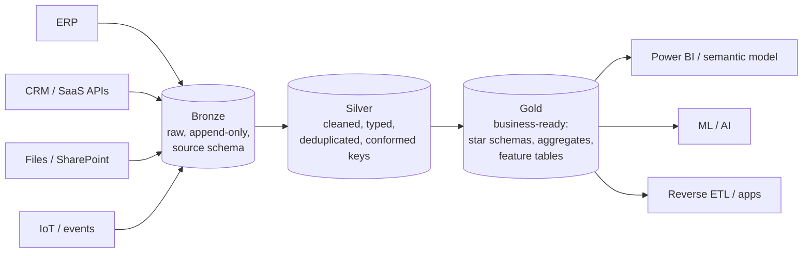
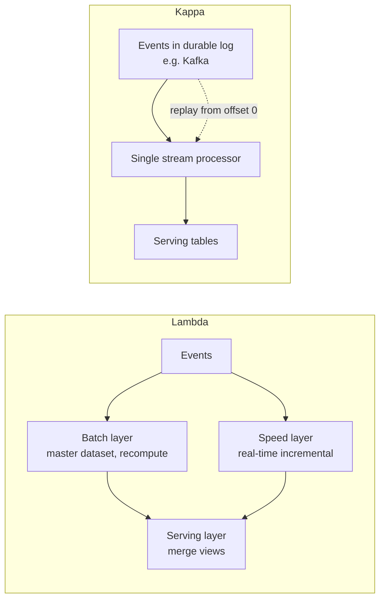
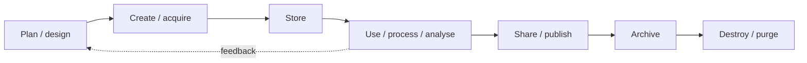

# Data Architecture Fundamentals

> **TL;DR** — Operational systems (OLTP) run the business; analytical systems (OLAP) explain and steer it. Pick a storage paradigm (warehouse, lake, lakehouse) and an organisational paradigm (central team, data mesh, data fabric) separately. Default for a mid-size company in 2026: ELT into a lakehouse with medallion layers, batch first, CDC where latency or deletes matter, streaming only where a decision actually needs seconds. Governance (DAMA-DMBOK) is the frame that keeps all of it trustworthy.

---

## 1. OLTP vs OLAP

| Aspect | OLTP (Online Transaction Processing) | OLAP (Online Analytical Processing) |
|---|---|---|
| Purpose | Run the business: record orders, invoices, stock moves | Understand the business: trends, KPIs, forecasting |
| Typical system | ERP (SAP, Dynamics 365, Exact, AFAS), CRM, WMS, MES | Data warehouse, lakehouse, cube / semantic model |
| Workload | Many small reads/writes, point lookups by key | Few large scans, aggregations over millions of rows |
| Schema | Normalised (3NF) to avoid update anomalies | Denormalised (star schema, wide tables) for read speed |
| Storage layout | Row-oriented (B-tree pages) | Column-oriented (Parquet, VertiPaq, columnstore) |
| Concurrency | Thousands of concurrent users, ACID per row | Tens-hundreds of analysts, snapshot reads |
| History | Current state (sometimes audit tables) | Full history, slowly changing dimensions |
| Latency target | Milliseconds | Seconds to minutes |
| Data volume per query | Rows | Millions to billions of rows |
| Example query | `SELECT * FROM orders WHERE order_id = 42` | `SELECT month, SUM(revenue) FROM fact_sales GROUP BY month` |

**Rule:** never run heavy analytics directly against a production ERP database. Use a replica, CDC, or an extract. ERP vendors often forbid direct DB access for SaaS editions anyway (API or export only).

**HTAP** (Hybrid Transactional/Analytical Processing) systems (e.g. SQL Server columnstore on OLTP tables, SingleStore, TiDB, Fabric mirroring of operational DBs) narrow the gap but do not remove the modelling difference.

---

## 2. Storage paradigms

### 2.1 Data warehouse

A subject-oriented, integrated, time-variant, non-volatile collection of data supporting management decisions (Inmon's definition).

| | Inmon ("top-down", Corporate Information Factory) | Kimball ("bottom-up", dimensional bus) |
|---|---|---|
| Core | Enterprise Data Warehouse in 3NF, then departmental data marts derived from it | Dimensional data marts (star schemas) integrated via conformed dimensions |
| Starting point | Enterprise data model | Business processes |
| Time to first value | Slow (model the enterprise first) | Fast (one process at a time) |
| Integration | In the normalised EDW | Via conformed dimensions + bus matrix |
| Users query | Data marts | Star schemas directly |
| Strength | Single version of truth, flexible for unknown use cases | Understandable, performant, incremental |
| Weakness | Big up-front design, expensive | Risk of inconsistent marts without bus discipline |
| Modern equivalent | Silver layer in 3NF / Data Vault, gold marts | Gold layer of conformed star schemas |

In practice most modern platforms are hybrids: raw → integrated/cleaned (3NF-ish or Data Vault) → dimensional marts. See [dimensional-modeling.md](dimensional-modeling.md).

### 2.2 Data lake

- Store raw data in native format (CSV, JSON, Parquet, images, PDFs) on cheap object storage (ADLS Gen2, S3, GCS).
- **Schema-on-read** instead of schema-on-write.
- Strengths: cheap, any data type, ML-friendly, decoupled storage/compute.
- Failure mode: **data swamp** — no catalog, no ownership, no quality, no ACID; files nobody trusts.

### 2.3 Lakehouse

Lake storage + warehouse semantics via an **open table format** (Delta Lake, Apache Iceberg, Apache Hudi) adding:

- ACID transactions on object storage (transaction log / manifest files)
- Schema enforcement and evolution
- Time travel (query as of version/timestamp)
- Upserts/deletes (`MERGE`), needed for CDC and GDPR erasure
- Statistics + data skipping, compaction, Z-order / liquid clustering
- Multiple engines over the same files (Spark, SQL engines, DuckDB, Power BI Direct Lake)

| Criterion | Warehouse | Lake | Lakehouse |
|---|---|---|---|
| Data types | Structured | All | All |
| ACID | Yes | No | Yes (table format) |
| Cost of storage | Higher (proprietary) | Lowest | Low |
| BI performance | Excellent | Poor | Good–excellent |
| ML / Python access | Via export / connectors | Direct | Direct |
| Vendor lock-in | Higher | Low | Low–medium (open formats) |
| Governance | Built-in | DIY | Catalog-based (Unity, OneLake, Purview) |

### 2.4 Medallion architecture (bronze / silver / gold)



| Layer | Contents | Rules | Who reads |
|---|---|---|---|
| **Bronze** (raw, landing) | Exact copy of source, plus ingestion metadata (`_ingested_at`, `_source_file`, `_batch_id`) | Append-only, immutable, no business logic, keep everything (replayable) | Data engineers only |
| **Silver** (cleansed, conformed, "enterprise") | Typed, deduplicated, standardised codes, history (SCD2), joined master data, PII handled | Idempotent, tested, one row per business entity version | Engineers, analytics engineers, data scientists |
| **Gold** (curated, presentation) | Dimensional models, aggregates, KPI tables, ML feature tables, per-use-case marts | Business names, documented, contracted, owned | Analysts, BI, apps, AI |

Notes:
- Medallion is a *naming convention for quality stages*, not a modelling method. Still decide **how** silver and gold are modelled.
- Some teams add a **landing/raw zone** before bronze (files as delivered) and a **platinum/semantic** layer after gold (Power BI semantic model, metric layer).
- Map dbt layers: bronze ≈ sources, silver ≈ staging + intermediate, gold ≈ marts.

### 2.5 Data vault and others

Covered in [dimensional-modeling.md](dimensional-modeling.md): Data Vault 2.0 is a popular silver-layer pattern when many sources feed the same entities and auditability matters.

---

## 3. Organisational paradigms

### 3.1 Centralised data team (hub)

One team owns ingestion → modelling → reporting. Works well up to roughly a few dozen sources and a handful of domains. Bottleneck appears when the backlog of domain-specific requests exceeds team capacity and the team lacks domain knowledge.

### 3.2 Data mesh (Zhamak Dehghani, 2019)

A socio-technical approach to decentralise analytical data ownership. Four principles:

| Principle | Meaning | Practical implications |
|---|---|---|
| **1. Domain-oriented ownership** | The domain that generates or best understands the data owns its analytical data | Sales owns sales data products; finance owns ledger products. Align with DDD bounded contexts. |
| **2. Data as a product** | Data shared across domains is treated as a product with users, SLAs, docs | Data product = code + data + metadata + infrastructure. Must be discoverable, addressable, trustworthy, self-describing, interoperable, secure, natively accessible, valuable on its own. |
| **3. Self-serve data infrastructure platform** | A platform team provides paved roads so domains can build products without deep infra skills | Templates, CI/CD, storage provisioning, catalog registration, monitoring out of the box |
| **4. Federated computational governance** | Global standards decided jointly, enforced automatically by the platform | Policies as code: naming, PII tagging, quality SLOs, interoperability standards (IDs, time zones, currencies) |

**When a mesh fits:** many domains, high domain complexity, mature engineering in domains, central team clearly a bottleneck.
**When not:** small company, few data engineers, domains without technical capacity, low data maturity. A mid-size company often benefits more from "mesh-lite": central platform + domain-owned gold data products + named data owners, without full decentralisation.

**Common mistakes**
- Renaming the central team's datasets "data products" with no domain ownership.
- Decentralising before having a platform → every domain builds its own pipelines differently.
- Ignoring the funding model: domains need budget and people.
- No interoperability standards → cross-domain joins impossible.

### 3.3 Data fabric

A **technology-driven** architecture (Gartner term) using active metadata, knowledge graphs, and automation to integrate data across distributed sources, often via virtualisation, recommendations, and automated lineage.

| | Data mesh | Data fabric |
|---|---|---|
| Nature | Organisational / socio-technical | Technological / metadata-driven |
| Integration | Domain teams publish products | Platform integrates and virtualises data |
| Key enabler | Ownership & product thinking | Active metadata, catalog, AI automation |
| Compatible? | Yes — a fabric can be the self-serve platform of a mesh | |

Microsoft Fabric is a product name; it is not a "data fabric" in the Gartner sense, though OneLake + Purview + shortcuts cover several fabric ideas.

---

## 4. Processing paradigms

### 4.1 ETL vs ELT

| | ETL (Extract–Transform–Load) | ELT (Extract–Load–Transform) |
|---|---|---|
| Transform location | Separate engine (SSIS, Informatica, custom code) before loading | Inside the target warehouse/lakehouse (SQL, Spark, dbt) |
| Raw data kept? | Often not | Yes (bronze) — reprocessable |
| Scales with | ETL server | Elastic warehouse compute |
| Pros | Data minimised before landing (privacy), less target storage | Agility, replay, SQL-first, analytics engineers can own transforms |
| Cons | Rigid, re-extract on logic change | Raw PII lands in platform (must govern bronze), compute cost |
| Typical tooling 2026 | SSIS (legacy), ADF data flows, Informatica | Fivetran/Airbyte/ADF copy + dbt / Spark / Fabric notebooks |

**EtLT** is common: small "t" during extraction (hash PII, drop secrets, flatten JSON), main "T" in platform.

### 4.2 Batch vs streaming

| | Batch | Micro-batch | Streaming |
|---|---|---|---|
| Latency | Hours/daily | Seconds–minutes | Milliseconds–seconds |
| Tools | ADF/Fabric pipelines, dbt, Spark jobs | Spark Structured Streaming, Fabric Eventstream to Delta | Kafka/Event Hubs + Flink, Kafka Streams, Eventhouse (KQL) |
| Complexity | Low | Medium | High (state, watermarks, late data, exactly-once) |
| Cost | Lowest | Medium | Highest (always-on) |
| Use when | Reporting, finance, planning | Near-real-time dashboards, operational alerts | Fraud, IoT control, real-time pricing, telemetry alerting |

Question to ask: **"What decision changes if the data is 5 minutes vs 24 hours old?"** If none, batch.

Streaming concepts: event time vs processing time, **watermarks** (how long to wait for late events), windows (tumbling, hopping/sliding, session), state stores, delivery semantics (at-most-once, at-least-once, exactly-once — usually achieved as at-least-once + idempotent sink).

### 4.3 Lambda vs Kappa



| | Lambda (Nathan Marz) | Kappa (Jay Kreps) |
|---|---|---|
| Paths | Batch + speed | Stream only |
| Reprocessing | Batch recompute | Replay the log |
| Code bases | Two (batch + streaming logic) — drift risk | One |
| Requires | Batch storage + stream infra | Long-retention log, replayable |
| Modern form | Lakehouse with batch + streaming into the same Delta tables | Kafka + Flink, or Event Hubs + Eventhouse |

Modern lakehouses blur both: one engine (Spark Structured Streaming, Fabric) writes streaming and batch into the same tables.

### 4.4 Change Data Capture (CDC)

Capturing inserts/updates/deletes from a source database incrementally.

| Method | How | Pros | Cons |
|---|---|---|---|
| Full extract | Copy whole table every run | Simple, catches deletes (via diff) | Expensive, slow for big tables |
| Timestamp / high-watermark | `WHERE modified_at > @last_watermark` | Simple, no DB privileges | Misses hard deletes, relies on reliable `modified_at`, clock/transaction-timing gaps |
| Trigger-based | DB triggers write to audit table | Catches deletes | Adds load on OLTP, intrusive |
| **Log-based** | Read DB transaction log (SQL Server CDC/CT, Postgres WAL logical decoding, MySQL binlog, Oracle redo/LogMiner) | Low impact, captures deletes, ordering, before/after images | Needs privileges, log retention management, schema change handling |
| Application events / outbox | App publishes events (transactional outbox) | Business semantics | Requires app changes |

**Debezium**: open-source log-based CDC on Kafka Connect (also Debezium Server for non-Kafka sinks). Emits change events with `before`, `after`, `op` (`c`, `u`, `d`, `r` for snapshot read), `source` metadata (LSN, ts). Initial snapshot then streaming.

Azure/Fabric options: SQL Server CDC + ADF/Fabric copy, **Fabric Mirroring** (Azure SQL, Cosmos DB, Snowflake, others — near-real-time replication into OneLake Delta; as of 2026, verify supported sources), Fivetran/Airbyte log-based connectors.

**Applying CDC downstream** (in silver):
```sql
-- Keep only the latest change per key in the batch, then MERGE
WITH ranked AS (
  SELECT *, ROW_NUMBER() OVER (PARTITION BY customer_id ORDER BY _lsn DESC) AS rn
  FROM bronze.customer_changes
  WHERE _batch_id = :batch
)
MERGE INTO silver.customer AS t
USING (SELECT * FROM ranked WHERE rn = 1) AS s
ON t.customer_id = s.customer_id
WHEN MATCHED AND s.op = 'd' THEN DELETE
WHEN MATCHED THEN UPDATE SET name = s.name, city = s.city, _updated_at = s._ts
WHEN NOT MATCHED AND s.op <> 'd' THEN INSERT (customer_id, name, city, _updated_at)
  VALUES (s.customer_id, s.name, s.city, s._ts);
```

**ERP CDC pitfalls**
- ERP tables often lack reliable `modified_at` on lines vs headers (header changes but lines not, or vice versa).
- Soft deletes via status flags vs hard deletes — model both.
- Vendor-managed SaaS ERPs expose APIs/OData/export services, not logs (e.g. Dynamics 365 F&O → Synapse Link / Fabric Link).
- Customisations add columns: plan for schema evolution.

---

## 5. DAMA-DMBOK

The DAMA Data Management Body of Knowledge (DMBOK2, revised 2024) defines **11 knowledge areas** arranged in the "DAMA wheel" with **Data Governance at the hub**.

| # | Knowledge area | Core question | Typical deliverables |
|---|---|---|---|
| 1 | **Data Governance** (centre) | Who decides, by what rules? | Policies, councils, ownership/stewardship model, decision rights |
| 2 | Data Architecture | What is the blueprint? | Enterprise data model, flow diagrams, target platform |
| 3 | Data Modeling & Design | How is data structured? | Conceptual/logical/physical models |
| 4 | Data Storage & Operations | How is data stored and run? | DB administration, backup, retention |
| 5 | Data Security | Who may access what? | Classification, access control, encryption, masking |
| 6 | Data Integration & Interoperability | How does data move? | ETL/ELT, APIs, CDC, messaging |
| 7 | Document & Content Management | Unstructured data? | DMS, records management, retention |
| 8 | Reference & Master Data | Shared core entities and code lists? | MDM hub, golden records, reference lists |
| 9 | Data Warehousing & Business Intelligence | How is data used for decisions? | DWH, BI, semantic models |
| 10 | Metadata Management | What do we know about our data? | Catalog, glossary, lineage |
| 11 | Data Quality | Is it fit for purpose? | DQ rules, monitoring, remediation |

Environmental factors per area (the "hexagon"): goals & principles, organisation & culture, activities, deliverables, roles & responsibilities, techniques, tools.

Use DMBOK as a **checklist for maturity assessment**, not as a project plan. Score each area 1–5 (initial → optimised), prioritise the 2–3 areas blocking business value.

See [data-quality-governance.md](data-quality-governance.md).

---

## 6. Data lifecycle



| Stage | Key concerns |
|---|---|
| Plan | Purpose, legal basis (GDPR), ownership, classification, contract with producers |
| Create/acquire | Validation at entry, master data rules, consent capture |
| Store | Format, partitioning, encryption, residency, retention tagging |
| Use | Access control, quality, lineage, compute cost |
| Share | Data products, contracts, APIs, reverse ETL, external sharing agreements |
| Archive | Cold tiers (ADLS cool/archive), legal hold, still queryable? |
| Destroy | Retention schedule, right to erasure, deletion in backups/time travel (Delta `VACUUM`) |

Fundamentals of Data Engineering's **data engineering lifecycle**: generation → storage → ingestion → transformation → serving, with undercurrents: security, data management, DataOps, data architecture, orchestration, software engineering.

---

## 7. Architecture decision checklist

- [ ] What decisions/processes does the data serve? (Start from use cases, not tools.)
- [ ] Latency requirement per use case (daily / hourly / minutes / seconds).
- [ ] Source inventory: system, owner, access method (DB, API, file, CDC), volume, change rate.
- [ ] Storage paradigm: warehouse vs lakehouse; open format required?
- [ ] Modelling approach per layer (raw → 3NF/vault → star).
- [ ] Identity strategy: business keys, surrogate keys, cross-source matching (MDM).
- [ ] History requirements (SCD types, snapshots, audit).
- [ ] Security model: workspace/role separation, RLS, PII handling.
- [ ] Environments: dev/test/prod, CI/CD, Git.
- [ ] Observability: freshness, volume, schema, tests, alerts.
- [ ] Cost model: capacity vs pay-per-query, idle costs.
- [ ] Ownership: who is accountable for each gold dataset?
- [ ] Exit strategy: can data and logic be moved (open formats, SQL/dbt portable)?

## When to use what (quick guide)

| Situation | Recommendation |
|---|---|
| < 20 sources, mostly structured, Power BI consumers | Lakehouse or warehouse in Fabric, medallion, dbt or notebooks, batch |
| Heavy unstructured / ML workloads | Lakehouse (Delta/Iceberg) |
| Strict SQL-only team, mostly BI | Warehouse (Fabric Warehouse, Snowflake, BigQuery) |
| Many autonomous business units with own engineers | Data mesh elements |
| Need sub-minute operational alerts | Streaming path (Event Hubs/Eventstream → Eventhouse/Activator) alongside batch |
| Deletes in source must propagate | Log-based CDC or full-snapshot diffing |

## Common mistakes

- Choosing tools before use cases and latency needs.
- Building streaming because it sounds modern; paying for always-on compute with daily consumers.
- Treating bronze as optional → no ability to replay after logic bugs.
- Business logic in ingestion pipelines (hidden, untested).
- No conformed keys between ERP, CRM, and spreadsheets → every report reconciles differently.
- "Data mesh" without platform or governance.
- Ignoring deletes and late-arriving data.
- No retention policy → GDPR exposure and cost growth.

## References

- Kimball Group — Dimensional modeling techniques: https://www.kimballgroup.com/data-warehouse-business-intelligence-resources/kimball-techniques/dimensional-modeling-techniques/
- Zhamak Dehghani — Data Mesh Principles and Logical Architecture: https://martinfowler.com/articles/data-mesh-principles.html
- Zhamak Dehghani — How to Move Beyond a Monolithic Data Lake to a Distributed Data Mesh: https://martinfowler.com/articles/data-monolith-to-mesh.html
- DAMA International — DMBOK: https://www.dama.org/cpages/body-of-knowledge
- Jay Kreps — Questioning the Lambda Architecture: https://www.oreilly.com/radar/questioning-the-lambda-architecture/
- Lambda architecture (Wikipedia): https://en.wikipedia.org/wiki/Lambda_architecture
- Change data capture (Wikipedia): https://en.wikipedia.org/wiki/Change_data_capture
- Debezium: https://debezium.io/
- Delta Lake: https://delta.io/ · Apache Iceberg: https://iceberg.apache.org/ · Apache Hudi: https://hudi.apache.org/
- Databricks — Medallion architecture: https://www.databricks.com/glossary/medallion-architecture
- Microsoft Fabric documentation: https://learn.microsoft.com/fabric/
- Azure Architecture Center: https://learn.microsoft.com/azure/architecture/
- Related sections: [Software architecture](../05-software-architecture/README.md), [Cloud architecture](../06-cloud-architecture/README.md), [Enterprise architecture](../11-enterprise-architecture-business/README.md)
- Sibling files: [modern-data-stack.md](modern-data-stack.md), [reference-architectures.md](reference-architectures.md)
