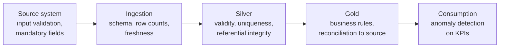

# Data Quality, Governance, Privacy & Compliance

> **TL;DR** — Governance decides *who owns what and by which rules*; quality, metadata, MDM, security, and privacy are how the rules are executed. Make it concrete: named owners and stewards per data product, data contracts at producer boundaries, automated tests + observability (freshness, volume, schema, distribution, lineage), a catalog with lineage, MDM for customers/products/suppliers, and privacy-by-design (GDPR lawful basis, minimisation, pseudonymisation, erasure). For AI use cases add EU AI Act risk classification. Start small, automate enforcement, measure.

---

## 1. Data governance operating model

| Role | Responsibility | Typical person |
|---|---|---|
| Data governance council / board | Sets policies, resolves cross-domain conflicts, prioritises | CFO/COO/CIO delegates, domain leads, data lead |
| **Data owner** | Accountable for a data domain/product: access approvals, quality targets, definitions | Business manager (e.g. Head of Sales for customer data) |
| **Data steward** | Day-to-day definitions, quality issue triage, glossary, master data rules | Domain expert / key user |
| Data custodian | Technical operation: storage, security, backups, pipelines | IT / data engineering |
| Data product owner | Roadmap and consumer satisfaction of a data product | Analytics engineer / product-minded analyst |
| DPO (Data Protection Officer) | GDPR advice, DPIA review, supervisory authority contact | Legal/compliance |
| Data consumer | Uses data within policy; reports issues | Analysts, apps, AI systems |

RACI example — "Change definition of Net Revenue":

| Activity | Owner (Finance) | Steward | Analytics eng. | BI team | Council |
|---|---|---|---|---|---|
| Propose change | C | R | C | C | I |
| Approve | A | C | I | I | C (if cross-domain) |
| Implement in gold/semantic layer | I | C | R | R | I |
| Communicate | A | R | I | R | I |

Governance anti-patterns: policy documents nobody reads; governance as a gate at the end; ownership assigned to IT for business data; council without decision rights.

**Minimum viable governance** (first 90 days):
1. Inventory critical data elements (CDEs): ~20–50 fields that drive KPIs or regulatory reports.
2. Assign owner + steward for each domain.
3. Business glossary for top 30 terms/KPIs.
4. Classification scheme + PII tagging.
5. Automated tests on CDEs with alerts to stewards.
6. Issue log with SLA.

---

## 2. Data quality

### 2.1 Dimensions

| Dimension | Question | Example rule (ERP) | Metric |
|---|---|---|---|
| **Accuracy** | Does it reflect reality? | Customer address matches postal register; stock count matches physical count | % matching reference / audit sample |
| **Completeness** | Is required data present? | Every active item has a weight and HS code | % non-null for required fields |
| **Consistency** | Is it the same across systems/records? | Customer VAT number identical in ERP and CRM; order total = sum of lines | % consistent pairs |
| **Timeliness** (freshness) | Available when needed? | Sales data loaded by 06:00 | Lag (now − last load), % on-time loads |
| **Validity** | Conforms to format/domain/rules? | Postal code matches country pattern; status in allowed set | % valid |
| **Uniqueness** | No unintended duplicates? | One customer master per VAT number | Duplicate rate |
| (Integrity) | Relationships hold? | Every order line refers to existing item | Orphan rate |
| (Precision / reasonableness) | Plausible values? | Unit price within ±50% of list | Outlier rate |

Quality = **fitness for purpose**: define thresholds per use case (finance close requires 100% completeness; marketing segmentation may accept 95%).

### 2.2 Where to check



Fix at the source whenever possible (validation in ERP, master data workflow); downstream "cleaning" hides problems and repeats them.

### 2.3 Tooling

| Tool | Style | Strengths |
|---|---|---|
| **dbt tests** (+ `dbt_expectations`, `dbt_utils`) | YAML/SQL assertions in transformation project | Close to models, CI-friendly |
| **Great Expectations (GX)** | Python "Expectations" suites, Data Docs, checkpoints | Rich expectation library, pandas/Spark/SQL |
| **Soda** (Soda Core / Cloud) | SodaCL YAML checks, anomaly detection | Readable checks, observability features |
| **Fabric/Purview data quality** | Rules in Purview Unified Catalog | Integrated with catalog (verify maturity) |
| Deequ / PyDeequ | Spark-based constraint checks | Large Spark data |
| Monte Carlo, Metaplane, Anomalo, Bigeye, Elementary (dbt-native) | Observability platforms | ML-based anomaly detection, lineage, incident mgmt |

SodaCL example:

```yaml
checks for dim_customer:
  - row_count > 0
  - duplicate_count(vat_number) = 0
  - missing_count(country_code) = 0
  - invalid_percent(email) < 2%:
      valid format: email
  - freshness(_loaded_at) < 1d
```

Great Expectations example (GX 1.x style):

```python
import great_expectations as gx
ctx = gx.get_context()
batch = ctx.data_sources.pandas_default.read_csv("items.csv")
batch.validate(gx.expectations.ExpectColumnValuesToNotBeNull(column="item_no"))
batch.validate(gx.expectations.ExpectColumnValuesToBeBetween(column="weight_kg", min_value=0, max_value=5000))
```

### 2.4 Data observability — the five pillars

| Pillar | Monitors | Detects |
|---|---|---|
| **Freshness** | Time since last update | Stale tables, stuck pipelines |
| **Volume** | Row counts, file sizes | Missing partitions, duplicated loads |
| **Schema** | Columns, types | Breaking upstream changes |
| **Distribution** | Null rates, value ranges, cardinality, mean/stddev | Silent logic/data errors |
| **Lineage** | Upstream/downstream dependencies | Blast radius, root cause |

Incident workflow: detect → triage (severity by downstream impact via lineage) → notify owners/consumers → root cause → fix + backfill → postmortem → add test so it cannot recur.

DQ SLOs example: "`fct_sales_lines` fresh by 06:00 on 99% of business days; < 0.1% orphan customer keys; revenue reconciles to ERP within 0.5% monthly".

### 2.5 Data contracts

An agreement between a data **producer** and its **consumers** specifying schema, semantics, quality, and SLAs — enforced in CI and at runtime.

Contents:
- Owner, contact, version, status
- Schema: fields, types, nullability, keys, PII classification
- Semantics: business definitions, units, enumerations
- Quality rules and SLAs (freshness, completeness)
- Service levels: availability, support hours, retention
- Change policy: semantic versioning, deprecation notice period
- Access/usage terms

Standards/tools: **Open Data Contract Standard (ODCS)** by Bitol (Linux Foundation), Data Contract Specification / `datacontract` CLI, dbt model contracts (schema-only), schema registries (Avro/Protobuf for events).

```yaml
# Simplified ODCS-like contract
apiVersion: v3.0.0
kind: DataContract
id: erp-sales-order-lines
name: Sales order lines
version: 1.2.0
status: active
owner: sales-operations
schema:
  - name: sales_order_lines
    properties:
      - name: order_line_id
        logicalType: string
        required: true
        unique: true
      - name: customer_no
        logicalType: string
        required: true
        classification: internal
      - name: net_amount
        logicalType: number
        description: Amount excl. VAT after line discount, in document currency
quality:
  - rule: freshness
    mustBeLessThan: 6h
slaProperties:
  - property: availability
    value: 99%
```

Where contracts help most: interfaces between ERP/app teams and the data platform (prevent silent column renames), between domains in a mesh, and for event schemas.

---

## 3. Master data and reference data

| | Master data | Reference data | Transactional data |
|---|---|---|---|
| What | Core business entities shared across processes | Code lists / classifications | Events |
| Examples | Customer, supplier, item/product, employee, location, asset | Country (ISO 3166), currency (ISO 4217), UoM, payment terms, GL account types | Orders, invoices, movements |
| Change rate | Low–medium | Low | High |
| Governance | Steward workflows, matching, golden record | Central maintained lists, versioned | Process controls |

### MDM implementation styles

| Style | How | Golden record lives | Pros | Cons | Fit |
|---|---|---|---|---|---|
| **Registry** | Hub stores keys + match links; data stays in sources; virtual golden view | Computed on read | Fast, non-intrusive | Source quality unchanged | Analytics-driven, many sources |
| **Consolidation** | Copies data to hub, matches/merges into golden record for downstream (analytics) use | Hub (read-only for sources) | Good for BI, moderate effort | Sources not corrected | BI/reporting first step |
| **Coexistence** | Golden record in hub synced back to sources; authoring can happen in both | Hub + sources | Improves sources | Sync conflicts, complex | Mature orgs |
| **Centralised (transaction)** | All creation/maintenance in hub; pushed to sources | Hub only | Highest quality, control | Most intrusive, process change | Strict governance, regulated |

MDM process: profiling → standardisation (addresses, names, legal forms) → matching (deterministic: VAT/Chamber of Commerce ID; probabilistic: fuzzy name + address, Jaro-Winkler, Levenshtein) → survivorship rules (most recent, most trusted source, most complete) → golden record with cross-reference table → stewardship UI for uncertain matches.

Cross-reference table:

| golden_customer_id | source_system | source_key | match_rule | confidence |
|---|---|---|---|---|
| GC-000123 | ERP | C10023 | VAT exact | 1.00 |
| GC-000123 | CRM | 0015g00000ABC | name+postcode fuzzy | 0.93 |
| GC-000123 | Webshop | 88812 | email exact | 0.98 |

Microsoft ecosystem options: Profisee (Azure-native partner), Dataverse as lightweight master hub, Purview reference data (verify), custom in SQL + Power Apps for stewardship. LLMs can assist matching and standardisation but should propose, not auto-merge, below a confidence threshold.

---

## 4. Metadata, catalog, lineage

| Metadata type | Examples |
|---|---|
| Technical | Schemas, types, partitions, file locations, row counts |
| Business | Glossary terms, definitions, owners, KPIs, classifications |
| Operational | Load times, run status, test results, usage statistics |
| Social | Popularity, ratings, comments, certified badges |

| Catalog / lineage tool | Notes |
|---|---|
| **Microsoft Purview** (Unified Catalog, Data Map) | Scans Azure/Fabric/on-prem sources, glossary, classifications, sensitivity labels, lineage (ADF, Fabric, Power BI), data products & health management |
| **OpenLineage** | Open standard (LF AI & Data) for lineage events: Job, Run, Dataset facets; integrations for Airflow, Spark, dbt, Flink; reference backend Marquez |
| **DataHub** | Open-source metadata platform (LinkedIn origin), push-based ingestion, lineage, governance |
| OpenMetadata | Open-source catalog with quality and lineage |
| Unity Catalog | Databricks governance + open-source version |
| dbt docs / dbt Explorer | Lineage within dbt + exposures |

**Active metadata**: use metadata to drive automation — auto-tag PII by classifier → apply masking policy; failing test → mark dataset "degraded" in catalog and BI.

Column-level lineage is required for impact analysis ("what dashboards break if we drop `discount_pct`?") and for GDPR ("where does email flow?").

---

## 5. Data classification and PII handling

### 5.1 Classification scheme (example, align with Microsoft Purview sensitivity labels)

| Label | Definition | Examples | Controls |
|---|---|---|---|
| Public | Approved for public release | Product catalog, published price lists | None special |
| Internal | Normal business data | Sales volumes, stock levels | Authenticated employees |
| Confidential | Harm if disclosed | Margins, contracts, customer lists, personal data | Need-to-know, RLS, encryption, no external sharing |
| Highly confidential / restricted | Severe harm, special-category data | Salaries, health data (sick leave), BSN/national IDs, M&A | Strong access control, masking, logging, DPIA |

### 5.2 PII techniques

| Technique | Reversible? | Still personal data under GDPR? | Use |
|---|---|---|---|
| **Anonymisation** (aggregation, generalisation, k-anonymity, differential privacy, noise) | No (must be irreversible considering all means reasonably likely) | **No** — out of GDPR scope if truly anonymous | Open data, broad analytics |
| **Pseudonymisation** (tokenisation, keyed hashing/HMAC with secret key, encryption with key held separately) | Yes, with additional info | **Yes** — still personal data, but a recognised safeguard | Analytics needing linkability per person |
| Masking (static / dynamic) | Static: no; dynamic: underlying data intact | Yes for dynamic | Non-prod copies, limited viewer roles |
| Encryption at rest/in transit | Yes | Yes | Baseline security |
| Generalisation / bucketing | Partially | Depends | Age bands, postal-code-4 |
| Synthetic data | No (if well done) | Generally no, but check memorisation risk | Test data, ML prototyping |

Plain unsalted hashes of emails or national IDs are **not anonymisation** (dictionary attack). Use HMAC with a secret key in Key Vault, rotate deliberately.

```sql
-- Pseudonymise in silver: keyed hash (key supplied by secure parameter)
SELECT
  HASHBYTES('SHA2_256', CONCAT(@pepper, LOWER(TRIM(email)))) AS customer_email_pseudo,
  LEFT(postal_code, 4) AS postal_area,
  YEAR(birth_date) / 10 * 10 AS birth_decade
FROM bronze.webshop_customer;
```

Dynamic data masking (SQL Server/Azure SQL/Fabric Warehouse): `ALTER TABLE dbo.customer ALTER COLUMN email ADD MASKED WITH (FUNCTION = 'email()');` — a presentation control, not a security boundary against determined users with query access.

PII in the platform checklist:
- [ ] PII columns tagged in catalog (automatic classifiers + steward review).
- [ ] Bronze access restricted to engineers; PII pseudonymised or dropped in silver unless a purpose requires it.
- [ ] Non-production environments use masked/synthetic data.
- [ ] Erasure procedure covers bronze, silver, gold, snapshots, Delta time travel (`VACUUM`), backups, exports, vector indexes, LLM logs.
- [ ] Retention period per dataset enforced by jobs.
- [ ] Access reviews quarterly.
- [ ] No PII in logs, URLs, prompts to external services without agreements.

---

## 6. GDPR essentials for data platforms

(EU Regulation 2016/679; not legal advice — involve the DPO.)

### 6.1 Principles (Art. 5)
Lawfulness, fairness, transparency · purpose limitation · **data minimisation** · accuracy · storage limitation · integrity & confidentiality · accountability.

### 6.2 Lawful bases (Art. 6)

| Basis | Typical data platform example |
|---|---|
| Consent | Marketing analytics on website behaviour (cookies) |
| Contract | Processing customer orders, delivery addresses |
| Legal obligation | Retaining invoices for tax law (e.g. 7 years in NL) |
| Vital interests | Rare (emergencies) |
| Public task | Public bodies |
| Legitimate interests | Fraud detection, internal analytics, B2B contact analysis — requires balancing test (LIA) |

Special categories (Art. 9: health, biometrics, ethnicity, religion, union membership, etc.) need an additional Art. 9 exception — keep out of analytics unless essential.

### 6.3 Data subject rights
Information (Art. 13–14) · access (15) · rectification (16) · **erasure / "right to be forgotten" (17)** · restriction (18) · portability (20) · objection (21) · not to be subject to solely automated decisions with legal/similarly significant effects (22) — relevant for AI automation (human review!).

Right to erasure in a lakehouse:
1. Maintain a **subject index**: where each person's identifiers appear (lineage + PII tags).
2. Delete/anonymise in silver/gold via `DELETE`/`MERGE`; handle bronze (rewrite partitions).
3. `VACUUM` Delta tables after the retention window so old files are physically removed.
4. Purge from vector stores, caches, ML training sets (document retraining policy), BI import models (refresh).
5. Log the erasure (without re-storing the personal data).

Exceptions: legal retention obligations (e.g. invoices) override erasure — restrict instead.

### 6.4 Other obligations
- **Records of processing activities** (Art. 30).
- **DPIA** (Data Protection Impact Assessment, Art. 35): required when processing is likely high-risk — systematic monitoring, large-scale special categories, profiling with significant effects, innovative technology like AI on personal data. Content: description, necessity/proportionality, risks to rights, mitigations.
- **Privacy by design and by default** (Art. 25).
- **Processors**: Data Processing Agreement (Art. 28) with SaaS/cloud/LLM vendors; check sub-processors and data residency.
- **International transfers**: adequacy (EU–US Data Privacy Framework), SCCs, transfer impact assessment.
- **Breach notification**: to authority within 72 hours where risk (Art. 33).

---

## 7. EU AI Act (Regulation (EU) 2024/1689)

Risk-based regulation of AI systems placed on the EU market or used in the EU. Entered into force 1 Aug 2024; obligations phase in.

| Tier | Examples | Obligations |
|---|---|---|
| **Unacceptable risk** (prohibited, Art. 5) | Social scoring, manipulative techniques exploiting vulnerabilities, untargeted facial image scraping, emotion recognition at work/school (with exceptions), certain biometric categorisation, most real-time remote biometric ID in public for law enforcement | Banned (from 2 Feb 2025) |
| **High risk** (Annex I products, Annex III use cases) | Employment (CV screening, promotion, monitoring), creditworthiness of persons, essential services access, education scoring, critical infrastructure safety components, law enforcement, migration, justice | Risk management system, data governance (training data quality, bias), technical documentation, logging, transparency to deployers, human oversight, accuracy/robustness/cybersecurity, conformity assessment, registration; deployers: use per instructions, human oversight, monitoring, FRIA for some deployers |
| **Limited risk / transparency** (Art. 50) | Chatbots (disclose AI interaction), deepfakes/synthetic content (label), emotion recognition disclosure | Transparency duties |
| **Minimal risk** | Spam filters, demand forecasting, most internal process automation, document extraction | No specific obligations; voluntary codes; AI literacy still applies |
| **General-purpose AI models** (GPAI) | Foundation models / LLMs | Provider duties: technical docs, copyright policy, training-data summary; systemic-risk models: evaluations, incident reporting, cybersecurity (from 2 Aug 2025); GPAI Code of Practice |

Timeline (as of 2026, verify — the EU "digital omnibus" proposals in late 2025 suggested delaying some high-risk obligations):
- 2 Feb 2025: prohibitions + **AI literacy** obligation (Art. 4) for providers and deployers.
- 2 Aug 2025: GPAI obligations, governance, penalties.
- 2 Aug 2026: most remaining obligations incl. Annex III high-risk (subject to possible postponement).
- 2 Aug 2027: high-risk AI in Annex I regulated products.

Practical steps for a company **deploying** (not building foundation models):
1. Maintain an **AI system inventory** (use case, model/vendor, data, users, decisions affected).
2. Classify each by risk tier; most operational analytics/automation is minimal or limited risk — but HR and credit-related uses can be high risk.
3. AI literacy training for staff using AI.
4. Transparency: label chatbots and AI-generated content where required.
5. Human oversight for decisions affecting people; align with GDPR Art. 22.
6. Vendor due diligence: provider documentation, DPAs, data residency.
7. Link with ISO/IEC 42001 and NIST AI RMF — see [llm-evaluation-security-responsible-ai.md](llm-evaluation-security-responsible-ai.md).

---

## 8. Data security controls (summary)

| Layer | Controls |
|---|---|
| Identity | Entra ID, groups not individuals, PIM for admin roles, managed identities/service principals for pipelines |
| Network | Private endpoints, managed VNets, workspace-level private links (Fabric), firewall rules |
| Data | Encryption at rest (customer-managed keys where needed), TLS, sensitivity labels, DLP |
| Access | Least privilege, RBAC per workspace/layer, RLS/CLS/OLS, dynamic masking |
| Secrets | Key Vault, no secrets in notebooks/Git |
| Monitoring | Audit logs, anomaly alerts on mass export, access reviews |

See [Cloud architecture](../06-cloud-architecture/README.md) for platform-level security.

## Common mistakes

- Treating data quality as a one-off cleansing project.
- Tests that alert a shared channel nobody owns.
- MDM tool purchase before defining match rules and stewardship processes.
- Hashing PII and calling it anonymous.
- Forgetting copies: exports to Excel, BI import models, vector stores, LLM prompt logs.
- Catalog populated once by a project, never maintained → stale and ignored.
- Legal-only GDPR approach; engineers unaware of erasure or retention duties.
- Assuming all AI use is "minimal risk" without checking HR/credit/people-impacting uses.

## References

- DAMA DMBOK: https://www.dama.org/cpages/body-of-knowledge
- Microsoft Purview: https://learn.microsoft.com/purview/
- OpenLineage: https://openlineage.io/ · DataHub: https://datahubproject.io/ · OpenMetadata: https://open-metadata.org/
- Great Expectations: https://greatexpectations.io/ · Soda: https://www.soda.io/ · Elementary: https://www.elementary-data.com/
- dbt data tests: https://docs.getdbt.com/docs/build/data-tests
- Monte Carlo (data observability): https://www.montecarlodata.com/
- Open Data Contract Standard (Bitol): https://github.com/bitol-io/open-data-contract-standard
- GDPR official text (EUR-Lex): https://eur-lex.europa.eu/eli/reg/2016/679/oj
- GDPR article browser: https://gdpr-info.eu/
- European Data Protection Board (guidelines): https://www.edpb.europa.eu/
- EU AI Act official text (EUR-Lex): https://eur-lex.europa.eu/eli/reg/2024/1689/oj
- EU AI Act explorer: https://artificialintelligenceact.eu/
- Pseudonymization (Wikipedia): https://en.wikipedia.org/wiki/Pseudonymization
- k-anonymity (Wikipedia): https://en.wikipedia.org/wiki/K-anonymity
- Differential privacy (Wikipedia): https://en.wikipedia.org/wiki/Differential_privacy
- Master data management (Wikipedia): https://en.wikipedia.org/wiki/Master_data_management
- Related: [Enterprise architecture](../11-enterprise-architecture-business/README.md), [Leadership & facilitation](../09-leadership-teams-facilitation/README.md)
