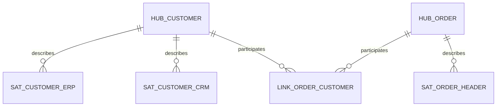

# Dimensional Modeling, Data Vault & Other Modeling Approaches

> **TL;DR** — Model business processes, not source tables. Follow Kimball's 4 steps: process → grain → dimensions → facts. Declare the grain in one sentence before writing SQL. Use surrogate keys, conformed dimensions, and a bus matrix to integrate. Pick SCD types per attribute (Type 1 overwrite vs Type 2 history is 95% of real cases). Use Data Vault 2.0 for a raw, auditable integration layer when many sources and frequent change; use One Big Table for narrow, tool-specific consumption; put shared business definitions in a semantic layer.

---

## 1. Core vocabulary

| Term | Meaning | Example (manufacturing / distribution) |
|---|---|---|
| **Fact table** | Measurements of a business process event, at a declared grain | `fact_sales_order_line`: quantity, net amount |
| **Dimension table** | Descriptive context ("by what?") | `dim_customer`, `dim_product`, `dim_date` |
| **Grain** | What exactly one fact row represents | "One row per sales order line per day it was booked" |
| **Measure** | Numeric fact, ideally additive | `quantity`, `net_amount_eur` |
| **Surrogate key (SK)** | Warehouse-generated meaningless key, integer or hash | `customer_sk = 1834` |
| **Natural / business key (NK/BK)** | Key from source | `customer_no = 'C10023'` |
| **Durable key** | Stable identifier across SCD2 versions | `customer_durable_id` |
| **Conformed dimension** | Same dimension (keys, attributes, values) shared by multiple facts | `dim_product` used by sales, inventory, production |
| **Star schema** | Fact in centre, denormalised dimensions around | |
| **Snowflake schema** | Dimensions normalised into sub-dimensions | `dim_product → dim_product_group → dim_category` |

### Additivity

| Type | Can sum across | Examples | Handling |
|---|---|---|---|
| Additive | All dimensions | Quantity, revenue, cost | `SUM` |
| Semi-additive | Some dimensions, not time | Stock on hand, account balance, headcount | Last value / average over time (`LASTNONBLANK`, `CLOSINGBALANCEMONTH` in DAX) |
| Non-additive | None | Ratios, percentages, unit price | Store components (numerator/denominator), compute ratio in the measure |

**Rule:** store additive components, compute ratios at query time. `margin_pct = SUM(margin) / SUM(revenue)`, never `AVG(margin_pct)`.

---

## 2. Kimball's 4-step dimensional design process

1. **Select the business process** — an operational activity generating events: order entry, shipping, invoicing, production order completion, stock movement, purchase receipt.
2. **Declare the grain** — exactly what one row represents. Prefer the **atomic grain** (lowest level captured by the source); you can always aggregate up, never down.
3. **Identify the dimensions** — the "who, what, where, when, why, how" that are true at that grain.
4. **Identify the facts** — numeric measurements true to that grain. Facts that do not fit the grain belong in another fact table.

Grain declaration template:
> "One row in `fact_shipment_line` represents **one shipped line of one delivery note**, at the moment the delivery is posted."

Workshop practice: run steps 1–2 with business stakeholders (whiteboard, sticky notes), steps 3–4 with source-system experts. Validate grain against sample data: `SELECT grain_cols, COUNT(*) ... HAVING COUNT(*) > 1` must return nothing.

---

## 3. Fact table types

| Type | Grain | Row lifecycle | Example | Typical measures |
|---|---|---|---|---|
| **Transactional** | One row per event | Insert only | Order line booked, stock movement, sensor reading | Quantity, amount |
| **Periodic snapshot** | One row per entity per period | Insert one row per period | Daily inventory per item per warehouse; monthly AR balance per customer | Balances, levels (semi-additive) |
| **Accumulating snapshot** | One row per process instance (pipeline with milestones) | Inserted, then **updated** as milestones occur | Order fulfilment: ordered → picked → shipped → invoiced → paid | Milestone dates (role-playing date keys), lag measures (`days_order_to_ship`) |
| **Factless fact** | Event or coverage without measures | Insert | Student attendance; promotion coverage (which products were on promo in which store) ; machine-assigned-to-line | `COUNT(*)` only |
| **Aggregate fact** | Pre-summarised for performance | Rebuilt | Monthly sales by product group | Same as base |
| **Consolidated fact** | Combines processes at same grain | | Actual vs budget by month × cost centre | Actual, budget |

Accumulating snapshot example:

```sql
CREATE TABLE gold.fact_order_fulfilment (
  order_line_sk        BIGINT PRIMARY KEY,
  customer_sk          INT,
  product_sk           INT,
  order_date_sk        INT,
  promised_date_sk     INT,
  picked_date_sk       INT NULL,
  shipped_date_sk      INT NULL,
  invoiced_date_sk     INT NULL,
  ordered_qty          DECIMAL(18,3),
  shipped_qty          DECIMAL(18,3),
  days_order_to_ship   INT NULL,
  is_on_time_in_full   BIT NULL,   -- OTIF
  current_status       VARCHAR(20)
);
```

**Factless coverage** answers "what did *not* happen": products on promotion (coverage fact) minus products sold (sales fact) = promoted but unsold.

---

## 4. Dimension design

### 4.1 Good dimension attributes
- Verbose, business-friendly labels (`'Active'` not `'A'`).
- Hierarchies flattened into columns (`category`, `subcategory`, `product`).
- Flags as descriptive values (`'Discontinued'` / `'Active'`) for slicers.
- Unknown / not applicable members: reserved SKs `-1 = Unknown`, `-2 = Not applicable`, `-3 = Late arriving`. Never NULL foreign keys in facts.

### 4.2 Date dimension (always build it)

| Column | Example |
|---|---|
| `date_sk` | 20261010 (smart key acceptable for dates) |
| `date` | 2026-10-10 |
| `year`, `quarter`, `month_no`, `month_name` | 2026, Q4, 10, October |
| `iso_week`, `iso_year` | 41, 2026 |
| `day_of_week`, `is_weekend`, `is_holiday_nl` | Saturday, 1, 0 |
| `fiscal_year`, `fiscal_period` | FY2027, P04 |
| `is_working_day`, `working_day_no_in_month` | |

### 4.3 Special dimension types

| Type | What | Example |
|---|---|---|
| **Role-playing** | One physical dimension used in multiple roles via different FKs | `dim_date` as order date, ship date, invoice date. In Power BI: one active + inactive relationships with `USERELATIONSHIP`, or separate views. |
| **Degenerate** | Dimension key with no attributes, stored in fact | `order_no`, `invoice_no` in fact table — for drill-through and grouping lines |
| **Junk** | Combines low-cardinality flags/indicators into one dimension | `dim_order_flags(is_rush, payment_terms_type, channel_flag)` — all combinations, one SK |
| **Conformed** | Shared, identical across facts | `dim_customer`, `dim_product`, `dim_date` |
| **Shrunken / rollup** | Subset of a conformed dimension for aggregated facts | `dim_month`, `dim_product_group` for budget at month × group |
| **Outrigger** | Dimension referenced from another dimension | `dim_customer.first_order_date_sk → dim_date` (use sparingly) |
| **Mini-dimension** | Volatile attributes split off a large dimension (SCD4) | `dim_customer_profile(age_band, credit_band)` |
| **Bridge table** | Many-to-many between fact and dimension or for ragged hierarchies | Multiple sales reps per order with allocation %, BOM explosion, account hierarchies |
| **Audit dimension** | Lineage per load | `batch_id`, `source_system`, `loaded_at`, `dq_status` |
| **Heterogeneous / supertype-subtype** | Core dimension + type-specific extensions | Products: core + spare-part attributes + machine attributes |

### 4.4 Surrogate keys

Why: decouple from source key changes, integrate multiple sources (same customer in ERP and CRM), support SCD2 (multiple rows per NK), handle unknown members, smaller joins.

| Option | Pros | Cons |
|---|---|---|
| Integer identity/sequence | Compact, fast joins, VertiPaq-friendly | Requires lookup during fact load, not deterministic across environments |
| Hash key (`MD5/SHA2` of BK + source) | Deterministic, parallel loads, no lookup | Wider, collisions theoretically possible, less compression |
| Smart key (`20261010`) | Readable | Only OK for date/time dims |

dbt: `{{ dbt_utils.generate_surrogate_key(['source_system','customer_no']) }}` produces an MD5 hash.

Power BI tip: hash strings compress poorly; for very large facts convert to integer SKs in gold.

---

## 5. Slowly Changing Dimensions (SCD) types 0–7

Running example: customer `C100` moves from city `Utrecht` to `Rotterdam` on 2026-03-01; segment changes `SMB` → `Mid-market`.

| Type | Name | Behaviour | Example result | Use when |
|---|---|---|---|---|
| **0** | Retain original | Never change after insert | `original_credit_score` stays | Original values are meaningful (first order date, date of birth) |
| **1** | Overwrite | Update in place, no history | City = Rotterdam on the one row; all history now reports Rotterdam | Corrections, attributes where history is irrelevant (spelling, phone) |
| **2** | Add new row | New row with new SK, validity dates, current flag | Row1: Utrecht, 2020-01-01–2026-02-28, `is_current=0`; Row2: Rotterdam, 2026-03-01–9999-12-31, `is_current=1` | History must be reported "as was" (sales by region at time of sale) |
| **3** | Add new attribute | Keep current + previous in columns | `city_current=Rotterdam`, `city_previous=Utrecht` | One-time reorganisation, compare "old vs new" territory |
| **4** | Mini-dimension (Kimball) / history table | Rapidly changing attributes in separate dimension linked from fact | `dim_customer_profile(age_band, segment)` with own SK in fact | Large dims with fast-changing banded attributes |
| **5** | 4 + 1 | Mini-dimension + Type 1 outrigger in base dim pointing to current mini-dim row | `dim_customer.current_profile_sk` | Need both historical and current profile cheaply |
| **6** | 1 + 2 + 3 hybrid | Type 2 rows plus a Type 1 "current" column overwritten on all rows | Each row has `city_historical` and `city_current=Rotterdam` | Report both "as was" and "as is" without double joins |
| **7** | Dual Type 1 and Type 2 | Fact carries both SK (Type 2 row) and durable key; join to Type 2 dim for "as was", to current-view dim for "as is" | `fact.customer_sk` + `fact.customer_durable_key` | Users flexibly choose as-was vs as-is per report |

(Some literature calls a separate history table "Type 4"; Kimball's definition is the mini-dimension.)

### SCD2 table layout

```sql
CREATE TABLE gold.dim_customer (
  customer_sk     BIGINT IDENTITY PRIMARY KEY,
  customer_bk     VARCHAR(20) NOT NULL,
  source_system   VARCHAR(10) NOT NULL,
  customer_name   VARCHAR(200),
  city            VARCHAR(100),
  segment         VARCHAR(50),
  row_hash        BINARY(32),       -- hash of tracked attributes for change detection
  valid_from      DATETIME2 NOT NULL,
  valid_to        DATETIME2 NOT NULL DEFAULT '9999-12-31',
  is_current      BIT NOT NULL DEFAULT 1
);
```

### SCD2 load (generic SQL, two-step)

```sql
-- 1. Expire changed current rows
UPDATE d
SET valid_to = s.extract_ts, is_current = 0
FROM gold.dim_customer d
JOIN stage.customer s
  ON d.customer_bk = s.customer_bk AND d.is_current = 1
WHERE d.row_hash <> s.row_hash;

-- 2. Insert new versions and brand-new customers
INSERT INTO gold.dim_customer (customer_bk, source_system, customer_name, city, segment, row_hash, valid_from)
SELECT s.customer_bk, s.source_system, s.customer_name, s.city, s.segment, s.row_hash, s.extract_ts
FROM stage.customer s
LEFT JOIN gold.dim_customer d
  ON d.customer_bk = s.customer_bk AND d.is_current = 1
WHERE d.customer_bk IS NULL;      -- new, or just expired in step 1
```

In dbt, use **snapshots** (`strategy: timestamp` or `check`) — see [modern-data-stack.md](modern-data-stack.md).

### Fact lookup to SCD2 dimension (point-in-time join)

```sql
SELECT f.*, d.customer_sk
FROM silver.sales_line f
LEFT JOIN gold.dim_customer d
  ON d.customer_bk = f.customer_no
 AND f.order_date >= d.valid_from
 AND f.order_date <  d.valid_to
```

Use half-open intervals `[valid_from, valid_to)` to avoid double matches on boundary days.

### SCD pitfalls
- Tracking every column as Type 2 → row explosion (e.g. `last_login` in customer dim). Choose per column.
- Back-dated changes in ERP (effective date ≠ change date) → decide whether `valid_from` = business effective date or load time.
- Late-arriving dimension members: insert inferred member (`is_inferred=1`) with BK, update attributes when they arrive.
- Deletes in source: soft-close (`valid_to = delete_ts`, `is_deleted = 1`), never physically delete history (unless GDPR erasure).

---

## 6. Star vs snowflake vs others

| | Star | Snowflake | One Big Table (OBT) | 3NF |
|---|---|---|---|---|
| Joins at query | 1 hop | Multi-hop | None | Many |
| Redundancy | Some in dims | Low | High | None |
| BI tool friendliness | Best (Power BI optimised for star) | OK, more relationships | Good for single-purpose tools; poor for semantic models | Poor |
| Maintenance | Moderate | Higher | Rebuild entire table on dim change | Matches source |
| Storage | Moderate | Lower | Highest (columnar compression helps) | Lowest |
| Use for | Gold/semantic models | Very large dims with shared sub-dims, or when tool requires | ML features, export to external tools, simple embedded dashboards | OLTP, Inmon EDW, silver |

**Power BI guidance:** star schema, single-direction relationships from dimension to fact, avoid bi-directional filters unless intended, avoid snowflaking (flatten dims in SQL/Power Query).

**One Big Table**: denormalise facts with all dimension attributes. Works well on columnar engines (BigQuery, DuckDB) for narrow use cases; downsides: SCD changes require full rebuild, ambiguous grain when multiple facts combined, metric definitions duplicated.

**3NF (Third Normal Form)**: every non-key attribute depends on "the key, the whole key, and nothing but the key". Good for integration layers and OLTP; bad for direct BI consumption.

---

## 7. Conformed dimensions and the bus matrix

The **enterprise data warehouse bus matrix**: rows = business processes (future fact tables), columns = conformed dimensions. An X means the process uses that dimension. It is the integration roadmap and the main planning artefact.

| Business process ↓ / Dimension → | Date | Customer | Product | Warehouse | Supplier | Employee | Cost centre | Currency |
|---|---|---|---|---|---|---|---|---|
| Sales orders | X | X | X | X | | X | | X |
| Shipments | X | X | X | X | | | | |
| Invoicing | X | X | X | | | | X | X |
| Inventory snapshot | X | | X | X | | | | |
| Purchase receipts | X | | X | X | X | | | X |
| Production orders | X | | X | X | | X | X | |
| GL actuals | X | | | | | | X | X |
| Budget | X (month) | | X (group) | | | | X | X |

Rules:
- A conformed dimension has identical keys, attribute names, and values everywhere (or is a strict subset: shrunken dimension).
- Conformed **facts**: same definition and units wherever used (e.g. `net_revenue_eur` always excludes VAT, after discounts).
- Prioritise processes by business value × feasibility; deliver one row of the bus matrix per iteration.

### Drill-across

Querying two facts via conformed dimensions: aggregate each fact separately to the common grain, then join on conformed attributes (never join fact-to-fact at row level → fan-out).

```sql
WITH s AS (SELECT month, product_sk, SUM(qty) AS sold   FROM fact_sales     GROUP BY 1,2),
     p AS (SELECT month, product_sk, SUM(qty) AS produced FROM fact_production GROUP BY 1,2)
SELECT COALESCE(s.month,p.month) month, COALESCE(s.product_sk,p.product_sk) product_sk, sold, produced
FROM s FULL OUTER JOIN p ON s.month = p.month AND s.product_sk = p.product_sk;
```

---

## 8. Data Vault 2.0

Created by Dan Linstedt. Designed for **auditable, scalable, insert-only integration** of many sources. Usually the silver / "raw vault" + "business vault" layer, with dimensional marts (information marts) on top.

| Component | Contains | Example |
|---|---|---|
| **Hub** | Unique list of business keys for a core concept + hash key + load date + record source | `hub_customer(hk_customer, customer_bk, load_dts, record_source)` |
| **Link** | Relationship/transaction between hubs (many-to-many) | `link_order_customer(hk_link, hk_order, hk_customer, load_dts, record_source)` |
| **Satellite** | Descriptive attributes with history, attached to a hub or link | `sat_customer_erp(hk_customer, load_dts, hash_diff, name, city, segment, record_source)` |

Additional constructs: **PIT tables** (point-in-time, to speed up joins across multiple satellites), **bridge tables**, **same-as links** (deduplication of keys), **hierarchical links**, **effectivity satellites** (relationship validity), **reference tables**, **multi-active satellites**.



Principles: hash keys (MD5/SHA-1/SHA-256 of normalised BK), hash diff for change detection, all loads insert-only and parallel, business rules applied only in the business vault, raw vault = "all the data, all the time" for auditability.

| | Data Vault | Dimensional | 3NF EDW |
|---|---|---|---|
| Purpose | Integration, history, audit | Consumption | Integration |
| Change resilience | High (add satellites) | Medium | Low |
| Query complexity | High (many joins) | Low | Medium |
| Automation | Highly pattern-based (dbt packages like AutomateDV/datavault4dbt, WhereScape) | Moderate | Moderate |
| Team effort | High up-front | Moderate | High |

**When to use Data Vault:** many sources for same entities, frequent source changes, regulatory audit needs, large team with automation.
**When not:** few sources, small team, mostly one ERP → straight staging → dimensional is cheaper.

---

## 9. Semantic layer / metrics layer

A layer that defines **business entities, relationships, and metrics once**, consumed by many tools.

| Implementation | Notes |
|---|---|
| Power BI semantic model (formerly dataset) | DAX measures, relationships, RLS; consumed by Power BI, Excel, Fabric notebooks (semantic link), XMLA tools |
| dbt Semantic Layer (MetricFlow) | Metrics defined in YAML on dbt models, queried via APIs/integrations |
| Cube, AtScale, LookML (Looker) | Headless BI / universal semantic layers |
| SQL views with documented measures | Lightweight, low governance |

Metric definition checklist: name, business definition, formula, grain/aggregation, filters (e.g. excludes intercompany), dimensions allowed, owner, unit/currency, time attribution (order date vs invoice date), certification status.

Example (dbt MetricFlow style, abbreviated):

```yaml
semantic_models:
  - name: order_lines
    model: ref('fct_order_lines')
    entities:
      - name: order_line
        type: primary
      - name: customer
        type: foreign
    dimensions:
      - name: order_date
        type: time
        type_params: {time_granularity: day}
    measures:
      - name: net_revenue
        agg: sum
        expr: net_amount_eur
metrics:
  - name: net_revenue
    label: Net revenue (EUR)
    type: simple
    type_params:
      measure: net_revenue
```

---

## 10. Modeling ERP data — practical patterns

| ERP pattern | Modelling response |
|---|---|
| Header/line documents (order, invoice) | Fact at line grain; header attributes as degenerate dims or junk dim; allocate header charges (freight) to lines by value share |
| Status fields evolving over time | Accumulating snapshot or status history fact (one row per status change) |
| Multi-company / intercompany | `dim_company`; flag intercompany customers/suppliers; eliminate in measures |
| Multi-currency | Store transaction currency amount + company currency + reporting currency (EUR) with rate date; `dim_currency`, `fact_exchange_rate` |
| Units of measure | Convert to base UoM in silver; keep original; `dim_uom` with conversion factors |
| BOMs / item hierarchies | Bridge tables or flattened levels; parent-child for ragged |
| GL account hierarchies | Parent-child flattened (level1..levelN) + sign convention column |
| Custom fields per customer | Keep in silver; promote to gold only if governed |
| Dates as `0001-01-01` / `1753-01-01` | Map to unknown date member |
| Credit notes / returns | Negative quantities; `transaction_type` attribute |

## Checklist before publishing a star schema

- [ ] Grain sentence written and validated with uniqueness test.
- [ ] All FKs non-null; unknown members exist.
- [ ] Conformed dims reused, not copied.
- [ ] SCD type documented per tracked attribute.
- [ ] Additive vs semi-additive measures labelled.
- [ ] Currency, UoM, sign conventions consistent.
- [ ] Business-friendly names, descriptions in catalog.
- [ ] Row counts and totals reconciled against source (e.g. revenue per month vs ERP report).
- [ ] dbt tests: `unique`, `not_null`, `relationships`, accepted values.

## Common mistakes

- Mixing grains in one fact (order header totals next to line amounts → double counting).
- Modelling source tables 1:1 and calling it a star schema.
- Averages of averages, summing ratios or balances over time.
- Bi-directional relationships in Power BI to "fix" a missing dimension.
- Treating every attribute as SCD2.
- Using natural keys from one source as dimension keys → breaks when second source or key reuse appears.
- Snowflaking for "normalisation purity" in Power BI.
- Forgetting role-playing date relationships → wrong date used silently.

## References

- Kimball Group — Dimensional Modeling Techniques: https://www.kimballgroup.com/data-warehouse-business-intelligence-resources/kimball-techniques/dimensional-modeling-techniques/
- Kimball Group — The Data Warehouse Toolkit (book page): https://www.kimballgroup.com/data-warehouse-business-intelligence-resources/books/data-warehouse-dw-toolkit/
- Kimball Group home: https://www.kimballgroup.com/
- Slowly changing dimension (Wikipedia): https://en.wikipedia.org/wiki/Slowly_changing_dimension
- Star schema (Wikipedia): https://en.wikipedia.org/wiki/Star_schema
- Snowflake schema (Wikipedia): https://en.wikipedia.org/wiki/Snowflake_schema
- Data vault modeling (Wikipedia): https://en.wikipedia.org/wiki/Data_vault_modeling
- Third normal form (Wikipedia): https://en.wikipedia.org/wiki/Third_normal_form
- Power BI — Understand star schema: https://learn.microsoft.com/power-bi/guidance/star-schema
- dbt Snapshots: https://docs.getdbt.com/docs/build/snapshots
- dbt documentation: https://docs.getdbt.com/
- Sibling: [microsoft-fabric-power-bi.md](microsoft-fabric-power-bi.md), [sql-patterns.md](sql-patterns.md), [analytics-bi-kpis.md](analytics-bi-kpis.md)
