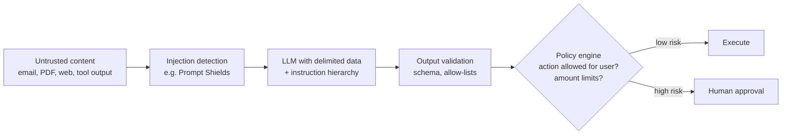
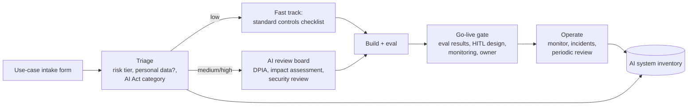

# LLM Evaluation, Guardrails, Security & Responsible AI

> **TL;DR** — You cannot improve what you do not measure: build a golden dataset early, combine deterministic checks, LLM-as-judge (calibrated against humans), and online feedback, and run evals in CI on every prompt/model change. Treat LLM apps as untrusted-input systems: prompt injection cannot be fully prevented, so limit blast radius (least privilege, human approval, output handling). Use the OWASP Top 10 for LLM Applications as threat checklist, and frame governance with Microsoft's Responsible AI principles, NIST AI RMF (Govern–Map–Measure–Manage), ISO/IEC 42001 (AI management system), and the EU AI Act.

---

## 1. Evaluation strategy

### 1.1 Layers of evaluation

| Layer | What | When | Examples |
|---|---|---|---|
| Unit / deterministic | Code checks on output | Every run & CI | JSON schema valid, required fields, regex (IDs), length, no PII patterns, citations exist |
| Reference-based | Compare with expected output | CI on golden set | Exact match (classification), F1 on extracted fields, BLEU/ROUGE (weak), semantic similarity |
| **LLM-as-judge** | Model grades output against rubric | CI and sampled production | Faithfulness, helpfulness, tone, policy compliance, pairwise preference |
| Human evaluation | SMEs rate outputs | Calibration, launches, disputes | Likert scales, pairwise A/B, error taxonomy |
| Online / production | Real usage signals | Continuous | Thumbs up/down, edits, override rate, escalation, task completion, STP rate |
| Red teaming | Adversarial probing | Before launch & periodically | Injection, jailbreaks, data leakage, harmful content |

### 1.2 Golden datasets

- 50–500 representative cases with inputs, expected outputs (or acceptance criteria), metadata (category, difficulty, language, source).
- Sources: real production samples (anonymised), SME-written cases, historical tickets/documents, synthetic generation reviewed by humans.
- Cover: happy path, edge cases, unanswerable/out-of-scope, adversarial, multilingual, long inputs, each document type/supplier layout.
- Split into dev set (iterate) and held-out test set (report).
- Version datasets; add every production failure as a new case (regression).
- Track metrics per slice, not only averages.

### 1.3 Error analysis first
Before choosing metrics: read 50–100 outputs, label failure modes (open coding → categories), count them, and build targeted evaluators for the top failure modes. Generic "helpfulness" scores rarely find real problems.

### 1.4 LLM-as-judge

Good practice:
- Use **binary or small-scale** judgements with explicit criteria ("Does the answer contain any claim not supported by the context? yes/no + reasons") rather than 1–10 scores.
- One criterion per judge prompt.
- Provide reference answer/context where available.
- **Calibrate**: measure agreement (precision/recall, Cohen's kappa) between judge and human labels on 100+ cases; iterate the rubric.
- Use a strong model as judge; avoid same-model self-grading bias where possible.
- Known biases: position bias (pairwise — swap order), verbosity bias, self-preference, sensitivity to formatting.
- Log judge reasoning for audit.

Example judge prompt:

```text
You are evaluating whether an answer is fully supported by the provided sources.
<sources>{{context}}</sources>
<answer>{{answer}}</answer>
List each factual claim in the answer. For each, state SUPPORTED or NOT_SUPPORTED with the source id.
Then output a final line: VERDICT: PASS if all claims are supported, otherwise VERDICT: FAIL.
```

### 1.5 RAGAS and RAG metrics

| Metric | Measures | Needs |
|---|---|---|
| **Faithfulness** | Fraction of answer claims inferable from retrieved context | Question, answer, contexts |
| **Answer (response) relevancy** | How well the answer addresses the question (via generated questions' similarity) | Question, answer |
| **Context precision** | Whether relevant chunks are ranked higher | Question, contexts, reference |
| **Context recall** | Whether contexts cover the reference answer's claims | Contexts, reference |
| Context entity recall, noise sensitivity, factual correctness | Additional diagnostics (verify current set) | |

See [rag-architecture.md](rag-architecture.md).

### 1.6 Metrics by task type

| Task | Metrics |
|---|---|
| Classification / routing | Accuracy, per-class precision/recall/F1, confusion matrix |
| Extraction | Field-level precision/recall/exact match, document-level all-fields-correct rate, STP rate |
| Summarisation | Faithfulness, coverage of key points (checklist), conciseness |
| RAG Q&A | Faithfulness, relevancy, context precision/recall, citation accuracy, abstention correctness |
| Agents | Task success, correct final state, tool-call accuracy, steps, cost, safety violations |
| Text-to-SQL | Execution accuracy (results match), valid SQL rate |
| Generation (emails) | Rubric pass rate (tone, policy, facts), human preference |

### 1.7 Tooling (as of 2026, verify)
promptfoo, DeepEval, RAGAS, OpenAI Evals, Inspect (UK AISI), Azure AI Foundry evaluation & red-teaming agent (PyRIT-based), Langfuse, Arize Phoenix, LangSmith, Braintrust, MLflow GenAI evaluation.

CI example (promptfoo-style config):

```yaml
prompts: [file://prompts/extract_confirmation.txt]
providers: [azureopenai:chat:gpt-prod-deployment]
tests:
  - vars: {doc: file://golden/conf_001.txt}
    assert:
      - type: is-json
      - type: javascript
        value: JSON.parse(output).lines.length === 3
      - type: llm-rubric
        value: "Delivery dates match the document exactly; no invented values."
```

---

## 2. Guardrails

| Stage | Guardrail | Implementation |
|---|---|---|
| Input | Topic/scope classifier, jailbreak/prompt-injection detection, PII detection/redaction, length limits, rate limiting | Azure AI Content Safety (Prompt Shields), Llama Guard-style classifiers, Presidio for PII, NeMo Guardrails, custom classifiers |
| Retrieval | ACL filtering, sensitivity-label exclusion, source allow-lists | Search filters |
| Generation | System prompt rules, structured output, constrained tools | Schemas, tool allow-lists |
| Output | Content safety (hate, violence, self-harm, sexual), groundedness detection, PII leakage check, schema/business-rule validation, protected material detection | Azure AI Content Safety, custom validators |
| Action | Human approval, amount limits, dry runs, idempotency | Workflow gates |
| Monitoring | Logging, anomaly detection on usage/cost, abuse detection | App Insights, SIEM |

Guardrails add latency and false positives — run fast checks in parallel with generation where possible, tune thresholds on eval data.

---

## 3. LLM security — OWASP Top 10 for LLM Applications (2025 edition)

| ID | Risk | Description | Key mitigations |
|---|---|---|---|
| **LLM01** | Prompt Injection | Direct (user) or **indirect** (via documents, emails, web pages, tool outputs) inputs altering model behaviour | Treat all external content as untrusted; segregate/delimit; least-privilege tools; human approval for sensitive actions; input/output filtering; adversarial testing. Cannot be fully solved — design for containment |
| **LLM02** | Sensitive Information Disclosure | Leaking PII, secrets, proprietary data via outputs | Data minimisation, access control at retrieval, output PII filters, no secrets in prompts, training-data sanitisation |
| **LLM03** | Supply Chain | Compromised models, datasets, plugins, MCP servers, LoRA adapters | Vetted sources, signatures/SBOM/AI-BOM, pin versions, scan models |
| **LLM04** | Data and Model Poisoning | Manipulated training/fine-tuning/RAG data | Data provenance, validation, anomaly detection, controlled ingestion |
| **LLM05** | Improper Output Handling | Passing LLM output unvalidated to downstream systems (XSS, SQL injection, command execution) | Treat output as untrusted user input: encode, parameterise, validate against schema, sandbox code execution |
| **LLM06** | Excessive Agency | Too much functionality, permissions, or autonomy | Minimal tools, minimal scopes, user-context auth, human-in-the-loop, rate limits |
| **LLM07** | System Prompt Leakage | Secrets or security logic embedded in system prompts get exposed | Never put credentials/authorisation logic in prompts; assume prompts are public |
| **LLM08** | Vector and Embedding Weaknesses | Unauthorised access via vector stores, cross-tenant leakage, embedding inversion, poisoned documents | Permission-aware retrieval, tenant isolation, source validation, monitoring |
| **LLM09** | Misinformation | Hallucinations and overreliance | Grounding, citations, verification, UI disclosure of uncertainty, user training |
| **LLM10** | Unbounded Consumption | Excessive usage → denial of service, cost explosion ("denial of wallet"), model extraction | Rate limits, quotas, max tokens, timeouts, budget alerts, API gateway |

### 3.1 Prompt injection defence-in-depth



Design principles:
- **Lethal trifecta** (Simon Willison): an agent combining (1) access to private data, (2) exposure to untrusted content, and (3) ability to communicate externally can be tricked into exfiltrating data. Remove at least one leg for any given flow.
- Dual-LLM / quarantine pattern: a privileged LLM never sees untrusted content directly; a quarantined LLM processes it and returns only constrained, structured values.
- Plan-then-execute with fixed tool sequences for untrusted inputs (e.g. CaMeL-style control/data flow separation — research).
- No markdown image rendering of model output from untrusted contexts (exfiltration via URL parameters).
- Egress allow-lists for agent tools.

### 3.2 Platform security checklist (Azure)
- [ ] Models accessed through private endpoints; public network disabled where possible.
- [ ] Managed identity / Entra ID auth; no API keys in code.
- [ ] API Management as AI gateway: auth, quotas per consumer, token metrics, logging, failover.
- [ ] Content filtering configured per deployment; abuse monitoring settings reviewed with legal.
- [ ] Data residency (Data Zone / regional deployments) aligned with GDPR stance.
- [ ] Prompt/response logs classified as potentially containing personal data; retention set.
- [ ] Threat model per use case (STRIDE + OWASP LLM).
- [ ] Red-team before launch; periodic re-tests.

---

## 4. Responsible AI frameworks

### 4.1 Microsoft Responsible AI principles (Responsible AI Standard v2)

| Principle | Meaning in practice |
|---|---|
| **Fairness** | Similar quality of service and allocation across groups; assess for disparities |
| **Reliability & safety** | Performs as intended, tested for failure modes, safe under unexpected conditions |
| **Privacy & security** | Protects data, complies with privacy law, resists attacks |
| **Inclusiveness** | Usable by people of all abilities, languages, backgrounds |
| **Transparency** | People understand capabilities, limitations, and that they interact with AI (transparency notes) |
| **Accountability** | People remain accountable; governance, impact assessments, oversight |

Microsoft provides an Impact Assessment template, transparency notes for Azure AI services, and tools (Responsible AI dashboard, Content Safety, PyRIT).

### 4.2 NIST AI Risk Management Framework (AI RMF 1.0, Jan 2023)

Characteristics of trustworthy AI: valid & reliable; safe; secure & resilient; accountable & transparent; explainable & interpretable; privacy-enhanced; fair with harmful bias managed.

| Function | Purpose | Example activities |
|---|---|---|
| **GOVERN** (cross-cutting) | Culture, policies, roles, accountability | AI policy, inventory, risk tolerance, training, third-party management |
| **MAP** | Establish context and identify risks | Use case description, stakeholders, impacts, categorisation |
| **MEASURE** | Analyse and track risks | Evals, bias testing, red teaming, monitoring metrics |
| **MANAGE** | Prioritise and act on risks | Mitigations, go/no-go, incident response, decommissioning |

Companion: **NIST AI 600-1 Generative AI Profile** (July 2024) listing GenAI-specific risks (confabulation, information integrity, information security, data privacy, harmful bias, IP, value chain, etc.) and suggested actions. Also the NIST AI RMF Playbook.

### 4.3 ISO/IEC 42001:2023 — AI Management System (AIMS)

- Certifiable management-system standard (like ISO 27001 for security) for organisations that develop, provide, or use AI.
- Harmonised structure (clauses 4–10): context, leadership, planning (AI risk assessment, **AI system impact assessment**), support, operation, performance evaluation, improvement (Plan-Do-Check-Act).
- Annex A controls: AI policy, internal organisation, resources, impact assessment, AI system lifecycle, data for AI systems, information for interested parties, use of AI systems, third-party relationships.
- Related: ISO/IEC 23894 (AI risk management guidance), ISO/IEC 22989 (concepts/terminology), ISO/IEC 42005 (AI system impact assessment), ISO/IEC 27001/27701 (security/privacy).
- Useful as backbone to demonstrate EU AI Act readiness (harmonised standards under the Act are being developed separately by CEN-CENELEC JTC 21 — verify status).

### 4.4 EU AI Act
Risk tiers and timeline are in [data-quality-governance.md](data-quality-governance.md#7-eu-ai-act-regulation-eu-20241689).

### 4.5 Lightweight AI governance process for a mid-size company



Intake form fields: purpose, business owner, users, decisions affected (people? money? safety?), data used (personal? confidential?), model/vendor, autonomy level, human oversight, success metrics, risks, AI Act tier, DPIA needed?

Standard controls (all use cases): approved models/vendors list, data classification rules for prompts, logging, evaluation before go-live, user disclosure, AI literacy training, incident reporting channel.

---

## 5. Production monitoring and incident response for LLM apps

| Signal | Metric | Alert example |
|---|---|---|
| Quality (sampled) | Judge pass rate on sampled traffic (faithfulness, policy) | Pass rate drops > 5 pts week-over-week |
| User feedback | Thumbs-down rate, edit distance of accepted drafts, escalation rate | Thumbs-down > 15% for a topic |
| Automation | STP rate, human override rate, exception reasons | Override rate doubles after model update |
| Safety | Content filter hits, injection detections, PII leak detections | Any confirmed leak → incident |
| Retrieval | No-result / abstention rate, avg reranker score | Abstention spikes (index broken?) |
| Performance | p50/p95 latency, time-to-first-token, error/timeout rate, 429s | p95 > SLO for 15 min |
| Cost | Tokens and € per request/outcome, per consumer | Daily spend > budget × 1.5 |
| Drift | Input topic distribution, language mix, document types | New cluster of unanswered questions |

Incident playbook (AI-specific additions to standard incident management):
1. Contain: disable affected tool/action, switch to manual mode or fallback model, tighten autonomy thresholds.
2. Preserve evidence: traces, prompts, retrieved chunks, model/prompt versions.
3. Assess impact: which users/records/decisions were affected (audit log); personal data breach? (GDPR 72-hour clock); serious incident under the AI Act (high-risk systems)?
4. Fix root cause: prompt, retrieval, data, tool permission, guardrail.
5. Add failing cases to golden set; re-run evals before re-enabling.
6. Post-incident review and update risk register / AI inventory.

Model version changes: providers deprecate and update models regularly. Pin model versions where possible, subscribe to deprecation notices, and run the full eval suite before switching (as of 2026, verify provider lifecycle policies).

---

## 6. Model and system documentation

| Artefact | Content |
|---|---|
| Model card | Intended use, out-of-scope uses, training data, evaluation results (incl. per-slice), limitations, ethical considerations |
| System card / transparency note | End-to-end system: components, guardrails, human oversight, known failure modes |
| Datasheet for datasets | Motivation, composition, collection, preprocessing, uses, distribution, maintenance |
| Prompt & eval changelog | Version, change, eval delta, approver |
| Decision log (automation) | Inputs, AI recommendation, human decision, outcome |

## Common mistakes

- Shipping on vibes: no golden set, no regression testing.
- LLM-as-judge scores trusted without human calibration.
- Relying on the system prompt ("never reveal X") as a security control.
- Giving agents write access with service-account permissions broader than the user's.
- Rendering model output as HTML/Markdown links without sanitisation.
- No cost limits → denial-of-wallet.
- Responsible-AI policy on paper, but no inventory of where AI is actually used (including shadow AI in SaaS tools).
- Treating ISO 42001/NIST/AI Act as separate programmes instead of one integrated control set.

## References

- OWASP Top 10 for LLM Applications: https://owasp.org/www-project-top-10-for-large-language-model-applications/
- OWASP GenAI Security Project: https://genai.owasp.org/
- NIST AI Risk Management Framework: https://www.nist.gov/itl/ai-risk-management-framework
- NIST AI 600-1 Generative AI Profile: https://doi.org/10.6028/NIST.AI.600-1
- ISO/IEC 42001:2023: https://www.iso.org/standard/81230.html
- Microsoft Responsible AI: https://www.microsoft.com/ai/responsible-ai
- Azure AI Content Safety: https://learn.microsoft.com/azure/ai-services/content-safety/
- Microsoft PyRIT (red teaming toolkit): https://github.com/Azure/PyRIT
- Microsoft Presidio (PII detection): https://microsoft.github.io/presidio/
- EU AI Act (EUR-Lex): https://eur-lex.europa.eu/eli/reg/2024/1689/oj
- MITRE ATLAS (adversarial threat landscape for AI): https://atlas.mitre.org/
- Simon Willison — writing on prompt injection: https://simonwillison.net/
- RAGAS: https://docs.ragas.io/ · promptfoo: https://www.promptfoo.dev/ · DeepEval: https://deepeval.com/ · Inspect: https://inspect.aisi.org.uk/
- Zheng et al. — Judging LLM-as-a-Judge with MT-Bench (2023): https://arxiv.org/abs/2306.05685
- Mitchell et al. — Model Cards for Model Reporting (2018): https://arxiv.org/abs/1810.03993
- Gebru et al. — Datasheets for Datasets (2018): https://arxiv.org/abs/1803.09010
- Sibling: [data-quality-governance.md](data-quality-governance.md), [ai-agents-automation.md](ai-agents-automation.md), [rag-architecture.md](rag-architecture.md); [Cloud architecture](../06-cloud-architecture/README.md), [Laws & mental models](../10-laws-principles-mental-models/README.md)
