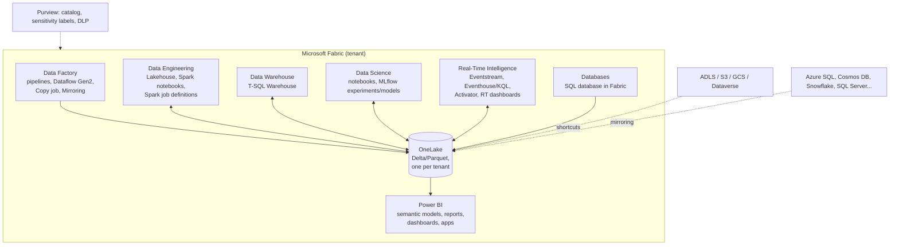

# Microsoft Fabric & Power BI

> **TL;DR** — Microsoft Fabric is a SaaS analytics platform where every workload (Data Factory, Spark, Warehouse, Real-Time Intelligence, Data Science, Power BI) reads and writes **one copy of data in OneLake as Delta/Parquet**, billed by a shared **capacity** (F SKU). Power BI sits on top through semantic models; **Direct Lake** reads Delta tables without import refresh. Good Power BI = star schema + measures (not calculated columns) + correct storage mode + RLS + deployment pipelines/Git. Fabric evolves monthly: treat all feature details here as "as of 2026, verify".

---

## 1. Fabric component map



| Component | What it is | Typical use |
|---|---|---|
| **OneLake** | Single logical data lake per tenant, built on ADLS Gen2, ADLS-compatible APIs (`abfss://`), organised by workspace → item | Store everything once; all engines read same Delta files |
| **Shortcuts** | Virtual pointers to data in other OneLake locations or external storage (ADLS Gen2, S3, GCS, Dataverse, others) without copying | Reuse data across workspaces/domains, avoid duplication |
| **Mirroring** | Near-real-time replication of operational databases into OneLake as Delta (Azure SQL DB, Azure SQL MI, Cosmos DB, Snowflake, SQL Server, Postgres, open mirroring API, ...) | ERP/app DB replication without pipelines (check source support) |
| **Lakehouse** | Item with `Tables/` (managed Delta) and `Files/` (any files) + auto-generated read-only **SQL analytics endpoint** | Bronze/silver, Spark-centric engineering |
| **Warehouse** | Fully transactional T-SQL warehouse (DDL/DML, multi-table transactions), stores data as Delta in OneLake | SQL-centric gold layer, dbt-fabric target |
| **Data Factory** | Pipelines (ADF-like orchestration), **Dataflow Gen2** (Power Query at scale), **Copy job** (simple incremental copy), connectors, on-prem data gateway | Ingestion and orchestration |
| **Data Engineering** | Spark (PySpark, Spark SQL, Scala, R), notebooks, environments, Spark job definitions, Native Execution Engine | Transformations, ML prep |
| **Data Science** | Notebooks with MLflow experiment tracking and model registry, SynapseML, semantic link (SemPy) | ML on lakehouse data |
| **Real-Time Intelligence** | **Eventstream** (ingest/route events), **Eventhouse** (KQL databases, time-series optimised), **Real-Time dashboards**, **Activator** (no-code rules/triggers → Teams, email, Power Automate, pipelines) | IoT, telemetry, logs, operational alerts |
| **SQL database in Fabric** | Azure SQL-based OLTP database, auto-mirrored to OneLake | Small operational apps, write-back, metadata tables |
| **Power BI** | Semantic models, reports, paginated reports, dashboards, apps, metrics/scorecards | Consumption |
| **Copilot / AI** | Copilot in notebooks, Power BI, Data Factory; Fabric data agents (natural-language Q&A over data) | Assisted development & Q&A (as of 2026, verify capabilities and licensing) |

### Organisation concepts

| Concept | Notes |
|---|---|
| Tenant → **domains** → **workspaces** → **items** | Domains group workspaces for data-mesh-style ownership and delegated governance |
| Workspace roles | Admin, Member, Contributor, Viewer; item-level sharing; OneLake data access roles (folder-level, preview → GA, verify) |
| **Capacity** (F2 … F2048) | Shared compute measured in Capacity Units (CU); smoothing (background jobs spread over 24h) and bursting; throttling when overloaded; pause/resume and scale for pay-as-you-go |
| Licensing | Below F64, report consumers need Power BI Pro/PPU licences; F64+ allows free viewers (verify current rules) |
| Git integration | Workspaces sync with Azure DevOps / GitHub; items serialised (PBIP/TMDL for Power BI) |
| Deployment pipelines | Dev → Test → Prod promotion with deployment rules (parameters, connections) |

### Recommended workspace layout (medallion + separation of concerns)

| Workspace | Items | Who |
|---|---|---|
| `DP-Ingest-[env]` | Pipelines, Mirroring, Bronze lakehouse | Data engineers |
| `DP-Transform-[env]` | Silver lakehouse, notebooks / dbt, Gold warehouse/lakehouse | Data / analytics engineers |
| `BI-[Domain]-[env]` | Semantic models, reports | BI developers, domain analysts |
| `App-[Domain]` (Power BI app) | Published content | Consumers |

Separate dev/test/prod workspaces (or at least dev and prod) and, for heavy workloads, separate capacities so ingestion spikes do not throttle reporting.

---

## 2. Lakehouse vs Warehouse vs Eventhouse vs SQL database

| Need | Lakehouse | Warehouse | Eventhouse (KQL) | SQL database |
|---|---|---|---|---|
| Primary language | PySpark / Spark SQL (T-SQL read via endpoint) | T-SQL (read/write) | KQL (+ limited T-SQL) | T-SQL |
| Write via T-SQL | No (SQL endpoint read-only) | Yes | Ingestion APIs | Yes (OLTP) |
| Multi-table transactions | No | Yes | No | Yes |
| Unstructured files | Yes (`Files/`) | No | No | No |
| Streaming/time-series | Via Spark streaming | No | Excellent | No |
| Typical layer | Bronze, silver, gold (Spark teams) | Gold (SQL teams, dbt) | Hot telemetry, logs | Operational/app data |
| Skill fit | Python/Spark engineers | SQL developers | Ops/IoT analysts | App developers |

Both lakehouse and warehouse tables are Delta in OneLake, so a gold warehouse can query silver lakehouse tables cross-database (three-part names) without copying.

---

## 3. Power BI modelling essentials

### 3.1 Star schema in Power BI
- Dimensions filter facts via **one-to-many, single-direction** relationships.
- One fact table per process, no fact-to-fact relationships; use conformed dims for cross-fact visuals.
- Flatten snowflakes into one dimension table (Power Query or SQL).
- Dedicated **date table** marked as date table; continuous, covering full range.
- Hide FK columns and technical columns; expose measures in display folders.
- Avoid high-cardinality text columns (GUIDs, free-text comments, timestamps with seconds) in import models — they dominate size.
- Role-playing dims: inactive relationships + `USERELATIONSHIP` in measures, or duplicate dimension tables when users need to slice by both.

See [dimensional-modeling.md](dimensional-modeling.md).

### 3.2 Storage modes

| Mode | How | Pros | Cons | Use when |
|---|---|---|---|---|
| **Import** | Data compressed into VertiPaq in-memory, refreshed on schedule | Fastest queries, full DAX/Power Query | Refresh latency, memory limits, duplicate copy | Default for most models < model size limit |
| **DirectQuery** | Queries sent to source at runtime | Near-real-time, huge data | Slower, source load, DAX/feature limits, max rows per query | Real-time requirements, data that cannot be copied |
| **Dual** | Table can act as Import or DirectQuery | Efficient composite models | Complexity | Dimension tables in composite models |
| **Direct Lake** | Reads Delta/Parquet from OneLake directly into VertiPaq on demand (column "transcoding"), no import refresh; "framing" points model at latest Delta version | Import-like speed, no data copy, near-real-time after Delta commit | Requires Fabric capacity, guardrails per SKU (rows, model size), no calculated columns on Direct Lake tables (limited support, verify), fallback to DirectQuery (Direct Lake on SQL endpoint) when exceeding guardrails or using views/RLS on SQL endpoint | Large Fabric-hosted gold tables |

Direct Lake variants: **Direct Lake on SQL endpoints** (can fall back to DirectQuery) and **Direct Lake on OneLake** (no DirectQuery fallback, can combine tables from multiple items) — as of 2026, verify.

Direct Lake tips:
- Produce gold Delta tables with **V-Order**, sensible row-group sizes, and few small files (run `OPTIMIZE`).
- Do the modelling (SK, flattening, calculated columns) upstream in SQL/Spark.
- Monitor fallback with DAX Studio / Performance Analyzer; set `DirectLakeBehavior` to prevent silent fallback if desired.

### 3.3 Composite models
- Mix Import + DirectQuery (+ Dual) in one model, or chain to other published semantic models ("DirectQuery for Power BI datasets and Analysis Services").
- **Aggregations**: imported aggregate table answers summary queries, DirectQuery detail table answers drill-downs (user-defined or automatic aggregations).
- Watch: limited relationships across source groups, security boundary considerations, performance of cross-source joins.

### 3.4 Measures vs calculated columns

| | Measure | Calculated column | Calculated table |
|---|---|---|---|
| Evaluated | At query time, in **filter context** | At refresh, in **row context** | At refresh |
| Stored | No | Yes (compressed in model) | Yes |
| Use for | Aggregations, KPIs, ratios, time intelligence | Attributes for slicing/filtering/grouping when not available upstream | Helper tables (date table, disconnected parameter tables) |
| Memory | None | Adds to model size | Adds |
| Best practice | Prefer measures for any number shown in visuals | Prefer computing in SQL/Power Query (upstream) — "as far upstream as possible, as far downstream as necessary" (Roche's maxim) | Prefer upstream |

### 3.5 DAX basics

Core concepts:
- **Filter context**: filters from slicers, visuals, rows/columns, RLS, `CALCULATE`.
- **Row context**: iteration over rows (calculated columns, iterators like `SUMX`).
- **Context transition**: `CALCULATE` inside a row context converts the current row into filters.
- `CALCULATE(<expr>, <filters>...)` is the only function that modifies filter context (plus `CALCULATETABLE`).
- Use `VAR`/`RETURN` for readability and performance; `DIVIDE` instead of `/` to handle division by zero.

```dax
Net Revenue := SUM ( fct_sales[net_amount_eur] )

Gross Margin := [Net Revenue] - SUM ( fct_sales[cost_amount_eur] )

Gross Margin % := DIVIDE ( [Gross Margin], [Net Revenue] )

Net Revenue PY :=
CALCULATE ( [Net Revenue], SAMEPERIODLASTYEAR ( dim_date[date] ) )

Net Revenue YoY % :=
VAR cur = [Net Revenue]
VAR py  = [Net Revenue PY]
RETURN DIVIDE ( cur - py, py )

Net Revenue YTD := TOTALYTD ( [Net Revenue], dim_date[date] )

-- Role-playing date via inactive relationship
Shipped Qty by Ship Date :=
CALCULATE (
    SUM ( fct_sales[shipped_qty] ),
    USERELATIONSHIP ( fct_sales[ship_date_key], dim_date[date_key] )
)

-- Semi-additive: closing stock = last date with data in the period
Stock On Hand :=
CALCULATE (
    SUM ( fct_inventory_snapshot[qty_on_hand] ),
    LASTNONBLANK ( dim_date[date], CALCULATE ( COUNTROWS ( fct_inventory_snapshot ) ) )
)

-- Iterator: revenue at list price
Revenue at List := SUMX ( fct_sales, fct_sales[quantity] * RELATED ( dim_product[list_price] ) )

-- Share of total ignoring product filter
Revenue Share of Category :=
DIVIDE ( [Net Revenue], CALCULATE ( [Net Revenue], REMOVEFILTERS ( dim_product[product_name] ) ) )

-- On-time-in-full rate
OTIF % := DIVIDE (
    CALCULATE ( COUNTROWS ( fct_order_fulfilment ), fct_order_fulfilment[is_on_time_in_full] = TRUE () ),
    COUNTROWS ( fct_order_fulfilment )
)
```

Newer DAX features worth knowing (verify availability): **calculation groups** (time-intelligence once for all measures), **field parameters**, **visual calculations**, **user-defined functions** (DAX UDFs, preview 2025), window functions (`OFFSET`, `INDEX`, `WINDOW`).

### 3.6 Row-level security (RLS) and object-level security (OLS)

- Define **roles** with DAX filter expressions on dimension tables; filters propagate along relationships.
- **Static RLS**: `dim_company[company_code] = "NL01"`.
- **Dynamic RLS**: security mapping table keyed by user principal name.

```dax
-- Role "SalesRegion" filter on dim_security_user_region (bridged to dim_region)
dim_security_user_region[user_upn] = USERPRINCIPALNAME ()
```

- Model: `dim_security_user_region (user_upn, region_key)` → `dim_region` → facts. Use single-direction with "apply security filter in both directions" only where needed.
- **OLS** hides tables/columns (e.g. cost price) per role (author via Tabular Editor / TMDL).
- RLS applies to Viewers only; workspace Admins/Members/Contributors bypass it in that workspace — publish via apps/Viewer access.
- Test with "View as role" and with real accounts; document mapping ownership (HR/IT feed).
- Direct Lake / DirectQuery: RLS defined in the semantic model works; RLS defined on SQL endpoint forces DirectQuery fallback in Direct Lake on SQL endpoints (verify). OneLake security (data access roles) is evolving.

### 3.7 Performance checklist
- [ ] Star schema; no bi-directional relationships unless justified.
- [ ] Remove unused columns; reduce cardinality (split datetime into date + time; round decimals).
- [ ] Integer keys; avoid GUID/text keys.
- [ ] Measures instead of calculated columns; avoid `FILTER(ALL(fact))` over large tables when a column filter suffices.
- [ ] Incremental refresh (import) with partitions on date; hybrid tables for real-time tail.
- [ ] Limit visuals per page (< ~8–10); use bookmarks/drill-through instead of everything at once.
- [ ] Use Performance Analyzer, DAX Studio (Server Timings, VertiPaq Analyzer), Best Practice Analyzer in Tabular Editor.
- [ ] Query folding in Power Query (check "View native query").

---

## 4. Development lifecycle (ALM)

| Practice | How |
|---|---|
| Source control | Fabric Git integration; Power BI Project (PBIP) with **TMDL** model files and PBIR report format |
| Environments | Dev/Test/Prod workspaces + deployment pipelines (or Git-based deployment via fabric-cicd / REST APIs) |
| Parameterisation | Deployment rules, variable libraries (verify), parameters for connection strings |
| Testing | DAX query tests, row-count/total reconciliation, BPA rules in CI |
| Documentation | Descriptions on tables/columns/measures (surface in Copilot and catalog), endorsement (promoted/certified) |
| Monitoring | Capacity Metrics app, Monitoring hub, workspace monitoring (Eventhouse-based logs), refresh failure alerts |

**Semantic link (SemPy)**: read semantic models and evaluate measures from Fabric notebooks — reuse certified business logic in data science and data quality checks:

```python
import sempy.fabric as fabric
df = fabric.evaluate_measure(
    dataset="Sales Model",
    measure="Net Revenue",
    groupby_columns=["dim_date[year]", "dim_product[category]"],
)
```

---

## 5. Real-Time Intelligence quick reference

| Item | Role |
|---|---|
| Eventstream | No-code ingestion from Event Hubs, IoT Hub, Kafka, CDC sources, custom apps; transformations (filter, aggregate, join); routes to Eventhouse, Lakehouse, Activator |
| Eventhouse / KQL database | Columnar, indexed, time-series optimised store; KQL queries; OneLake availability (Delta copy) |
| Real-Time dashboard | KQL-based auto-refreshing tiles |
| Activator | Detect conditions on streams/Power BI data ("temperature > 80 for 5 minutes") → actions (Teams, email, Power Automate, Fabric item) |
| Real-Time hub | Catalog of streams and events in tenant (incl. Fabric/Azure system events) |

KQL example:

```kusto
Telemetry
| where Timestamp > ago(1h)
| summarize avg(TemperatureC), max(TemperatureC) by MachineId, bin(Timestamp, 5m)
| where max_TemperatureC > 80
```

---

## 6. Governance in Fabric

- **Microsoft Purview** integration: Purview hub, data map scans of Fabric, sensitivity labels (inherit downstream to exports), DLP policies for semantic models, Information Protection.
- **Endorsement**: Promoted / Certified (certification restricted to authorised users) / Master data.
- **Domains** for federated ownership; **tenant settings** (who can create items, export, share externally, use Copilot).
- Lineage view per workspace; impact analysis before changes.
- Audit logs via Microsoft Purview audit / Fabric admin APIs.
- Capacity governance: chargeback via Capacity Metrics, separate capacities for critical workloads.

See [data-quality-governance.md](data-quality-governance.md).

## When to use Fabric / when not

| Use Fabric when | Be cautious when |
|---|---|
| Heavy Power BI usage and M365 integration | Workloads need fine-grained infra control or specific Spark/runtime versions |
| Team skills in SQL/Power Query/Power BI, few platform engineers | Very large, cost-sensitive always-on workloads where capacity sizing is hard |
| Desire for one bill and one copy of data | Multi-cloud strategy with non-Microsoft consumers (open formats help though) |
| Real-time + BI + light ML on same platform | Feature you need is preview-only and business-critical |

## Common mistakes

- One giant workspace for everything; no dev/prod separation.
- Ingestion and reporting on the same small capacity → throttled reports during loads.
- Business logic in Dataflow Gen2/Power Query scattered across reports instead of shared gold tables.
- Direct Lake models falling back to DirectQuery silently because of views or SQL endpoint RLS.
- Calculated columns everywhere; huge import models with unused columns.
- RLS tested only as admin (who bypasses it).
- Uncertified "copies" of the same model per department → conflicting numbers.
- Ignoring capacity metrics until users complain.

## References

- Microsoft Fabric documentation: https://learn.microsoft.com/fabric/
- What is Microsoft Fabric: https://learn.microsoft.com/fabric/fundamentals/microsoft-fabric-overview
- OneLake overview: https://learn.microsoft.com/fabric/onelake/onelake-overview
- Power BI documentation: https://learn.microsoft.com/power-bi/
- Power BI — Understand star schema: https://learn.microsoft.com/power-bi/guidance/star-schema
- Power BI guidance documentation: https://learn.microsoft.com/power-bi/guidance/
- DAX reference: https://learn.microsoft.com/dax/
- SQLBI (DAX and modelling articles): https://www.sqlbi.com/
- Microsoft Purview: https://learn.microsoft.com/purview/
- Tabular Editor: https://tabulareditor.com/ · DAX Studio: https://daxstudio.org/
- Delta Lake: https://delta.io/
- Sibling: [modern-data-stack.md](modern-data-stack.md), [analytics-bi-kpis.md](analytics-bi-kpis.md), [reference-architectures.md](reference-architectures.md); [Cloud architecture](../06-cloud-architecture/README.md)
