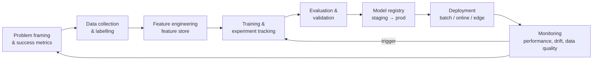

# Machine Learning Fundamentals, Forecasting & MLOps

> **TL;DR** — Frame the business decision first, then the ML task (classification, regression, forecasting, clustering). Split data correctly (time-aware for temporal data), beat a simple baseline, pick metrics that match the cost of errors (precision vs recall, MAE vs MAPE), and watch for leakage. For tabular business data, gradient-boosted trees are the strong default. In production, ML is mostly engineering: versioned data and models, pipelines, registry, monitoring for drift, and retraining — formalised as MLOps maturity levels.

---

## 1. Types of learning

| Type | Data | Goal | Business examples | Algorithms |
|---|---|---|---|---|
| **Supervised – classification** | Labelled, categorical target | Predict class/probability | Late delivery yes/no, churn, invoice category, defect detection | Logistic regression, decision trees, random forest, gradient boosting (XGBoost, LightGBM, CatBoost), neural nets |
| **Supervised – regression** | Labelled, numeric target | Predict value | Lead time, price, demand quantity | Linear/ridge/lasso, gradient boosting, neural nets |
| **Unsupervised – clustering** | Unlabelled | Find groups | Customer segmentation, SKU clustering | k-means, DBSCAN/HDBSCAN, hierarchical, Gaussian mixtures |
| **Unsupervised – dimensionality reduction** | Unlabelled | Compress/visualise | Feature compression, embeddings visualisation | PCA, UMAP, t-SNE |
| **Unsupervised – anomaly detection** | Mostly unlabelled | Find outliers | Fraudulent invoices, sensor anomalies, data quality | Isolation forest, LOF, autoencoders, statistical (z-score, IQR) |
| **Semi-/self-supervised** | Few labels + lots unlabelled | Learn representations | Foundation models, LLM pre-training | Transformers |
| **Reinforcement learning** | Rewards from environment interaction | Learn a policy maximising cumulative reward | Dynamic pricing, robotics, RLHF for LLMs, inventory policy (research) | Q-learning, policy gradients, PPO |
| **Time-series forecasting** | Ordered history | Predict future values | Demand, cash flow, energy | ARIMA/ETS, Prophet, gradient boosting with lag features, deep models (N-BEATS, TFT), foundation models (TimesFM, Chronos — verify) |

---

## 2. Core concepts

### 2.1 Bias–variance trade-off

Expected error = **Bias²** + **Variance** + irreducible noise.

| | High bias (underfitting) | High variance (overfitting) |
|---|---|---|
| Symptom | Poor on train and validation | Great on train, poor on validation |
| Cause | Model too simple, missing features | Model too complex, too little data, leakage-like memorisation |
| Fixes | More features, more complex model, less regularisation | More data, regularisation (L1/L2, dropout), simpler model, early stopping, bagging, feature selection |

Learning curves (error vs training size) diagnose which regime you are in.

### 2.2 Data splitting

| Split | Purpose | Typical share |
|---|---|---|
| Train | Fit parameters | 60–80% |
| Validation | Tune hyperparameters, select model, early stopping | 10–20% |
| Test (holdout) | Final unbiased estimate — touch once | 10–20% |

- **k-fold cross-validation**: rotate validation fold; average metrics; use when data is limited. **Stratified** k-fold keeps class balance.
- **Group k-fold**: keep all rows of one entity (customer, machine) in the same fold to prevent leakage.
- **Time-series split** (rolling/expanding window, "walk-forward"): train on past, validate on future only. Never shuffle temporal data.

```python
from sklearn.model_selection import TimeSeriesSplit, cross_val_score
from lightgbm import LGBMRegressor
tscv = TimeSeriesSplit(n_splits=5, test_size=8)        # e.g. 8 weeks per fold
scores = cross_val_score(LGBMRegressor(), X, y, cv=tscv, scoring="neg_mean_absolute_error")
```

### 2.3 Data leakage (the #1 silent failure)
- **Target leakage**: features that are only known after the outcome (e.g. "delivery_status_updated_at" when predicting late delivery; "credit note issued" when predicting returns).
- **Train–test contamination**: scaling/imputation fit on full data before split; duplicates across splits; random split on time series.
- **Point-in-time correctness**: features must be computed as they were at prediction time — use SCD2 dimensions / feature store point-in-time joins.
Check: suspiciously high accuracy; feature importance dominated by one "too good" feature.

### 2.4 Class imbalance
Use PR-AUC rather than accuracy; class weights (`class_weight="balanced"`), resampling (SMOTE with care), threshold tuning on validation set by business cost.

---

## 3. Evaluation metrics

### 3.1 Confusion matrix

| | Predicted positive | Predicted negative |
|---|---|---|
| **Actual positive** | True Positive (TP) | False Negative (FN) — miss |
| **Actual negative** | False Positive (FP) — false alarm | True Negative (TN) |

| Metric | Formula | Question answered | Prefer when |
|---|---|---|---|
| Accuracy | (TP+TN)/(all) | Overall % right | Balanced classes only |
| **Precision** | TP/(TP+FP) | Of flagged, how many are real? | False alarms are costly (manual review capacity) |
| **Recall** (sensitivity, TPR) | TP/(TP+FN) | Of real positives, how many caught? | Misses are costly (fraud, safety, defects) |
| Specificity (TNR) | TN/(TN+FP) | Of negatives, how many correctly cleared? | |
| **F1** | 2·P·R/(P+R) | Harmonic mean of P and R | Need balance, imbalanced data |
| F-beta | (1+β²)·P·R/(β²·P+R) | β>1 weights recall | Recall more important |
| **ROC-AUC** | Area under TPR vs FPR curve | Ranking quality across thresholds; P(score_pos > score_neg) | Balanced-ish classes; threshold-independent comparison |
| **PR-AUC** (average precision) | Area under precision–recall curve | Ranking quality focused on positive class | **Imbalanced** data (rare events) |
| Log loss | −mean(y·log p + (1−y)·log(1−p)) | Probability quality | When calibrated probabilities matter |
| Brier score | mean((p − y)²) | Calibration + sharpness | Probabilistic decisions |

Worked example: 1,000 orders, 100 actually late. Model flags 120; 80 of them are late.
TP=80, FP=40, FN=20, TN=860 → Precision 0.667, Recall 0.80, F1 0.727, Accuracy 0.94 (a model predicting "never late" gets 0.90 accuracy — why accuracy misleads).

**Threshold selection**: choose threshold minimising expected cost: `cost = FP × cost_fp + FN × cost_fn`, or to meet a capacity constraint (top-k flagged per day).

### 3.2 Regression and forecasting metrics

| Metric | Formula | Properties |
|---|---|---|
| **MAE** | mean(|y − ŷ|) | Same unit as target, robust to outliers, optimal predictor = median |
| **RMSE** | sqrt(mean((y − ŷ)²)) | Penalises large errors, optimal = mean, sensitive to outliers |
| **MAPE** | mean(|y − ŷ| / |y|) × 100 | Scale-free, intuitive, **undefined at y=0**, asymmetric (penalises over-forecasts more), biased toward under-forecasting |
| sMAPE | mean(2|y − ŷ| / (|y| + |ŷ|)) | Bounded, still issues near zero |
| **WAPE** (wMAPE) | Σ|y − ŷ| / Σ|y| | Robust for intermittent demand, weights by volume — common in supply chain |
| MASE | MAE / MAE of naive (seasonal) forecast | Scale-free, < 1 beats naive; recommended by Hyndman |
| Bias | Σ(ŷ − y)/Σ y | Systematic over/under-forecasting |
| R² | 1 − SS_res/SS_tot | Variance explained; not an error magnitude |
| Pinball / quantile loss | For prediction intervals | Probabilistic forecasts (P10/P50/P90) |

### 3.3 Business metrics
Always translate to business impact: euros saved, hours of manual work avoided, stock-outs prevented, service level achieved. A model with lower AUC but deployed in the workflow beats a perfect one in a notebook.

---

## 4. Feature engineering

| Data type | Techniques |
|---|---|
| Numeric | Scaling (standard/min-max for linear/NN; not needed for trees), log transform for skew, binning, ratios, interactions |
| Categorical | One-hot (low cardinality), target/mean encoding with CV (high cardinality, beware leakage), ordinal, native categorical (LightGBM/CatBoost), embeddings |
| Dates/time | Day of week, month, holiday flags, days to/from events, cyclical encoding (sin/cos), business-day counts |
| Time series | Lags (t−1, t−7, t−52), rolling means/std/min/max, expanding stats, differences, seasonality indicators, promotions, price changes |
| Aggregates (entity behaviour) | Customer's order count last 90 days, average lead time per supplier, % late last 10 deliveries — computed point-in-time |
| Text | TF-IDF, embeddings (sentence transformers / LLM embeddings), LLM-extracted attributes |
| Missing values | Imputation (median, model-based), **missing indicator** feature (missingness often informative) |
| Geo | Distance, region, clustering |

Use scikit-learn `Pipeline` + `ColumnTransformer` so preprocessing is fit only on training folds and shipped with the model.

```python
from sklearn.pipeline import Pipeline
from sklearn.compose import ColumnTransformer
from sklearn.preprocessing import OneHotEncoder
from sklearn.impute import SimpleImputer
from sklearn.ensemble import HistGradientBoostingClassifier

pre = ColumnTransformer([
    ("num", SimpleImputer(strategy="median", add_indicator=True), num_cols),
    ("cat", OneHotEncoder(handle_unknown="infrequent_if_exist", min_frequency=20), cat_cols),
])
clf = Pipeline([("pre", pre), ("model", HistGradientBoostingClassifier(class_weight="balanced"))])
clf.fit(X_train, y_train)
```

Explainability: permutation importance, SHAP values (global and per-prediction), partial dependence plots. Needed for user trust and regulated uses.

---

## 5. Forecasting

### 5.1 Approach selection

| Method | Idea | Strengths | Weaknesses | Use when |
|---|---|---|---|---|
| Naive / seasonal naive | Last value / same period last season | **Mandatory baseline** | | Always as benchmark |
| Moving average / exponential smoothing (ETS, Holt-Winters) | Weighted past, level+trend+seasonality | Simple, robust | Univariate | Many stable series |
| **ARIMA / SARIMA(X)** | Autoregression + differencing + moving average (+ seasonal, + exogenous) | Statistical rigour, intervals | Needs stationarity, per-series tuning, struggles with many series/multiple seasonality | Few important series with clear structure |
| **Prophet** | Additive model: trend (piecewise linear/logistic) + seasonality (Fourier) + holidays | Easy, interpretable components, handles missing data, holidays | Often beaten by simple baselines/GBMs in benchmarks; weak for intermittent | Business series with strong calendar effects, quick wins |
| **Gradient boosting** (LightGBM/XGBoost) global model | Tabular regression on lag/rolling/calendar/exogenous features across many series | Top performer in competitions (M5), handles exogenous vars, scales to 1000s of series | Feature engineering, recursive vs direct multi-step design | Many SKUs/locations, promotions, prices |
| Croston / TSB | Separate demand size and interval | Intermittent demand | | Spare parts, slow movers |
| Deep learning (N-BEATS, N-HiTS, TFT, DeepAR) | Neural global models | Complex patterns, probabilistic | Data/compute hungry | Very large datasets |
| Time-series foundation models | Pretrained zero-shot forecasting | No training needed | Evolving; verify on your data | Quick baselines, cold-start (as of 2026, verify) |

ARIMA(p,d,q): p = AR order (lags of series), d = differencing order, q = MA order (lags of errors). Seasonal (P,D,Q)m. Use ACF/PACF plots, or `auto_arima`/`AutoARIMA` (statsforecast).

Hierarchical forecasting: forecasts at SKU × DC must sum to totals — reconciliation methods (bottom-up, top-down, MinT).

### 5.2 Forecasting practice
- Backtest with rolling origin over multiple periods.
- Report WAPE + bias per segment (ABC-XYZ).
- Forecast value added (FVA): does each step (model, planner override) improve over naive?
- Clean history: stock-outs (censored demand), promotions, one-offs, COVID-like breaks.
- Produce prediction intervals → safety stock decisions.
- Libraries: statsforecast, mlforecast, neuralforecast (Nixtla), sktime, Darts, Prophet, pmdarima.

```python
# Global LightGBM model with lag features (mlforecast)
from mlforecast import MLForecast
from mlforecast.lag_transforms import RollingMean
import lightgbm as lgb

fcst = MLForecast(
    models=[lgb.LGBMRegressor(objective="tweedie")],   # tweedie suits non-negative, zero-inflated demand
    freq="W",
    lags=[1, 2, 4, 52],
    lag_transforms={1: [RollingMean(window_size=4)], 52: [RollingMean(window_size=4)]},
    date_features=["month", "week"],
)
fcst.fit(train_df)          # columns: unique_id, ds, y (+ exogenous)
preds = fcst.predict(h=12)
```

---

## 6. MLOps

### 6.1 Lifecycle



### 6.2 Maturity models

**Google (MLOps: continuous delivery and automation pipelines in ML)**

| Level | Description |
|---|---|
| 0 — Manual process | Notebooks, manual handoff of model artefact to engineering, infrequent releases, no monitoring |
| 1 — ML pipeline automation | Automated training pipeline, continuous training (CT) triggered by schedule/new data/drift, feature store, metadata, model validation |
| 2 — CI/CD pipeline automation | Automated build/test/deploy of the *pipelines themselves*; rapid experimentation to production |

**Microsoft (Azure Architecture Center MLOps maturity model)**

| Level | Name | Characteristics |
|---|---|---|
| 0 | No MLOps | Black-box, manual, hard to reproduce |
| 1 | DevOps but no MLOps | App releases automated; model training manual |
| 2 | Automated training | Training reproducible and tracked; manual deployment |
| 3 | Automated model deployment | CI/CD for models, A/B, traceability to data |
| 4 | Full MLOps automated operations | Automated retraining on monitoring signals, near-zero-downtime |

### 6.3 Components

| Component | Purpose | Tools |
|---|---|---|
| Experiment tracking | Params, metrics, artefacts per run | MLflow (Fabric, Databricks, Azure ML native), Weights & Biases |
| **Feature store** | Reusable, point-in-time correct features; offline (training) + online (serving) stores; avoid train/serve skew | Feast, Databricks Feature Store, Azure ML managed feature store, Tecton |
| **Model registry** | Versioned models with stage/alias (champion/challenger), lineage to data & code, approval | MLflow Model Registry, Azure ML registry, Unity Catalog models |
| Pipelines | Reproducible training/inference workflows | Azure ML pipelines, Fabric notebooks + pipelines, Kubeflow, Vertex AI pipelines, Dagster |
| Serving | Batch scoring (write predictions to gold), real-time endpoints (REST), streaming | Azure ML endpoints, Databricks Model Serving, Fabric `PREDICT` batch scoring, containers |
| Monitoring | Performance, drift, data quality, latency, cost | Azure ML monitoring, Evidently, WhyLabs, custom dashboards |
| Data/version control | Reproducibility | Delta time travel, DVC, lakeFS |

**Batch vs online inference**: most operational-company use cases (demand forecast, churn risk, late-delivery risk) are fine with **batch scoring** into gold tables consumed by Power BI/ERP — far simpler than real-time endpoints.

### 6.4 Drift

| Type | What changes | Example | Detection |
|---|---|---|---|
| **Data (covariate) drift** | P(X) — input distribution | New product range, new customer segment | PSI, KL/JS divergence, Kolmogorov–Smirnov, Wasserstein on features |
| **Concept drift** | P(Y|X) — relationship | Supplier behaviour changes after contract; pandemic | Performance decay once labels arrive |
| **Label / prior drift** | P(Y) | Late-delivery rate jumps | Monitor base rate |
| Training–serving skew | Features computed differently online vs offline | Different timezone logic | Compare feature distributions; shared feature code |
| Upstream data issues | Schema/semantic changes | ERP field repurposed | Data quality tests, contracts |

**Population Stability Index (PSI)**: `PSI = Σ (actual% − expected%) × ln(actual% / expected%)` over bins. Rule of thumb: < 0.1 stable, 0.1–0.25 moderate shift, > 0.25 significant shift.

Response: alert → investigate (data bug vs real change) → retrain/recalibrate → validate vs champion → promote.

### 6.5 Production readiness checklist
- [ ] Business owner, decision, and action defined; baseline and success metric agreed.
- [ ] Leakage review; point-in-time features.
- [ ] Beats naive/heuristic baseline on time-aware backtest.
- [ ] Fairness/bias check if people are affected (EU AI Act/GDPR).
- [ ] Model card: purpose, data, metrics, limitations, owner.
- [ ] Registered with lineage; reproducible training pipeline.
- [ ] Monitoring: input drift, prediction distribution, performance when labels arrive, pipeline freshness.
- [ ] Fallback behaviour if model/pipeline fails (last good predictions, rules).
- [ ] Retraining policy and approval workflow.
- [ ] User feedback loop (overrides captured as labels).

## When to use ML / when not

| Use ML when | Don't (yet) when |
|---|---|
| Decision is repeated often, at scale | One-off decision → analysis suffices |
| Patterns too complex for rules, data available with labels/history | Few rows, no labels, no history |
| Errors tolerable and measurable | Zero tolerance + no human review |
| Action can be embedded in a process | No one will act on predictions |
| Rules approach plateaued | Simple rules/heuristics not tried yet |

## Common mistakes

- No baseline → "85% accuracy" sounds good but naive gets 90%.
- Random split on time series; leakage through future-derived features.
- Optimising AUC when the business needs top-k precision at fixed capacity.
- MAPE on intermittent demand (division by zero, explosive values).
- Training in notebooks with no reproducibility; model can't be retrained by anyone else.
- Real-time serving infrastructure for a daily decision.
- Ignoring planner overrides and feedback; no monitoring after go-live.

## References

- scikit-learn user guide: https://scikit-learn.org/stable/user_guide.html
- Google — Rules of Machine Learning: https://developers.google.com/machine-learning/guides/rules-of-ml
- Google Cloud — MLOps: Continuous delivery and automation pipelines in ML: https://cloud.google.com/architecture/mlops-continuous-delivery-and-automation-pipelines-in-machine-learning
- Microsoft — MLOps maturity model: https://learn.microsoft.com/azure/architecture/ai-ml/guide/mlops-maturity-model
- Azure Machine Learning docs: https://learn.microsoft.com/azure/machine-learning/
- Fabric Data Science: https://learn.microsoft.com/fabric/data-science/
- MLflow: https://mlflow.org/ · Feast: https://feast.dev/ · Evidently: https://www.evidentlyai.com/
- Hyndman & Athanasopoulos — Forecasting: Principles and Practice (3rd ed., free): https://otexts.com/fpp3/
- Prophet: https://facebook.github.io/prophet/
- Nixtla (statsforecast/mlforecast): https://nixtlaverse.nixtla.io/
- LightGBM: https://lightgbm.readthedocs.io/
- SHAP: https://shap.readthedocs.io/
- Bias–variance tradeoff (Wikipedia): https://en.wikipedia.org/wiki/Bias%E2%80%93variance_tradeoff
- Precision and recall (Wikipedia): https://en.wikipedia.org/wiki/Precision_and_recall
- ROC curve (Wikipedia): https://en.wikipedia.org/wiki/Receiver_operating_characteristic
- Autoregressive integrated moving average (Wikipedia): https://en.wikipedia.org/wiki/Autoregressive_integrated_moving_average
- Sibling: [python-data-stack.md](python-data-stack.md), [analytics-bi-kpis.md](analytics-bi-kpis.md), [llm-fundamentals-prompting.md](llm-fundamentals-prompting.md)
