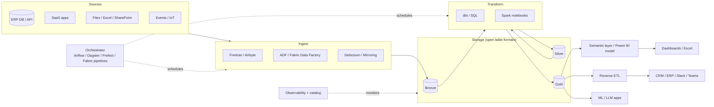

# Modern Data Stack: Ingestion, Transformation, Orchestration, Storage, Engines

> **TL;DR** — The "modern data stack" is a modular, cloud-native ELT chain: managed ingestion → cheap object/warehouse storage in open formats → SQL-first transformation (dbt) → orchestration → semantic layer/BI → reverse ETL back into operational tools. In 2026 the pendulum swung back towards consolidated platforms (Microsoft Fabric, Databricks, Snowflake) that bundle most components; the patterns stay the same. Choose by team skills, data volume, latency needs, and the ecosystem you already pay for.

---

## 1. Stack overview



---

## 2. Ingestion

| Tool | Model | Strengths | Weaknesses | Fit |
|---|---|---|---|---|
| **Fivetran** | Managed SaaS, per-MAR (monthly active rows) pricing | 500+ connectors, log-based CDC for DBs, schema drift handling, minimal ops | Cost grows with volume/changes; limited transformation; black-box | Many SaaS sources, small team |
| **Airbyte** | Open-source + Cloud; connector builder (low-code CDK) | Free self-hosted, custom connectors, large catalog | Self-hosting ops; connector quality varies | Budget-aware, custom APIs |
| **Azure Data Factory (ADF)** | Azure PaaS; pipelines + Copy activity + mapping data flows; self-hosted IR for on-prem | 90+ connectors, on-prem via SHIR, integrated with Azure security | UI-centric, JSON authoring, limited Git-based testing | Azure shops, on-prem ERP |
| **Fabric Data Factory** | Pipelines, Dataflow Gen2 (Power Query), Copy job, Mirroring | Native OneLake, low-code, capacity-billed | Evolving feature parity with ADF (as of 2026, verify) | Fabric-centric orgs |
| **dlt (data load tool)** | Python library | Code-first, schema inference, runs anywhere | You own hosting | Engineers who prefer Python |
| **Debezium** | Log-based CDC on Kafka Connect | Real-time, deletes, open-source | Kafka ops | Streaming CDC |
| **Custom Python / Azure Functions** | Code | Full control (odd APIs, ERP web services) | Maintenance, error handling, retries are on you | Long tail sources |

### Ingestion design rules
- Land **raw** first (bronze), with metadata columns: `_ingested_at`, `_source`, `_batch_id`, `_file_name`, `_op` (CDC).
- Make every load **idempotent** (re-running the same window gives the same result). See [sql-patterns.md](sql-patterns.md).
- Use **watermarks** stored in a control table, not "yesterday" in code.
- Handle **schema drift**: new columns auto-added in bronze; breaking changes alert.
- Pagination, rate limits, retries with exponential backoff and jitter for APIs.
- Secrets in Key Vault, never in pipeline JSON or notebooks.
- Separate extraction credentials with least privilege (read-only DB user / API scope).

Control table pattern:

```sql
CREATE TABLE meta.ingestion_watermark (
  source_name     VARCHAR(100) PRIMARY KEY,
  watermark_col   VARCHAR(100),
  last_value      DATETIME2,
  last_run_status VARCHAR(20),
  last_run_at     DATETIME2
);
```

---

## 3. Transformation with dbt

dbt (data build tool) compiles Jinja-templated SQL `SELECT` statements into DDL/DML, builds a DAG via `ref()`/`source()`, and runs tests and docs. Adapters: Fabric (Warehouse), Fabric Spark, Synapse, SQL Server, Databricks, Snowflake, BigQuery, Postgres, DuckDB, and more. dbt Core is open-source CLI; dbt Cloud / dbt platform is the managed offering. (Licensing and product naming changed 2024–2025 with dbt Fusion engine; as of 2026, verify.)

### 3.1 Key concepts

| Concept | What | Example |
|---|---|---|
| **Model** | A `.sql` (or Python) file with one `SELECT`; becomes table/view | `models/marts/fct_orders.sql` |
| **Source** | Declared raw table, referenced via `{{ source('erp','salesline') }}`; enables freshness checks and lineage | `sources.yml` |
| **ref()** | Reference to another model; builds dependency DAG and env-aware names | `{{ ref('stg_erp__sales_lines') }}` |
| **Tests (data tests)** | Assertions returning failing rows: generic (`unique`, `not_null`, `accepted_values`, `relationships`) and singular (custom SQL) | |
| **Unit tests** | Test model logic with mocked input rows (dbt 1.8+) | |
| **Snapshots** | SCD Type 2 capture of mutable source tables | `strategy: timestamp` / `check` |
| **Seeds** | Small CSVs version-controlled and loaded as tables | Country codes, mapping tables |
| **Macros** | Jinja functions for reusable SQL | `cents_to_euros()` |
| **Packages** | Reusable macro/model libraries | `dbt_utils`, `dbt_expectations`, `audit_helper` |
| **Exposures** | Declare downstream consumers (dashboards, apps) for lineage | |
| **Contracts** | Enforce column names/types on a model | `contract: {enforced: true}` |
| **Model versions / access** | `access: public/protected/private`, versioned models for mesh | dbt Mesh |
| **Semantic layer** | MetricFlow metrics on top of models | |

### 3.2 Materializations

| Materialization | Behaviour | Use for | Watch out |
|---|---|---|---|
| `view` | `CREATE VIEW` | Staging, light logic | Query-time cost, deep view stacks slow |
| `table` | Full rebuild each run | Small/medium marts, dims | Rebuild cost for big data |
| `incremental` | Insert/merge only new/changed rows | Large facts, event data | Logic for late data, full-refresh path, schema changes |
| `ephemeral` | Inlined as CTE | Reusable snippets | Not queryable, debug harder |
| `materialized_view` | DB-managed MV (adapter-dependent) | Near-real-time aggregates | Adapter support varies |
| `snapshot` | SCD2 history table | Mutable sources | Must run regularly, can't backfill history |

Incremental strategies (adapter-dependent): `append`, `merge`, `delete+insert`, `insert_overwrite` (partition replace), `microbatch` (dbt 1.9+: processes time-bounded batches, supports backfills by batch).

### 3.3 Incremental model example

```sql
-- models/marts/sales/fct_sales_lines.sql
{{ config(
    materialized='incremental',
    unique_key='sales_line_id',
    incremental_strategy='merge',
    on_schema_change='append_new_columns'
) }}

with lines as (
    select * from {{ ref('int_sales_lines_enriched') }}
    
      -- 3-day lookback to catch late-arriving updates
      where modified_at >= (select dateadd(day, -3, max(modified_at)) from {{ this }})
    
)
select
    sales_line_id,
    {{ dbt_utils.generate_surrogate_key(['customer_no']) }} as customer_key,
    order_date,
    quantity,
    net_amount_eur,
    modified_at
from lines
```

### 3.4 Snapshot example (YAML config, dbt 1.9+ style)

```yaml
# snapshots/snap_erp_customer.yml
snapshots:
  - name: snap_erp_customer
    relation: source('erp', 'customer')
    config:
      unique_key: customer_no
      strategy: timestamp
      updated_at: modified_at
      hard_deletes: new_record   # 'ignore' | 'invalidate' | 'new_record'
```

Produces `dbt_valid_from`, `dbt_valid_to`, `dbt_scd_id`, `dbt_updated_at` (and `dbt_is_deleted` with `new_record`).

### 3.5 Tests

```yaml
# models/marts/sales/_sales__models.yml
models:
  - name: fct_sales_lines
    description: "One row per ERP sales order line (atomic grain)."
    config:
      contract: {enforced: true}
    columns:
      - name: sales_line_id
        data_type: varchar
        data_tests: [unique, not_null]
      - name: customer_key
        data_type: varchar
        data_tests:
          - relationships:
              to: ref('dim_customer')
              field: customer_key
      - name: net_amount_eur
        data_type: decimal(18,2)
        data_tests:
          - dbt_utils.accepted_range:
              min_value: -1000000
              max_value: 1000000
sources:
  - name: erp
    loaded_at_field: _ingested_at
    freshness:
      warn_after: {count: 6, period: hour}
      error_after: {count: 24, period: hour}
    tables:
      - name: salesline
```

Singular test (`tests/assert_revenue_reconciles.sql`): returns rows where gold monthly revenue differs from ERP control totals by > 0.5%.

Use `severity: warn` vs `error`, `store_failures: true` for triage, and `--select state:modified+` in CI (Slim CI) to test only changed models and children.

### 3.6 Project structure (dbt Labs recommended)

```
models/
  staging/                 # 1:1 with source tables; rename, cast, light cleaning; views
    erp/
      _erp__sources.yml
      _erp__models.yml
      stg_erp__sales_lines.sql
      stg_erp__customers.sql
    crm/
  intermediate/            # business logic building blocks; joins, pivots; not exposed
    sales/
      int_sales_lines_enriched.sql
  marts/                   # business-facing entities: facts & dims per domain
    sales/
      fct_sales_lines.sql
      dim_customer.sql
    finance/
    operations/
snapshots/
seeds/
macros/
tests/
analyses/
```

Naming: `stg_<source>__<entity>` (double underscore), `int_<entity>_<verb>`, `fct_` / `dim_`. Staging: one model per source table, only staging models select from sources. Marts: grouped by business domain/department.

### 3.7 dbt CI/CD workflow

1. Developer works on branch, runs `dbt build --select +my_model` against dev schema.
2. Pull request → CI job: `dbt build --select state:modified+ --defer --state prod-artifacts` into ephemeral PR schema; lint SQL (SQLFluff); check docs coverage.
3. Merge → deploy job on prod: `dbt build` (or by tags/schedule), `dbt source freshness`, generate docs.
4. Artifacts (`manifest.json`, `run_results.json`) → catalog/observability (lineage, test results).

---

## 4. Orchestration

| Tool | Paradigm | Strengths | Weaknesses | Fit |
|---|---|---|---|---|
| **Apache Airflow** | Task-centric DAGs in Python; huge operator ecosystem; Airflow 3 (2025) added DAG versioning, asset-aware scheduling, new UI | Ubiquitous, mature, managed versions (Astronomer, MWAA, Cloud Composer; Fabric Apache Airflow job) | Task-centric not data-aware (improving), local dev heavier | Large teams, heterogeneous jobs |
| **Dagster** | **Asset-centric** (software-defined assets), strong typing, partitions, dbt integration | Lineage-native, testing, local dev, observability | Smaller ecosystem | Data platforms built around assets/dbt |
| **Prefect** | Pythonic flows/tasks, dynamic workflows, hybrid execution | Very easy to adopt, dynamic | Less asset-oriented | Python-heavy, ML pipelines |
| **ADF / Fabric pipelines** | Low-code activities, triggers (schedule, tumbling window, event) | Native Azure/Fabric, no infra | Weak testing/versioning ergonomics, complex logic awkward | Azure/Fabric-centric, ingest + call notebooks/dbt |
| **dbt Cloud jobs** | Schedules dbt only | Simple | dbt only | Pure dbt shops |
| **Databricks Workflows / Lakeflow Jobs** | Native jobs | Integrated | Databricks only | Databricks |

### Orchestration principles
- Orchestrator **schedules and coordinates**; heavy compute happens in engines.
- Tasks idempotent and retryable; pass references (table names, partitions), not data.
- Prefer **data-aware triggers** (run when upstream asset updated) over clock chains.
- Backfills by partition (date) must be first-class.
- Alerting on failure + SLA breach (Teams/Slack/email), with runbook links.
- Separate environments; parameterise by environment.

Dagster asset sketch:

```python
from dagster import asset, DailyPartitionsDefinition

daily = DailyPartitionsDefinition(start_date="2025-01-01")

@asset(partitions_def=daily)
def erp_sales_lines_raw(context) -> None:
    day = context.partition_key
    extract_to_bronze(table="salesline", day=day)   # idempotent overwrite of partition

@asset(deps=[erp_sales_lines_raw], partitions_def=daily)
def sales_lines_clean(context) -> None:
    run_sql("silver/sales_lines.sql", day=context.partition_key)
```

---

## 5. Storage formats

### 5.1 File formats

| Format | Layout | Schema | Compression | Use |
|---|---|---|---|---|
| CSV | Row, text | None | Poor | Interchange only |
| JSON / NDJSON | Row, semi-structured | Self-describing | Poor | APIs, events, bronze |
| Avro | Row, binary | Embedded schema, evolution | Good | Kafka, streaming, CDC |
| ORC | Columnar | Embedded | Excellent | Hive ecosystem |
| **Parquet** | Columnar (row groups → column chunks → pages) | Embedded | Excellent (dictionary, RLE, Snappy/ZSTD) | Default analytics format |

Parquet benefits: column pruning, predicate pushdown via min/max statistics per row group, efficient encoding. Ideal file size ≈ 128 MB–1 GB; avoid "small files problem".

### 5.2 Open table formats

| | **Delta Lake** | **Apache Iceberg** | **Apache Hudi** |
|---|---|---|---|
| Origin | Databricks (Linux Foundation) | Netflix (Apache) | Uber (Apache) |
| Metadata | `_delta_log` JSON commits + Parquet checkpoints | Metadata files → manifest lists → manifests | Timeline in `.hoodie` |
| ACID | Yes (optimistic concurrency) | Yes | Yes |
| Time travel | Version / timestamp | Snapshots | Instants |
| Partitioning | Hive-style; liquid clustering (newer) | **Hidden partitioning** + partition evolution | Hive-style |
| Upserts | `MERGE`, deletion vectors | Merge-on-read / copy-on-write, row-level deletes | Built for upserts: COW and MOR tables, record-level index |
| Strong ecosystem | Spark, Databricks, **Microsoft Fabric (native)**, Power BI Direct Lake | Snowflake, BigQuery, AWS (S3 Tables), Trino, Dremio, Flink | Streaming ingestion, AWS EMR |
| Catalog | Unity Catalog, Hive metastore | REST catalog spec, Polaris, Nessie, Glue | Hive metastore |

Interoperability: **Delta UniForm** writes Iceberg/Hudi metadata alongside Delta; **Apache XTable** (incubating) translates metadata; Fabric OneLake can virtualise Iceberg tables as Delta (as of 2026, verify). Since Databricks acquired Tabular (2024), Delta and Iceberg have been converging.

Table maintenance (Delta):

```sql
OPTIMIZE silver.sales_lines ZORDER BY (customer_id);  -- compaction + clustering
VACUUM silver.sales_lines RETAIN 168 HOURS;           -- remove unreferenced files (also limits time travel)
DESCRIBE HISTORY silver.sales_lines;
SELECT * FROM silver.sales_lines VERSION AS OF 42;
```

Fabric adds **V-Order** (write-time optimisation for VertiPaq/Direct Lake reads).

---

## 6. Query engines and platforms

| Engine / platform | Type | Storage | Pricing model | Strengths | Consider when |
|---|---|---|---|---|---|
| **Apache Spark** (Databricks, Fabric, Synapse, EMR) | Distributed compute | Lake (Delta/Iceberg) | Cluster/capacity time | Huge scale, Python/SQL/Scala, ML, streaming | Large volumes, complex transformations, unstructured |
| **DuckDB** | In-process OLAP | Local / Parquet / Delta / Iceberg via extensions | Free | Fast single-node, great for dev, tests, notebooks, < ~100s GB | Small/medium data, CI tests, local analysis, MotherDuck for cloud |
| **Google BigQuery** | Serverless warehouse | Managed columnar (Capacitor) + BigLake | On-demand per TB scanned or slot reservations | Zero ops, scale, BQML, partition + cluster | GCP shops, spiky workloads |
| **Azure Synapse Analytics** | Dedicated SQL pools (MPP), serverless SQL, Spark | | DWU / per TB | Legacy enterprise DWH | Existing estates; Microsoft positions Fabric as successor |
| **Microsoft Fabric** | SaaS unified platform: Spark, T-SQL Warehouse, KQL, Power BI over OneLake (Delta) | OneLake | Capacity (F SKUs) | One copy of data, Power BI Direct Lake, M365 integration | Microsoft-centric orgs |
| **Snowflake** | Cloud warehouse, separated storage/compute (virtual warehouses) | Managed + Iceberg tables | Credits per second | Simplicity, data sharing, concurrency | Multi-cloud, SQL-centric |
| **Databricks** | Lakehouse platform (Spark, Photon, Databricks SQL, Unity Catalog, MLflow) | Delta/Iceberg in your storage | DBUs | ML/AI + data engineering in one, open formats | Heavy engineering/ML |
| **Trino / Starburst** | Federated SQL | Many | Cluster | Query across sources | Virtualisation |
| **ClickHouse** | Columnar OLAP DB | Native | Self/Cloud | Sub-second analytics on huge event data | Product analytics, logs |
| **Postgres** | OLTP (+ extensions) | Row | | Small analytics, pgvector | < tens of GB analytics |

BigQuery cost control: always filter on partition column (`require_partition_filter = true`), cluster by common filter columns, avoid `SELECT *`, use `--dry_run` / maximum bytes billed.

DuckDB examples:

```sql
-- Query Parquet and Delta files directly
SELECT customer_id, SUM(amount) FROM 'data/sales/*.parquet' GROUP BY ALL;
INSTALL delta; LOAD delta;
SELECT COUNT(*) FROM delta_scan('abfss://.../Tables/sales_lines');
```

---

## 7. Reverse ETL and activation

Pushing modelled warehouse data back into operational systems (CRM, ERP, marketing, support, Teams/Slack).

| Option | Notes |
|---|---|
| Hightouch, Census (Census acquired by Fivetran, 2025) | SaaS, syncs with diffing, many destinations |
| Custom (Azure Functions / Logic Apps / Power Automate reading gold) | Cheap, more maintenance |
| Fabric Activator (Real-Time Intelligence) | Trigger actions (Teams, email, Power Automate) on data conditions |
| Write-back via APIs (Dataverse, ERP OData) | Respect source validation and rate limits |

Use cases: customer health score into CRM, predicted stock-outs to purchasing, credit risk flags to order entry, lead scoring, AI-generated summaries into tickets.

Rules: sync only **governed gold** datasets; idempotent upserts by key; never overwrite operational source-of-truth fields without owner agreement; log all writes; monitor sync failures.

---

## 8. Choosing a stack — decision table

| Context | Suggested stack |
|---|---|
| Microsoft 365 + Power BI shop, mid-size, ERP on SQL/Dynamics | Fabric: Data Factory / Mirroring → Lakehouse (bronze/silver) → Warehouse or Lakehouse gold → Power BI Direct Lake; dbt-fabric or notebooks; Purview |
| GCP / product analytics | Fivetran/Datastream → BigQuery → dbt → Looker/Looker Studio |
| Heavy ML + engineering team | Databricks (Delta, Unity Catalog, MLflow, Workflows) + dbt |
| Small team, low budget | Airbyte/dlt → DuckDB/MotherDuck or Postgres → dbt → Metabase/Power BI |
| Multi-cloud, SQL analysts | Snowflake + Fivetran + dbt |

## Common mistakes

- Buying many point tools without an owner for integration → "modern data stack sprawl".
- dbt without tests or with tests nobody watches.
- Incremental models without a full-refresh strategy or late-data lookback.
- Business logic duplicated in Power Query, dbt, and DAX.
- Orchestration by chained cron times ("job B runs at 02:30 because A usually finishes by 02:20").
- Ignoring the small-files problem in lakes; never running `OPTIMIZE`/compaction.
- Using `VACUUM` with too-short retention, breaking time travel and concurrent readers.
- Reverse ETL from unvalidated tables into CRM, polluting operational data.

## References

- dbt documentation: https://docs.getdbt.com/
- dbt — How we structure our dbt projects: https://docs.getdbt.com/best-practices/how-we-structure/1-guide-overview
- dbt — Materializations: https://docs.getdbt.com/docs/build/materializations
- dbt — Incremental models: https://docs.getdbt.com/docs/build/incremental-models
- dbt — Snapshots: https://docs.getdbt.com/docs/build/snapshots
- dbt — Data tests: https://docs.getdbt.com/docs/build/data-tests
- Fivetran: https://www.fivetran.com/ · Airbyte: https://airbyte.com/ · dlt: https://dlthub.com/
- Azure Data Factory: https://learn.microsoft.com/azure/data-factory/
- Apache Airflow: https://airflow.apache.org/ · Dagster: https://dagster.io/ · Prefect: https://www.prefect.io/
- Apache Parquet: https://parquet.apache.org/
- Delta Lake: https://delta.io/ · Apache Iceberg: https://iceberg.apache.org/ · Apache Hudi: https://hudi.apache.org/
- Apache Spark: https://spark.apache.org/ · DuckDB: https://duckdb.org/
- BigQuery docs: https://cloud.google.com/bigquery/docs · Snowflake docs: https://docs.snowflake.com/ · Databricks docs: https://docs.databricks.com/
- Microsoft Fabric: https://learn.microsoft.com/fabric/
- Debezium: https://debezium.io/
- Hightouch: https://hightouch.com/
- Sibling: [microsoft-fabric-power-bi.md](microsoft-fabric-power-bi.md), [data-quality-governance.md](data-quality-governance.md), [python-data-stack.md](python-data-stack.md); [Engineering practices](../08-engineering/README.md)
