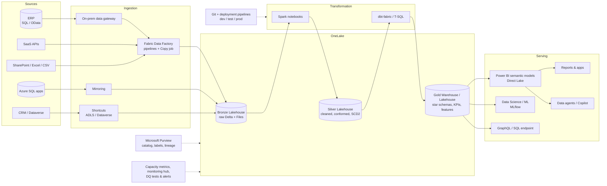
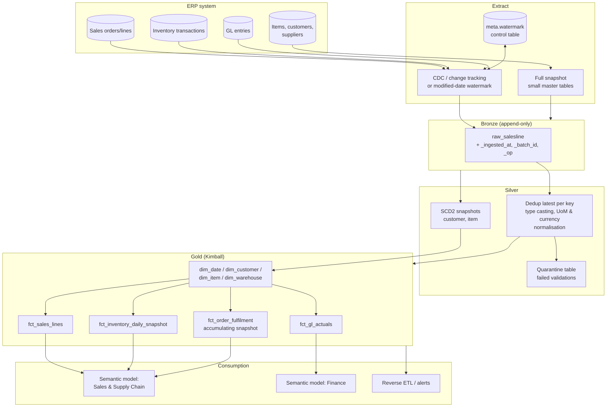
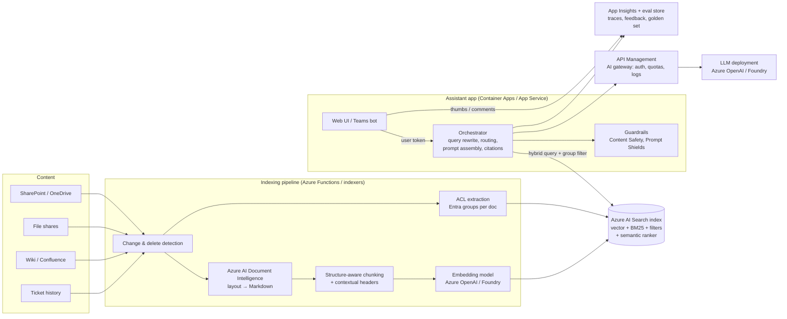
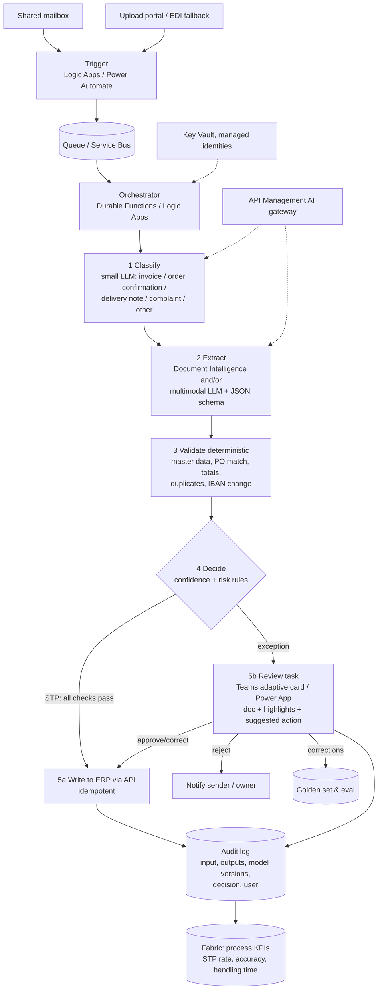
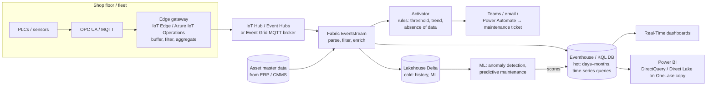

# Reference Architectures (Azure / Microsoft Fabric)

> **TL;DR** — Five reusable blueprints: (1) modern Fabric lakehouse, (2) ERP-to-BI pipeline, (3) RAG over company documents, (4) AI-assisted process automation with human-in-the-loop, (5) streaming IoT/telemetry. Each lists components, data flow, design decisions, non-functional concerns, and alternatives. Adapt; do not copy blindly — start from use cases, latency, and team skills. Product names and features are "as of 2026, verify".

---

## 1. Modern Azure / Fabric lakehouse

| Decision | Recommendation | Rationale |
|---|---|---|
| Layer storage | Bronze & silver as Lakehouse; gold as Warehouse (SQL team) or Lakehouse (Spark team) | Matches skills; both Delta in OneLake |
| Workspaces | Separate per layer/domain and per environment | Security boundaries, capacity isolation, ALM |
| Transformation | dbt for SQL-modelled gold; notebooks for parsing/complex ingestion | Tests, docs, lineage |
| Semantic layer | Few certified, shared models in Direct Lake | One version of truth, no refresh copies |
| Orchestration | Fabric pipelines calling notebooks/dbt; or external Airflow/Dagster | Keep orchestration declarative and alertable |
| Security | Entra groups → workspace roles; RLS in semantic model; sensitivity labels | Least privilege |
| Capacity | Separate capacity (or at least scheduling) for heavy ETL vs reporting | Avoid throttling |

Non-functional checklist: environments & CI/CD; data quality tests on every layer; freshness SLAs; cost monitoring (CU usage per item); backup/DR (OneLake BCDR settings, Git for code); documentation in catalog.

Alternatives: Databricks + Unity Catalog + Power BI (DirectQuery/import), Azure Synapse (legacy), Snowflake + dbt + Power BI.

---

## 2. ERP-to-BI pipeline (detailed)

Key design points:
1. **Access**: Read-only replica or CDC; for SaaS ERPs use vendor export (e.g. Dynamics 365 → Fabric Link / Synapse Link; Business Central API/OData; SAP → SAP Datasphere / ODP-based connectors; verify per ERP).
2. **Incremental logic**: watermark per table in control table; lookback window for late commits; periodic full reconciliation to detect hard deletes.
3. **Header/line consistency**: load headers and lines in the same batch; if a line changes but header `modified_at` doesn't (or vice versa), use union of changed keys.
4. **Conformance in silver**: units of measure to base, currencies to company + EUR with dated rates, status codes to readable labels (seed mapping tables), company/intercompany flags.
5. **Gold**: conformed dims across sales, purchasing, inventory, production, finance (bus matrix — see [dimensional-modeling.md](dimensional-modeling.md)).
6. **Reconciliation tests**: revenue per month vs ERP financial report; inventory value vs ERP stock valuation; open orders count vs ERP screen.
7. **Fiscal calendar** and closing periods: freeze prior-period finance facts after close (snapshot) to avoid restated history surprises.
8. **Schedule**: nightly full pipeline + intraday incremental for operational facts (e.g. every 30–60 min for orders/shipments) if needed.

Failure modes to monitor: ERP upgrade renames columns (schema tests), extract partial (row count anomaly), FX rate missing (null checks), new company code (accepted values test).

---

## 3. RAG over company documents

| Decision | Recommendation |
|---|---|
| Build vs buy | First check Microsoft 365 Copilot / Copilot Studio with SharePoint knowledge — may suffice for general Q&A; build custom when you need control over retrieval, evaluation, specific sources, or integration in a process |
| Identity | On-behalf-of flow; filter by user's group IDs on every query |
| Index design | One index per security domain or a shared index with ACL fields; metadata for doc type, department, validity |
| Retrieval | Hybrid + semantic ranker; top 50 → rerank → top 5–8 |
| Prompting | Grounding rules, citations with IDs, abstention |
| Evaluation | Golden set of 100+ real questions, RAGAS-style metrics in CI, online feedback |
| Privacy | Exclude highly confidential labels or separate assistant; logging retention policy |
| Cost | Cache embeddings; prompt caching for system prompt; small model for query rewriting |

See [rag-architecture.md](rag-architecture.md).

---

## 4. AI-assisted process automation (e.g. inbound supplier documents / customer emails)

Design decisions:
- **Deterministic first**: validation, matching, posting are code; the LLM classifies, extracts, interprets, drafts.
- **Autonomy policy as configuration** (thresholds per document type/supplier/amount) owned by the process owner, versioned.
- **Idempotency** by document hash + business key so retries never double-post.
- **Durable state** for long-running human tasks (hours/days).
- **Fallbacks**: model outage → queue for manual processing; never lose documents (dead-letter queue).
- **Observability**: per-step latency, cost, confidence distributions, override reasons; weekly review with process owner.
- **Compliance**: GDPR (personal data in emails), retention of documents per legal requirements, AI Act tier (usually minimal risk), transparency to staff.
- **Rollout**: shadow mode (AI suggests, humans process as before) → assisted → exception-based automation per document type as accuracy proves out.

See [ai-agents-automation.md](ai-agents-automation.md).

---

## 5. Streaming IoT / telemetry

| Concern | Guidance |
|---|---|
| Protocols | OPC UA for industrial equipment, MQTT for devices; normalise at the edge |
| Edge processing | Downsample high-frequency signals, buffer during connectivity loss, local alerts for safety-critical logic (cloud is not a safety system) |
| Schema | Versioned message schema (device id, timestamp UTC, signal, value, unit, quality flag) |
| Time | Event time vs ingestion time; handle late/out-of-order data; NTP on devices |
| Hot vs cold | KQL/Eventhouse for recent, fast queries; Delta in OneLake for long history and ML |
| Alerting | Activator / KQL alerts with hysteresis and minimum durations to avoid alert storms |
| Enrichment | Join with asset master data (line, machine type, maintenance plan) |
| KPIs | OEE, MTBF, MTTR, energy per unit — see [analytics-bi-kpis.md](analytics-bi-kpis.md) |
| Security | Device identity (X.509), network segmentation (IT/OT, ISA/IEC 62443 zones), no inbound connections to OT |
| Cost | Retention policies and caching policies in Eventhouse; aggregate before storing everything forever |

Alternatives: Azure Stream Analytics → ADLS/SQL; Azure Data Explorer (standalone); Databricks Structured Streaming; Kafka + Flink; time-series DBs (InfluxDB, TimescaleDB).

---

## 6. Cross-cutting architecture checklist

- [ ] Use cases and decisions documented; latency and freshness requirements explicit.
- [ ] Data classification and GDPR basis per data flow.
- [ ] Identity: Entra ID everywhere, managed identities for services.
- [ ] Network: private endpoints / managed VNets for sensitive data.
- [ ] Environments + IaC (Bicep/Terraform) + Git + CI/CD.
- [ ] Observability: logs, metrics, traces, data quality, cost.
- [ ] Ownership: product owner and data owner per component.
- [ ] DR: RPO/RTO defined; reprocessable from bronze/raw.
- [ ] Documentation: C4/arc42-style views, ADRs for key decisions (see [Software architecture](../05-software-architecture/README.md)).

## Common mistakes

- Copying a reference architecture with every box, for a use case needing three.
- No reconciliation with ERP numbers → BI distrusted from day one.
- RAG prototypes promoted to production without ACL filtering or evaluation.
- Automation with no exception path or audit log.
- Streaming everything when hourly batch would do.
- Mixing OT safety logic into cloud alerting.

## References

- Azure Architecture Center: https://learn.microsoft.com/azure/architecture/
- Microsoft Fabric documentation: https://learn.microsoft.com/fabric/
- Fabric Real-Time Intelligence: https://learn.microsoft.com/fabric/real-time-intelligence/
- Azure AI Search: https://learn.microsoft.com/azure/search/
- Azure AI Document Intelligence: https://learn.microsoft.com/azure/ai-services/document-intelligence/
- Azure API Management: https://learn.microsoft.com/azure/api-management/
- Azure Logic Apps: https://learn.microsoft.com/azure/logic-apps/
- Azure Durable Functions: https://learn.microsoft.com/azure/azure-functions/durable/
- Azure IoT Hub: https://learn.microsoft.com/azure/iot-hub/
- Azure Event Hubs: https://learn.microsoft.com/azure/event-hubs/
- OPC Foundation (OPC UA): https://opcfoundation.org/
- MQTT: https://mqtt.org/
- Anthropic — Building effective agents: https://www.anthropic.com/research/building-effective-agents
- Sibling: [data-architecture-fundamentals.md](data-architecture-fundamentals.md), [microsoft-fabric-power-bi.md](microsoft-fabric-power-bi.md), [rag-architecture.md](rag-architecture.md), [ai-agents-automation.md](ai-agents-automation.md); [Cloud architecture](../06-cloud-architecture/README.md), [Enterprise architecture](../11-enterprise-architecture-business/README.md)
