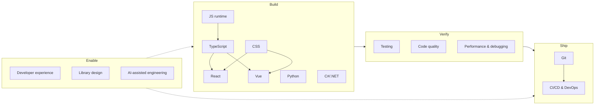

# 08 — Engineering

> **TL;DR** — Hands-on software engineering practice: languages and frameworks (TypeScript, JavaScript/Node, React, Vue, CSS, Python, C#/.NET), how to test, version and ship code (testing strategy, Git, CI/CD, DevOps, DORA), how to keep it healthy (code quality, refactoring, performance, debugging), and how to make engineers effective (developer experience, library design, AI-assisted engineering).

---

## Files in this section

| File | Description |
|---|---|
| [typescript.md](typescript.md) | Type system essentials (structural typing, narrowing, discriminated unions, generics, conditional/mapped/template literal types), utility types, `satisfies`/`as const`, branded types, strict tsconfig, zod validation, pitfalls |
| [javascript-runtime.md](javascript-runtime.md) | Event loop (macro/microtasks), closures, `this`, promises/async, ESM vs CJS, Node.js essentials, npm/pnpm/Yarn/Bun, monorepos (Turborepo, Nx, workspaces) |
| [react.md](react.md) | Rendering model, every hook, "You might not need an effect", state management decision guide, React 19 & Server Components, Next.js App Router, forms, performance, component patterns, testing, accessibility |
| [vue.md](vue.md) | Composition vs Options API, reactivity (`ref`/`reactive`/`computed`/`watch`), SFCs, composables, Pinia, Vue Router, Nuxt, Vue vs React |
| [css.md](css.md) | Box model, cascade & specificity, cascade layers, flexbox vs grid, container queries, modern CSS, Tailwind, CSS Modules, design tokens |
| [python.md](python.md) | PEP 8/20 idioms, typing (mypy/pyright), dataclasses vs Pydantic, uv/Poetry/packaging, FastAPI, Django, asyncio, pytest, classic pitfalls |
| [csharp-dotnet.md](csharp-dotnet.md) | Modern C# (records, pattern matching, NRT, primary constructors, LINQ), ASP.NET Core pipeline & DI lifetimes, EF Core, async pitfalls, logging, options pattern, xUnit/NSubstitute/Testcontainers |
| [testing.md](testing.md) | Pyramid vs trophy vs honeycomb, test types incl. contract (Pact), test doubles, TDD, BDD, property-based & mutation testing, coverage myths, flaky tests, testing in production |
| [git-and-version-control.md](git-and-version-control.md) | Git internals, branching strategies (trunk-based, GitHub flow, GitFlow), Conventional Commits, SemVer, commit hygiene, PR & code review practices, monorepo vs polyrepo |
| [ci-cd-devops.md](ci-cd-devops.md) | CI principles, pipeline stages, GitHub Actions & Azure DevOps YAML, deployment strategies, DORA metrics & thresholds, Three Ways, CALMS, environments, secrets, SRE summary, incidents & blameless postmortems |
| [code-quality-refactoring.md](code-quality-refactoring.md) | Clean Code & SOLID recap, naming, Fowler's code smells catalog, key refactorings, legacy code techniques, cyclomatic/cognitive complexity, linters/formatters/analyzers, SonarQube, tech debt |
| [developer-experience.md](developer-experience.md) | SPACE & DevEx frameworks, inner vs outer loop, dev containers, golden paths, internal developer platforms (Backstage), Diátaxis docs, README template, onboarding |
| [library-sdk-design.md](library-sdk-design.md) | Library API design principles, breaking-change rules, SemVer discipline, deprecation policy, Keep a Changelog, HTTP SDK design, packaging checklists |
| [algorithms-and-performance.md](algorithms-and-performance.md) | Big-O cheat sheet for data structures and algorithms, performance engineering process, profiling tools, debugging strategies, logging levels |
| [ai-assisted-engineering.md](ai-assisted-engineering.md) | Coding agents landscape (2026), how agents work, effective practices, reviewing AI code, risks & mitigations, measuring impact |
| [resources.md](resources.md) | Books, official docs, standards, learning resources, newsletters and suggested learning paths |

## How the topics connect

## Quick reference: top 10 practices

1. Turn on strict type checking (TS `strict`, C# nullable, mypy/pyright strict) and validate every trust boundary at runtime.
2. Model domain states explicitly (discriminated unions, records, pattern matching).
3. Separate server state from client state in frontends; derive instead of syncing.
4. Test behaviour through public interfaces; prefer real dependencies via containers over deep mocks.
5. Integrate to trunk daily with small PRs; review within a business day.
6. Build once, promote the same artifact; decouple deploy from release with feature flags.
7. Measure delivery with DORA and experience with DevEx/SPACE — at team level, never for individual ranking.
8. Automate formatting and linting; spend review time on design and correctness.
9. Profile before optimizing; fix N+1s and chatty I/O first.
10. Treat AI-generated code as untrusted input: specify, sandbox, verify, review.

## Related sections

- [01 — UX/UI](../01-ux-ui/README.md) — design systems, accessibility, usability
- [02 — Product management](../02-product-management/README.md) — discovery, outcomes, experimentation
- [03 — Project management](../03-project-management/README.md) — planning, estimation, risk
- [04 — Agile, Kanban, Scrum](../04-agile-kanban-scrum/README.md) — flow, WIP limits, team practices
- [05 — Software architecture](../05-software-architecture/README.md) — patterns, SOLID, DDD, ADRs, API design
- [06 — Cloud architecture](../06-cloud-architecture/README.md) — Azure, SRE, observability, platform engineering
- [07 — Data & AI architecture](../07-data-ai-architecture/README.md) — data platforms, LLM applications
- [09 — Leadership, teams, facilitation](../09-leadership-teams-facilitation/README.md) — team culture, feedback, coaching
- [10 — Laws, principles, mental models](../10-laws-principles-mental-models/README.md) — Conway, Hyrum, Goodhart, Gall
- [11 — Enterprise architecture & business](../11-enterprise-architecture-business/README.md) — capability maps, governance

## References

- See [resources.md](resources.md) and the References section at the end of each file.
