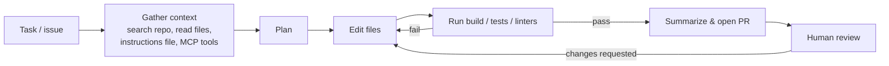

# AI-Assisted Engineering (state as of 2026)

> **TL;DR** — AI coding tools have moved from autocomplete to autonomous agents that read repositories, run commands and tests, and open pull requests. They amplify whatever engineering system they work in: strong tests, clear docs, small PRs and fast CI make agents productive; weak ones make them dangerous. Treat AI output as untrusted code from a fast, confident junior: specify precisely, constrain permissions, verify with tests and review, and measure outcomes (DORA/DevEx), not lines generated.

Related: [Developer experience](developer-experience.md) · [Testing](testing.md) · [Code review](git-and-version-control.md#6-pull-requests-and-code-review) · [CI/CD](ci-cd-devops.md) · [Data & AI architecture](../07-data-ai-architecture/README.md)

---

## 1. Landscape

| Category | What it does | Examples (2025–26) |
|---|---|---|
| Inline completion | Next-line / multi-line suggestions in the editor | GitHub Copilot, Cursor Tab, JetBrains AI, Supermaven-style models |
| Chat in IDE | Ask about code, generate snippets, explain errors | Copilot Chat, Cursor, Windsurf, JetBrains AI Assistant |
| Agentic IDE / editor agents | Multi-file edits, run terminal commands, iterate on test failures | Cursor Agent, Copilot agent mode (VS Code/Visual Studio), Windsurf Cascade, Zed |
| Terminal / CLI agents | Repo-wide autonomous tasks from the shell; scriptable, headless in CI | Claude Code, OpenAI Codex CLI, Gemini CLI, Aider, OpenCode |
| Cloud / background agents | Take an issue, work in a sandbox, open a PR | GitHub Copilot coding agent, OpenAI Codex (cloud), Devin, Jules, Claude Code on the web/GitHub Actions |
| AI code review | Comment on PRs, summarize diffs, find bugs | Copilot code review, CodeRabbit, Graphite Agent, Cursor Bugbot, Claude Code review actions |
| App builders | Prompt-to-app prototypes | v0, Bolt, Lovable, Replit Agent |
| Extensibility standards | Connect agents to tools and context | Model Context Protocol (MCP), `AGENTS.md`/`CLAUDE.md` style repo instructions, agent skills, sub-agents, hooks |

The field changes monthly; evaluate tools on your own codebase with a short structured trial rather than relying on leaderboards.

---

## 2. How coding agents work



Key properties:
- **Context is everything**: the agent only knows what it reads. Clear structure, READMEs, architecture docs and an instructions file (`AGENTS.md`, `CLAUDE.md`, `.github/copilot-instructions.md`) dramatically improve results.
- **Verification loop**: agents are only as good as the feedback they can get — fast tests, type checkers and linters are the agent's eyes.
- **Tool permissions**: file edits, shell commands, network, MCP servers — each is a capability to scope.
- **Non-determinism**: the same prompt can yield different solutions; reviews and tests are the stabilizer.

---

## 3. Effective practices

### Task design
- Give **specific, verifiable** goals: "Add pagination to `GET /invoices` using cursor-based paging like `GET /orders`; add tests; don't change the response shape for existing clients."
- Point at examples to imitate (existing files, patterns).
- Break big work into small, reviewable steps; ask for a plan first and review it before code ("plan → approve → implement").
- Ask the agent to write or update tests first (TDD with an agent works well: tests are the spec).
- State constraints: libraries allowed, files not to touch, performance and security requirements.
- For unfamiliar code, use AI to **explain** and map the codebase before editing.

### Repository readiness ("agent-friendly codebase")
- [ ] One-command setup, build, test, lint — documented in README and instructions file
- [ ] Fast, deterministic tests; good error messages
- [ ] Strict types and linters (agents get immediate feedback)
- [ ] Conventions written down (naming, folder structure, error handling, testing style)
- [ ] Architecture overview and ADRs
- [ ] Dev containers / sandboxes so agents run in isolated, reproducible environments

### Example instructions file (excerpt)

```markdown
# AGENTS.md
## Commands
- Install: `pnpm install`  - Test: `pnpm test`  - Typecheck: `pnpm typecheck`  - Lint: `pnpm lint --fix`
## Conventions
- TypeScript strict; no `any`; validate external input with zod schemas in `src/schemas`.
- React: function components, TanStack Query for server state, no new global stores.
- Tests: Vitest + Testing Library; query by role; no snapshot tests.
## Boundaries
- Never edit files under `generated/` or `migrations/` (create new migrations instead).
- Do not add dependencies without asking.
- Run typecheck, lint and tests before declaring a task complete.
```

---

## 4. Reviewing AI-generated code

AI code must meet **the same bar** as human code — the author (the human who submits it) owns it.

| Check | What to look for |
|---|---|
| Correctness | Does it solve the actual problem? Edge cases, error paths, concurrency |
| Hallucinations | Non-existent APIs, packages, config options, wrong library versions |
| Tests | Do the tests assert behaviour, or were they adjusted to pass? Deleted/skipped tests? Mocks that make tests meaningless? |
| Scope creep | Unrequested refactors, renamed files, "drive-by" changes |
| Duplication | Re-implemented helpers that already exist in the codebase |
| Security | Injection, missing authz checks, secrets in code, unsafe deserialization, permissive CORS, weakened validation |
| Dependencies | New packages — exist? maintained? licence? typosquats ("slopsquatting": hallucinated package names registered by attackers) |
| Performance | N+1 queries, unbounded loops, loading everything in memory |
| Consistency | Matches project conventions and architecture |
| Explainability | Can the submitter explain every line? If not, it's not ready |

Practices:
- Keep AI-authored PRs **small**; large generated diffs are unreviewable.
- Label agent-authored PRs; require human approval (branch protection) — agents should not self-merge to protected branches.
- Use AI reviewers as a *first pass* (summaries, obvious bugs), not as the approver.
- Run the full CI suite plus SAST/dependency scanning on every AI PR.

---

## 5. Risks and mitigations

| Risk | Description | Mitigation |
|---|---|---|
| Subtle bugs & false confidence | Plausible-looking but wrong code; overly confident explanations | Tests, review, small diffs, ask for reasoning and sources |
| Security vulnerabilities | Studies repeatedly find insecure patterns in generated code | SAST (CodeQL, Semgrep), secure-coding instructions, threat-aware review |
| Prompt injection | Malicious instructions in issues, web pages, docs, dependencies or MCP tool output steer the agent | Treat tool output as data; least-privilege tools; human approval for side-effectful actions; no secrets in agent env |
| Data leakage | Proprietary code or secrets sent to providers | Enterprise plans with no-training guarantees, data residency, secret scanning, `.gitignore`/ignore files for agents |
| Excessive permissions | Agent with prod credentials or unrestricted shell | Sandboxes/containers, allowlisted commands, separate low-privilege tokens, network egress limits |
| Supply chain | Hallucinated or malicious packages; compromised MCP servers | Lockfiles, allowlists, package age policies, vetted MCP servers |
| Licence / IP | Verbatim reproduction of licensed code | Provider IP indemnity, duplicate-detection filters, licence scanning |
| Skill atrophy | Developers (especially juniors) stop understanding the code | Require explanations, pair on reviews, deliberate practice, "no-AI" learning tasks |
| Review bottleneck | Code generation outpaces review capacity → bigger batches, lower stability | WIP limits, small PRs, invest in automated verification |
| Codebase entropy | Inconsistent styles, duplicated helpers, dead code | Strong conventions, linters, refactoring passes, architecture tests |
| Cost | Token usage of agents can be significant | Budgets, model routing (smaller models for simple tasks), caching |
| Compliance | Regulated environments (EU AI Act obligations mostly target AI systems, not dev tools, but data protection still applies) | Policy, audit logs, approved tool list |

---

## 6. Measuring impact

- DORA 2024 found that increased AI adoption correlated with higher self-reported productivity and documentation quality, but with a small *decrease* in delivery throughput and stability — likely due to larger batch sizes. The 2025 DORA report (*State of AI-assisted Software Development*) frames AI as an **amplifier**: it magnifies the strengths and weaknesses of existing practices and platforms.
- Controlled studies show mixed results: large speedups on well-defined greenfield tasks; some experienced developers in familiar large codebases were *slower* with AI while believing they were faster (METR, 2025). Perception ≠ measurement.
- Measure: DORA metrics, PR cycle time, change failure rate, review load, DevEx surveys (cognitive load, flow), defect escape rate — before and after adoption, at team level.
- Avoid: "% of code written by AI", accepted-suggestion counts, or lines of code as success metrics.

---

## 7. Where AI helps most / least

| High leverage | Lower leverage / higher risk |
|---|---|
| Boilerplate, scaffolding, CRUD, test data | Novel algorithms, subtle concurrency |
| Writing tests for existing behaviour, increasing coverage of edge cases | Security-critical code (auth, crypto, payments) without expert review |
| Explaining unfamiliar code, onboarding | Large cross-cutting architectural changes in one go |
| Migrations & mechanical refactors (framework upgrades, API renames) with tests as safety net | Domains with little public training data or heavy tacit knowledge |
| Documentation drafts, commit messages, PR descriptions | Performance-critical hot paths (needs profiling) |
| Debugging with stack traces + logs | Ambiguous product requirements |
| Scripts, one-off data transforms, prototypes | Anything without a way to verify output |

## 8. Team policy checklist

- [ ] Approved tools and plans (data handling terms reviewed)
- [ ] Rules for what code/data may be shared with which tools
- [ ] Instructions files maintained in repos
- [ ] Agent sandboxing and credential policy (no prod secrets)
- [ ] PR labeling and review requirements for AI-authored changes
- [ ] Security scanning mandatory on all PRs
- [ ] Training: prompting, reviewing AI code, prompt-injection awareness
- [ ] Metrics baseline and periodic review of impact
- [ ] Guidance for juniors on learning vs delegating

## 9. Common mistakes

- Accepting large diffs because "tests pass" (tests may have been modified).
- Vague prompts → generic code that ignores project conventions.
- Running agents with broad credentials on developer machines.
- Not providing the agent a way to run tests.
- Using AI-generated code you can't explain in an incident.
- Measuring adoption instead of outcomes.

## References

- DORA research (incl. AI reports) — https://dora.dev/research/
- GitHub Copilot docs — https://docs.github.com/en/copilot
- Claude Code docs — https://docs.anthropic.com/en/docs/claude-code/overview
- Model Context Protocol — https://modelcontextprotocol.io
- AGENTS.md — https://agents.md
- OWASP Top 10 for LLM Applications — https://genai.owasp.org
- METR, Measuring the impact of early-2025 AI on experienced open-source developer productivity — https://metr.org/blog/2025-07-10-early-2025-ai-experienced-os-dev-study/
- Simon Willison's weblog (practical LLM tooling) — https://simonwillison.net
- Martin Fowler, Exploring Generative AI (series) — https://martinfowler.com/articles/exploring-gen-ai.html
- Prompt injection — https://en.wikipedia.org/wiki/Prompt_injection
- See also [Data & AI architecture](../07-data-ai-architecture/README.md) for LLM application design
