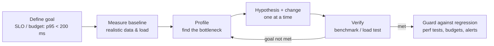

# Algorithms, Performance and Debugging

> **TL;DR** — Pick data structures by their access pattern (Big-O), then measure — never optimize on intuition. Profile CPU, memory, I/O and network separately; most real-world slowness is N+1 queries, chatty network calls, missing indexes, unbounded work, or blocking the event loop. Debug scientifically: reproduce, hypothesize, isolate (bisect), fix the root cause, add a regression test. Log with consistent levels and structure.

Related: [JavaScript runtime](javascript-runtime.md) · [React performance](react.md#9-performance) · [EF Core](csharp-dotnet.md#4-ef-core) · [Python](python.md) · [Data architecture](../07-data-ai-architecture/README.md) · [Cloud / observability](../06-cloud-architecture/README.md)

---

## 1. Big-O essentials

| Class | Name | Example | n = 1,000,000 ≈ ops |
|---|---|---|---|
| O(1) | constant | hash lookup, array index | 1 |
| O(log n) | logarithmic | binary search, balanced tree lookup | 20 |
| O(n) | linear | scan, single loop | 10⁶ |
| O(n log n) | linearithmic | efficient sorting | 2×10⁷ |
| O(n²) | quadratic | nested loops, naive dedupe | 10¹² (too slow) |
| O(2ⁿ) | exponential | brute-force subsets | impossible |
| O(n!) | factorial | brute-force permutations | impossible |

Notes: Big-O hides constants and memory locality — for small *n* a linear scan over an array can beat a hash map. Amortized O(1) (dynamic array append) occasionally costs O(n). Consider worst case for latency-sensitive and adversarial input (hash flooding, regex backtracking — ReDoS).

### Data structures

| Structure | Access | Search | Insert | Delete | Notes / language types |
|---|---|---|---|---|---|
| Array / dynamic array | O(1) | O(n) | O(1)* end, O(n) middle | O(n) | JS `Array`, Python `list`, C# `List<T>` |
| Linked list | O(n) | O(n) | O(1) at known node | O(1) at known node | C# `LinkedList<T>`; rarely the right choice (cache-unfriendly) |
| Stack | O(1) top | — | O(1) push | O(1) pop | array / `Stack<T>` |
| Queue / deque | O(1) ends | — | O(1) | O(1) | Python `collections.deque`, C# `Queue<T>`; JS `shift()` is O(n)! |
| Hash map / set | — | O(1) avg, O(n) worst | O(1) avg | O(1) avg | `Map`/`Set`, `dict`/`set`, `Dictionary`/`HashSet` |
| Balanced BST / sorted map | O(log n) | O(log n) | O(log n) | O(log n) | C# `SortedDictionary`, Java `TreeMap`; Python: `sortedcontainers` |
| Binary heap / priority queue | O(1) peek | O(n) | O(log n) | O(log n) pop | Python `heapq`, C# `PriorityQueue<T,P>` |
| Trie | — | O(k) key length | O(k) | O(k) | autocomplete, prefix matching |
| B-tree / B+tree | O(log n) | O(log n) | O(log n) | O(log n) | database indexes |
| Bloom filter | — | O(k) probabilistic | O(k) | n/a | "definitely not / maybe" membership |
| Graph (adjacency list) | — | O(V+E) traversal | O(1) | O(E) | sparse graphs |
| LRU cache (hash + list) | O(1) | O(1) | O(1) | O(1) | caching |

### Algorithms

| Algorithm | Time (avg / worst) | Space | Notes |
|---|---|---|---|
| Binary search | O(log n) | O(1) | sorted input |
| Quicksort | O(n log n) / O(n²) | O(log n) | in-place, not stable |
| Merge sort | O(n log n) / O(n log n) | O(n) | stable |
| Heapsort | O(n log n) / O(n log n) | O(1) | not stable |
| Timsort (Python, JS V8 `sort`, Java objects) | O(n log n) / O(n log n), O(n) best | O(n) | stable, adaptive |
| Introsort (.NET `Array.Sort`, C++ `std::sort`) | O(n log n) worst | O(log n) | not stable (use `OrderBy` for stable in LINQ) |
| Counting / radix sort | O(n + k) / O(nk) | O(n + k) | integer keys |
| BFS / DFS | O(V + E) | O(V) | BFS = shortest path in unweighted graphs |
| Dijkstra (binary heap) | O((V + E) log V) | O(V) | non-negative weights |
| Bellman–Ford | O(VE) | O(V) | negative weights |
| A* | depends on heuristic | O(V) | pathfinding |
| Topological sort (Kahn) | O(V + E) | O(V) | dependency ordering, build graphs |
| Union-Find | ~O(α(n)) per op | O(n) | connectivity, Kruskal |
| Dynamic programming | problem-specific | memo table | overlapping subproblems |
| Two pointers / sliding window | O(n) | O(1) | subarray/string problems |
| Hashing for dedupe/grouping | O(n) | O(n) | replaces O(n²) nested loops |

### Everyday patterns that change Big-O

```ts
// O(n·m): includes inside filter
const active = users.filter(u => activeIds.includes(u.id));
// O(n + m): Set lookup
const ids = new Set(activeIds);
const active2 = users.filter(u => ids.has(u.id));

// O(n²): find inside map → build an index first
const byId = new Map(orders.map(o => [o.id, o]));
```

---

## 2. Performance engineering process



- "Premature optimization is the root of all evil" (Knuth) — the full quote continues: yet we should not pass up the critical 3%. Design for performance at the architecture level (data access patterns, caching, async I/O); micro-optimize only after profiling.
- Use percentiles (p50, p95, p99), not averages. Tail latency compounds in fan-out systems.
- Amdahl's law: speedup limited by the fraction you can't improve.
- Latency numbers to know (order of magnitude): L1 ~1 ns, main memory ~100 ns, SSD random read ~16–100 µs, same-datacenter round trip ~0.5 ms, cross-continent ~70–150 ms.

### Typical bottlenecks and fixes

| Symptom | Likely cause | Fix |
|---|---|---|
| Many similar DB queries per request | N+1 | Eager load, batch (DataLoader), projections |
| Slow single query | Missing index, full scan, bad plan | `EXPLAIN (ANALYZE)`, index, rewrite, statistics |
| Latency grows with sequential calls | Chatty remote calls | Parallelize, batch endpoints, cache |
| Server CPU low but slow responses | Blocking I/O, thread-pool starvation, lock contention | Async I/O, remove sync-over-async, reduce lock scope |
| Node.js high latency under load | Event loop blocked | Move CPU work to workers, stream large payloads |
| Memory grows until OOM | Leak: caches, listeners, closures, static collections | Heap snapshots diff, bounded caches (LRU + TTL) |
| GC pauses | Allocation churn | Pooling, `Span<T>`/`ArrayPool` (.NET), fewer temp objects |
| Slow page load | Large JS bundles, render-blocking resources, unoptimized images | Code splitting, SSR/RSC, image optimization, CDN, HTTP caching |
| UI jank | Long tasks > 50 ms, layout thrashing | Break up work, virtualize lists, CSS transforms |

### Caching ladder
Browser cache (`Cache-Control`, ETag) → CDN → reverse proxy/output cache → application cache (in-memory, `HybridCache` in .NET 9+) → distributed cache (Redis) → database buffer pool. Always define invalidation and TTLs; protect against stampedes (request coalescing, stale-while-revalidate).

---

## 3. Profiling tools

| Platform | CPU | Memory | Other |
|---|---|---|---|
| Browser | Chrome DevTools Performance panel, React DevTools Profiler | Memory panel (heap snapshots, allocation timeline) | Lighthouse, Web Vitals extension, WebPageTest |
| Node.js | `node --cpu-prof`, `--inspect` + DevTools, `0x` flame graphs, clinic.js (Doctor, Flame, Bubbleprof) | `--heap-prof`, heap snapshots, `--trace-gc` | `perf_hooks.monitorEventLoopDelay`, autocannon (load) |
| Python | `cProfile` + snakeviz, `py-spy` (sampling, attach to prod), `scalene`, `pyinstrument` | `tracemalloc`, `memray` | `line_profiler` |
| .NET | Visual Studio Profiler, `dotnet-trace` + PerfView/Speedscope, JetBrains dotTrace | `dotnet-gcdump`, `dotnet-dump`, dotMemory | `dotnet-counters`, BenchmarkDotNet (micro-benchmarks) |
| Database | `EXPLAIN ANALYZE` (Postgres), Query Store & execution plans (SQL Server), `pg_stat_statements` | — | slow query logs |
| Distributed | OpenTelemetry tracing (Jaeger, Tempo, Azure Monitor/App Insights, Datadog, Honeycomb) | — | continuous profiling (Pyroscope, Datadog, Azure profiler) |
| Load testing | k6, Gatling, Locust, JMeter, NBomber, Azure Load Testing | — | — |

Micro-benchmark rules: warm-up, many iterations, statistical analysis, prevent dead-code elimination — use a harness (BenchmarkDotNet, `mitata`/`tinybench` for JS, `pytest-benchmark`, `timeit`).

**Flame graphs**: x-axis = proportion of samples (not time order), y-axis = stack depth; look for wide plateaus.

---

## 4. Debugging strategies

### The scientific method

1. **Reproduce** reliably (smallest failing case; capture inputs, versions, environment).
2. **Observe**: read the *whole* error and stack trace; check logs, traces, metrics around the time.
3. **Hypothesize** a cause that explains *all* symptoms.
4. **Experiment** to falsify: change one variable at a time.
5. **Fix the root cause**, not the symptom.
6. **Add a regression test**; check for the same bug elsewhere.
7. **Document** (commit message, postmortem if production).

### Techniques

| Technique | When |
|---|---|
| Debugger breakpoints, conditional breakpoints, logpoints | Local reproduction; inspect state without editing code |
| `git bisect` (automated with `git bisect run`) | "It worked last week" — find the commit |
| Binary search in code/data/config (comment out half) | Isolate component or input causing failure |
| Rubber duck debugging | Explain the code line by line — assumptions surface |
| Delta debugging / minimize input | Huge failing inputs |
| Add assertions / invariants | Catch corruption closer to the source |
| Diff working vs broken environments | Versions, config, env vars, data |
| Tracing (distributed) | Cross-service latency and failures |
| Record & replay (rr, Time Travel Debugging in WinDbg, Replay.io) | Non-deterministic bugs |
| Core/memory dumps (`dotnet-dump`, `node --heapsnapshot-signal`, `py-spy dump`) | Production hangs and leaks |
| Feature flag off / rollback | Mitigate first in production, debug after |
| Wolf fence / scientific elimination | Intermittent issues |
| Ask for help after a time box | 30–60 min stuck → pair |

### Heisenbugs and concurrency
Race conditions change under observation. Use: stress tests with many iterations, thread sanitizers, logging with timestamps + thread/task IDs, deterministic simulation, reasoning about happens-before. Common culprits: shared mutable state, check-then-act, missing `await`, non-thread-safe collections, cache invalidation timing, clock skew.

### Debugging checklists
- [ ] Is it actually running the code I think (build output, deployment version, cache, feature flag)?
- [ ] Is the input what I think (log it at the boundary)?
- [ ] What changed recently (deploys, config, dependency updates, data, traffic)?
- [ ] Does it fail in all environments / for all users?
- [ ] Time zones, locales, encodings, DST, leap years?
- [ ] Off-by-one, null/undefined, empty collection, integer overflow, float precision?
- [ ] Permissions, network policies, DNS, TLS certificates expired?

---

## 5. Logging levels

| Level | .NET `LogLevel` | Python `logging` | Use for | Prod default |
|---|---|---|---|---|
| Trace | `Trace` (0) | — (custom) | Very detailed flow, payloads (may contain sensitive data) | Off |
| Debug | `Debug` (1) | `DEBUG` (10) | Diagnostic info for developers | Off (enable per category temporarily) |
| Information | `Information` (2) | `INFO` (20) | Normal significant events: request handled, job completed, state transitions | On |
| Warning | `Warning` (3) | `WARNING` (30) | Unexpected but handled: retries, degraded mode, deprecated usage, validation failures at scale | On |
| Error | `Error` (4) | `ERROR` (40) | Operation failed, needs attention; include exception | On, alertable by rate |
| Critical / Fatal | `Critical` (5) | `CRITICAL` (50) | App/system failure, data loss risk, needs immediate action | On, pages |

JS loggers (pino, winston) use `trace, debug, info, warn, error, fatal`.

### Structured logging rules
- Log **events with fields**, not prose: `{"event":"order_placed","orderId":"…","amountMinor":1999,"traceId":"…"}`.
- Use message templates (`"Order {OrderId} placed"`) so fields are queryable.
- Always include correlation (trace/span IDs via OpenTelemetry), service name, version, environment.
- One log per failure with full context, not one per stack frame (log *or* rethrow, not both at every layer).
- Never log secrets, tokens, passwords, full PII, card data; redact by default.
- Logs are for events; metrics for aggregates; traces for request flow — don't build dashboards by grepping logs.
- Sample high-volume debug logs; control cost with retention tiers.
- Make log levels configurable per category at runtime.

---

## 6. Common mistakes

- Optimizing without profiling (or profiling a debug build).
- Benchmarking with unrealistic data sizes or a warm cache only.
- Averages instead of percentiles.
- Unbounded queries (`SELECT *` without `LIMIT`), unbounded caches, unbounded concurrency.
- Catch-and-log-everywhere producing duplicate, context-free errors.
- `console.log` debugging committed to main.
- Fixing symptoms ("added a retry") without understanding the cause.

## References

- Big-O Cheat Sheet — https://www.bigocheatsheet.com
- Big O notation — https://en.wikipedia.org/wiki/Big_O_notation
- Python TimeComplexity wiki — https://wiki.python.org/moin/TimeComplexity
- Latency numbers every programmer should know — https://gist.github.com/jboner/2841832
- Brendan Gregg, Flame Graphs — https://www.brendangregg.com/flamegraphs.html
- Brendan Gregg, USE method — https://www.brendangregg.com/usemethod.html
- Chrome DevTools performance — https://developer.chrome.com/docs/devtools/performance
- Node.js diagnostics guide — https://nodejs.org/en/learn/diagnostics/user-journey
- .NET diagnostics tools — https://learn.microsoft.com/dotnet/core/diagnostics/
- BenchmarkDotNet — https://benchmarkdotnet.org
- Python profilers — https://docs.python.org/3/library/profile.html
- Python logging HOWTO — https://docs.python.org/3/howto/logging.html
- .NET logging — https://learn.microsoft.com/dotnet/core/extensions/logging
- OpenTelemetry — https://opentelemetry.io/docs/
- Use The Index, Luke (SQL indexing) — https://use-the-index-luke.com
- web.dev performance — https://web.dev/performance
- *Introduction to Algorithms* (CLRS), *The Algorithm Design Manual* (Skiena)
- *Systems Performance* (Brendan Gregg, 2nd ed.)
- *Debugging: The 9 Indispensable Rules* (David Agans)
- *Why Programs Fail* (Andreas Zeller); The Debugging Book — https://www.debuggingbook.org
