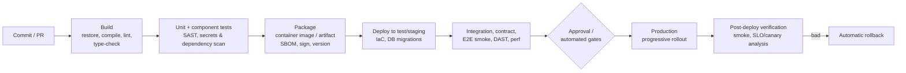
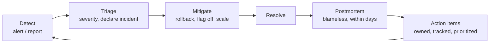

# CI/CD and DevOps

> **TL;DR** — Continuous Integration means integrating into trunk at least daily with a fast, reliable automated build; Continuous Delivery means every green build is releasable; Continuous Deployment ships it automatically. Build once, promote the same artifact through environments, decouple deploy from release with feature flags and progressive delivery, keep secrets out of pipelines via OIDC/workload identity, and measure with DORA's metrics. Culture (the Three Ways, CALMS, blameless postmortems) matters as much as tools.

Related: [Git](git-and-version-control.md) · [Testing](testing.md) · [Developer experience](developer-experience.md) · [Cloud architecture / SRE](../06-cloud-architecture/README.md) · [Agile](../04-agile-kanban-scrum/README.md) · [Leadership](../09-leadership-teams-facilitation/README.md)

---

## 1. Definitions

| Term | Meaning |
|---|---|
| Continuous Integration (CI) | Developers merge to mainline at least daily; every commit triggers an automated build + tests; a broken build is fixed immediately (within ~10 minutes or reverted) |
| Continuous Delivery (CD) | Software is always in a releasable state; deployment to production is a push-button business decision |
| Continuous Deployment | Every change passing the pipeline goes to production automatically |
| Deployment vs Release | Deploy = put code in an environment; release = expose functionality to users. Decouple them |

### CI principles (Fowler / Humble & Farley)
- Single source repository; everything in version control (code, config, pipelines, infra, DB migrations).
- Automate the build; make it self-testing.
- Everyone commits to mainline every day.
- Every commit builds mainline on an integration machine.
- Fix broken builds immediately — stop the line.
- Keep the build fast: commit stage < ~10 minutes.
- Test in a clone of production.
- Make it easy to get the latest executable; everyone can see what is happening.
- Automate deployment.

---

## 2. Pipeline stages



| Principle | Practice |
|---|---|
| Build once, deploy many | Same immutable artifact (image digest) promoted dev → test → prod; config injected per environment |
| Fail fast | Cheapest checks first; parallelize jobs |
| Pipelines as code | YAML in repo, reviewed like code; reusable templates/workflows |
| Hermetic, reproducible builds | Lockfiles, pinned tool versions, pinned action SHAs, container build images |
| Cache | Dependency caches, build caches (Turborepo/Nx remote cache, Docker layer cache) |
| Quality gates | Required checks on PR: build, tests, lint, coverage-on-diff, security scans |
| Supply chain | SBOM (CycloneDX/SPDX), signing (Sigstore/cosign), provenance (SLSA levels), dependency pinning |
| Database changes | Versioned migrations, backward-compatible (expand/contract) |
| Observability of pipelines | Track duration, failure rate, flaky tests, queue time |

---

## 3. Snippets

### GitHub Actions

```yaml
# .github/workflows/ci.yml
name: ci
on:
  pull_request:
  push:
    branches: [main]

permissions:
  contents: read

concurrency:
  group: ${{ github.workflow }}-${{ github.ref }}
  cancel-in-progress: true

jobs:
  build-test:
    runs-on: ubuntu-latest
    strategy:
      matrix:
        node: [22, 24]
    steps:
      - uses: actions/checkout@v4
      - uses: pnpm/action-setup@v4
      - uses: actions/setup-node@v4
        with:
          node-version: ${{ matrix.node }}
          cache: pnpm
      - run: pnpm install --frozen-lockfile
      - run: pnpm lint && pnpm typecheck
      - run: pnpm test -- --coverage
      - uses: actions/upload-artifact@v4
        if: matrix.node == 24
        with: { name: dist, path: dist/ }

  deploy-prod:
    needs: build-test
    if: github.ref == 'refs/heads/main'
    runs-on: ubuntu-latest
    environment: production          # protection rules: required reviewers, wait timer, branch policy
    permissions:
      id-token: write                # OIDC federation — no stored cloud secret
      contents: read
    steps:
      - uses: actions/download-artifact@v4
        with: { name: dist, path: dist }
      - uses: azure/login@v2
        with:
          client-id: ${{ vars.AZURE_CLIENT_ID }}
          tenant-id: ${{ vars.AZURE_TENANT_ID }}
          subscription-id: ${{ vars.AZURE_SUBSCRIPTION_ID }}
      - run: az webapp deploy --resource-group rg-app --name app-prod --src-path dist --type static
```

Hardening: pin third-party actions to full commit SHAs, least-privilege `permissions`, avoid `pull_request_target` with checkout of untrusted code, never echo secrets, use `environment` protection for prod, reusable workflows (`workflow_call`) for shared pipelines.

### Azure DevOps YAML (multi-stage)

```yaml
# azure-pipelines.yml
trigger:
  branches: { include: [main] }
pr:
  branches: { include: [main] }

variables:
  buildConfiguration: Release

stages:
- stage: Build
  jobs:
  - job: build
    pool: { vmImage: ubuntu-latest }
    steps:
    - task: UseDotNet@2
      inputs: { useGlobalJson: true }
    - script: dotnet restore --locked-mode
    - script: dotnet build -c $(buildConfiguration) --no-restore
    - script: dotnet test -c $(buildConfiguration) --no-build --logger trx --collect:"XPlat Code Coverage"
    - task: PublishTestResults@2
      inputs: { testResultsFormat: VSTest, testResultsFiles: '**/*.trx' }
    - script: dotnet publish src/Api -c $(buildConfiguration) -o $(Build.ArtifactStagingDirectory)/api
    - publish: $(Build.ArtifactStagingDirectory)/api
      artifact: api

- stage: DeployStaging
  dependsOn: Build
  jobs:
  - deployment: staging
    environment: staging
    pool: { vmImage: ubuntu-latest }
    strategy:
      runOnce:
        deploy:
          steps:
          - task: AzureWebApp@1
            inputs:
              azureSubscription: sc-staging        # service connection using workload identity federation
              appName: app-staging
              package: $(Pipeline.Workspace)/api

- stage: DeployProd
  dependsOn: DeployStaging
  condition: and(succeeded(), eq(variables['Build.SourceBranch'], 'refs/heads/main'))
  jobs:
  - deployment: prod
    environment: production                      # approvals & checks configured on the environment
    pool: { vmImage: ubuntu-latest }
    strategy:
      runOnce:
        deploy:
          steps:
          - task: AzureWebApp@1
            inputs:
              azureSubscription: sc-prod
              appName: app-prod
              package: $(Pipeline.Workspace)/api
              deployToSlotOrASE: true
              slotName: staging                  # then swap slots = blue-green
```

Azure DevOps concepts: **templates** (`extends`, `stages`/`jobs`/`steps` templates in a central repo), **variable groups** linked to Key Vault, **environments** with approvals and checks (manual approval, business hours, Azure Monitor alerts, required template, exclusive lock), **service connections** with workload identity federation, **deployment strategies** (`runOnce`, `rolling`, `canary`), Azure Artifacts feeds with upstream sources.

| Concept | GitHub Actions | Azure DevOps |
|---|---|---|
| Pipeline file | `.github/workflows/*.yml` | `azure-pipelines.yml` |
| Reuse | Reusable workflows, composite actions | Templates (`extends`, includes) |
| Gate to prod | Environments: required reviewers, wait timer, deployment branches, custom protection rules | Environments: approvals and checks |
| Secrets | Repo/org/environment secrets, OIDC | Variable groups, Key Vault link, secure files, workload identity federation |
| Artifacts | Actions artifacts (ephemeral), GitHub Packages, GHCR | Pipeline artifacts, Azure Artifacts (NuGet/npm/PyPI/Maven/Universal) |
| Runners | GitHub-hosted, larger runners, self-hosted, ARC on Kubernetes | Microsoft-hosted, self-hosted, scale-set agents, Managed DevOps Pools |

---

## 4. Deployment strategies

| Strategy | How | Pros | Cons | Use when |
|---|---|---|---|---|
| Recreate | Stop old, start new | Simple | Downtime | Dev/test, batch jobs |
| **Rolling** | Replace instances gradually | No extra capacity, default in Kubernetes | Two versions live simultaneously; slow rollback | Stateless services with backward-compatible changes |
| **Blue-green** | Two identical environments; switch traffic at the router | Instant switch and rollback, test the green env before switch | Double capacity; DB schema must work for both | Critical apps needing fast rollback (App Service slots, swap) |
| **Canary** | Route small % of traffic to new version, increase while metrics are healthy | Limits blast radius, real-traffic validation | Needs good metrics & traffic splitting; long rollouts | High-traffic services (Argo Rollouts, Flagger, Azure Front Door, service mesh) |
| **Feature flags** | Deploy code dark; toggle per user/cohort/% | Decouples deploy from release, kill switch, trunk-based dev | Flag debt, combinatorial testing, config is now code | Almost always for user-facing features |
| **Dark launch** | Run new code path in production without exposing results (shadow traffic) | Validates performance/correctness at scale | Side effects must be suppressed; cost | Rewrites, new backends, ML models |
| A/B testing | Variants to cohorts to measure outcome | Product learning | Statistical rigour needed | Product experiments |
| Ring deployment | Internal → early adopters → broad | Staged exposure | Slower | Large user bases (Microsoft rings model) |

Feature flag categories (Pete Hodgson): **release toggles** (short-lived), **experiment toggles**, **ops toggles** (kill switches, long-lived), **permission toggles**. Tools: LaunchDarkly, Unleash, Flagsmith, GrowthBook, Azure App Configuration feature manager, OpenFeature (vendor-neutral SDK standard).

Rollback vs roll-forward: keep both options; database migrations must be backward compatible for rollback to be safe.

---

## 5. DORA metrics

The DORA research program (DevOps Research and Assessment, now at Google Cloud) identified software delivery performance metrics that predict organizational performance.

| Metric | Measures | Category |
|---|---|---|
| **Deployment frequency** | How often code is deployed to production | Throughput |
| **Lead time for changes** | Commit → running in production | Throughput |
| **Change failure rate** | % of deployments causing a failure needing remediation (hotfix, rollback) | Stability |
| **Time to restore service** / Failed deployment recovery time | Time to recover from a failed deployment / incident | Stability |
| **+1: Reliability** (added 2021) | Meeting availability/performance/latency targets (operational performance) | Operations |
| Rework rate (added 2024) | Unplanned deployments to fix user-facing bugs | Instability |

### Performance clusters (2021 State of DevOps report — the widely cited "elite" thresholds)

| Metric | Elite | High | Medium | Low |
|---|---|---|---|---|
| Deployment frequency | On-demand (multiple per day) | Once per week – once per month | Once per month – once every 6 months | Fewer than once every 6 months |
| Lead time for changes | < 1 hour | 1 day – 1 week | 1 month – 6 months | > 6 months |
| Time to restore | < 1 hour | < 1 day | 1 day – 1 week | > 6 months |
| Change failure rate | 0–15% | 16–30% | 16–30% | 16–30% |

### 2023 report clusters (for comparison)

| Metric | Elite | High | Medium | Low |
|---|---|---|---|---|
| Deployment frequency | On demand | Daily – weekly | Weekly – monthly | Weekly – monthly |
| Lead time | < 1 day | 1 day – 1 week | 1 week – 1 month | 1 week – 1 month |
| Change failure rate | ~5% | ~10% | ~15% | ~64% |
| Failed deployment recovery time | < 1 hour | < 1 day | 1 day – 1 week | 1 month – 6 months |

Cluster boundaries are recalculated from survey data each year (2022 had no elite cluster; 2024/2025 reports moved toward team archetypes and AI-adoption findings). Use them as orientation, not targets. Key finding repeated every year: **speed and stability are not trade-offs** — top performers excel at both.

Measuring: derive from pipeline + incident data (Four Keys project, Azure DevOps/GitHub analytics, DX/LinearB/Sleuth-style platforms). Measure at team/service level; never use for individual performance (Goodhart's law). See [Developer experience](developer-experience.md) for SPACE/DevEx.

DORA capabilities that drive performance: version control, trunk-based development, CI, deployment automation, test automation, test data management, shift-left security, loosely coupled architecture, empowered teams, monitoring & observability, proactive failure notification, WIP limits, visual management, small batches, streamlined change approval, generative culture (Westrum), documentation quality, user-centric focus.

---

## 6. DevOps culture models

### The Three Ways (The Phoenix Project / The DevOps Handbook)

| Way | Principle | Practices |
|---|---|---|
| **First Way: Flow** | Fast left-to-right flow from Dev to Ops to customer | Small batches, limit WIP, make work visible, reduce handoffs, eliminate constraints (Theory of Constraints), CI/CD |
| **Second Way: Feedback** | Fast, constant right-to-left feedback | Telemetry, monitoring, peer review, swarming problems, stop-the-line (andon), push quality closer to source |
| **Third Way: Continual learning and experimentation** | Culture of experimentation, learning from failure, mastery through repetition | Blameless postmortems, chaos engineering, time for improvement work, sharing local discoveries globally |

The Four Types of Work (Phoenix Project): business projects, internal projects, operational changes/changes, unplanned work.

### CALMS (Jez Humble; extended from Damon Edwards & John Willis' CAMS)

| Letter | Meaning |
|---|---|
| **C**ulture | Shared responsibility, collaboration, trust, psychological safety |
| **A**utomation | Build, test, deploy, infra (IaC), compliance |
| **L**ean | Flow, small batches, value stream mapping, eliminate waste |
| **M**easurement | DORA metrics, telemetry, business outcomes |
| **S**haring | Knowledge, tools, postmortems, inner source |

Westrum organizational culture: pathological (power-oriented) → bureaucratic (rule-oriented) → **generative** (performance-oriented). Generative culture predicts delivery performance (DORA). See [Leadership](../09-leadership-teams-facilitation/README.md).

---

## 7. Environments, approvals and artifacts

| Topic | Guidance |
|---|---|
| Environment parity | Same IaC modules, container images, config schema; differences only in scale and secrets |
| Ephemeral environments | Preview environment per PR (Vercel/Netlify/Azure Static Web Apps previews, Kubernetes namespaces); destroyed on merge |
| Approvals | Prefer automated gates (tests, SLO checks, policy) over manual sign-offs. DORA: heavyweight external change approval (CAB) correlates with *worse* performance; peer review + automation is better |
| Segregation of duties | Satisfy via enforced PR review + protected pipeline, not separate deploy teams |
| Artifact management | Immutable versions, retention policies, promotion via feeds/views (Azure Artifacts `@Release` view) or registries (ACR, GHCR) with tags pointing to digests |
| Container images | Minimal base (distroless/chiseled), non-root, scanned (Trivy, Defender), signed, SBOM attached |
| Infrastructure as Code | Bicep, Terraform/OpenTofu, Pulumi; plan in PR, apply in pipeline; drift detection |
| GitOps | Desired state in git, reconciled by Argo CD/Flux (Kubernetes) |

## 8. Secrets in pipelines

| Do | Don't |
|---|---|
| OIDC / workload identity federation to cloud providers (no stored credentials) | Long-lived service principal secrets in variables |
| Central secret store (Key Vault, AWS Secrets Manager, Vault) referenced at runtime | Secrets in YAML, repo, Docker image layers, or build args |
| Managed identities for runtime apps | Shared admin credentials |
| Least privilege per environment, separate identities for prod | One identity for all environments |
| Secret scanning + push protection; rotate on exposure | "Delete the commit" and move on |
| Mask secrets; avoid `set -x` around them | Print env in debug steps |
| Limit secrets on fork PRs | Expose secrets to untrusted PR code |

---

## 9. SRE practices (summary)

Full treatment in [Cloud architecture](../06-cloud-architecture/README.md).

- **SLI** (indicator: e.g. % of requests < 300 ms), **SLO** (target: 99.9% over 28 days), **SLA** (contract with penalties).
- **Error budget** = 1 − SLO; when exhausted, prioritize reliability over features.
- Toil reduction (Google aims for < 50% of SRE time on toil).
- Alert on symptoms (SLO burn rate), not causes; every page must be actionable.
- Golden signals: latency, traffic, errors, saturation (RED for services, USE for resources).
- Observability: OpenTelemetry for traces, metrics, logs.

## 10. Incident management and blameless postmortems



Roles: **Incident Commander** (coordinates, decides), **Communications lead** (status page, stakeholders), **Operations/subject-matter leads** (hands on keyboard), **Scribe** (timeline).

Severity example:

| Sev | Definition | Response |
|---|---|---|
| SEV1 | Major outage / data loss / security breach affecting many customers | Page immediately, all hands, exec comms |
| SEV2 | Significant degradation, workaround exists | Page on-call, status page |
| SEV3 | Minor impact | Business hours |
| SEV4 | Cosmetic / internal | Backlog |

Mitigate first, root-cause later. Rollback or kill switch beats debugging in production.

### Postmortem template

| Section | Content |
|---|---|
| Summary | What happened, impact, duration (one paragraph) |
| Impact | Users affected, SLO budget consumed, revenue, data |
| Timeline | UTC timestamps: detection, escalation, mitigation, resolution |
| Root cause(s) and contributing factors | Systemic causes, not "human error" |
| Detection | How detected; how could it be faster |
| What went well / badly / where we got lucky | |
| Action items | Prevent, detect, mitigate — each with owner, priority, due date |
| Lessons learned | Shared broadly |

Blameless principles: assume people acted reasonably given the information they had; ask "how did the system allow this?" instead of "who did this?"; "human error" is a starting point of investigation, not a conclusion; reward reporting. Techniques: 5 Whys (use carefully — tends to a single linear cause), causal analysis/contributing factors, Learning From Incidents community approaches.

## 11. Common mistakes

- Pipeline takes 45 minutes → developers batch changes → bigger failures.
- Rebuilding artifacts per environment ("works in staging" means nothing).
- Manual production steps documented in a wiki.
- Long-lived secrets copied into every pipeline.
- CAB approval for every change instead of automated controls.
- Tolerating red main or flaky tests.
- Feature flags never removed.
- DORA metrics used to rank individuals or teams against each other.
- Postmortems that end with "be more careful".

## References

- DORA — https://dora.dev
- DORA research & reports — https://dora.dev/research/
- DORA capabilities — https://dora.dev/capabilities/
- Google Cloud, State of DevOps reports — https://cloud.google.com/devops/state-of-devops
- Martin Fowler, Continuous Integration — https://martinfowler.com/articles/continuousIntegration.html
- Martin Fowler, Continuous Delivery — https://martinfowler.com/bliki/ContinuousDelivery.html
- Martin Fowler, Blue-Green Deployment — https://martinfowler.com/bliki/BlueGreenDeployment.html
- Martin Fowler, Canary Release — https://martinfowler.com/bliki/CanaryRelease.html
- Feature Toggles (Pete Hodgson) — https://martinfowler.com/articles/feature-toggles.html
- OpenFeature — https://openfeature.dev
- GitHub Actions docs — https://docs.github.com/en/actions
- GitHub Actions security hardening — https://docs.github.com/en/actions/security-for-github-actions/security-guides/security-hardening-for-github-actions
- Azure Pipelines docs — https://learn.microsoft.com/azure/devops/pipelines/
- Azure Pipelines YAML schema — https://learn.microsoft.com/azure/devops/pipelines/yaml-schema/
- Azure Pipelines environments — https://learn.microsoft.com/azure/devops/pipelines/process/environments
- SLSA — https://slsa.dev
- Sigstore — https://www.sigstore.dev
- Google SRE books — https://sre.google/books/
- Google SRE book: Postmortem Culture — https://sre.google/sre-book/postmortem-culture/
- PagerDuty Incident Response docs — https://response.pagerduty.com
- Atlassian Incident Management handbook — https://www.atlassian.com/incident-management
- *The Phoenix Project*, *The DevOps Handbook* (Kim, Humble, Debois, Willis, Forsgren)
- *Accelerate* (Forsgren, Humble, Kim)
- *Continuous Delivery* (Humble & Farley) — https://continuousdelivery.com
- DevOps — https://en.wikipedia.org/wiki/DevOps
