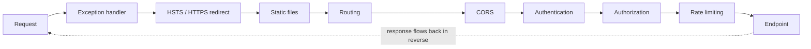

# C# and .NET

> **TL;DR** — Modern .NET (8 LTS, 9, 10 LTS) is cross-platform and fast. Use records for immutable data, pattern matching for branching on shape, nullable reference types everywhere, and LINQ judiciously. In ASP.NET Core, understand the middleware pipeline and DI lifetimes (avoid captive dependencies). In EF Core, use `AsNoTracking` for reads, project to DTOs, watch for N+1, and own your migrations. Go async all the way, never `async void`, never `.Result`. Log with structured `ILogger` templates, bind config through the Options pattern, and test with xUnit + NSubstitute + Testcontainers.

Related: [Testing](testing.md) · [CI/CD](ci-cd-devops.md) · [Software architecture](../05-software-architecture/README.md) · [Cloud architecture](../06-cloud-architecture/README.md)

---

## 1. Platform overview

| Item | Notes |
|---|---|
| Release cadence | Annual major in November. Even = LTS (3 years), odd = STS (24 months since .NET 9) |
| Current (late 2026) | .NET 10 LTS (Nov 2025, C# 14); .NET 8 LTS supported until Nov 2026; .NET 11 previews |
| SDK pinning | `global.json` |
| Central package management | `Directory.Packages.props` with `<ManagePackageVersionsCentrally>` |
| Shared build settings | `Directory.Build.props` (nullable, warnings as errors, analyzers) |
| Native AOT | Small, fast-starting binaries; trimming-compatible libraries required |
| .NET Aspire | Orchestration, service defaults (OpenTelemetry, health checks, resilience) and dashboard for distributed apps in dev |

```xml
<!-- Directory.Build.props -->
<Project>
  <PropertyGroup>
    <TargetFramework>net10.0</TargetFramework>
    <Nullable>enable</Nullable>
    <ImplicitUsings>enable</ImplicitUsings>
    <TreatWarningsAsErrors>true</TreatWarningsAsErrors>
    <AnalysisLevel>latest-recommended</AnalysisLevel>
    <EnforceCodeStyleInBuild>true</EnforceCodeStyleInBuild>
  </PropertyGroup>
</Project>
```

---

## 2. Modern C# features

| Feature | Version | Example / purpose |
|---|---|---|
| Records | 9 | `public record Money(decimal Amount, string Currency);` value equality, `with` expressions |
| `record struct` | 10 | Value-type records |
| Init-only setters | 9 | `public string Name { get; init; }` |
| `required` members | 11 | Compiler-enforced initialization |
| Pattern matching | 7–11 | type, property, relational, logical (`and/or/not`), list patterns |
| Switch expressions | 8 | Exhaustive expression-based branching |
| Nullable reference types | 8 | `string?` vs `string`, flow analysis |
| Global/implicit usings | 10 | Less boilerplate |
| File-scoped namespaces | 10 | `namespace Acme.Billing;` |
| Raw string literals | 11 | `"""…"""` JSON/SQL in code |
| Generic math, static abstract members | 11 | `INumber<T>` |
| Primary constructors (classes) | 12 | `class Service(ILogger<Service> log, IRepo repo)` |
| Collection expressions | 12 | `int[] xs = [1, 2, ..others];` |
| `params` collections, `lock` type, `field` keyword (preview→14) | 13/14 | |
| Extension members | 14 | Extension properties and static extension members (`extension(T t) { … }` blocks) |
| Null-conditional assignment | 14 | `customer?.Order = order;` |

### Records and pattern matching

```csharp
public abstract record Shape;
public sealed record Circle(double Radius) : Shape;
public sealed record Rect(double W, double H) : Shape;

static double Area(Shape s) => s switch
{
    Circle { Radius: <= 0 }          => throw new ArgumentException("radius"),
    Circle c                         => Math.PI * c.Radius * c.Radius,
    Rect(var w, var h) when w == h   => w * w,
    Rect r                           => r.W * r.H,
    _                                => throw new UnreachableException()
};

// List patterns
var msg = args switch
{
    []                 => "no args",
    [var one]          => $"one: {one}",
    [var first, .., var last] => $"{first}…{last}",
};

var updated = order with { Status = OrderStatus.Shipped };
```

### Nullable reference types

- Enable project-wide; treat nullable warnings as errors.
- `string?` may be null; `string` should not be. The compiler warns on dereference without checks.
- Attributes for APIs: `[NotNullWhen(true)]`, `[MaybeNull]`, `[MemberNotNull]`.
- `!` (null-forgiving) is a code smell — comment why.
- `ArgumentNullException.ThrowIfNull(arg);` at public boundaries.

### Primary constructors

```csharp
public sealed class InvoiceService(IInvoiceRepository repo, TimeProvider clock, ILogger<InvoiceService> log)
{
    public async Task<Invoice> IssueAsync(OrderId id, CancellationToken ct)
    {
        var invoice = Invoice.For(await repo.GetOrderAsync(id, ct), clock.GetUtcNow());
        log.LogInformation("Issued invoice {InvoiceId} for order {OrderId}", invoice.Id, id);
        return invoice;
    }
}
```

Caveat: parameters are captured mutable fields, not `readonly`; assign to `private readonly` fields if immutability matters.

### LINQ

| Do | Don't |
|---|---|
| Use for readable transformations | Chain 15 operators in one expression |
| `Any()` instead of `Count() > 0` | Multiple enumeration of `IEnumerable` (materialize with `ToList()` once) |
| Know deferred vs immediate execution | Assume `IQueryable` methods run in memory — they translate to SQL |
| `.NET 9+`: `CountBy`, `AggregateBy`, `Index` | Use LINQ in hot loops without measuring (allocations) |

```csharp
var topCustomers = orders
    .Where(o => o.PlacedAt >= since)
    .GroupBy(o => o.CustomerId)
    .Select(g => new { CustomerId = g.Key, Total = g.Sum(o => o.Total) })
    .OrderByDescending(x => x.Total)
    .Take(10)
    .ToList();
```

---

## 3. ASP.NET Core

### Minimal APIs vs Controllers

| | Minimal APIs | Controllers (MVC) |
|---|---|---|
| Style | Lambdas/static methods mapped to routes | Classes with action methods and attributes |
| Ceremony | Low | Higher |
| Performance | Slightly better, Native AOT friendly | Good |
| Features | Filters, route groups, typed results, OpenAPI, validation (built-in since .NET 10) | Model binding conventions, filters, `ApiController` behaviours, mature ecosystem |
| Organisation | Use route groups + extension methods per feature (vertical slices) | Controller per resource |
| Choose | New services, microservices, vertical slice architecture | Large existing codebases, teams used to MVC, heavy filter use |

```csharp
var builder = WebApplication.CreateBuilder(args);
builder.Services.AddProblemDetails();
builder.Services.AddOpenApi();
builder.Services.AddDbContext<AppDb>(o => o.UseNpgsql(builder.Configuration.GetConnectionString("Db")));
builder.Services.AddScoped<IInvoiceRepository, EfInvoiceRepository>();
builder.Services.AddOptions<BillingOptions>()
    .BindConfiguration(BillingOptions.Section)
    .ValidateDataAnnotations()
    .ValidateOnStart();

var app = builder.Build();
app.UseExceptionHandler();
app.UseAuthentication();
app.UseAuthorization();
app.MapOpenApi();

var invoices = app.MapGroup("/invoices").RequireAuthorization();
invoices.MapGet("/{id:int}", async Task<Results<Ok<InvoiceDto>, NotFound>> (int id, AppDb db, CancellationToken ct) =>
    await db.Invoices.AsNoTracking().Where(i => i.Id == id).Select(i => new InvoiceDto(i.Id, i.Total)).FirstOrDefaultAsync(ct)
        is { } dto ? TypedResults.Ok(dto) : TypedResults.NotFound());

app.Run();
```

### Middleware pipeline



- Order matters: each middleware can act before and after `next()`. Exception handling first, authentication before authorization, CORS before auth for preflight.
- Short-circuiting: static files return without hitting routing.
- Custom middleware: `app.Use(async (ctx, next) => { …; await next(ctx); … });` or a class with `InvokeAsync(HttpContext)`.
- Cross-cutting built-ins: `AddRateLimiter`, `AddOutputCache`, `AddResponseCompression`, `AddHealthChecks`, `AddProblemDetails`, HTTP logging, `AddRequestTimeouts`.

### Dependency injection lifetimes

| Lifetime | Instance | Typical use | Danger |
|---|---|---|---|
| **Transient** | New every resolution | Lightweight stateless services | Disposable transients resolved from root are held until app shutdown |
| **Scoped** | One per scope (= per HTTP request) | `DbContext`, unit of work, per-request context | Resolving from root provider → effectively singleton |
| **Singleton** | One for app lifetime | Caches, `HttpClient` handlers, config, stateless thread-safe services | Must be thread-safe; must not depend on scoped/transient-with-state |

**Captive dependency**: a longer-lived service holds a shorter-lived one (e.g. singleton → scoped `DbContext`). The scoped instance is captured forever: stale data, concurrency bugs, leaked connections.

```csharp
// BAD
builder.Services.AddSingleton<ReportCache>();          // ctor takes AppDb (scoped) → captive
// FIX: inject IServiceScopeFactory and create a scope per operation
public sealed class ReportCache(IServiceScopeFactory scopes)
{
    public async Task RefreshAsync(CancellationToken ct)
    {
        await using var scope = scopes.CreateAsyncScope();
        var db = scope.ServiceProvider.GetRequiredService<AppDb>();
        …
    }
}
```

Enable `ValidateScopes` and `ValidateOnBuild` (on by default in Development) to catch these at startup. `BackgroundService`s are singletons — always create scopes inside. Keyed services (`AddKeyedSingleton`, `[FromKeyedServices]`) since .NET 8. Use `IHttpClientFactory` / typed clients, never `new HttpClient()` per request. Inject `TimeProvider` instead of `DateTime.UtcNow` for testability.

---

## 4. EF Core

| Topic | Guidance |
|---|---|
| Change tracking | Tracked entities are snapshotted; `SaveChanges` diffs and emits SQL. Costs memory/CPU |
| `AsNoTracking()` | Use for read-only queries; `AsNoTrackingWithIdentityResolution` when the graph has duplicates |
| Projections | `Select` into DTOs — fetches only needed columns, no tracking |
| Loading related data | Eager `Include`/`ThenInclude`; explicit `Entry().Collection().LoadAsync()`; lazy loading (proxies) — avoid in web apps |
| N+1 | Iterating parents and touching navigation properties with lazy loading → one query per row. Fix with `Include` or projection |
| Cartesian explosion | Multiple collection `Include`s → `AsSplitQuery()` |
| Bulk ops | `ExecuteUpdateAsync` / `ExecuteDeleteAsync` (no load) |
| Compiled queries | `EF.CompileAsyncQuery` for very hot queries; compiled models for big-model startup time |
| Concurrency | Row version / concurrency tokens; handle `DbUpdateConcurrencyException` |
| `DbContext` | Scoped, not thread-safe; use `AddDbContextPool` for throughput; `IDbContextFactory` in Blazor/background |
| Raw SQL | `FromSql($"… {param}")` — interpolation is parameterized; never `FromSqlRaw` with concatenation |
| Logging | `LogTo(Console.WriteLine)`/`EnableSensitiveDataLogging` in dev; inspect generated SQL with `ToQueryString()` |

```csharp
// N+1 (lazy loading)
foreach (var order in await db.Orders.ToListAsync(ct))
    Console.WriteLine(order.Customer.Name);           // query per order

// Fix: projection
var rows = await db.Orders.AsNoTracking()
    .Select(o => new { o.Id, CustomerName = o.Customer.Name })
    .ToListAsync(ct);

// Compiled query
private static readonly Func<AppDb, int, CancellationToken, Task<Invoice?>> ById =
    EF.CompileAsyncQuery((AppDb db, int id, CancellationToken ct) => db.Invoices.FirstOrDefault(i => i.Id == id));
```

### Migrations

```bash
dotnet ef migrations add AddInvoiceDueDate
dotnet ef migrations script --idempotent -o migrate.sql     # for pipeline review/apply
dotnet ef migrations bundle -o efbundle                     # self-contained executable for CD
```

- Review generated migrations (renames can become drop+add → data loss).
- Apply in the deployment pipeline (script or bundle), not `Database.Migrate()` at app startup with multiple instances.
- Expand/contract for zero-downtime: add nullable column → deploy code writing both → backfill → make required → remove old.

---

## 5. Async/await pitfalls

| Pitfall | Why | Fix |
|---|---|---|
| `.Result` / `.Wait()` / `.GetAwaiter().GetResult()` | Blocks a thread; deadlocks under a `SynchronizationContext` (WinForms/WPF/classic ASP.NET); thread-pool starvation in ASP.NET Core | Async all the way |
| `async void` | Exceptions crash the process, cannot be awaited/tested | `async Task`; only event handlers may be `async void` |
| `ConfigureAwait(false)` | Avoids capturing context | Use in **library** code; unnecessary in ASP.NET Core app code (no sync context) |
| Missing `CancellationToken` | Work continues after client disconnects | Accept and pass `ct` everywhere; `HttpContext.RequestAborted` |
| Fire-and-forget `_ = DoAsync()` | Lost exceptions, work killed on shutdown, scoped services disposed | Queue to `Channel<T>` + `BackgroundService`, or a durable queue |
| `Task.Run` in ASP.NET Core request | Just moves work to another pool thread | Only for CPU-bound work in UI apps |
| Sequential awaits for independent work | Slow | `await Task.WhenAll(a, b)` |
| Parallel use of one `DbContext` | Not thread-safe → exception | Sequential, or separate contexts |
| `ValueTask` awaited twice | Undefined behaviour | Await once, or `.AsTask()` |
| Sync over async in constructors / DI factories | Deadlocks/starvation | Async factory methods / `IHostedService` initialization |
| Elided `async` with `using` | Disposed before task completes | Keep `async`/`await` when using `using`/`try` |

```csharp
// Bounded parallelism
await Parallel.ForEachAsync(ids, new ParallelOptions { MaxDegreeOfParallelism = 8, CancellationToken = ct },
    async (id, token) => await ProcessAsync(id, token));
```

---

## 6. Logging

```csharp
// Structured logging: message template with named holes — NOT string interpolation
log.LogInformation("Order {OrderId} placed by {CustomerId} for {Total:C}", order.Id, customer.Id, total);

// High-performance source-generated logging
public static partial class Log
{
    [LoggerMessage(EventId = 1001, Level = LogLevel.Warning, Message = "Payment {PaymentId} declined: {Reason}")]
    public static partial void PaymentDeclined(this ILogger logger, string paymentId, string reason);
}

using (log.BeginScope(new Dictionary<string, object> { ["TenantId"] = tenantId }))
{ … }
```

| Concern | Recommendation |
|---|---|
| Abstraction | Code depends on `ILogger<T>` only |
| Provider | Serilog (rich sinks, enrichers, `UseSerilog`), or built-in + OpenTelemetry exporter |
| Format | JSON in production (`CompactJsonFormatter` / OTLP) |
| Correlation | `Activity`/W3C trace context; OpenTelemetry for traces + metrics + logs |
| Levels | Configure per category in `appsettings.json` (`"Microsoft.AspNetCore": "Warning"`) |
| PII | Never log secrets, tokens, full card numbers; use redaction (`Microsoft.Extensions.Compliance.Redaction`) |

```csharp
builder.Services.AddSerilog((sp, cfg) => cfg
    .ReadFrom.Configuration(builder.Configuration)
    .Enrich.FromLogContext()
    .WriteTo.Console(new Serilog.Formatting.Compact.RenderedCompactJsonFormatter()));
```

See [Algorithms & performance](algorithms-and-performance.md#5-logging-levels) for level semantics.

---

## 7. Configuration and the Options pattern

Default source precedence (last wins): `appsettings.json` → `appsettings.{Environment}.json` → user secrets (Development) → environment variables (`Billing__MaxRetries`) → command line. Add Azure Key Vault / App Configuration for cloud.

```csharp
public sealed class BillingOptions
{
    public const string Section = "Billing";
    [Required, Url] public required string PaymentGatewayUrl { get; init; }
    [Range(1, 10)] public int MaxRetries { get; init; } = 3;
}
```

| Interface | Lifetime | Reloads | Use |
|---|---|---|---|
| `IOptions<T>` | Singleton | No | Static settings |
| `IOptionsSnapshot<T>` | Scoped | Per request | Settings that may change, in scoped services |
| `IOptionsMonitor<T>` | Singleton | Live + `OnChange` | Singletons needing live updates, named options |

Always `ValidateOnStart()` — fail at boot, not on first request. Use source-generated validation (`[OptionsValidator]`) for AOT. Secrets never in `appsettings.json` committed to git.

---

## 8. Testing

| Tool | Role |
|---|---|
| xUnit (v3) | Test framework; constructor/`IDisposable` per test, `IClassFixture`, `ICollectionFixture`, `[Theory]` + `[InlineData]`/`[MemberData]` |
| NUnit / MSTest | Alternatives (MSTest v3+ modernized; Microsoft.Testing.Platform) |
| NSubstitute | Friendly mocking syntax |
| Moq | Popular mocking library (note: 2023 SponsorLink controversy led some teams to switch) |
| FakeItEasy | Alternative |
| Shouldly / AwesomeAssertions / FluentAssertions | Assertions (FluentAssertions v8 is commercially licensed) |
| `WebApplicationFactory<TProgram>` | In-memory integration tests of the whole ASP.NET Core app |
| Testcontainers for .NET | Real Postgres/SQL Server/Redis/RabbitMQ in Docker per test run |
| Respawn | Reset DB state between tests |
| Verify | Snapshot testing |
| Bogus / AutoFixture | Test data |
| Stryker.NET | Mutation testing |
| `FakeTimeProvider` | Deterministic time |

```csharp
public class InvoiceServiceTests
{
    [Theory]
    [InlineData(100, 0.21, 121)]
    [InlineData(0, 0.21, 0)]
    public void Gross_includes_vat(decimal net, decimal rate, decimal expected) =>
        Assert.Equal(expected, Pricing.Gross(net, rate));

    [Fact]
    public async Task Issue_logs_and_persists()
    {
        var repo = Substitute.For<IInvoiceRepository>();
        repo.GetOrderAsync(Arg.Any<OrderId>(), Arg.Any<CancellationToken>()).Returns(TestData.Order());
        var sut = new InvoiceService(repo, new FakeTimeProvider(), NullLogger<InvoiceService>.Instance);

        var invoice = await sut.IssueAsync(new OrderId(1), CancellationToken.None);

        Assert.Equal(TestData.Order().Total, invoice.Total);
    }
}

// Integration with a real database
public sealed class ApiFixture : WebApplicationFactory<Program>, IAsyncLifetime
{
    private readonly PostgreSqlContainer _db = new PostgreSqlBuilder().WithImage("postgres:17").Build();
    public async ValueTask InitializeAsync() => await _db.StartAsync();
    protected override void ConfigureWebHost(IWebHostBuilder b) =>
        b.UseSetting("ConnectionStrings:Db", _db.GetConnectionString());
    public override async ValueTask DisposeAsync() { await _db.DisposeAsync(); await base.DisposeAsync(); }
}
```

Prefer integration tests through `WebApplicationFactory` + Testcontainers over mocking `DbContext` (the EF in-memory provider does not behave like a relational DB).

---

## 9. Common mistakes

- Singleton capturing scoped services (captive dependency).
- `new HttpClient()` per call → socket exhaustion; or a static one → stale DNS. Use `IHttpClientFactory`.
- `DateTime.Now` in server code → use `TimeProvider`/UTC (`DateTimeOffset`).
- Returning EF entities from APIs (over-posting, lazy-loading surprises, cycles) → DTOs.
- Catching `Exception` and returning 200 → use `ProblemDetails` and an exception handler.
- `string.Format` in log calls → message templates.
- Blocking async code.
- Ignoring analyzer warnings; disabling nullable.
- Applying migrations at startup across multiple replicas.

## References

- C# documentation — https://learn.microsoft.com/dotnet/csharp/
- What's new in C# — https://learn.microsoft.com/dotnet/csharp/whats-new/
- Pattern matching — https://learn.microsoft.com/dotnet/csharp/fundamentals/functional/pattern-matching
- Nullable reference types — https://learn.microsoft.com/dotnet/csharp/nullable-references
- .NET support policy — https://dotnet.microsoft.com/platform/support/policy/dotnet-core
- ASP.NET Core docs — https://learn.microsoft.com/aspnet/core/
- Middleware — https://learn.microsoft.com/aspnet/core/fundamentals/middleware/
- Minimal APIs — https://learn.microsoft.com/aspnet/core/fundamentals/minimal-apis
- Dependency injection — https://learn.microsoft.com/dotnet/core/extensions/dependency-injection
- Options pattern — https://learn.microsoft.com/dotnet/core/extensions/options
- Logging — https://learn.microsoft.com/dotnet/core/extensions/logging
- EF Core — https://learn.microsoft.com/ef/core/
- EF Core performance — https://learn.microsoft.com/ef/core/performance/
- Async best practices (David Fowler) — https://github.com/davidfowl/AspNetCoreDiagnosticScenarios
- Stephen Cleary, "Don't Block on Async Code" — https://blog.stephencleary.com/2012/07/dont-block-on-async-code.html
- Serilog — https://serilog.net
- xUnit — https://xunit.net
- NSubstitute — https://nsubstitute.github.io
- Testcontainers for .NET — https://dotnet.testcontainers.org
- .NET Aspire — https://learn.microsoft.com/dotnet/aspire/
- *C# in Depth* (Jon Skeet), *Dependency Injection Principles, Practices, and Patterns* (Seemann & van Deursen)
