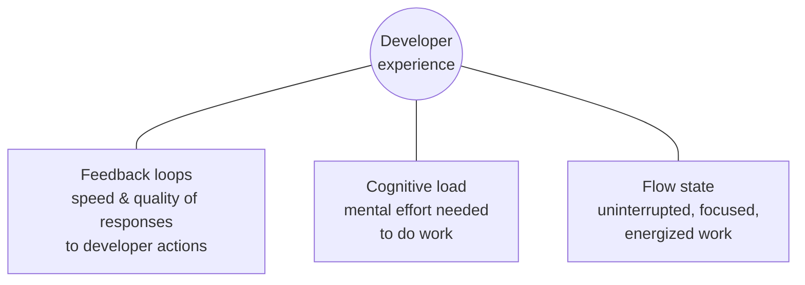
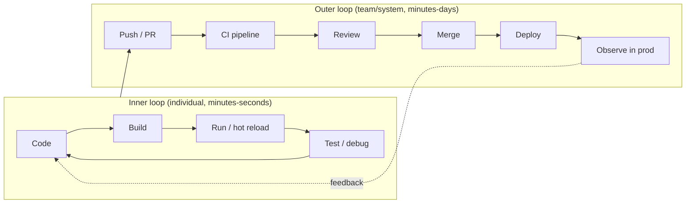

# Developer Experience (DX)

> **TL;DR** — Developer experience is how it *feels* to build and ship software in your environment; it drives productivity, quality and retention. Measure it with frameworks that combine perception and system data (SPACE, DevEx: feedback loops, cognitive load, flow state; DORA for delivery). Shorten the inner loop, automate the outer loop, provide golden paths through a platform (Backstage-style portal, templates, dev containers), and organize documentation with Diátaxis.

Related: [CI/CD & DevOps](ci-cd-devops.md) · [Library & SDK design](library-sdk-design.md) · [AI-assisted engineering](ai-assisted-engineering.md) · [Leadership & teams](../09-leadership-teams-facilitation/README.md) · [Cloud / platform engineering](../06-cloud-architecture/README.md)

---

## 1. Measuring developer productivity and experience

### SPACE framework (Forsgren, Storey, Maddila, Zimmermann, Houck, Butler — 2021)

| Dimension | Example metrics (perception) | Example metrics (system) |
|---|---|---|
| **S**atisfaction & well-being | Satisfaction with tools, burnout, eNPS | Retention |
| **P**erformance | Perceived quality/impact | Change failure rate, defects, customer outcomes |
| **A**ctivity | — | PRs, commits, deployments, reviews (never alone!) |
| **C**ommunication & collaboration | Ease of finding expertise, review quality | Review turnaround, onboarding time, knowledge distribution |
| **E**fficiency & flow | Perceived ability to get into flow, interruptions | Lead time, handoffs, wait time, value stream efficiency |

Rules: use **at least three dimensions**; mix perceptual (surveys) and system data; measure at team level; never single-metric productivity (lines of code, story points, commits).

### DevEx framework (Noda, Storey, Forsgren, Greiler — 2023)



| Dimension | Perceptions to survey | Workflow measures |
|---|---|---|
| Feedback loops | Satisfaction with build/test speed, review turnaround, deploy speed | Build time, CI time, time to first review, deploy lead time |
| Cognitive load | Clarity of docs, codebase complexity, ease of deploying, ease of debugging | Time to find answers, number of tools/handoffs, onboarding time |
| Flow state | Ability to focus, interruptions, meeting load, clarity of goals | Hours of uninterrupted focus time, meeting-free blocks, on-call interruptions |

### Other frameworks and signals
- **DORA** (delivery performance — see [CI/CD](ci-cd-devops.md#5-dora-metrics)).
- **DX Core 4** (DX, 2024): speed, effectiveness (Developer Experience Index), quality, impact — unifies DORA, SPACE and DevEx.
- **Developer Experience Index / Good Day project / developer surveys** — quarterly lightweight surveys with action follow-up.
- Leading indicators: CI duration p50/p90, flaky test rate, PR cycle time (open → merge), time to first review, local build time, time-to-first-commit for new hires, deploys per developer per week (trend, not target).

Anti-patterns: leaderboards; activity metrics tied to performance reviews; surveys without visible follow-up; measuring AI impact only by "lines generated".

---

## 2. Inner loop vs outer loop



| Loop | Goal | Levers |
|---|---|---|
| **Inner** | Sub-second to few-second feedback | Hot module replacement (Vite), `dotnet watch`, incremental builds, fast unit tests in watch mode, local containers for deps, seeded test data, good debugger config, AI completion |
| **Outer** | Minutes from push to production | Fast CI (caching, affected-only, parallelism), small PRs, quick reviews, automated deploys, preview environments, progressive delivery, observability |

Budget targets (common aspirations): local rebuild < 2 s, unit test run < 30 s, CI on PR < 10 min, review turnaround < 4 business hours, merge → prod < 1 hour.

---

## 3. Reproducible development environments

| Approach | Description | Fit |
|---|---|---|
| **Dev Containers** (`.devcontainer/devcontainer.json`) | Container-defined toolchain opened by VS Code, JetBrains, GitHub Codespaces, DevPod | Polyglot repos, fast onboarding, consistent tools |
| Cloud dev environments | GitHub Codespaces, Microsoft Dev Box, Gitpod/Ona, Coder | Heavy builds, locked-down machines, contractors |
| Version managers | `mise`, asdf, Volta, nvm, `uv python`, `global.json` | Lightweight pinning |
| Nix / devbox / Flox | Hermetic declarative environments | Teams willing to learn Nix |
| Docker Compose / .NET Aspire / Tilt / Skaffold | Local dependencies and multi-service orchestration | Service-based systems |
| Task runners | `make`, `just`, `Taskfile`, npm scripts | One command per action |

```jsonc
// .devcontainer/devcontainer.json
{
  "name": "app",
  "image": "mcr.microsoft.com/devcontainers/typescript-node:22",
  "features": {
    "ghcr.io/devcontainers/features/dotnet:2": { "version": "10.0" },
    "ghcr.io/devcontainers/features/azure-cli:1": {},
    "ghcr.io/devcontainers/features/docker-outside-of-docker:1": {}
  },
  "forwardPorts": [3000, 5432],
  "postCreateCommand": "corepack enable && pnpm install && dotnet restore",
  "customizations": {
    "vscode": { "extensions": ["dbaeumer.vscode-eslint", "esbenp.prettier-vscode", "ms-dotnettools.csdevkit"] }
  }
}
```

Goal: **clone → one command → running app with seeded data and passing tests** in < 30 minutes on a fresh machine.

---

## 4. Golden paths and internal developer platforms

- **Golden path** (Spotify) / **paved road** (Netflix): an opinionated, supported, well-documented way to build and run a common type of software (e.g. "a .NET API on Azure Container Apps with CI/CD, observability, auth"). Optional but so convenient that most teams choose it.
- **Internal Developer Platform (IDP)**: self-service capabilities (create service, provision DB, environments, deploy, observe) built by a **platform team** treating developers as customers (Team Topologies: platform team reduces cognitive load of stream-aligned teams).
- **Internal Developer Portal**: the UI/catalog front-end of the platform.

| Component | Examples |
|---|---|
| Portal & software catalog | Backstage (CNCF), Port, Cortex, OpsLevel, Roadie (managed Backstage) |
| Scaffolding / templates | Backstage Software Templates, `dotnet new` templates, `create-*` CLIs, Cookiecutter/Copier, Nx generators |
| Infra self-service | Terraform modules, Bicep registries, Crossplane, Radius, Azure Deployment Environments |
| CI/CD templates | Reusable GitHub workflows, Azure DevOps template repos |
| Docs-as-code | Backstage TechDocs (MkDocs), Docusaurus, Starlight |
| Scorecards | Production readiness checks (owners, SLOs, runbooks, dependency freshness) |

Backstage core concepts: Software Catalog (`catalog-info.yaml` per repo: Component, API, System, Domain, Resource, Group, User), Software Templates (scaffolder), TechDocs, Search, plugin ecosystem (Kubernetes, CI, cost, security).

```yaml
# catalog-info.yaml
apiVersion: backstage.io/v1alpha1
kind: Component
metadata:
  name: billing-api
  description: Issues and tracks invoices
  annotations:
    github.com/project-slug: acme/billing-api
  tags: [dotnet, api]
spec:
  type: service
  lifecycle: production
  owner: team-billing
  system: payments
  providesApis: [billing-api-v1]
```

Platform-as-a-product principles: user research with developers, thinnest viable platform, adoption by attraction not mandate, measure adoption + satisfaction, documented support model, versioned templates with upgrade paths. See [Cloud architecture](../06-cloud-architecture/README.md) and [Enterprise architecture](../11-enterprise-architecture-business/README.md).

---

## 5. Documentation — Diátaxis

Diátaxis (Daniele Procida) splits documentation by user need into four distinct types:

| | **Tutorials** | **How-to guides** | **Reference** | **Explanation** |
|---|---|---|---|---|
| Orientation | Learning | Goal / task | Information | Understanding |
| User need | "Teach me" — acquire skills | "Help me do X" — apply skills | "Tell me the facts" | "Help me understand why" |
| Form | A lesson with a guaranteed successful outcome | Series of steps to solve a real problem | Dry, accurate, complete description | Discursive discussion, context, alternatives |
| Analogy | Teaching a child to cook | A recipe | Encyclopedia article / ingredient info | Article on culinary history |
| Example | "Build your first service on our platform" | "How to rotate the DB credentials" | API reference, CLI flags, config schema | "Why we chose event sourcing for billing" (ADR-like) |

```mermaid
quadrantChart
  title Diátaxis map
  x-axis Acquisition (study) --> Application (work)
  y-axis Theory (cognition) --> Practice (action)
  quadrant-1 How-to guides
  quadrant-2 Tutorials
  quadrant-3 Explanation
  quadrant-4 Reference
```

Rules: don't mix types in one page (a tutorial full of explanation loses learners; a reference with opinions is hard to scan). Link between them instead.

Docs-as-code practices: Markdown in the repo next to code, reviewed in PRs, built by CI, linted (markdownlint, Vale), link-checked, owned (CODEOWNERS), with "last reviewed" dates. Architecture Decision Records (ADRs) for decisions — see [Software architecture](../05-software-architecture/README.md).

### README template

```markdown
# <Project name>

One-sentence description of what this is and who it is for.

[](pipeline-url) [](package-url)

## Quick start
<the 3–5 commands from clone to running>

## Prerequisites
- Tooling + versions (or "open in Dev Container")
- Access needed (feeds, cloud subscriptions)

## Usage
Minimal example(s) of the main use case.

## Development
- Run tests: `…`
- Lint/format: `…`
- Run locally with dependencies: `…`
- Seed data / test accounts: see `docs/…`

## Configuration
| Variable | Description | Default |
|---|---|---|

## Architecture
Short overview + link to diagrams/ADRs (`docs/adr/`).

## Deployment
How it ships (pipeline link, environments, feature flags).

## Operations
Dashboards, alerts, runbooks, on-call/owner team.

## Contributing
Link to CONTRIBUTING.md, branching/commit conventions, review expectations.

## Support / contact
Team channel, issue tracker.

## License
```

---

## 6. Onboarding

| Phase | Goals | Artifacts |
|---|---|---|
| Before day 1 | Accounts, hardware, access requests done | Access checklist, automated provisioning |
| Day 1 | Environment running, meet team & buddy | Dev container, README quick start |
| Week 1 | First PR merged and deployed (small, real change) | "Good first issues", pairing sessions |
| Month 1 | Understand architecture, domain, on-call basics | Architecture overview, domain glossary, recorded walkthroughs |
| Month 3 | Independently delivering features; reviewing others | 30/60/90 plan, feedback sessions |

Metrics: time to first commit, time to first production deploy, time to 10th PR, new-hire survey at 30/90 days. Every new hire fixes something in the onboarding docs (they are the best testers of them).

---

## 7. DX improvement playbook

1. **Listen**: survey (DevEx dimensions), interviews, shadow developers for a day, analyse CI/PR data.
2. **Map** the value stream: where is waiting time? (reviews, environments, approvals, flaky tests)
3. **Prioritize** by frequency × pain × number of developers affected.
4. **Fix** visibly: faster CI, dev containers, templates, docs, removing approvals.
5. **Measure** again; communicate improvements ("CI p50 went from 18 to 7 minutes").
6. Institutionalize: DX/platform team, DX budget per quarter, engineering effectiveness reviews.

Quick wins checklist:
- [ ] Single command setup; documented in README
- [ ] Pre-commit hooks fast (< 5 s) and optional to bypass in emergencies
- [ ] CI cached, parallel, affected-only; flaky tests quarantined
- [ ] Preview environments per PR
- [ ] PR templates, CODEOWNERS, review SLAs
- [ ] Automated dependency updates with auto-merge for safe ones
- [ ] Searchable docs; owners for every service in a catalog
- [ ] Meeting-free focus blocks
- [ ] Clear error messages in internal tools/CLIs

## 8. Common mistakes

- Building a platform nobody asked for (no user research) and mandating it.
- Measuring productivity by output volume.
- Dev setup that "works on my machine" only for seniors.
- Docs that mix tutorial, reference and opinion; stale wiki pages with no owner.
- Ignoring cognitive load: every team owns too many services, tools and on-call rotations.
- Platform team becoming a ticket queue (gatekeeping instead of self-service).

## References

- SPACE framework (ACM Queue) — https://queue.acm.org/detail.cfm?id=3454124
- DevEx: What Actually Drives Productivity (ACM Queue) — https://queue.acm.org/detail.cfm?id=3595878
- DORA — https://dora.dev
- Diátaxis — https://diataxis.fr
- Dev Containers specification — https://containers.dev
- VS Code Dev Containers — https://code.visualstudio.com/docs/devcontainers/containers
- GitHub Codespaces — https://docs.github.com/en/codespaces
- Backstage — https://backstage.io
- Backstage docs — https://backstage.io/docs/overview/what-is-backstage
- CNCF Platforms white paper — https://tag-app-delivery.cncf.io/whitepapers/platforms/
- platformengineering.org — https://platformengineering.org
- Team Topologies — https://teamtopologies.com
- Martin Fowler, What I Talk About When I Talk About Platforms (Evan Bottcher) — https://martinfowler.com/articles/talk-about-platforms.html
- Spotify Engineering, How we use golden paths — https://engineering.atspotify.com/2020/08/how-we-use-golden-paths-to-solve-fragmentation-in-our-software-ecosystem/
- Write the Docs — https://www.writethedocs.org
- Google developer documentation style guide — https://developers.google.com/style
- Make a README — https://www.makeareadme.com
- *Team Topologies* (Skelton & Pais)
- *Accelerate* (Forsgren, Humble, Kim)
- *Docs for Developers* (Bhatti et al.)
