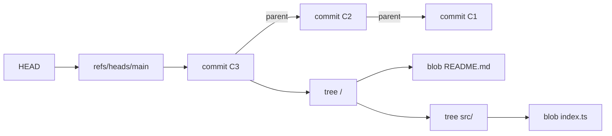
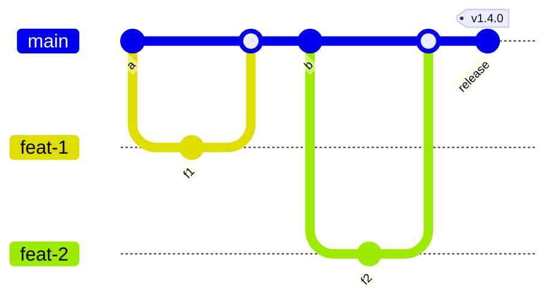

# Git and Version Control

> **TL;DR** — Git is a content-addressed object store (blobs, trees, commits, tags) with movable pointers (branches). Prefer trunk-based development or GitHub flow with short-lived branches, small PRs and feature flags; reserve GitFlow for products with multiple supported release lines. Write Conventional Commits, version with SemVer, review code for design and correctness first (Google's "improves overall code health" standard), and keep history meaningful.

Related: [CI/CD & DevOps](ci-cd-devops.md) · [Library design](library-sdk-design.md) · [Code quality](code-quality-refactoring.md) · [Agile](../04-agile-kanban-scrum/README.md)

---

## 1. Git internals basics



| Object | Contents | Identified by |
|---|---|---|
| **blob** | File content (no name) | hash of content |
| **tree** | Directory listing: names → blobs/trees + modes | hash |
| **commit** | Tree pointer, parent(s), author, committer, message | hash |
| **annotated tag** | Pointer to an object + tagger + message (+ signature) | hash |

- Hashes are SHA-1 by default; SHA-256 repositories are supported (Git 3.0 planned to make SHA-256 default).
- **Refs** (`refs/heads/*`, `refs/tags/*`, `refs/remotes/*`) are files/packed entries holding a hash. A branch is just a movable pointer.
- **HEAD** points to the current branch (or a commit = detached HEAD).
- **Index (staging area)** = the proposed next tree.
- **Reflog** records where refs pointed — your safety net (`git reflog`, then `git reset --hard HEAD@{2}`).
- Objects are immutable; "rewriting history" creates new commits; old ones remain until garbage-collected.
- Packfiles store deltas for efficiency; `git gc` maintains them.

Three trees: **working directory** ↔ `git add` ↔ **index** ↔ `git commit` ↔ **HEAD/repository**.

### Everyday commands worth knowing

| Goal | Command |
|---|---|
| Switch / create branch | `git switch -c feat/x` |
| Restore file | `git restore path` / `git restore --staged path` |
| Interactive staging | `git add -p` |
| Amend last commit | `git commit --amend` |
| Fixup commit for later squash | `git commit --fixup <sha>` + `git rebase -i --autosquash` |
| Update branch onto main | `git fetch && git rebase origin/main` |
| Safe force push | `git push --force-with-lease` |
| Find regressing commit | `git bisect start; git bisect bad; git bisect good <sha>` (`git bisect run npm test`) |
| Who changed a line, ignoring formatting commits | `git blame --ignore-revs-file .git-blame-ignore-revs` |
| Search history | `git log -S "functionName"` (pickaxe), `git log -G regex` |
| Multiple checkouts | `git worktree add ../hotfix main` |
| Temporarily shelve | `git stash push -m "wip"` |
| Undo a pushed commit | `git revert <sha>` |
| Big repos | `git clone --filter=blob:none`, sparse-checkout, `scalar` |
| Reuse conflict resolutions | `git config rerere.enabled true` |

### Merge vs rebase vs squash

| Strategy | History | Pros | Cons |
|---|---|---|---|
| Merge commit | Non-linear, preserves branch topology | True history, easy to revert a whole feature | Noisy graph |
| Rebase + fast-forward | Linear | Clean, bisectable | Rewrites commits; never rebase shared branches |
| Squash merge | One commit per PR | Clean main, PR = unit | Loses granular commits; long PRs become huge commits |

Golden rule: **do not rewrite history others have based work on.** Rebase your own local/feature branch freely.

---

## 2. Branching strategies



| Strategy | Model | When to use | When not |
|---|---|---|---|
| **Trunk-based development** | Everyone integrates into `main` at least daily; very short-lived branches (< 1–2 days) or direct commits; feature flags hide incomplete work; release from trunk (or short-lived release branches) | High-performing teams practising CI/CD, SaaS, strong automated tests; correlated with DORA elite performance | Weak test automation, open-source with untrusted contributors (use PRs, still short) |
| **GitHub flow** | `main` always deployable; feature branch → PR → review → merge → deploy | Most web apps/SaaS; simple and PR-centric | Multiple versions in support |
| **GitLab flow** | GitHub flow + environment or release branches (`production`, `pre-production`) | When deployment timing is not fully controlled (e.g. app store, customer environments) | Pure continuous deployment |
| **GitFlow** | `develop` + `main` + `feature/*`, `release/*`, `hotfix/*` | Versioned, shipped software with scheduled releases and several maintained versions (desktop, embedded, on-prem) | Continuous delivery web apps — its own author added a note (2020) recommending simpler flows for those |
| **Release branches** | Cut `release/x.y` from trunk, cherry-pick fixes | Mobile/on-prem with stabilization windows | — |

Feature flags are what make trunk-based development possible: merge dark, release by toggle. Clean up flags (flag debt) — track expiry dates.

---

## 3. Conventional Commits

```
<type>[optional scope][!]: <description>

[optional body]

[optional footer(s)]
```

| Type | Meaning | SemVer impact |
|---|---|---|
| `feat` | New feature | MINOR |
| `fix` | Bug fix | PATCH |
| `feat!` / `BREAKING CHANGE:` footer | Breaking API change | MAJOR |
| `docs` | Documentation only | none |
| `style` | Formatting, no logic | none |
| `refactor` | Neither fix nor feature | none |
| `perf` | Performance improvement | PATCH (by convention) |
| `test` | Tests | none |
| `build` | Build system, dependencies | none |
| `ci` | CI config | none |
| `chore` | Maintenance | none |
| `revert` | Reverts a commit | depends |

Examples:

```
feat(billing): support partial refunds

fix(api)!: return 404 instead of 200 with null for missing invoice

BREAKING CHANGE: clients relying on 200/null must handle 404.
Refs: #482
```

Tooling: commitlint + husky/lefthook (local hook), semantic-release / release-please / Changesets / GitVersion (automated versioning and changelog), `git-cliff`.

---

## 4. Semantic Versioning

`MAJOR.MINOR.PATCH[-prerelease][+build]`

| Increment | When |
|---|---|
| MAJOR | Incompatible public API change |
| MINOR | Backwards-compatible functionality added (incl. deprecations) |
| PATCH | Backwards-compatible bug fix |

Rules of note:
- `0.y.z` = initial development; anything may change.
- `1.0.0` defines the public API.
- Pre-releases sort lower: `1.0.0-alpha < 1.0.0-alpha.1 < 1.0.0-beta < 1.0.0-rc.1 < 1.0.0`.
- Build metadata (`+sha.5114f85`) is ignored for precedence.
- Released versions are immutable — fix forward with a new version.

Range syntax (npm): `^1.2.3` = `>=1.2.3 <2.0.0`; `~1.2.3` = `>=1.2.3 <1.3.0`; `^0.2.3` = `>=0.2.3 <0.3.0`. NuGet uses interval notation `[1.2.3, 2.0.0)`. Python uses `~=1.2` (compatible release).

Alternatives: CalVer (`2026.10.1`) for apps/OS distributions where API compatibility is not the primary signal. Apps deployed continuously often don't need SemVer at all — use build numbers/commit SHAs. See [Library & SDK design](library-sdk-design.md) for semver discipline.

---

## 5. Commit hygiene

- **Atomic commits**: one logical change, builds and tests pass at each commit (bisectable).
- Separate refactoring/formatting commits from behaviour changes (add formatting SHAs to `.git-blame-ignore-revs`).
- Message: imperative subject ≤ ~50–72 chars ("Add retry to payment client"), blank line, body explains **why** and context, references issues.
- Don't commit: secrets, generated artefacts, large binaries (use Git LFS), local config. Use `.gitignore` and secret scanning (gitleaks, GitHub push protection).
- Sign commits/tags (SSH or GPG signing, Sigstore gitsign) where supply-chain integrity matters.
- Clean up before review: `rebase -i` to squash "fix typo" commits, or rely on squash merge.

---

## 6. Pull requests and code review

### Author checklist
- [ ] Small: aim for < ~400 changed lines; split refactors from features; stacked PRs for large work
- [ ] Description: what, **why**, how to test, screenshots for UI, risk/rollback notes, linked ticket
- [ ] Self-review the diff first
- [ ] CI green; tests added/updated; docs/changelog updated
- [ ] Draft PR early for direction feedback

### Reviewer guidance (adapted from Google Engineering Practices)

**Standard:** approve once the change *definitely improves the overall code health* of the system, even if it is not perfect. There is no perfect code — only better code.

What to look for, in priority order:

| Area | Questions |
|---|---|
| Design | Does this belong here? Does it integrate well? Is now the right time? |
| Functionality | Does it do what the author intended? Edge cases, concurrency, user impact |
| Complexity | Can it be simpler? Over-engineering for speculative needs? |
| Tests | Correct, sensible, useful; would they fail if code broke? |
| Naming | Clear, not too long |
| Comments | Explain *why*, not *what* |
| Style | Follows style guide (ideally automated) |
| Consistency | With existing code |
| Documentation | Updated if behaviour/usage changes |
| Every line | Read all human-written code in context |
| Security & privacy | Input validation, authz, secrets, PII |

Speed: respond within one business day at most (Google: ideally shortly after you finish your current task). Slow reviews are a top DX complaint.

Comment etiquette:
- Comment on code, not the person; explain reasoning; offer alternatives.
- Label severity: **Nit:**, **Optional:**, **FYI:** vs blocking.
- Use Conventional Comments (`suggestion:`, `issue:`, `question:`, `praise:`) for clarity.
- Resolve disagreement with data/principles; escalate to a sync conversation quickly.
- Praise good work.

Automation: linters/formatters, type checks, CODEOWNERS for required reviewers, branch protection/rulesets (required checks, required reviews, linear history, signed commits), preview environments per PR, AI review assistants as a first pass (see [AI-assisted engineering](ai-assisted-engineering.md)).

---

## 7. Monorepo vs polyrepo

| | Monorepo | Polyrepo |
|---|---|---|
| Atomic cross-project changes | Yes — one PR | Coordinated multi-repo PRs + version bumps |
| Code sharing | Direct imports; single version policy | Published packages; version drift |
| Tooling needs | Build graph, affected detection, caching (Nx, Turborepo, Bazel), sparse checkout at scale | Standard per repo |
| CI | Must be selective to stay fast | Naturally scoped |
| Access control | CODEOWNERS; harder to restrict read access | Per-repo permissions |
| Ownership boundaries | Need lint-enforced boundaries | Repo boundary is the boundary |
| Refactoring | Easy, global | Hard across repos |
| Dependency upgrades | Once for all | N times |
| Fits | One product/platform, shared libs, one org with shared standards | Independent products/teams, open-source components, different lifecycles or compliance zones |

Middle ground: a few domain-aligned monorepos. Conway's law applies — repo structure tends to mirror team structure (see [Laws & principles](../10-laws-principles-mental-models/README.md)).

---

## 8. Repository hygiene checklist

- [ ] `README.md`, `CONTRIBUTING.md`, `CODEOWNERS`, `LICENSE` (if public), `SECURITY.md`
- [ ] `.gitignore`, `.gitattributes` (line endings, LFS), `.editorconfig`
- [ ] Branch protection / rulesets on `main`
- [ ] PR template and issue templates
- [ ] Pre-commit hooks (lint-staged, format, secret scan) — fast (< 5 s)
- [ ] Dependency update bot (Renovate/Dependabot)
- [ ] Secret scanning + push protection
- [ ] Automated releases from Conventional Commits or changesets
- [ ] Stale branch cleanup (auto-delete head branches on merge)

## 9. Common mistakes

- Long-lived feature branches → merge hell, late integration.
- Force-pushing shared branches (use `--force-with-lease`, protect `main`).
- Huge PRs ("LGTM" rubber stamps).
- Mixing formatting and logic in one commit.
- Committing secrets (rotate immediately — removing from history is not enough).
- Treating version numbers as marketing.
- Review comments about style that a formatter should enforce.

## References

- Pro Git book — https://git-scm.com/book/en/v2
- Git internals (Pro Git ch. 10) — https://git-scm.com/book/en/v2/Git-Internals-Plumbing-and-Porcelain
- Git documentation — https://git-scm.com/docs
- Trunk Based Development — https://trunkbaseddevelopment.com
- GitHub flow — https://docs.github.com/en/get-started/using-github/github-flow
- A successful Git branching model (GitFlow, with 2020 note) — https://nvie.com/posts/a-successful-git-branching-model/
- Martin Fowler, Patterns for Managing Source Code Branches — https://martinfowler.com/articles/branching-patterns.html
- Martin Fowler, Feature Toggles (Pete Hodgson) — https://martinfowler.com/articles/feature-toggles.html
- Conventional Commits — https://www.conventionalcommits.org/en/v1.0.0/
- Semantic Versioning — https://semver.org
- Calendar Versioning — https://calver.org
- Google Engineering Practices: code review — https://google.github.io/eng-practices/review/
- Google: The Standard of Code Review — https://google.github.io/eng-practices/review/reviewer/standard.html
- Google: Small CLs — https://google.github.io/eng-practices/review/developer/small-cls.html
- Conventional Comments — https://conventionalcomments.org
- Chris Beams, How to Write a Git Commit Message — https://cbea.ms/git-commit/
- monorepo.tools — https://monorepo.tools
- DORA capability: trunk-based development — https://dora.dev/capabilities/trunk-based-development/
