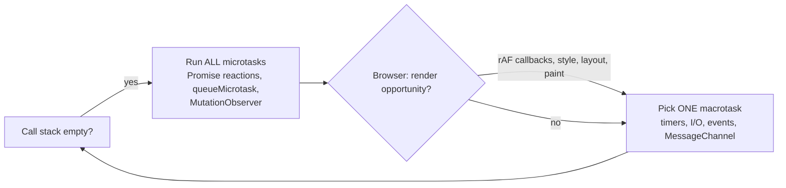
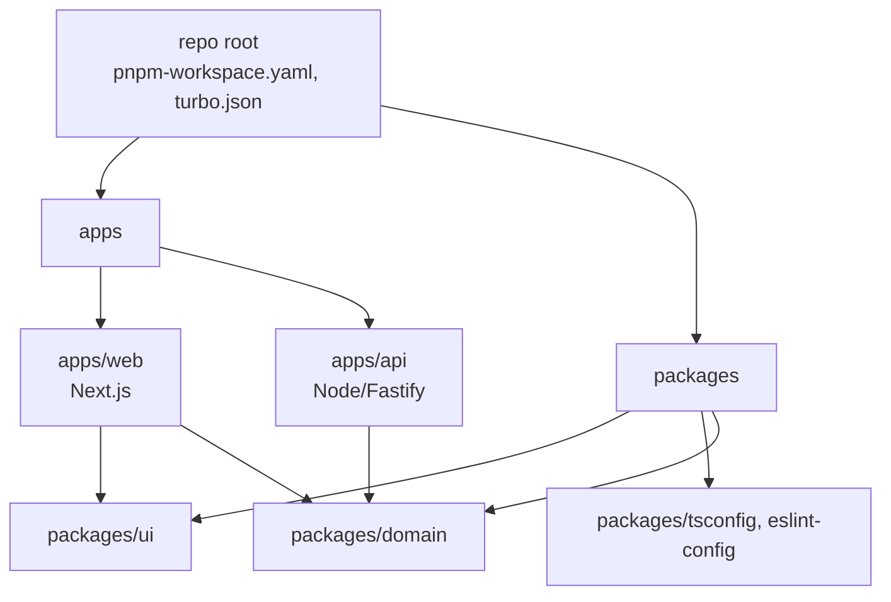

# JavaScript Runtime, Node.js, Packages and Monorepos

> **TL;DR** — JavaScript runs one call stack per agent; concurrency comes from the event loop draining a task queue and, after every task, the *entire* microtask queue. Master closures, `this` binding rules and promise semantics, use ESM for new code, pick one package manager per repo (pnpm is the safe default), and adopt a monorepo task runner (Turborepo/Nx) only once you have several packages that build together.

Related: [TypeScript](typescript.md) · [React](react.md) · [CI/CD](ci-cd-devops.md) · [Developer experience](developer-experience.md)

---

## 1. The event loop



| Queue | Sources | Drained |
|---|---|---|
| Macrotask (task) | `setTimeout`, `setInterval`, I/O callbacks, UI events, `MessageChannel`, `setImmediate` (Node) | One per loop iteration |
| Microtask | `Promise.then/catch/finally`, `await` continuations, `queueMicrotask`, `MutationObserver` | All of them, after every task — including microtasks queued by microtasks |
| Node `process.nextTick` | Node only | Before promise microtasks |
| `requestAnimationFrame` | Browser | Before paint, once per frame |
| `requestIdleCallback` | Browser | When idle |

### Ordering quiz

```js
console.log("1 sync");
setTimeout(() => console.log("5 timeout"), 0);
Promise.resolve().then(() => console.log("3 micro"));
queueMicrotask(() => console.log("4 micro 2"));
(async () => { console.log("2 sync in async"); await null; console.log("4b after await"); })();
// 1 sync, 2 sync in async, 3 micro, 4 micro 2, 4b after await, 5 timeout
```

### Node.js event loop phases

`timers` → `pending callbacks` → `idle/prepare` → `poll` (I/O) → `check` (`setImmediate`) → `close callbacks`. Between each phase Node drains `nextTick` then promise microtasks.

Practical consequences:
- A long synchronous loop (or an infinite microtask chain) **blocks everything** — rendering, I/O, timers.
- Split CPU work: `scheduler.yield()` (browser, where supported), `setTimeout(0)` chunks, Web Workers / `worker_threads`.
- `setTimeout(fn, 0)` is ≥ 0 ms, clamped to ≥ 4 ms after 5 nested levels in browsers, throttled in background tabs.
- libuv thread pool (default 4) handles fs, DNS `lookup`, crypto, zlib — saturating it stalls unrelated I/O (`UV_THREADPOOL_SIZE`).

---

## 2. Closures and scope

A closure is a function plus the lexical environment it was created in.

```js
function counter() {
  let n = 0;                     // captured, private
  return { inc: () => ++n, get: () => n };
}
```

Classic bug — `var` is function-scoped:

```js
for (var i = 0; i < 3; i++) setTimeout(() => console.log(i)); // 3 3 3
for (let i = 0; i < 3; i++) setTimeout(() => console.log(i)); // 0 1 2 — new binding per iteration
```

| Keyword | Scope | Hoisting | Reassign |
|---|---|---|---|
| `var` | function | hoisted, initialized `undefined` | yes |
| `let` | block | hoisted, TDZ until declaration | yes |
| `const` | block | hoisted, TDZ | no (but object is mutable) |

Closure pitfalls: stale closures in React hooks (captured old state), memory leaks when long-lived closures (listeners, caches) reference large objects.

---

## 3. `this` binding rules (in priority order)

| Rule | Call form | `this` |
|---|---|---|
| `new` | `new Foo()` | the new object |
| Explicit | `fn.call(obj)`, `fn.apply(obj)`, `fn.bind(obj)` | `obj` |
| Implicit | `obj.fn()` | `obj` |
| Default | `fn()` | `undefined` in strict mode / modules, `globalThis` in sloppy |
| Arrow functions | any | lexical — inherited from enclosing scope, cannot be rebound |

```js
class Button {
  label = "OK";
  handleClick() { console.log(this.label); }
  handleClickArrow = () => console.log(this.label);  // class field arrow: bound per instance
}
const b = new Button();
const f = b.handleClick; f();          // TypeError: this is undefined
el.addEventListener("click", b.handleClickArrow); // works
```

---

## 4. Promises and async/await

### States
`pending` → `fulfilled` | `rejected` (settled, immutable).

### Combinators

| Combinator | Resolves when | Rejects when | Use |
|---|---|---|---|
| `Promise.all` | all fulfil | first rejection (others keep running!) | independent required calls |
| `Promise.allSettled` | all settle | never | best-effort batch, report per item |
| `Promise.race` | first settles | first settles with rejection | timeouts (prefer `AbortSignal.timeout`) |
| `Promise.any` | first fulfils | all reject (`AggregateError`) | redundant mirrors |
| `Promise.withResolvers()` | — | — | expose resolve/reject (ES2024) |

### Patterns

```js
// Parallel, not sequential
const [user, orders] = await Promise.all([getUser(id), getOrders(id)]);

// Cancellation
const ac = new AbortController();
const res = await fetch(url, { signal: AbortSignal.any([ac.signal, AbortSignal.timeout(5000)]) });

// Bounded concurrency (p-limit style)
async function mapLimit(items, limit, fn) {
  const results = new Array(items.length);
  let next = 0;
  const worker = async () => { while (next < items.length) { const i = next++; results[i] = await fn(items[i], i); } };
  await Promise.all(Array.from({ length: Math.min(limit, items.length) }, worker));
  return results;
}

// Async iteration
for await (const chunk of stream) process(chunk);
```

### Common mistakes

| Mistake | Fix |
|---|---|
| `await` inside `for` loop for independent work | `Promise.all` / bounded concurrency |
| `array.forEach(async …)` | forEach ignores promises → use `for…of` or `Promise.all(map)` |
| Floating promise (no `await`, no `.catch`) | lint `@typescript-eslint/no-floating-promises`; Node crashes on unhandled rejection by default |
| `return await` confusion | inside `try` you *need* `return await` for the catch to apply |
| Wrapping a promise in `new Promise` | "explicit construction anti-pattern" — just return it |
| Mixing callbacks and promises | `util.promisify`, `node:fs/promises` |
| Swallowing errors in `.catch(() => {})` | log or rethrow with `cause`: `new Error("x", { cause: e })` |

---

## 5. Modules: ESM vs CommonJS

| | ESM | CommonJS |
|---|---|---|
| Syntax | `import`/`export` | `require`/`module.exports` |
| Loading | static, async, analysable → tree-shaking | dynamic, sync |
| Top-level await | yes | no |
| `this` at top level | `undefined` | `module.exports` |
| `__dirname` | `import.meta.dirname` (Node 20.11+) | yes |
| File marker in Node | `.mjs` or `"type": "module"` | `.cjs` or default |
| Interop | can `import` CJS (default export = `module.exports`) | `require(esm)` supported in modern Node (22.12+/20.19+) for sync ESM graphs |

Package `exports` map (dual publishing):

```json
{
  "name": "@acme/utils",
  "type": "module",
  "exports": {
    ".": {
      "types": "./dist/index.d.ts",
      "import": "./dist/index.js",
      "require": "./dist/index.cjs"
    },
    "./package.json": "./package.json"
  },
  "files": ["dist"],
  "sideEffects": false
}
```

Guidance: new packages → ESM-only unless consumers demonstrably need CJS. Validate with `@arethetypeswrong/cli` and `publint`.

---

## 6. Node.js essentials

| Topic | Notes |
|---|---|
| Versions | Even-numbered majors become LTS; run Active/Maintenance LTS in production. Pin via `.nvmrc` / `engines` / Volta / `mise` |
| Built-ins worth knowing | `node:test` test runner, `--watch`, `--env-file=.env`, `fetch`/`WebSocket`, `node:sqlite`, type stripping for `.ts` files (Node 22.6+ flag, unflagged in 23.6+/22.18+) |
| Streams | Use `pipeline()` from `node:stream/promises` to propagate errors and backpressure |
| Error handling | Process-level: `unhandledRejection`, `uncaughtException` → log and exit; let the orchestrator restart |
| Config | 12-factor: env vars, validated at startup |
| Graceful shutdown | Handle `SIGTERM`: stop accepting, drain, close DB pools, exit within the grace period |
| Performance | `--cpu-prof`, `--heap-prof`, `node --inspect` + Chrome DevTools, clinic.js, `perf_hooks` |
| Security | `npm audit`/`pnpm audit`, lockfile, `--ignore-scripts` in CI where possible, permission model (`--permission`) |

Alternative runtimes: **Deno** (secure-by-default, TS native, npm compat), **Bun** (fast all-in-one: runtime, bundler, test runner, package manager). Both target Node API compatibility; check native addon support before switching.

---

## 7. Package managers

| | npm | pnpm | Yarn (Berry, v4) | Bun |
|---|---|---|---|---|
| Install layout | flat `node_modules` (hoisted) | content-addressable store + symlinks, strict | Plug'n'Play (no `node_modules`) or `node-modules` linker | flat `node_modules`, very fast |
| Phantom deps | possible | prevented (strict) | prevented (PnP) | possible |
| Disk usage | high | low (hard links) | low | medium |
| Workspaces | yes | yes (`pnpm-workspace.yaml`), `catalog:` versions | yes, constraints | yes |
| Lockfile | `package-lock.json` | `pnpm-lock.yaml` | `yarn.lock` | `bun.lock` (text) |
| CI command | `npm ci` | `pnpm install --frozen-lockfile` | `yarn install --immutable` | `bun install --frozen-lockfile` |

Rules:
- One package manager per repo; enforce with `"packageManager": "pnpm@x.y.z"` + Corepack (or `mise`/Volta).
- Commit the lockfile. CI installs from the lockfile only.
- Version ranges: apps can pin exact; libraries use `^` ranges for deps and `peerDependencies` for frameworks.
- Automate updates: Renovate or Dependabot, grouped, with auto-merge for patch updates that pass CI.
- Supply chain: enable `minimumReleaseAge` (pnpm) or similar cool-down, disable lifecycle scripts for untrusted deps (pnpm `onlyBuiltDependencies`), use provenance (`npm publish --provenance`).

---

## 8. Monorepos



| Tool | Scope | Strengths | Consider when |
|---|---|---|---|
| pnpm / npm / Yarn workspaces | Linking + install | Zero extra tooling | ≤ a handful of packages |
| Turborepo | Task runner + caching | Simple `turbo.json`, remote cache, low config | JS/TS repos wanting fast CI with minimal ceremony |
| Nx | Full build system | Project graph, affected commands, generators, module boundary lint rules, plugins for many stacks, distributed execution | Large repos, many teams, need enforced boundaries |
| Changesets | Versioning + changelogs | Per-PR change intent files, release PR | Publishing multiple packages |
| Bazel / Pants / Buck2 | Polyglot hermetic builds | Massive scale | Very large, multi-language orgs |

`pnpm-workspace.yaml`:

```yaml
packages:
  - "apps/*"
  - "packages/*"
catalog:
  react: ^19.1.0
  typescript: ^5.9.0
```

`turbo.json`:

```json
{
  "$schema": "https://turbo.build/schema.json",
  "tasks": {
    "build": { "dependsOn": ["^build"], "outputs": ["dist/**", ".next/**", "!.next/cache/**"] },
    "lint": {},
    "test": { "dependsOn": ["^build"], "outputs": ["coverage/**"] },
    "dev": { "cache": false, "persistent": true }
  }
}
```

Run only what changed: `turbo run test --filter=...[origin/main]` or `nx affected -t test`.

### Monorepo checklist
- [ ] Internal packages referenced with `workspace:*`
- [ ] Shared `tsconfig` base and ESLint config packages
- [ ] TypeScript project references or "internal packages" pattern (export TS source, let the app bundler compile)
- [ ] Task graph with caching (local + remote) in CI
- [ ] CODEOWNERS per folder
- [ ] Enforced dependency boundaries (Nx tags, `eslint-plugin-boundaries`, dependency-cruiser)
- [ ] Single version policy for frameworks (catalog / syncpack)

See [Git and version control](git-and-version-control.md#7-monorepo-vs-polyrepo) for the monorepo vs polyrepo decision.

---

## 9. Language features worth knowing (ES2020–ES2025)

| Feature | Example |
|---|---|
| Optional chaining / nullish | `a?.b ?? "default"` (`??` only for `null`/`undefined`, unlike `\|\|`) |
| Logical assignment | `x ??= []`, `count \|\|= 1` |
| Private fields | `#secret` |
| `structuredClone` | deep copy incl. Map/Set/Date |
| `Array.prototype.at`, `findLast`, `toSorted`, `toReversed`, `with` | non-mutating array ops (ES2023) |
| `Object.groupBy`, `Map.groupBy` | ES2024 |
| `Set` methods | `union`, `intersection`, `difference` (ES2025) |
| Iterator helpers | `iter.map().filter().take()` (ES2025) |
| `Promise.try` | ES2025 |
| `using` / `await using` | explicit resource management (TS 5.2+, runtime support rolling out) |
| `Temporal` | modern date/time API, shipping in engines — use polyfill where missing |

## 10. Common mistakes

- Comparing with `==` (use `===`, except `x == null` idiom).
- Mutating arrays passed in (`sort`, `reverse`, `splice`) — use `toSorted` etc.
- Floating-point money: `0.1 + 0.2 !== 0.3` — use integer minor units or a decimal library.
- `Date` time zone confusion — store UTC ISO strings, format at the edge.
- Blocking the event loop with sync APIs (`fs.readFileSync`, heavy JSON) in request handlers.
- Memory leaks: unremoved listeners, unbounded caches/Maps, closures held by timers.
- Assuming `JSON.stringify` round-trips (`Date`, `Map`, `undefined`, `BigInt` do not).

## References

- MDN: Event loop / execution model — https://developer.mozilla.org/en-US/docs/Web/JavaScript/Event_loop
- MDN: Closures — https://developer.mozilla.org/en-US/docs/Web/JavaScript/Closures
- MDN: `this` — https://developer.mozilla.org/en-US/docs/Web/JavaScript/Reference/Operators/this
- MDN: Using promises — https://developer.mozilla.org/en-US/docs/Web/JavaScript/Guide/Using_promises
- MDN: JavaScript modules — https://developer.mozilla.org/en-US/docs/Web/JavaScript/Guide/Modules
- Node.js docs — https://nodejs.org/docs/latest/api/
- Node.js Learn: event loop, timers and nextTick — https://nodejs.org/en/learn/asynchronous-work/event-loop-timers-and-nexttick
- Node.js release schedule — https://nodejs.org/en/about/previous-releases
- Jake Archibald, "Tasks, microtasks, queues and schedules" — https://jakearchibald.com/2015/tasks-microtasks-queues-and-schedules/
- pnpm — https://pnpm.io
- Yarn — https://yarnpkg.com
- Bun — https://bun.sh
- Deno — https://deno.com
- Turborepo — https://turborepo.com
- Nx — https://nx.dev
- Changesets — https://github.com/changesets/changesets
- monorepo.tools — https://monorepo.tools
- Are The Types Wrong — https://arethetypeswrong.github.io
- *You Don't Know JS Yet* (Kyle Simpson) — https://github.com/getify/You-Dont-Know-JS
- javascript.info — https://javascript.info
