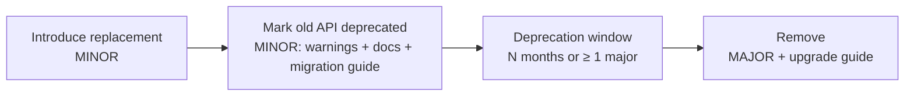

# Library and SDK Design

> **TL;DR** — A library's API is a long-term contract: every public symbol is a promise. Keep the surface small, make the common case trivial and the advanced case possible, design for evolution (options objects, extension points, no leaked internals), follow SemVer strictly, deprecate with warnings and migration paths before removing, and keep a human-written changelog (Keep a Changelog). Ship types, docs and examples as first-class parts of the product.

Related: [Git & SemVer](git-and-version-control.md#4-semantic-versioning) · [TypeScript](typescript.md) · [C#/.NET](csharp-dotnet.md) · [Python packaging](python.md#4-environments-and-packaging) · [Developer experience](developer-experience.md) · [Software architecture](../05-software-architecture/README.md)

---

## 1. Principles of good library APIs

| Principle | Meaning | Example |
|---|---|---|
| Small surface area | Expose the minimum; you can add later, you can't remove without a major | Export from a single entry point; mark internals `internal`/`_private`/unexported |
| Pit of success | Easy to use correctly, hard to misuse | Safe defaults (timeouts, retries, TLS on), required args are positional/required |
| Progressive disclosure | Simple things simple, complex things possible | `client.get(url)` + optional `{ retry, signal, hooks }` |
| Consistency | Same naming, parameter order, error style everywhere | All async methods suffixed `Async` (.NET), all options objects named `XxxOptions` |
| Least astonishment | Behaves as a user of the platform expects | Follow platform idioms (iterables, `IDisposable`/`using`, context managers, `AbortSignal`, `CancellationToken`) |
| Explicit over magic | No hidden global state, implicit network calls, or monkey-patching | Constructor-injected config, no singletons by default |
| Composable | Small pieces users can combine | Middleware/hooks/interceptors pipelines |
| Errors are part of the API | Typed, documented, actionable | `RateLimitError` with `retryAfter`; messages that say how to fix |
| Testability for consumers | Users can fake or mock your library | Interfaces/abstract types, in-memory test doubles shipped, injectable clock/HTTP |
| Zero or few dependencies | Each dependency is a liability for your users | Use platform APIs; peer dependencies for frameworks |
| Observable | Users can see what it does | Logging via the platform abstraction (`ILogger`, `logging`, debug hooks), OpenTelemetry instrumentation |

Joshua Bloch's maxims (paraphrased): APIs should be easy to learn and use, hard to misuse, sufficiently powerful, easy to evolve; when in doubt, leave it out; names matter; documentation matters; don't make the client do anything the library could do.

### Designing the shape

```ts
// Avoid: positional booleans, many optional params, ambiguous order
createClient("https://api", 5000, true, false, 3);

// Prefer: required essentials + options object (extensible without breaking)
const client = createClient({
  baseUrl: "https://api.example.com",
  timeoutMs: 5_000,
  retry: { attempts: 3, backoff: "exponential" },
});
```

```csharp
// .NET: options + DI extension method is the idiomatic integration point
services.AddAcmeClient(o =>
{
    o.BaseAddress = new Uri("https://api.example.com");
    o.Timeout = TimeSpan.FromSeconds(5);
});
```

### Write the usage first
Write README examples and tests *from the consumer's perspective* before implementing ("README-driven development"). If the example is awkward, the API is awkward.

---

## 2. Compatibility — what counts as breaking

| Change | Breaking? |
|---|---|
| Removing/renaming a public type, member, function, export, CLI flag | Yes |
| Adding a required parameter / required option | Yes |
| Changing a parameter or return type (narrowing return is usually safe; narrowing input is breaking) | Usually yes |
| Throwing new exception types from existing methods | Behaviourally breaking (often treated as major) |
| Changing default values with behavioural effect | Behaviourally breaking |
| Adding a member to an interface that consumers implement | Yes (unless default interface methods / optional members) |
| Adding an optional parameter (binary compat in .NET!) | Source-compatible, **binary-breaking** in .NET → add an overload instead |
| Dropping support for a runtime version (Node 18, .NET 6, Python 3.9) | Yes (major) — announce ahead |
| Adding new types/functions/optional options | No (minor) |
| Fixing a bug users depend on | Grey zone — Hyrum's Law; document, consider a flag |
| TypeScript: making a type stricter | Can break consumers' compilation — treat carefully |

**Hyrum's Law**: with enough users, every observable behaviour of your system will be depended on by somebody. Minimize observable behaviour (don't leak ordering, timing, error text) and document what is guaranteed.

Tooling to detect breaks:
- .NET: `Microsoft.DotNet.ApiCompat` / package validation (`<EnablePackageValidation>true</EnablePackageValidation>` with baseline version), PublicApiAnalyzers (`PublicAPI.Shipped.txt`).
- TypeScript: API Extractor (`api-extractor` report diff), `@arethetypeswrong/cli`, `publint`.
- Python: `griffe check` for API breakage.
- HTTP APIs: `oasdiff`, Buf `breaking` for Protobuf.

---

## 3. SemVer discipline

- Version describes the **public API** — define it explicitly (exports map, `internal`, `__all__`, docs).
- Release MAJOR for any breaking change, no matter how small. Don't hide breaks in minors to "avoid scaring people".
- Batch breaking changes into planned majors; publish an upgrade guide and codemods where possible.
- Pre-1.0 is a license to iterate, but don't stay at 0.x forever once people depend on you.
- Pre-releases (`2.0.0-beta.1`) for feedback on majors; use dist-tags (`npm publish --tag next`).
- Support policy: document which majors receive fixes (e.g. "current + previous major get security fixes for 12 months").
- Automate versioning from commit/changeset intent: Changesets, semantic-release, release-please, GitVersion, Nerdbank.GitVersioning.
- Lockstep vs independent versioning in monorepos: lockstep is simpler for tightly coupled packages; independent for unrelated packages.

---

## 4. Deprecation policy



| Ecosystem | Mechanism |
|---|---|
| TypeScript/JS | `/** @deprecated Use fooV2() instead. Removed in 4.0. */` (editors strike through); runtime `process.emitWarning` / one-time `console.warn`; `npm deprecate` for whole versions |
| .NET | `[Obsolete("Use FooV2. Will be removed in 4.0.", DiagnosticId = "ACME001", UrlFormat = "https://…/{0}")]`; error mode `[Obsolete(…, error: true)]` before removal |
| Python | `warnings.warn("…", DeprecationWarning, stacklevel=2)`; `@typing_extensions.deprecated` / `@warnings.deprecated` (3.13, PEP 702) |
| HTTP APIs | `Deprecation` and `Sunset` headers (RFC 9745 / RFC 8594), changelog, emails to API key owners |

Policy template:
- Deprecations announced in release notes and changelog under **Deprecated**.
- Minimum window: one major version *and* at least 6 months (adjust per audience).
- Every deprecation message states: what to use instead, when it will be removed, link to guide.
- Provide automated migration (codemod, Roslyn code fix, `pyupgrade`-style tool) for widely used APIs.
- Track usage via telemetry (if opt-in) or code search to assess impact.

---

## 5. Changelog (Keep a Changelog)

Principles: changelogs are **for humans**; one entry per version; latest first; dates in ISO 8601; group changes by type; link versions to diffs; keep an `Unreleased` section; mention deprecations and security fixes explicitly. Commit logs are *not* changelogs.

```markdown
# Changelog
All notable changes to this project will be documented in this file.

The format is based on [Keep a Changelog](https://keepachangelog.com/en/1.1.0/),
and this project adheres to [Semantic Versioning](https://semver.org/spec/v2.0.0.html).

## [Unreleased]
### Added
- `client.invoices.stream()` async iterator for large result sets.

## [3.2.0] - 2026-09-14
### Added
- `retry.jitter` option (default `true`).
### Changed
- Default timeout raised from 10 s to 30 s for upload endpoints.
### Deprecated
- `client.getInvoices()` — use `client.invoices.list()`. Will be removed in 4.0.
### Fixed
- Retries no longer re-send non-idempotent POST requests without an idempotency key.
### Security
- Bumped `undici` to address CVE-XXXX-YYYY.

## [3.1.1] - 2026-08-02
### Fixed
- Type definitions for ESM consumers (`exports.types` path).

[Unreleased]: https://github.com/acme/sdk/compare/v3.2.0...HEAD
[3.2.0]: https://github.com/acme/sdk/compare/v3.1.1...v3.2.0
[3.1.1]: https://github.com/acme/sdk/compare/v3.1.0...v3.1.1
```

Categories: **Added, Changed, Deprecated, Removed, Fixed, Security.**

---

## 6. SDKs for HTTP APIs

| Concern | Guidance |
|---|---|
| Generation | Generate the transport layer from OpenAPI (Kiota, openapi-generator, NSwag, Speakeasy, Stainless, Fern, `openapi-typescript` + `openapi-fetch`) and hand-craft ergonomic wrappers where needed |
| Authentication | Pluggable credential providers (`TokenCredential` in Azure SDKs), token caching/refresh |
| Retries | Exponential backoff with jitter, only for idempotent requests or with idempotency keys; honour `Retry-After` |
| Timeouts & cancellation | Defaults on; per-call override; `AbortSignal` / `CancellationToken` |
| Pagination | Async iterators (`for await` / `await foreach` / `async for`) over pages and items |
| Errors | Typed hierarchy: `ApiError` → `NotFoundError`, `RateLimitError`…; include request ID, status, body |
| Long-running operations | Pollers with `waitForCompletion()` |
| Telemetry | User-Agent with SDK version; OpenTelemetry spans; opt-in only for usage telemetry |
| Versioning | SDK version independent from API version; support multiple API versions via options |
| Docs | Quick start, per-operation examples, migration guides, generated reference |

The Azure SDK guidelines (per language) are an excellent, publicly available reference for consistent, idiomatic SDK design.

---

## 7. Packaging checklist by ecosystem

### npm (TypeScript)
- [ ] ESM (plus CJS only if needed) via `exports` map with `types` condition first
- [ ] `sideEffects: false` if true, for tree-shaking
- [ ] `files` whitelist; no source maps of secrets; `.d.ts` shipped
- [ ] `peerDependencies` for frameworks (React, Vue) with wide ranges
- [ ] `engines` field; test against supported Node versions
- [ ] Validate with `publint` and `attw`
- [ ] Publish with provenance via CI (trusted publishing/OIDC)
- [ ] Bundler: tsup/tsdown/unbuild/`tsc` for libraries (avoid bundling dependencies)

### NuGet (.NET)
- [ ] Multi-target where needed (`netstandard2.0;net8.0;net10.0`)
- [ ] `PackageId`, `Description`, `PackageReadmeFile`, `PackageLicenseExpression`, `RepositoryUrl`, icon
- [ ] SourceLink + deterministic builds + symbol packages (`.snupkg`)
- [ ] XML docs generated (`GenerateDocumentationFile`)
- [ ] Nullable annotations, trimming/AOT compatibility (`IsAotCompatible`)
- [ ] Package validation against previous version
- [ ] Strong naming only if consumers require it

### PyPI (Python)
- [ ] `pyproject.toml` (PEP 621), `src/` layout
- [ ] `py.typed` marker for type hints (PEP 561)
- [ ] Wheels for all supported platforms if native code (cibuildwheel)
- [ ] Minimal pinned-free dependency ranges
- [ ] Trusted publishing from CI

### General
- [ ] README with quick start, LICENSE, CHANGELOG, CONTRIBUTING, SECURITY policy
- [ ] Supported versions matrix documented
- [ ] Examples directory that runs in CI
- [ ] Docs site (reference generated: TypeDoc, DocFX, mkdocstrings/Sphinx)

---

## 8. Inner source and internal libraries

- Treat internal shared libraries as products: owners, roadmap, issue tracker, versioned releases, changelog.
- Publish to private feeds (Azure Artifacts, GitHub Packages, Artifactory) with upstream proxies.
- Prefer **fewer, well-maintained** shared libraries; "shared kernel" libraries that every service depends on create coupling — keep them tiny (logging setup, auth helpers, contracts), and avoid putting business logic in them.
- Automate upgrades across consumers (Renovate, Dependabot, multi-repo codemods).
- Accept contributions (inner source) with clear CONTRIBUTING and review SLAs.

## 9. Common mistakes

- Exporting everything "just in case" → permanent maintenance burden.
- Breaking changes in minors/patches.
- Leaking third-party types in public API (ties your major versions to theirs).
- Global configuration/singletons that make testing and multi-tenant use impossible.
- Throwing generic errors with unhelpful messages.
- No changelog, or a dumped git log.
- Bundling large dependencies or polyfills into a library.
- Undocumented behaviour that becomes de facto contract (Hyrum's Law).

## References

- Semantic Versioning — https://semver.org
- Keep a Changelog — https://keepachangelog.com/en/1.1.0/
- Conventional Commits — https://www.conventionalcommits.org
- .NET open-source library guidance — https://learn.microsoft.com/dotnet/standard/library-guidance/
- .NET Framework Design Guidelines — https://learn.microsoft.com/dotnet/standard/design-guidelines/
- .NET breaking change rules — https://learn.microsoft.com/dotnet/core/compatibility/library-change-rules
- Azure SDK design guidelines — https://azure.github.io/azure-sdk/general_introduction.html
- Python Packaging User Guide — https://packaging.python.org
- PEP 702 (deprecated decorator) — https://peps.python.org/pep-0702/
- Node.js packages / exports — https://nodejs.org/api/packages.html
- API Extractor — https://api-extractor.com
- publint — https://publint.dev
- Hyrum's Law — https://www.hyrumslaw.com
- Joshua Bloch, How to Design a Good API and Why it Matters (talk) — https://www.youtube.com/watch?v=aAb7hSCtvGw
- Google API Improvement Proposals (AIP) — https://google.aip.dev
- Microsoft REST API Guidelines — https://github.com/microsoft/api-guidelines
- *Framework Design Guidelines* (Cwalina, Barton, Abrams, 3rd ed.)
- *API Design Patterns* (JJ Geewax)
