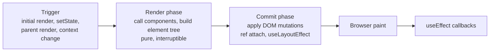
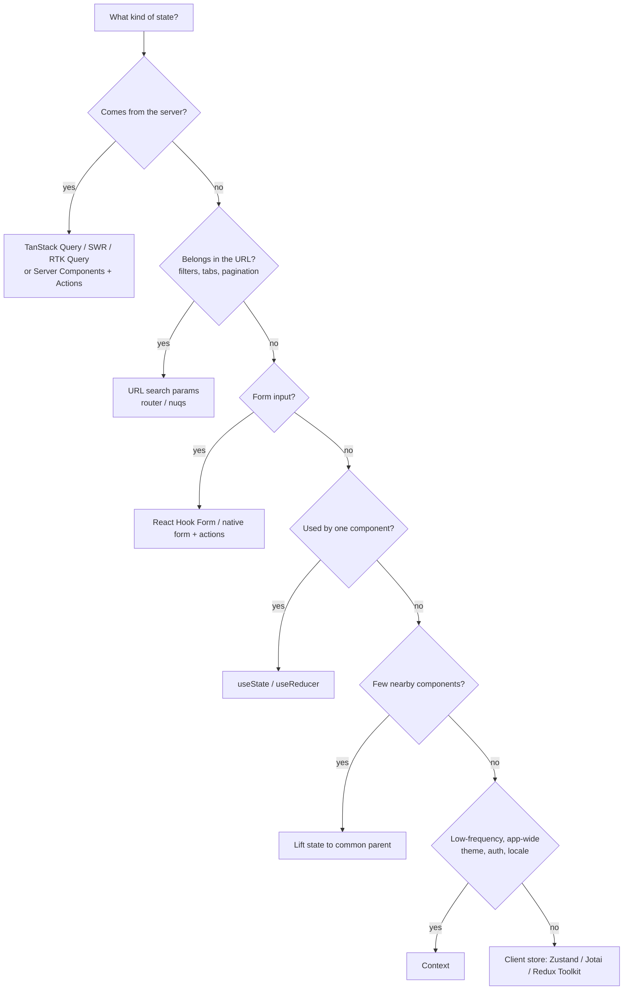

# React

> **TL;DR** — React re-renders a component whenever its state, its parent, or a consumed context changes; rendering must be pure. Derive values during render instead of syncing them with effects, keep server state in TanStack Query (or Server Components), keep client state as local as possible, and reach for memoization only after measuring (or let the React Compiler do it). Test behaviour through the accessible DOM with Testing Library and Playwright.

Related: [TypeScript](typescript.md) · [Vue](vue.md) · [CSS](css.md) · [Testing](testing.md) · [UX/UI](../01-ux-ui/README.md) · [Software architecture](../05-software-architecture/README.md)

---

## 1. Rendering model



| Fact | Implication |
|---|---|
| A component re-renders when its state changes, its parent re-renders, or a context it reads changes | Props changing is *not* the trigger; parent rendering is |
| Rendering = calling your function | Must be pure: no mutations of external values, no subscriptions, no fetches |
| Reconciliation compares element type + `key` at each position | Changing type or key **remounts** (state lost). Use `key` deliberately to reset state |
| State updates are batched (React 18+ everywhere) | Multiple `setX` in one event → one render |
| State is a snapshot per render | `setCount(count + 1)` twice = +1. Use updater `setCount(c => c + 1)` |
| StrictMode double-invokes render and mounts/unmounts/remounts effects in dev | Surfaces impure renders and missing cleanups |
| Concurrent features (transitions, Suspense) | Rendering can be paused, discarded, restarted |

### Keys
- Use stable IDs from data. Never index for reorderable/insertable lists, never `Math.random()`.
- `<Profile key={userId} />` resets all inner state when the user changes — often better than an effect.

---

## 2. Rules of hooks

1. Call hooks only at the **top level** of a component or custom hook — not in loops, conditions, nested functions, or after early returns. (`use` is the exception: it can be called conditionally.)
2. Call hooks only from React function components or custom hooks (`useXxx`).
3. Components and hooks must be pure; props and state are immutable; values passed to JSX/hooks must not be mutated afterwards.

Enforce with `eslint-plugin-react-hooks` (includes `rules-of-hooks`, `exhaustive-deps`, and React Compiler-powered rules in recent versions).

---

## 3. Hook reference

| Hook | Purpose | Notes / pitfalls |
|---|---|---|
| `useState` | Local state | Lazy init `useState(() => expensive())`; updater form for derived-from-previous |
| `useReducer` | State with transitions | Good for complex/related state; reducer must be pure; pairs well with discriminated unions |
| `useContext` | Read context | Every consumer re-renders when the value identity changes — memoize value or split contexts |
| `useRef` | Mutable box / DOM ref | Changing `.current` does not re-render; do not read/write during render (except lazy init) |
| `useEffect` | Synchronize with external systems after paint | Not for data derivation or event handling (see section 4) |
| `useLayoutEffect` | Measure DOM before paint | Blocks paint; use only for layout measurement/tooltips |
| `useInsertionEffect` | Inject styles before layout effects | CSS-in-JS library authors only |
| `useMemo` | Cache a computed value | Performance only; must work without it |
| `useCallback` | Cache a function identity | Useful when passed to memoized children or used as effect dep |
| `useId` | Stable unique IDs (SSR-safe) | For `htmlFor`/`aria-*`, not list keys |
| `useTransition` | Mark updates as non-urgent; `isPending` | Keeps UI responsive; React 19 supports async functions (Actions) |
| `useDeferredValue` | Defer re-rendering of a value | Typing + expensive filtered list |
| `useSyncExternalStore` | Subscribe to external stores | Correct tearing-free subscriptions (browser APIs, custom stores) |
| `useImperativeHandle` | Customize ref exposed to parent | Rarely; in React 19 `ref` is a normal prop (no `forwardRef` needed) |
| `useDebugValue` | Label in DevTools | Custom hooks |
| `useActionState` (19) | State driven by an action (form submit) | Returns `[state, formAction, isPending]` |
| `useFormStatus` (19, react-dom) | Pending state of parent `<form>` | For submit buttons in design systems |
| `useOptimistic` (19) | Optimistic UI during an async action | Automatically reverts when the action settles |
| `use` (19) | Read a promise (suspends) or context | Can be called conditionally |
| `useEffectEvent` (19.2) | Non-reactive event logic called from effects | Reads latest props/state without re-triggering the effect |

### Custom hooks
Extract *stateful logic*, not markup. Each call has independent state. Name `useSomething`. Return tuples for 2 values, objects for more.

```tsx
function useOnlineStatus() {
  return useSyncExternalStore(
    (cb) => { addEventListener("online", cb); addEventListener("offline", cb);
              return () => { removeEventListener("online", cb); removeEventListener("offline", cb); }; },
    () => navigator.onLine,
    () => true, // server snapshot
  );
}
```

---

## 4. useEffect pitfalls — "You might not need an effect"

Effects are an escape hatch to synchronize with **external systems** (network, DOM APIs, subscriptions, third-party widgets). If no external system is involved, you probably do not need one.

| Situation | Wrong | Right |
|---|---|---|
| Derived data | `useEffect(() => setFullName(first + " " + last), [first, last])` | `const fullName = first + " " + last` |
| Expensive derived data | effect + state | `useMemo(() => filter(todos, tab), [todos, tab])` |
| Reset all state when prop changes | effect that clears state | `<Form key={id} />` |
| Adjust some state on prop change | effect | compute during render, or store previous prop and compare during render |
| Event-specific logic (POST on click, toast) | effect watching a flag | do it in the event handler |
| Chains of effects setting state | effect → state → effect | compute next state in one event handler / reducer |
| Notify parent of change | effect calling `onChange(state)` | call `onChange` in the same handler that sets state, or lift state up |
| App initialization once | effect with `[]` (runs twice in StrictMode) | module-level code or a guarded `didInit` flag |
| Subscribing to external store | effect + state | `useSyncExternalStore` |
| Data fetching | raw effect | TanStack Query / framework loader / Server Component |

If you must fetch in an effect, handle races and cleanup:

```tsx
useEffect(() => {
  const ac = new AbortController();
  fetch(`/api/users/${id}`, { signal: ac.signal })
    .then(r => r.json()).then(setUser)
    .catch(e => { if (e.name !== "AbortError") setError(e); });
  return () => ac.abort();
}, [id]);
```

Dependency array rules: include every reactive value used; never lie to the linter. If a dep causes re-runs you do not want, restructure (move object creation inside the effect, use updater functions, `useEffectEvent`).

---

## 5. State management decision guide



| Option | Best for | Avoid when |
|---|---|---|
| Local `useState`/`useReducer` | UI state of one component | Many distant consumers |
| Lifting state | Siblings sharing state | Deep prop drilling (> 3 levels) |
| Context | Dependency injection, rarely-changing global values | High-frequency updates (re-renders all consumers) |
| Zustand | Simple global client state with selectors | You need strict event-sourced debugging |
| Jotai | Atomic, fine-grained derived state | Team unfamiliar with atom model |
| Redux Toolkit | Large apps, complex workflows, devtools time-travel, strict conventions | Small apps; server cache (use RTK Query) |
| TanStack Query | Server state: caching, dedupe, retries, background refresh, pagination, optimistic updates | Pure client state |
| URL state | Shareable, bookmarkable view state | Sensitive data |

**Biggest win:** separating *server cache* from *client state*. Most "global state" in older apps is actually cached server data.

```tsx
const { data, isPending, error } = useQuery({
  queryKey: ["user", id],
  queryFn: () => api.getUser(id),
  staleTime: 60_000,
});

const qc = useQueryClient();
const mutation = useMutation({
  mutationFn: api.updateUser,
  onSuccess: () => qc.invalidateQueries({ queryKey: ["user", id] }),
});
```

---

## 6. React 19 features

| Feature | What it does |
|---|---|
| **Actions** | Async functions passed to transitions or `<form action={fn}>`; React manages pending state, errors, optimistic updates and form reset |
| `useActionState` | `[state, action, isPending]` for an action |
| `useFormStatus` | Read parent form's pending state |
| `useOptimistic` | Temporary optimistic state during an action |
| `use(promise)` / `use(context)` | Suspend on a promise (must be created outside render, e.g. passed from a Server Component or cached); read context conditionally |
| `ref` as a prop | `forwardRef` no longer needed for function components; ref callbacks can return cleanup |
| `<Context>` as provider | `<ThemeContext value="dark">` |
| Document metadata | `<title>`, `<meta>`, `<link>` rendered anywhere are hoisted to `<head>` |
| Stylesheet & script support | `precedence` on `<link rel="stylesheet">`, async scripts dedupe |
| Resource preloading | `preload`, `preinit`, `prefetchDNS`, `preconnect` from `react-dom` |
| Server Components (RSC) | Components that run only on the server (or at build), can be `async`, ship zero JS |
| Server Functions (`"use server"`) | Client-callable server functions, typically used as form actions |
| 19.2 | `<Activity>` (hide/show while preserving state), `useEffectEvent`, partial pre-rendering primitives |

```tsx
"use client";
import { useActionState } from "react";
import { updateName } from "./actions"; // "use server" function

export function NameForm() {
  const [error, submit, isPending] = useActionState(async (_prev: string | null, formData: FormData) => {
    const res = await updateName(formData.get("name") as string);
    return res.ok ? null : res.error;
  }, null);

  return (
    <form action={submit}>
      <input name="name" required />
      <button disabled={isPending}>Save</button>
      {error && <p role="alert">{error}</p>}
    </form>
  );
}
```

### Server vs Client Components

| | Server Component (default in App Router) | Client Component (`"use client"`) |
|---|---|---|
| Runs | server / build time | server (SSR) + browser (hydration) |
| Can use | `async/await`, DB, secrets, filesystem | state, effects, event handlers, browser APIs |
| JS shipped | none | component code |
| Can import | Server and Client components | only Client components (Server ones passed as `children` props) |
| Props across boundary | must be serializable | — |

Rule: push `"use client"` to the **leaves** (buttons, interactive widgets). Keep data fetching in Server Components. Mark server-only modules with `import "server-only"`.

---

## 7. Next.js App Router basics

| File | Role |
|---|---|
| `app/layout.tsx` | Root layout (required), persists across navigation |
| `app/page.tsx` | Route UI; folder = segment |
| `app/[slug]/page.tsx` | Dynamic segment; `params` is a Promise in recent versions |
| `loading.tsx` | Suspense fallback for the segment |
| `error.tsx` | Error boundary (Client Component) |
| `not-found.tsx` | 404 UI |
| `route.ts` | Route Handler (HTTP endpoints: `GET`, `POST`…) |
| `(group)/` | Route group, no URL segment |
| `@slot/` | Parallel routes |
| `(.)photo` | Intercepting routes |
| `middleware.ts` / `proxy.ts` | Edge request interception (renamed to `proxy` in Next 16) |

Data & caching:
- Fetch in Server Components with `await`. Parallelize with `Promise.all`; stream slow parts with `<Suspense>`.
- Mutate with Server Actions, then `revalidatePath`/`revalidateTag` (or `updateTag`/`refresh` in newer versions).
- Caching defaults have changed between versions 14 → 15 → 16 (`"use cache"` directive, Cache Components). Check the docs for your version rather than relying on memory.
- Rendering modes: static (build), dynamic (per request), streaming, Partial Prerendering.

Alternatives: React Router v7 (framework mode, formerly Remix), TanStack Start, Vite SPA for apps that do not need SSR.

---

## 8. Forms (React Hook Form)

Uncontrolled inputs registered via refs → minimal re-renders. Pair with zod for schema validation.

```tsx
import { useForm } from "react-hook-form";
import { zodResolver } from "@hookform/resolvers/zod";
import { z } from "zod";

const Schema = z.object({ email: z.string().email(), age: z.coerce.number().min(18) });
type FormValues = z.infer<typeof Schema>;

export function SignupForm({ onSubmit }: { onSubmit: (v: FormValues) => Promise<void> }) {
  const { register, handleSubmit, formState: { errors, isSubmitting } } =
    useForm<FormValues>({ resolver: zodResolver(Schema) });

  return (
    <form onSubmit={handleSubmit(onSubmit)} noValidate>
      <label htmlFor="email">Email</label>
      <input id="email" type="email" {...register("email")} aria-invalid={!!errors.email}
             aria-describedby="email-err" />
      {errors.email && <p id="email-err" role="alert">{errors.email.message}</p>}
      <button type="submit" disabled={isSubmitting}>Sign up</button>
    </form>
  );
}
```

Options: native `<form action>` + `useActionState` (progressive enhancement, simple forms), React Hook Form (complex client forms), TanStack Form (type-safe, framework-agnostic), Conform (server-action-first). Always re-validate on the server.

---

## 9. Performance

Order of operations: **measure (React DevTools Profiler, Performance panel, Web Vitals) → fix architecture → memoize.**

| Technique | Use when |
|---|---|
| Move state down / lift content up (`children` prop) | Expensive subtree re-renders due to unrelated parent state |
| `React.memo(Component)` | Pure component re-rendering often with same props |
| `useMemo` | Expensive computation, or stable object identity for memoized children/effect deps |
| `useCallback` | Stable function identity for memoized children/effect deps |
| **React Compiler** | Build-time auto-memoization (stable 1.0 since late 2025); removes most manual `memo/useMemo/useCallback`; requires Rules of React compliance |
| `useTransition` / `useDeferredValue` | Keep input responsive during expensive renders |
| Virtualization (TanStack Virtual, react-window, Virtuoso) | Lists > a few hundred rows |
| Code splitting (`lazy` + `Suspense`, route-level) | Large bundles |
| Context splitting / selectors (Zustand) | Context consumers re-rendering on unrelated changes |
| Server Components | Move non-interactive rendering and data fetching off the client |
| Images: `next/image`, `loading="lazy"`, proper sizes | LCP issues |

Core Web Vitals targets (75th percentile): **LCP ≤ 2.5 s, INP ≤ 200 ms, CLS ≤ 0.1.**

---

## 10. Component patterns

| Pattern | Idea | Example |
|---|---|---|
| Composition via `children` | Pass elements instead of config props | `<Card><Card.Header/>…</Card>` |
| Compound components | Parent shares state with children via context | `<Tabs><Tabs.List><Tabs.Trigger/></Tabs.List><Tabs.Panel/></Tabs>` |
| Render props | Function child decides rendering | `<DataTable renderRow={(r) => …} />` — mostly replaced by hooks |
| Custom hooks | Share logic, not UI | `useDisclosure()` |
| Headless UI | Behaviour + a11y without styles | Radix UI, React Aria, Headless UI, TanStack Table, Base UI |
| Copy-in components | Own the source | shadcn/ui (Radix/Base UI + Tailwind) |
| Controlled | Parent owns value via `value` + `onChange` | Validated inputs, synced state |
| Uncontrolled | DOM owns value, read via ref/FormData | Simple forms, performance |
| Controllable (both) | Accept `value?`/`defaultValue?` | Design system components |
| Polymorphic / `asChild` | Render as another element | `<Button asChild><a href="…"/></Button>` |
| Container / presentational | Data vs view split | Largely replaced by hooks + RSC, still useful for testing |
| Error boundaries | Catch render errors in subtree | `react-error-boundary` |

```tsx
// Compound component skeleton
const TabsCtx = createContext<{ value: string; setValue: (v: string) => void } | null>(null);
const useTabs = () => { const c = use(TabsCtx); if (!c) throw new Error("Tabs.* must be inside <Tabs>"); return c; };

export function Tabs({ defaultValue, children }: { defaultValue: string; children: React.ReactNode }) {
  const [value, setValue] = useState(defaultValue);
  return <TabsCtx value={{ value, setValue }}>{children}</TabsCtx>;
}
Tabs.Trigger = function Trigger({ value, children }: { value: string; children: React.ReactNode }) {
  const t = useTabs();
  return <button role="tab" aria-selected={t.value === value} onClick={() => t.setValue(value)}>{children}</button>;
};
Tabs.Panel = function Panel({ value, children }: { value: string; children: React.ReactNode }) {
  return useTabs().value === value ? <div role="tabpanel">{children}</div> : null;
};
```

(Production tabs also need keyboard arrow navigation, `aria-controls`, roving tabindex — use a headless library.)

---

## 11. Testing

| Layer | Tool | What to test |
|---|---|---|
| Unit (pure logic, hooks) | Vitest (or Jest) | reducers, utils, custom hooks via `renderHook` |
| Component / integration | Testing Library + Vitest (jsdom/happy-dom) or Vitest Browser Mode | behaviour from the user's perspective |
| Network mocking | MSW (Mock Service Worker) | same handlers for tests, Storybook and dev |
| Visual / interaction catalogue | Storybook + interaction tests, Chromatic | states of design-system components |
| E2E | Playwright | critical user journeys across real browser + backend |
| Accessibility | axe-core (`vitest-axe`, `@axe-core/playwright`) | automated a11y rules (catches ~30–50% of issues) |

Testing Library query priority: `getByRole` → `getByLabelText` → `getByPlaceholderText` → `getByText` → `getByDisplayValue` → `getByAltText`/`getByTitle` → `getByTestId` (last resort).

```tsx
import { render, screen } from "@testing-library/react";
import userEvent from "@testing-library/user-event";

test("shows validation error for invalid email", async () => {
  const user = userEvent.setup();
  render(<SignupForm onSubmit={vi.fn()} />);
  await user.type(screen.getByLabelText(/email/i), "nope");
  await user.click(screen.getByRole("button", { name: /sign up/i }));
  expect(await screen.findByRole("alert")).toHaveTextContent(/email/i);
});
```

```ts
// Playwright
test("user can check out", async ({ page }) => {
  await page.goto("/products/1");
  await page.getByRole("button", { name: "Add to cart" }).click();
  await page.getByRole("link", { name: "Cart" }).click();
  await expect(page.getByRole("heading", { name: "Your cart" })).toBeVisible();
});
```

Avoid: testing implementation details (state values, internal methods), shallow rendering, snapshot tests of large trees, `waitFor` with side effects, arbitrary `sleep`s.

---

## 12. Accessibility essentials

- Semantic HTML first: `<button>` for actions, `<a href>` for navigation, `<label>` for inputs, headings in order, landmarks (`<main>`, `<nav>`).
- First rule of ARIA: do not use ARIA if a native element does the job. No ARIA is better than bad ARIA.
- Every interactive element: keyboard reachable, visible focus (`:focus-visible`), accessible name.
- Manage focus on route changes, modals (focus trap + restore), and after deletions.
- Announce async results with live regions (`role="status"`, `role="alert"`).
- Colour contrast ≥ 4.5:1 for body text (WCAG AA), don't convey meaning by colour alone.
- Respect `prefers-reduced-motion`.
- Images: meaningful `alt`, or `alt=""` for decorative.
- Lint with `eslint-plugin-jsx-a11y`; test with axe + keyboard + a screen reader (NVDA, VoiceOver).
- Target: WCAG 2.2 AA (legal baseline in the EU via the European Accessibility Act from June 2025). See [UX/UI](../01-ux-ui/README.md).

---

## 13. Common mistakes

- Effects for derived state, event logic, or data fetching without race handling.
- Index keys on dynamic lists → state attached to wrong rows.
- Defining components inside components → remount on every render.
- Mutating state (`arr.push`, `obj.x = 1`) then `setState(arr)` → no re-render.
- Huge context providers with object values recreated every render.
- Premature `useMemo`/`useCallback` everywhere (noise, no measured gain).
- `"use client"` at the top of the tree in App Router (ships everything to the client).
- Storing server data in Redux/Zustand and hand-rolling cache invalidation.
- `div onClick` instead of `button`.
- Missing error boundaries and Suspense fallbacks.

## References

- react.dev Learn — https://react.dev/learn
- Thinking in React — https://react.dev/learn/thinking-in-react
- Rules of React — https://react.dev/reference/rules
- Rules of Hooks — https://react.dev/reference/rules/rules-of-hooks
- Hooks reference — https://react.dev/reference/react/hooks
- You Might Not Need an Effect — https://react.dev/learn/you-might-not-need-an-effect
- Choosing the state structure — https://react.dev/learn/choosing-the-state-structure
- React 19 release — https://react.dev/blog/2024/12/05/react-19
- React Compiler — https://react.dev/learn/react-compiler
- Server Components — https://react.dev/reference/rsc/server-components
- Next.js App Router docs — https://nextjs.org/docs/app
- TanStack Query — https://tanstack.com/query/latest
- Zustand — https://zustand.docs.pmnd.rs
- Redux Toolkit — https://redux-toolkit.js.org
- React Hook Form — https://react-hook-form.com
- Testing Library — https://testing-library.com/docs/
- Vitest — https://vitest.dev
- Playwright — https://playwright.dev
- MSW — https://mswjs.io
- Radix UI — https://www.radix-ui.com
- React Aria — https://react-spectrum.adobe.com/react-aria/
- shadcn/ui — https://ui.shadcn.com
- web.dev Core Web Vitals — https://web.dev/articles/vitals
- WCAG 2.2 — https://www.w3.org/TR/WCAG22/
- WAI-ARIA Authoring Practices — https://www.w3.org/WAI/ARIA/apg/
