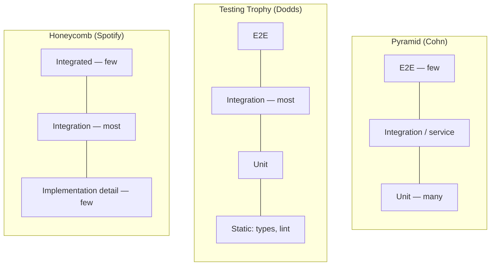
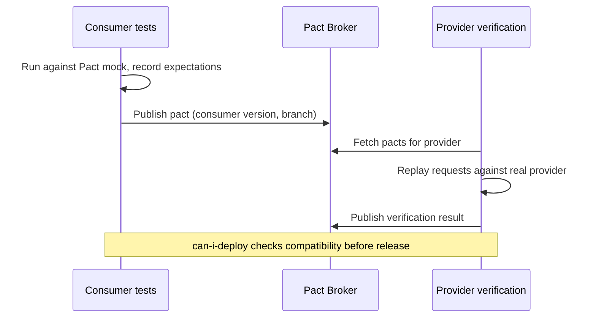
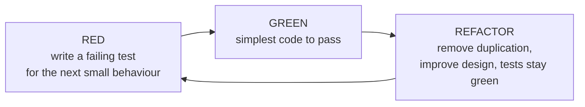

# Testing Strategy

> **TL;DR** — Tests exist to give fast, trustworthy feedback that lets you change code with confidence. Choose the shape (pyramid, trophy, honeycomb) that fits your architecture, test behaviour through public interfaces, prefer real collaborators (fakes, Testcontainers) over deep mocking, use contract tests between services, keep E2E to critical journeys, and treat flaky tests as production bugs. Coverage is a floor indicator, not a goal — mutation testing tells you if tests actually check anything.

Related: [React testing](react.md#11-testing) · [Python pytest](python.md#8-testing-with-pytest) · [.NET testing](csharp-dotnet.md#8-testing) · [CI/CD](ci-cd-devops.md) · [Software architecture](../05-software-architecture/README.md)

---

## 1. Why test — properties of good tests

| Property | Meaning |
|---|---|
| Protection against regressions | Catches real bugs |
| Resistance to refactoring | Does not break when behaviour is unchanged (no false positives) |
| Fast feedback | Seconds locally, minutes in CI |
| Maintainability | Cheap to read and change |
| Deterministic | Same result every run |
| Isolated | Order-independent, no shared mutable state |
| Readable | Documents intended behaviour; failure message points to cause |

Source: Vladimir Khorikov's four pillars (regression protection, refactoring resistance, fast feedback, maintainability). Kent Beck's "Test Desiderata" lists 12 properties along similar lines.

---

## 2. Test shapes



| Model | Emphasis | Fits |
|---|---|---|
| **Test pyramid** (Mike Cohn, popularized by Fowler) | Many fast unit tests, fewer service tests, very few UI tests | Logic-heavy domains, libraries, monoliths with rich domain model |
| **Testing trophy** (Kent C. Dodds) | Static analysis base, *integration* tests give best confidence/cost, some unit, few E2E | Frontend apps (Testing Library philosophy) |
| **Testing honeycomb** (Spotify) | Integration tests of a service through its API with real dependencies; few unit and integrated (cross-service) tests | Microservices where the logic is mostly I/O orchestration |
| Ice-cream cone (anti-pattern) | Mostly manual/E2E, few unit | Avoid — slow, flaky, expensive |

Takeaway: the *shape* matters less than "many fast, reliable tests close to the code; few slow, broad ones". Define what "unit" means for your team (a class? a module? a behaviour?) — the classicist (Detroit) school tests behaviour units with real collaborators; the mockist (London) school isolates each class.

---

## 3. Test types

| Type | Scope | Speed | Dependencies | Example tools |
|---|---|---|---|---|
| Static | Code without running | instant | none | TypeScript, mypy, ESLint, Roslyn analyzers |
| Unit | Function/class/module behaviour | ms | in-memory | Vitest, Jest, pytest, xUnit |
| Component | One UI component or one service in isolation | ms–s | fakes/mocks at edges | Testing Library, Storybook |
| Integration (narrow) | Code + one real dependency (DB, queue) | s | Testcontainers | Testcontainers, `WebApplicationFactory`, pytest + docker |
| Integration (broad) / service | Whole service via its API, real infra, external services stubbed | s | containers + stubs (WireMock, MSW) | |
| Contract | API compatibility between consumer and provider | s | none (contract broker) | Pact, Spring Cloud Contract, schema diff (OpenAPI) |
| E2E | Full system through UI/API | s–min | full env | Playwright, Cypress |
| Smoke | Is the deployed thing alive | s | deployed env | health checks, synthetic tests |
| Performance / load | Latency/throughput under load | min | prod-like env | k6, Gatling, JMeter, NBomber, Locust |
| Security | Vulnerabilities | min | — | SAST, DAST (OWASP ZAP), dependency scanning |
| Accessibility | WCAG rules | s | browser | axe-core, Lighthouse |
| Visual regression | Pixel/DOM diffs | s | browser | Playwright screenshots, Chromatic |
| Exploratory | Human-driven discovery | — | — | session-based testing |

### Contract testing (Pact)



- Consumer-driven: the consumer defines what it needs, not the whole API.
- Replaces many cross-service E2E tests; enables independent deployment.
- `can-i-deploy` gate in CI; tag/branch/environment awareness.
- Alternative: provider-driven schema checks (OpenAPI diff with `oasdiff`, GraphQL schema checks, AsyncAPI/Protobuf `buf breaking`).

---

## 4. Test doubles (Meszaros, xUnit Test Patterns)

| Double | Behaviour | Verifies | Example |
|---|---|---|---|
| **Dummy** | Passed but never used | — | `null` logger placeholder |
| **Stub** | Returns canned answers | State (via SUT output) | `repo.Get(1)` returns a fixed user |
| **Spy** | Stub that records calls | Calls, after the fact | Record emails "sent" |
| **Mock** | Pre-programmed expectations | Interactions (behaviour) | Expect `Publish(OrderPlaced)` once |
| **Fake** | Working lightweight implementation | State | In-memory repository, SQLite, fake clock |

Guidance:
- Mock **what you own** at architectural boundaries (ports); for third-party APIs, wrap them behind your interface and test the adapter with integration tests.
- Use mocks for **outgoing commands** that are the observable outcome (send email, publish event); use stubs for **incoming queries**. Do not assert on stub calls.
- Over-mocking couples tests to implementation → tests break on refactors (low resistance to refactoring).
- Fakes (in-memory repo, `FakeTimeProvider`) are often the best balance; verify fakes with the same contract tests as the real implementation.

---

## 5. Writing good tests

### Structure: Arrange–Act–Assert (Given–When–Then)

```ts
test("applies 10% discount for orders above 100", () => {
  // Arrange
  const order = anOrder().withLines([{ price: 60 }, { price: 50 }]).build();
  // Act
  const total = priceOrder(order);
  // Assert
  expect(total).toBe(99);
});
```

Checklist:
- [ ] Name describes behaviour and expectation (`rejects_expired_token`, "shows error when email invalid")
- [ ] One behaviour per test (multiple asserts on the same outcome are fine)
- [ ] No logic (loops/ifs) in tests — use parametrization
- [ ] Test data builders / factories over giant fixtures; only relevant fields visible
- [ ] No sleeps; await conditions
- [ ] Control time, randomness, IDs, network
- [ ] Tests clean up or run in isolated transactions/containers
- [ ] Failure message is diagnosable
- [ ] Test public behaviour, not private methods

---

## 6. TDD



- Kent Beck's rules: write new code only if a test fails; eliminate duplication.
- Keep a **test list**; pick the next simplest case.
- Strategies to green: *fake it* (return constant), *triangulate* (second example forces generalization), *obvious implementation*.
- Benefits: design pressure toward small, decoupled units; built-in regression suite; executable spec.
- Where it shines: business rules, parsers, algorithms, bug fixes (reproduce with a failing test first).
- Where it is awkward: exploratory spikes (throw away, then TDD), UI layout, unknown external APIs.
- Outside-in (London/"double loop") TDD: start with a failing acceptance test, then drive inner units.

## 7. BDD

- Collaboration practice: business, dev and test agree on **examples** before coding ("Three Amigos", Example Mapping).
- Gherkin specification by example:

```gherkin
Feature: Order discounts
  Scenario: Loyal customer gets 10% off
    Given a customer with 5 previous orders
    When they place an order totalling €200
    Then the order total is €180
```

- Tools: Cucumber, SpecFlow successor **Reqnroll** (.NET), behave/pytest-bdd (Python), Playwright BDD.
- Pitfall: Gherkin without collaboration = expensive test scripts. Value is in the conversation; automation is optional.

---

## 8. Advanced techniques

### Property-based testing

Instead of examples, state **properties** that hold for all generated inputs; the framework generates hundreds of cases and **shrinks** failures to minimal counterexamples.

```ts
import fc from "fast-check";
test("sort is idempotent and ordered", () => {
  fc.assert(fc.property(fc.array(fc.integer()), (xs) => {
    const s = mySort(xs);
    expect(mySort(s)).toEqual(s);
    for (let i = 1; i < s.length; i++) expect(s[i - 1]).toBeLessThanOrEqual(s[i]);
  }));
});
```

```python
from hypothesis import given, strategies as st
@given(st.text())
def test_roundtrip(s):
    assert decode(encode(s)) == s
```

Common property patterns: round-trip (encode/decode), invariants (size, ordering), idempotence, oracle (compare with a simple reference impl), commutativity, metamorphic relations. Tools: fast-check (JS/TS), Hypothesis (Python), FsCheck / CsCheck (.NET), QuickCheck (Haskell, the original).

### Mutation testing

Tool injects small faults (mutants: `>` → `>=`, remove call, flip boolean) and re-runs tests. A **killed** mutant = a test failed (good). **Survived** = tests did not notice the change → weak assertions or missing cases.

- Mutation score = killed / (total − equivalent).
- Tools: Stryker (JS/TS, .NET via Stryker.NET), mutmut / cosmic-ray (Python), PIT (Java).
- Expensive: run incrementally on changed code or nightly.

### Snapshot / approval testing
Useful for large, stable outputs (serializers, generated code, CLI output). Review diffs carefully; avoid for UI trees that churn.

### Fuzzing
Random/coverage-guided malformed input to find crashes and security bugs (libFuzzer, AFL++, Atheris, Jazzer.js, SharpFuzz).

---

## 9. Coverage — myths and reality

| Myth | Reality |
|---|---|
| "100% coverage means no bugs" | Coverage shows lines *executed*, not *verified*. A test without assertions gives coverage |
| "Higher coverage target = better quality" | Targets get gamed (Goodhart's law). Teams write low-value tests |
| "Low coverage is fine if we test manually" | Untested code is risky to change |
| "Line coverage is enough" | Branch/condition coverage reveals untested paths; mutation score reveals untested *behaviour* |

Practical guidance:
- Use coverage to **find untested areas**, not as a goal. A reasonable floor (e.g. 70–80% on domain code) prevents erosion.
- Gate on **coverage of changed lines** (diff coverage) rather than the global number.
- Exclude generated code; don't chase coverage of trivial getters.
- Google's guidance: ~60% acceptable, 75% commendable, 90% exemplary — but context matters.

---

## 10. Flaky tests

A flaky test passes and fails on the same code. It erodes trust ("just re-run it") until real failures are ignored.

| Cause | Fix |
|---|---|
| Timing / async (sleep-based waits) | Await explicit conditions; Playwright auto-waiting + web-first assertions |
| Order dependence / shared state | Isolate data per test; random order runs |
| Time & time zones | Inject clock; freeze time |
| Randomness | Seeded RNG; log the seed |
| Network / external services | Stub at boundary (MSW, WireMock); containers for owned deps |
| Resource leaks / port clashes | Dynamic ports, proper teardown |
| Test env drift | Containers, pinned versions |
| Concurrency bugs (real!) | Investigate — sometimes the test is right |

Process: detect (CI analytics, rerun-on-failure tagging), **quarantine** with an owner and ticket, fix within an SLA, delete if worthless. Never silently auto-retry without tracking.

---

## 11. Testing in production

Pre-production testing cannot reproduce real traffic, data and scale. Complement it with safe production verification:

| Technique | Description |
|---|---|
| Synthetic monitoring | Scripted probes of key journeys (Playwright, Azure App Insights availability tests) |
| Canary releases | Small % of traffic to new version, compare SLIs |
| Feature flags | Enable for internal users/cohorts first |
| Dark launch / shadow traffic | Duplicate requests to new version, discard responses, compare |
| A/B testing | Product experiments with statistical analysis |
| Chaos engineering | Inject failures deliberately (Chaos Mesh, Azure Chaos Studio, Gremlin) |
| Observability | SLOs, tracing, structured logs — the "test oracle" in production |
| Smoke tests after deploy | Gate promotion on post-deploy checks |

See [CI/CD & DevOps](ci-cd-devops.md#4-deployment-strategies) and [Cloud architecture](../06-cloud-architecture/README.md).

---

## 12. Test strategy template

| Question | Answer for this system |
|---|---|
| Critical risks (money, data loss, security, compliance)? | |
| Which test types cover each risk? | |
| What runs on every commit (< 10 min)? | |
| What runs pre-deploy / nightly? | |
| Test environments & data strategy (synthetic, anonymized)? | |
| Ownership — who fixes broken/flaky tests? | |
| Quality gates (types, lint, tests, diff coverage, contract can-i-deploy, a11y, perf budget)? | |
| Production verification (smoke, canary metrics, SLO alerts)? | |

## 13. Common mistakes

- Testing implementation details (private methods, internal state, call order of collaborators).
- Mocking everything, including value objects and the system under test's own internals.
- One giant shared fixture database.
- E2E tests for every edge case.
- Ignoring test code quality (duplication, magic numbers).
- Coverage as a KPI with incentives.
- Tolerating red/flaky builds.
- No tests for the bug you just fixed.

## References

- Martin Fowler, Practical Test Pyramid (Ham Vocke) — https://martinfowler.com/articles/practical-test-pyramid.html
- Martin Fowler, Test Pyramid — https://martinfowler.com/bliki/TestPyramid.html
- Martin Fowler, Mocks Aren't Stubs — https://martinfowler.com/articles/mocksArentStubs.html
- Martin Fowler, Test Double — https://martinfowler.com/bliki/TestDouble.html
- Martin Fowler, Eradicating Non-Determinism in Tests — https://martinfowler.com/articles/nonDeterminism.html
- Martin Fowler, Test Coverage — https://martinfowler.com/bliki/TestCoverage.html
- Kent C. Dodds, The Testing Trophy — https://kentcdodds.com/blog/the-testing-trophy-and-testing-classifications
- Spotify Engineering, Testing of Microservices (honeycomb) — https://engineering.atspotify.com/2018/01/testing-of-microservices/
- Google Testing Blog — https://testing.googleblog.com
- Pact — https://docs.pact.io
- Stryker Mutator — https://stryker-mutator.io
- fast-check — https://fast-check.dev
- Hypothesis — https://hypothesis.readthedocs.io
- Testcontainers — https://testcontainers.com
- Playwright best practices — https://playwright.dev/docs/best-practices
- Cucumber / Gherkin — https://cucumber.io/docs/gherkin/
- Test-driven development — https://en.wikipedia.org/wiki/Test-driven_development
- *Test-Driven Development: By Example* (Kent Beck)
- *Growing Object-Oriented Software, Guided by Tests* (Freeman & Pryce)
- *Unit Testing Principles, Practices, and Patterns* (Vladimir Khorikov)
- *xUnit Test Patterns* (Gerard Meszaros) — http://xunitpatterns.com
- *Software Engineering at Google*, testing chapters — https://abseil.io/resources/swe-book
