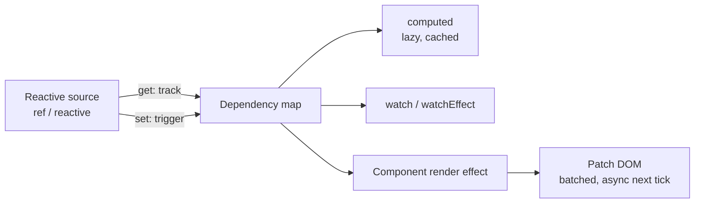

# Vue 3

> **TL;DR** — Vue 3 is a progressive framework with fine-grained, proxy-based reactivity: components re-run only the effects that depend on changed values, so manual memoization is rarely needed. Use `<script setup lang="ts">` with the Composition API, `ref` by default, `computed` for derived state, `watch` only for side effects, Pinia for shared client state, Vue Router for routing and Nuxt when you need SSR/SSG.

Related: [React](react.md) · [TypeScript](typescript.md) · [CSS](css.md) · [Testing](testing.md)

---

## 1. Composition API vs Options API

| | Options API | Composition API (`<script setup>`) |
|---|---|---|
| Organisation | By option type (`data`, `methods`, `computed`, `watch`) | By logical concern |
| Logic reuse | Mixins (name clashes, implicit sources) | Composables (`useXxx`) — explicit inputs/outputs |
| TypeScript | Workable, verbose | First-class inference |
| `this` | Yes | No |
| Bundle/minification | Property names not minifiable | Better minification, less overhead |
| Learning curve | Gentler for beginners | Requires understanding reactivity |
| Recommendation | Legacy code, simple widgets | **Default for new apps and libraries** |

Both are fully supported in Vue 3; the Options API is implemented on top of the Composition API.

```vue
<!-- Options API -->
<script>
export default {
  props: { initial: Number },
  data() { return { count: this.initial ?? 0 }; },
  computed: { double() { return this.count * 2; } },
  methods: { inc() { this.count++; } },
};
</script>
```

```vue
<!-- Composition API -->
<script setup lang="ts">
import { ref, computed } from "vue";
const props = defineProps<{ initial?: number }>();
const count = ref(props.initial ?? 0);
const double = computed(() => count.value * 2);
const inc = () => count.value++;
</script>

<template>
  <button @click="inc">{{ count }} × 2 = {{ double }}</button>
</template>
```

---

## 2. Reactivity system



| API | Purpose | Notes |
|---|---|---|
| `ref(v)` | Reactive box for any value | Access via `.value` in script; auto-unwrapped in templates. Objects inside become deeply reactive |
| `reactive(obj)` | Reactive proxy of an object | Loses reactivity on destructure or reassignment; only objects/collections |
| `shallowRef` / `shallowReactive` | Only top level reactive | Large immutable data, external class instances |
| `readonly` | Read-only proxy | Expose state from composables/stores |
| `computed(fn)` | Derived, cached value | Getter must be pure; writable computed with `get/set` |
| `watch(src, cb, opts)` | Side effect on specific sources | Lazy by default; `immediate`, `deep`, `once`, `flush: 'post'` |
| `watchEffect(fn)` | Auto-tracks deps, runs immediately | Good for quick syncs; less explicit |
| `toRef` / `toRefs` | Keep reactivity when destructuring props/reactive | `const { title } = toRefs(props)` |
| `toValue` / `MaybeRefOrGetter` | Normalize inputs in composables | Accept ref, getter or plain value |
| `nextTick()` | Await DOM update flush | After state change, before reading DOM |
| `onWatcherCleanup` (3.5) | Cancel stale async work in watchers | Like effect cleanup |
| `effectScope` | Group effects to dispose together | Library authors |

Vue 3.5 highlights: reactive props destructure (`const { count = 0 } = defineProps<…>()` stays reactive), `useTemplateRef`, `useId`, lazy hydration strategies, and a refactored, more memory-efficient reactivity system.

### `ref` vs `reactive`

Prefer **`ref` everywhere** (official recommendation): consistent `.value`, survives destructuring and replacement, works with primitives.

```ts
const state = reactive({ count: 0 });
let { count } = state;        // count is now a plain number — reactivity lost
const s2 = toRefs(state);     // s2.count is a Ref — reactive
```

### `computed` vs `watch`

| Need | Use |
|---|---|
| A value derived from other state | `computed` |
| Call an API / write to localStorage / imperative DOM when something changes | `watch` |
| Debounced search request | `watch` with cleanup |

```ts
watch(query, async (q, _old) => {
  const ac = new AbortController();
  onWatcherCleanup(() => ac.abort());
  results.value = await search(q, { signal: ac.signal });
}, { immediate: true });
```

---

## 3. Single-File Components (SFC)

```vue
<script setup lang="ts">
import { useTemplateRef, onMounted } from "vue";

const props = withDefaults(defineProps<{ label: string; modelValue: string; disabled?: boolean }>(), {
  disabled: false,
});
const emit = defineEmits<{ (e: "submit", value: string): void }>();
// or two-way binding shortcut:
const model = defineModel<string>({ required: true });

const input = useTemplateRef<HTMLInputElement>("input");
onMounted(() => input.value?.focus());
defineExpose({ focus: () => input.value?.focus() });
defineSlots<{ default(props: { value: string }): any; hint(): any }>();
</script>

<template>
  <label>
    {{ label }}
    <input ref="input" v-model="model" :disabled="disabled" @keyup.enter="emit('submit', model)" />
  </label>
  <slot :value="model" />
  <slot name="hint" />
</template>

<style scoped>
label { display: grid; gap: .25rem; }
:deep(.child) { color: var(--color-muted); }
</style>
```

Template essentials: `v-if`/`v-else`/`v-show`, `v-for` with `:key`, `v-model` (with modifiers `.trim`, `.number`, `.lazy`), `v-bind`/`:`, `v-on`/`@` (modifiers `.prevent`, `.stop`, `.once`), slots and scoped slots, `<Teleport>`, `<KeepAlive>`, `<Transition>`, `<Suspense>` (experimental), dynamic `<component :is>`.

Avoid `v-if` and `v-for` on the same element (`v-if` has higher priority in Vue 3) — wrap with `<template>` or filter via `computed`.

---

## 4. Composables

```ts
// useFetch.ts
import { ref, watchEffect, toValue, type MaybeRefOrGetter } from "vue";

export function useFetch<T>(url: MaybeRefOrGetter<string>) {
  const data = ref<T | null>(null);
  const error = ref<Error | null>(null);
  const loading = ref(false);

  watchEffect(async (onCleanup) => {
    const ac = new AbortController();
    onCleanup(() => ac.abort());
    loading.value = true; error.value = null;
    try {
      const r = await fetch(toValue(url), { signal: ac.signal });
      data.value = await r.json();
    } catch (e) {
      if ((e as Error).name !== "AbortError") error.value = e as Error;
    } finally { loading.value = false; }
  });

  return { data, error, loading };
}
```

Conventions: name `useXxx`, accept `MaybeRefOrGetter` inputs, return an object of refs (destructurable), register lifecycle hooks synchronously in `setup`. Library: **VueUse** (200+ composables). For server state prefer **TanStack Query for Vue** or **Pinia Colada**.

---

## 5. Pinia (state management)

```ts
// stores/cart.ts — setup store syntax
import { defineStore } from "pinia";
import { ref, computed } from "vue";

export const useCartStore = defineStore("cart", () => {
  const items = ref<{ id: string; price: number; qty: number }[]>([]);
  const total = computed(() => items.value.reduce((s, i) => s + i.price * i.qty, 0));
  function add(item: { id: string; price: number }) {
    const existing = items.value.find(i => i.id === item.id);
    existing ? existing.qty++ : items.value.push({ ...item, qty: 1 });
  }
  return { items, total, add };
});
```

```ts
// usage
const cart = useCartStore();
const { items, total } = storeToRefs(cart); // keep reactivity; actions destructure directly
const { add } = cart;
```

| Pinia vs Vuex | Pinia |
|---|---|
| Mutations | None — actions mutate directly |
| Modules | Each store is a module, imported where used |
| TS | Full inference |
| Devtools | Supported, time-travel |
| Status | Official recommendation; Vuex in maintenance |

Rules: keep stores for **client** state shared across routes; don't mirror server data you could fetch-with-cache; use `$reset` (option stores) or a manual reset for setup stores; with SSR, never create state at module scope outside a store.

---

## 6. Vue Router

```ts
import { createRouter, createWebHistory } from "vue-router";

export const router = createRouter({
  history: createWebHistory(),
  routes: [
    { path: "/", component: () => import("./pages/Home.vue") },
    { path: "/users/:id", component: () => import("./pages/User.vue"), props: true, meta: { requiresAuth: true } },
    { path: "/:pathMatch(.*)*", component: () => import("./pages/NotFound.vue") },
  ],
});

router.beforeEach((to) => {
  const auth = useAuthStore();
  if (to.meta.requiresAuth && !auth.isLoggedIn) return { path: "/login", query: { redirect: to.fullPath } };
});
```

Key concepts: nested routes + `<RouterView>`, named routes, navigation guards (global, per-route, in-component `onBeforeRouteLeave`), lazy loading, `useRoute()`/`useRouter()`, scroll behaviour, typed routes (file-based routing via `unplugin-vue-router`, now being merged into Vue Router 5).

---

## 7. Nuxt

| Feature | Notes |
|---|---|
| File-based routing | `pages/` |
| Rendering | SSR, SSG (`nuxi generate`), SPA, hybrid per-route rules (`routeRules`: `prerender`, `swr`, `isr`) |
| Data fetching | `useFetch`, `useAsyncData` (dedupe, SSR payload transfer), `$fetch` |
| Server | Nitro server engine, `server/api/*.ts` routes, deploy to Node, serverless, edge |
| Auto-imports | Components, composables, utils |
| Modules | Ecosystem (`@nuxt/image`, `@nuxt/content`, `@pinia/nuxt`, `@nuxtjs/i18n`) |
| State | `useState` (SSR-safe shared state) or Pinia |
| Layers | Share config/components across projects |

Nuxt 4 (2025) introduced the `app/` directory structure and improved data-fetching defaults.

---

## 8. Testing Vue

- **Vitest + Vue Test Utils** (or `@testing-library/vue` for user-centric tests).
- Pinia: `createTestingPinia()` from `@pinia/testing` to stub actions and preset state.
- Router: use a real router with memory history in integration tests.
- E2E: Playwright (or Cypress). Nuxt: `@nuxt/test-utils`.

```ts
import { render, screen } from "@testing-library/vue";
import userEvent from "@testing-library/user-event";
import Counter from "./Counter.vue";

test("increments", async () => {
  render(Counter, { props: { initial: 1 } });
  await userEvent.click(screen.getByRole("button"));
  expect(screen.getByRole("button")).toHaveTextContent("2");
});
```

---

## 9. Vue vs React

| Dimension | Vue 3 | React 19 |
|---|---|---|
| Reactivity | Mutable proxies, fine-grained dependency tracking | Immutable state, re-run component function, reconcile |
| Re-render scope | Only components whose tracked deps changed | Component + descendants (unless memoized / compiled) |
| Memoization | Rarely needed (`computed` is built in) | `useMemo`/`memo` or React Compiler |
| Templates | HTML-based templates with directives, compiled & optimized (static hoisting, patch flags); JSX optional | JSX (JavaScript all the way) |
| Styling | Scoped CSS in SFC built-in | Bring your own (CSS Modules, Tailwind, CSS-in-JS) |
| Two-way binding | `v-model`, `defineModel` | Controlled inputs manually |
| Official ecosystem | Router, Pinia, devtools, Vite, Nuxt maintained by core team | Router, state, meta-framework are community/Vercel/Meta-separate |
| Server components | Not (Nuxt server components/islands exist) | RSC core concept |
| Mobile native | Limited (NativeScript, Capacitor) | React Native |
| Job market / ecosystem size | Smaller, strong in EU/Asia | Largest |
| Learning curve | Gentler; conventions | Flexible; more decisions |
| Future direction | Vapor Mode (no-VDOM compile output), alien-signals based reactivity | Compiler, RSC, Activity |

Choose Vue when a team values conventions, templates, and an integrated official stack; choose React for the largest ecosystem, React Native, and RSC-based architectures. Either is fine for most products — team familiarity dominates.

---

## 10. Common mistakes

- Destructuring `reactive()` or props without `toRefs` (pre-3.5) → lost reactivity.
- Forgetting `.value` in script (or adding it in templates).
- Using `watch` to compute derived state → use `computed`.
- Mutating props → emit an event or use `defineModel`.
- Deep watchers on large objects (expensive) → watch a getter for the specific field.
- `v-for` without `:key`, or index keys on mutable lists.
- Wrapping class instances / third-party objects in deep reactivity → `markRaw` / `shallowRef`.
- Global state at module scope in SSR → cross-request state pollution.
- Async `setup` without `<Suspense>`.

## References

- Vue guide — https://vuejs.org/guide/introduction.html
- Composition API FAQ — https://vuejs.org/guide/extras/composition-api-faq.html
- Reactivity fundamentals — https://vuejs.org/guide/essentials/reactivity-fundamentals.html
- Reactivity in depth — https://vuejs.org/guide/extras/reactivity-in-depth.html
- Composables — https://vuejs.org/guide/reusability/composables.html
- SFC `<script setup>` — https://vuejs.org/api/sfc-script-setup.html
- Vue style guide — https://vuejs.org/style-guide/
- Pinia — https://pinia.vuejs.org
- Vue Router — https://router.vuejs.org
- Nuxt — https://nuxt.com/docs
- VueUse — https://vueuse.org
- Vue Test Utils — https://test-utils.vuejs.org
- Testing Library for Vue — https://testing-library.com/docs/vue-testing-library/intro
- Vite — https://vite.dev
