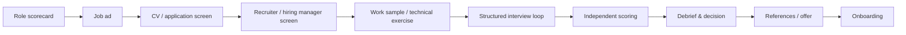
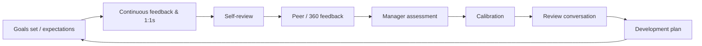

# Careers, Hiring, Onboarding and Performance

> **TL;DR** — Make expectations explicit with a career framework (ladder) that has a dual track for individual contributors and managers. Staff+ engineers take one of several archetypes (Tech Lead, Architect, Solver, Right Hand). Hire with structured interviews and work-sample tests scored against predefined rubrics — they predict job performance far better than unstructured chats. Onboard deliberately (30-60-90 days, buddy, first PR in week one). Run performance reviews as summaries of continuous feedback, calibrated across managers, never as surprises.

Related: [Motivation & leadership](motivation-and-leadership.md) · [Feedback & 1:1s](feedback-1on1s-conflict.md) · [Coaching](coaching-and-consulting.md) · [Engineering practices](../08-engineering/README.md)

---

## 1. Career frameworks / engineering ladders

### 1.1 Purpose

- Make expectations explicit and fair (reduce bias, "who shouts loudest").
- Give a shared language for growth conversations.
- Support calibration of promotions and compensation.
- Show that people can grow without becoming managers (dual track).

### 1.2 Typical levels (generic)

| Level | Common titles | Scope | Autonomy | Impact radius |
|---|---|---|---|---|
| L1 | Junior / Associate Engineer | Well-defined tasks | Needs guidance | Own tasks |
| L2 | Engineer / Medior | Features | Independent on features | Team |
| L3 | Senior Engineer | Projects / complex features; mentors | Owns ambiguous problems in team scope | Team + neighbors |
| L4 | Staff Engineer | Multi-team technical direction | Sets direction, finds problems | Group / org area |
| L5 | Senior Staff / Principal | Org-wide strategy | Defines what matters | Org / company |
| L6 | Distinguished / Fellow | Industry/company-defining | — | Company / industry |

Manager track (parallel): Engineering Manager → Senior EM → Director → VP Engineering → CTO.

### 1.3 Common dimensions (axes)

| Dimension | Example indicators at senior level |
|---|---|
| **Technical skill / craft** | Designs maintainable systems; sound trade-offs; code quality |
| **Delivery / execution** | Breaks down work; delivers predictably; manages risk |
| **Scope & impact** | Owns outcomes for a product area |
| **Collaboration & communication** | Explains trade-offs to non-technical stakeholders; writes good docs |
| **Leadership & influence** | Mentors; leads by example; drives decisions without authority |
| **Ownership / operational excellence** | On-call quality; postmortems; observability |
| **Strategy / business understanding** | Connects technical work to business goals |

### 1.4 Ladder design tips

- Describe **behaviors and impact**, not years of experience or tech lists.
- Each level should be **cumulative**.
- Provide **examples** for each level.
- Avoid checklists that become box-ticking ("did 3 talks → promotion").
- Calibrate across teams; publish internally.
- Review annually.
- Public examples to learn from: see [progression.fyi](https://progression.fyi/) (collection of published frameworks) and the CircleCI, Rent the Runway, Medium (snowflake) frameworks linked there.

---

## 2. Staff+ engineers (Will Larson, *Staff Engineer*)

Source: [staffeng.com](https://staffeng.com/).

### 2.1 Four archetypes

| Archetype | Description | Typical work | Fits orgs that… |
|---|---|---|---|
| **Tech Lead** | Guides approach and execution of a team (or small cluster); partners closely with a manager | Scoping, architecture of team's work, unblocking, mentoring, project execution | Have multiple teams needing technical leadership |
| **Architect** | Responsible for direction, quality, and approach within a critical area | Deep domain knowledge, technical vision, standards, cross-team design | Have complex domains needing coherence |
| **Solver** | Digs into arbitrarily complex problems and finds a path forward; moves between hot spots | Hard incidents, performance crises, migrations | Have urgent, hard problems leadership trusts one person with |
| **Right Hand** | Extends an executive's attention, borrowing their scope and authority | Operating complex org initiatives, filling leadership gaps | Large orgs with overloaded executives |

### 2.2 What Staff+ engineers do (Larson's themes)

- **Set and edit technical direction** — write strategy and vision docs (vision = 2–3 years, strategy = how to get there).
- **Mentorship and sponsorship** — sponsor = actively advocates and creates opportunities.
- **Inject engineering context into organizational decisions.**
- **Exploration** — investigate ambiguous, important problems.
- **Be glue** — the "glue work" that makes teams succeed (Tanya Reilly's term); ensure it's recognized.
- **Work on what matters** — avoid snacking (easy low-impact) and preening (high visibility, low impact); find work that matters: existential issues, foster growth, edit, finish things, what only you can do.
- **Manage technical quality**, **stay aligned with authority**, **build a network of peers**, **present to executives**.

### 2.3 Technical leadership without authority — tactics

- Write it down: RFCs, design docs, strategy notes (see [meetings & async](meetings-async-and-effectiveness.md#5-rfc--design-doc-culture)).
- Build coalitions before meetings (pre-wiring / nemawashi).
- Use data and prototypes to make arguments concrete.
- Give others credit; make the idea "ours".
- Pick battles; disagree and commit when appropriate.

---

## 3. Hiring

### 3.1 Evidence base

- Meta-analyses (e.g., Schmidt & Hunter 1998; later revisions by Sackett et al. 2022) find **structured interviews** among the best predictors of job performance; **work sample tests** and **job knowledge tests** also good; **unstructured interviews**, years of experience, and reference checks are weaker. Exact rankings differ between studies — the robust message is: **structure beats gut feel**.
- Google re:Work's hiring guides recommend structured interviewing with consistent questions and scoring rubrics.

### 3.2 Hiring process blueprint



### 3.3 Role scorecard (before writing the job ad)

```markdown
## Role scorecard: <Senior Backend Engineer, Payments>
**Mission:** why this role exists (1–2 sentences)
**Outcomes (first 12 months):**
1. Deliver X by Q3 with Y quality metric
2. Reduce Z incidents by …
**Competencies (with weights):**
| Competency | Weight | Evidence at hiring bar |
|---|---|---|
| System design | 30% | Designs a service with clear trade-offs, failure modes |
| Coding quality | 25% | Readable, tested code in exercise |
| Collaboration | 20% | Concrete examples of resolving disagreement |
| Ownership | 15% | Has owned production systems end-to-end |
| Communication | 10% | Explains to non-technical audience |
**Must-haves vs nice-to-haves**
**Interview plan:** which stage assesses which competency
```

### 3.4 Structured interviews

| Element | Practice |
|---|---|
| Same questions | All candidates get the same core questions per stage |
| Behavioral questions | "Tell me about a time when…" — past behavior |
| Situational questions | "What would you do if…" — hypothetical |
| Rubric | Predefined 1–4 anchors per question describing poor/meh/good/excellent answers |
| Independent scoring | Interviewers score **before** discussing |
| Note-taking | Write evidence, not impressions |
| Trained interviewers | Calibrate; shadow before leading |
| Debrief | Discuss evidence per competency; hiring manager decides; watch for halo effect & groupthink |

**STAR answer structure** (to probe): Situation, Task, Action, Result (+ Reflection).

### 3.5 Question bank (behavioral)

| Competency | Question | Follow-ups |
|---|---|---|
| Ownership | Tell me about a production issue you owned from detection to prevention. | What did you change afterward? What would you do differently? |
| Collaboration | Describe a technical disagreement with a peer. | How was it resolved? What did you concede? |
| Influence | Tell me about a time you convinced others to adopt an approach without authority. | What didn't work? |
| Learning | What's something hard you learned recently? How? | How do you know you learned it? |
| Prioritization | Describe a time you had too much to do. | What did you drop and how did you communicate it? |
| Mentoring | Tell me about someone you helped grow. | What did they achieve? |
| Failure | Tell me about a project that failed. | Your role? What did you learn? |
| Stakeholders | Describe explaining a technical risk to a non-technical stakeholder. | How did they react? Outcome? |

### 3.6 Work sample tests

| Type | Pros | Cons / mitigations |
|---|---|---|
| Take-home exercise | Realistic; low pressure | Time burden — cap at ~2–4h, consider paying; plagiarism/AI — follow with discussion |
| Pair-programming session | Shows collaboration & thinking | Stressful; interviewer skill matters |
| Code review exercise | Realistic; short | Narrower signal |
| System design interview | Senior-level signal | Can favor rehearsed answers; use realistic constraints |
| Debugging exercise | Realistic, short | Needs good setup |
| Trial day / paid project | Very realistic | Hard for employed candidates; legal issues |

**Rules:** relevant to the actual job; same exercise for all candidates; rubric defined upfront; candidate gets context and time expectation; give feedback where possible.

### 3.7 Bias reduction checklist

- [ ] Gender-neutral, inclusive job ad (avoid long must-have lists)
- [ ] Structured questions and rubrics
- [ ] Diverse interview panel
- [ ] Independent scoring before debrief
- [ ] "Culture add" over "culture fit"
- [ ] Track funnel metrics by stage
- [ ] Don't ask about age, family plans, religion, health, etc. (illegal in many jurisdictions incl. EU/NL/PL)

---

## 4. Onboarding

### 4.1 Goals

- Time-to-first-commit ≤ first week; time-to-productivity reduced.
- Belonging: new hire feels welcomed and knows who to ask.
- Clarity: expectations for 30-60-90 days.

### 4.2 Onboarding plan template

```markdown
## Before day 1
- [ ] Hardware/accounts/access ordered (check twice)
- [ ] Buddy assigned (not the manager)
- [ ] Welcome message to team; calendar invites for first week
- [ ] Starter task(s) labelled "good first issue"

## Week 1
- [ ] Welcome 1:1 with lead: expectations, working style (see first 1:1 questions)
- [ ] Dev environment working (target: day 1–2)
- [ ] First PR merged (small, real)
- [ ] Meet key stakeholders (list)
- [ ] Read: team charter, Team API, architecture overview, ADRs
- [ ] Shadow an on-call / support session

## 30 days — learn
- [ ] Delivered 2–3 small features end-to-end
- [ ] Understands domain basics & architecture
- [ ] Feedback loop: what's confusing in onboarding? (improve docs)

## 60 days — contribute
- [ ] Owns a medium-sized item
- [ ] Participates in code reviews and planning
- [ ] Joins on-call rotation (with backup)

## 90 days — own
- [ ] Owns a component or initiative
- [ ] 90-day review: strengths, growth areas, goals for next 6 months
```

### 4.3 Onboarding tips

- New hires are the best testers of your docs: have them update the README as they go.
- Pair heavily in the first weeks.
- Introduce context: history of the system ("why it is like this"), politics, key decisions.
- Schedule check-ins at 1 week, 30, 60, 90 days.
- For senior hires: "listening tour" before changing things.

---

## 5. Performance management

### 5.1 Principles

- **No surprises**: anything in a review should have been discussed before.
- Separate **development** conversations (growth) from **evaluation** (rating/pay) where possible.
- Evidence-based: examples tied to ladder expectations.
- **Calibration** across managers reduces leniency/severity bias.
- Watch biases: recency, halo/horn, similarity, central tendency, attribution (team success → individual?).

### 5.2 Review cycle



### 5.3 Self-review / brag document template

```markdown
## Period: H1 2026
### Key outcomes (impact first)
- Shipped X → reduced Y by Z%
### Technical contributions
### Collaboration & leadership (mentoring, reviews, docs, hiring)
### Glue work / invisible work
### Learning & growth
### What didn't go well & what I learned
### Goals for next period
```

(Julia Evans popularized the "brag document" — keep it continuously, not at review time.)

### 5.4 Peer feedback questions

- What should <name> continue doing?
- What should <name> start or stop doing to be more effective?
- Describe one situation where <name> had high impact.
- (Optional) How does <name> compare to expectations for their level? (only for trained reviewers)

### 5.5 Goal setting

| Method | Description | Fit |
|---|---|---|
| **SMART** | Specific, Measurable, Achievable, Relevant, Time-bound | Individual development goals |
| **OKRs** | Objective (qualitative) + 2–5 Key Results (measurable) | Team/org alignment — avoid tying directly to individual pay |
| **Growth goals** | Skill / behavior with evidence of progress | Career development |

### 5.6 Performance improvement plan (PIP) — fair practice

- Only after informal feedback and support have failed.
- Specific gaps, expected behaviors/results, support provided, timeline (often 30–90 days), regular check-ins.
- Involve HR; follow local labor law (in NL and PL, employment protection is strong; dismissal procedures have formal requirements — consult HR/legal).
- Must be a genuine chance, not paperwork for exit.

---

## 6. Promotions

- Promote based on **sustained** demonstration of next-level behaviors (often 3–6 months), not potential alone.
- Promotion packet: impact examples mapped to ladder; peer quotes; manager summary.
- Committees/calibration to reduce bias.
- Watch "glue work" being undervalued.

---

## 7. Offboarding & retention

- **Stay interviews** (proactive): "What keeps you here? What might lure you away?"
- **Exit interviews**: collect themes; involve someone other than the direct manager.
- Knowledge transfer checklist: documentation, ownership transfer, access revocation, farewell.
- Regretted attrition is a key leadership metric.

---

## 8. When to use / when not

| Practice | Use | Avoid |
|---|---|---|
| Formal ladder | Org > ~20 engineers or any promotion disputes | Over-engineered frameworks in a 5-person startup |
| Take-home tests | Roles where focused work matters | Long unpaid tasks (> 4h) |
| Stack ranking / forced distribution | — | Generally harmful to collaboration |
| PIPs | Documented, supported improvement | As surprise or disguised dismissal |

---

## 9. Common mistakes

- Hiring for "culture fit" (similarity) → homogeneous teams.
- Interviewers improvising questions per candidate.
- Debrief where the most senior person speaks first.
- Onboarding = "here's the wiki, good luck".
- Reviews as the first time someone hears feedback.
- Promoting the best engineer into management without support or desire.
- Ladders that reward visible heroics and ignore glue work.

---

## References

- Staff Engineer (Will Larson): https://staffeng.com/
- Will Larson's blog: https://lethain.com/
- Progression frameworks collection: https://progression.fyi/
- Google re:Work (hiring, structured interviewing): https://rework.withgoogle.com/
- Structured interview: https://en.wikipedia.org/wiki/Structured_interview
- Work sample test: https://en.wikipedia.org/wiki/Work_sample
- Situation, Task, Action, Result (STAR): https://en.wikipedia.org/wiki/Situation,_task,_action,_result
- SMART criteria: https://en.wikipedia.org/wiki/SMART_criteria
- OKR: https://en.wikipedia.org/wiki/OKR
- Onboarding: https://en.wikipedia.org/wiki/Onboarding
- Books: *Staff Engineer* (Larson), *The Staff Engineer's Path* (Tanya Reilly), *The Manager's Path* (Fournier), *Who* (Smart & Street), *Work Rules!* (Laszlo Bock)
