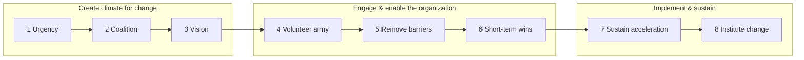
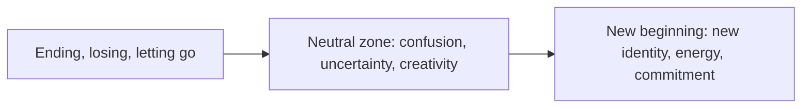

# Change Management

> **TL;DR** — Organizational change fails mostly on the human side. Use structural models to plan (Kotter's 8 steps, Lewin's unfreeze-change-refreeze), individual models to support people (ADKAR, Bridges' transitions, Satir, Kübler-Ross change curve), adoption models to target the right people in the right order (Rogers' diffusion of innovations), and the Heath brothers' Switch (direct the rider, motivate the elephant, shape the path). Treat resistance as information, not opposition.

Related: [Communication & influence](communication-and-stakeholders.md) · [Team design](team-design.md) · [Coaching & consulting](coaching-and-consulting.md) · [Decision making](decision-making.md) · [Enterprise architecture & business](../11-enterprise-architecture-business/README.md) · [Project management](../03-project-management/README.md) · [Agile transformations](../04-agile-kanban-scrum/README.md)

---

## 1. Change models overview

| Model | Level | Focus | Best for |
|---|---|---|---|
| **Lewin** (1947) | Organization | 3 phases: unfreeze → change → refreeze | Simple mental model; explaining change |
| **Kotter 8 steps** (1995/96) | Organization | Leadership-driven top-down process | Large transformations needing sponsorship |
| **ADKAR** (Prosci, Hiatt) | Individual | 5 outcomes each person must reach | Diagnosing where individuals are stuck |
| **Bridges' Transition model** | Individual (psychological) | Endings → neutral zone → new beginnings | Reorgs, losses, identity changes |
| **Satir change model** | Individual/team | Performance dip through chaos | Explaining productivity dip after change |
| **Kübler-Ross change curve** | Individual emotional | Shock → denial → … → acceptance | Anticipating emotional responses |
| **Rogers' Diffusion of Innovations** | Social system | Adopter categories, adoption curve | Rollouts of tools/practices |
| **Switch** (Heath) | Individual & situational | Rider, elephant, path | Designing behavior change |
| **McKinsey 7-S** | Organization | Strategy, structure, systems, shared values, style, staff, skills | Diagnosing alignment |
| **Influencer model** (Grenny et al.) | Behavior | Six sources of influence (personal/social/structural × motivation/ability) | Behavior change |
| **Cynefin-based / emergent change** | Complex systems | Safe-to-fail probes | Culture change, complex domains |

---

## 2. Lewin's three-stage model

Kurt Lewin (1940s). Often presented as below (the strict "freeze" metaphor is a later simplification).

| Stage | Description | Activities |
|---|---|---|
| **Unfreeze** | Create readiness; reduce forces maintaining status quo | Share data on problems; burning platform; involve people in diagnosis; address fears |
| **Change (transition / moving)** | Implement new behaviors, processes, structures | Communicate frequently, train, support, quick wins, empower |
| **Refreeze** | Stabilize new state as the norm | Update policies, metrics, rewards, onboarding docs; celebrate; remove old ways |

### Force field analysis (Lewin)

List **driving forces** (for change) and **restraining forces** (against). Strengthen drivers or — often more effective — weaken restrainers.

| Driving forces | ← Change: adopt trunk-based development → | Restraining forces |
|---|---|---|
| Merge conflicts cost ~1 day/week (4) | | Fear of breaking main (5) |
| Faster feedback (3) | | Lack of feature flag tooling (4) |
| DORA research evidence (2) | | Habits of long-lived branches (3) |
| Leadership support (3) | | Release process requires branches (4) |

(Scores 1–5 = strength.) Actions: introduce feature flags; improve test automation; pilot with one team.

**Caveat:** in continuously changing environments "refreeze" is more "stabilize to the next change"; modern views emphasize continuous adaptation.

---

## 3. Kotter's 8 steps

John Kotter, *Leading Change* (1996), from the 1995 HBR article "Leading Change: Why Transformation Efforts Fail". Updated (*Accelerate*, 2014 — different from the DevOps book) as 8 accelerators running concurrently with a dual operating system (hierarchy + network).

| # | Step | Purpose | Practices in a tech context | Failure mode |
|---|---|---|---|---|
| 1 | **Create a sense of urgency** | Help others see the need for change | Share incident data, competitor moves, customer feedback, cost of delay | Complacency; urgency through fear only |
| 2 | **Build a guiding coalition** | Assemble a group with power, credibility, expertise | Cross-functional: respected engineers, product, exec sponsor | Coalition too weak or too homogeneous |
| 3 | **Form a strategic vision & initiatives** | Clarify how the future differs from the past | One-page vision; target architecture; North Star metric | Vision too complex (can't explain in 5 minutes) |
| 4 | **Enlist a volunteer army** (orig. communicate the vision) | Large numbers of people rallying around | Roadshows, AMAs, demos, champions network | Under-communicating by factor of 10 |
| 5 | **Enable action by removing barriers** | Remove obstacles (structures, processes, bosses) | Change approval process, tooling, budgets, org structure | Ignoring blockers like incentives |
| 6 | **Generate short-term wins** | Visible, unambiguous successes early | Pilot team success in 3 months; publish metrics | No wins within 6–18 months → momentum lost |
| 7 | **Sustain acceleration** (orig. consolidate gains) | Use credibility to change more | Expand to more teams; tackle bigger systems | Declaring victory too soon |
| 8 | **Institute change** (anchor in culture) | Connect new behaviors with success | Update onboarding, career ladders, hiring criteria, rituals | Change dies when sponsor leaves |



**Critiques:** linear and top-down; assumes leaders know the right destination; less suitable for emergent/complex change. Kotter's later work addresses some of this.

---

## 4. ADKAR (Prosci)

Jeff Hiatt / Prosci. Individual change requires five sequential outcomes. Change happens **one person at a time**.

| Element | Question | Tactics | Signs it's missing |
|---|---|---|---|
| **A — Awareness** of the need to change | Do they know **why**? | Sponsor messages, data, business case, "what's the risk of not changing" | "Why are we doing this?"; rumors |
| **D — Desire** to participate and support | Do they **want** to? | WIIFM (what's in it for me), involvement, address concerns, manager conversations | Passive resistance, "wait and see" |
| **K — Knowledge** on how to change | Do they know **how**? | Training, docs, examples, coaching | Errors, uncertainty, workarounds |
| **A — Ability** to implement | **Can** they do it in practice? | Practice time, pairing, tools, reduced load during transition, support desk | Knows the theory, can't apply |
| **R — Reinforcement** to sustain | Will it **stick**? | Recognition, metrics, consequences, remove old system, celebrate | Reverting to old ways |

**Barrier point:** the first element scoring ≤ 3 on a 1–5 scale is where to focus.

**ADKAR assessment template**

| Person / group | A | D | K | A | R | Barrier point | Action |
|---|---|---|---|---|---|---|---|
| Team Payments | 5 | 4 | 2 | — | — | Knowledge | Workshop + pairing on new CI |
| Support team | 3 | 2 | — | — | — | Awareness | Sponsor session on why |

---

## 5. Bridges' Transition Model

William Bridges (*Managing Transitions*, 1991). **Change** is situational (external event); **transition** is psychological (internal process). Change can happen fast; transition takes time.



| Phase | Experience | Leader actions |
|---|---|---|
| **Ending, losing, letting go** | Loss of identity, status, relationships, competence; denial, anger, fear | Acknowledge losses openly; don't argue with feelings; mark the ending (ceremony, "retro of the old team"); respect the past; identify who's losing what |
| **Neutral zone** | In-between; old ways gone, new not yet comfortable; productivity drops; anxiety; but also creativity | Temporary structures and goals; frequent communication; short-term wins; encourage experimentation; check in often |
| **New beginning** | New identity and energy; commitment | Explain the 4Ps: **Purpose**, **Picture** (what it will look like), **Plan** (step by step), **Part** (each person's role); celebrate; reinforce |

**Key question:** "Who is losing what?" — list it explicitly for every change.

---

## 6. Satir Change Model

Virginia Satir (family therapist; applied to software by Jerry Weinberg and others).

| Stage | Description | Performance |
|---|---|---|
| **Late status quo** | Familiar, stable, predictable | Steady |
| **Foreign element** | Something disrupts (new tool, reorg, new member) | — |
| **Chaos** | Unfamiliar, anxiety, old expectations fail | Drops, erratic |
| **Transforming idea** | Insight about how to make it work | Starts rising |
| **Practice & integration** | New skills practiced | Rises |
| **New status quo** | Stable at (hopefully) higher level | Higher steady |

```text
Performance
   ^                                         ______ New status quo
   |  ______ Late status quo               /
   |        \                    ________/  Practice & integration
   |         \  Chaos          /
   |          \___/\__/\_____/  <- Transforming idea
   +-----------------------------------------------------> time
            Foreign element
```

Lesson for stakeholders: **expect a productivity dip** after introducing change (e.g., new framework, team restructure) and plan capacity for it. Don't judge the change during chaos.

---

## 7. Kübler-Ross change curve

Derived from Elisabeth Kübler-Ross' five stages of grief (*On Death and Dying*, 1969), later adapted to organizational change (often 7 stages).

| Stage | Typical expressions | Support |
|---|---|---|
| **Shock** | "What? Really?" | Clear information, time |
| **Denial** | "This won't affect us", "It'll blow over" | Repeat the message, explain why |
| **Frustration / anger** | "This is stupid", blame | Listen, acknowledge, don't argue |
| **Bargaining** | "Can we keep the old system for our team?" | Clarify what's negotiable |
| **Depression / low** | Disengagement, low energy | Support, small wins, check-ins |
| **Experiment** | Trying new ways | Training, encouragement |
| **Decision / acceptance / integration** | "This works", advocacy | Celebrate, involve as champions |

**Caveats:** the original grief model is not empirically validated as a fixed sequence; people don't move linearly and may skip or revisit stages. Use as a vocabulary for emotions, not a prediction.

---

## 8. Diffusion of Innovations (Everett Rogers)

Rogers (1962): how innovations spread through a social system. Adoption follows an S-curve; adopters fall into categories (bell curve):

| Category | Share | Characteristics | How to engage |
|---|---|---|---|
| **Innovators** | ~2.5% | Venturesome, tech-savvy, tolerate failure | Give early access, let them experiment |
| **Early adopters** | ~13.5% | Opinion leaders, respected, judicious | Recruit as champions; their success is your social proof |
| **Early majority** | ~34% | Deliberate, pragmatic; want proof | Case studies, peer references, easy onboarding |
| **Late majority** | ~34% | Skeptical; adopt under pressure or when norm | Make it the default; remove old path; support |
| **Laggards** | ~16% | Traditional, suspicious | Understand objections; sometimes accept |

**Attributes that speed adoption (Rogers):**

| Attribute | Question | Tactic |
|---|---|---|
| **Relative advantage** | Is it better than what I have? | Show measurable benefit |
| **Compatibility** | Does it fit my values, habits, tools? | Integrate with existing workflow |
| **Complexity** (−) | Is it easy to understand/use? | Simplify; paved road; templates |
| **Trialability** | Can I try it without commitment? | Sandboxes, pilots |
| **Observability** | Can I see results in others? | Demos, dashboards, show-and-tell |

**Crossing the Chasm** (Geoffrey Moore): a gap between early adopters (visionaries) and early majority (pragmatists) — pragmatists need references from other pragmatists and a complete solution.

**Internal platform/tool rollout plan using Rogers**

1. Pilot with innovators (1–2 enthusiastic teams).
2. Turn early-adopter teams into references (internal case studies, metrics).
3. Make onboarding trivial for the early majority (templates, docs, migration support).
4. Make it the default for new projects; deprecate old path (late majority).
5. Set sunset dates and support remaining teams (laggards).

---

## 9. Switch (Chip & Dan Heath)

Based on Jonathan Haidt's metaphor: the **Rider** (rational mind) sits on the **Elephant** (emotional mind) on a **Path** (environment).

| Component | Principle | Tactics | Example (adopting code review standards) |
|---|---|---|---|
| **Direct the Rider** | Find the **bright spots** | Study what's already working and clone it | Team X already reviews in < 4 h — how? |
| | Script the **critical moves** | Specific behaviors, not vague goals | "Every PR < 400 lines, reviewed within one working day" |
| | Point to the **destination** | Vivid, concrete goal | "Merge to production the same day" |
| **Motivate the Elephant** | Find the **feeling** | Show, don't just tell; emotional connection | Show customer impact of a bug that slipped |
| | **Shrink the change** | Make first steps small; show progress already made | Start with one repo |
| | **Grow your people** | Build identity and growth mindset | "We're a team that ships quality" |
| **Shape the Path** | **Tweak the environment** | Make the right behavior easy | PR templates, auto-assign reviewers, size linter |
| | **Build habits** | Action triggers, checklists | Review slot after stand-up |
| | **Rally the herd** | Social proof | Dashboard of review times per team |

Core insight: what looks like **resistance** is often **lack of clarity** (rider); what looks like **laziness** is often **exhaustion** (elephant); what looks like a **people problem** is often a **situation problem** (path).

---

## 10. Resistance handling

### 10.1 Reframing resistance

- Resistance is **information** about concerns, costs, or design flaws — and a sign of engagement (apathy is worse).
- Common sources: loss (status, competence, control, relationships), uncertainty, lack of trust in leaders, change fatigue, bad past experiences, real flaws in the plan, unchanged incentives.

### 10.2 Diagnosing resistance

| Source | Signal | Response |
|---|---|---|
| Don't understand (head) | Questions, confusion | Explain why, data, Q&A |
| Don't like it (heart) | Emotional reactions | Listen, acknowledge losses (Bridges), involve |
| Don't trust the leaders | Cynicism, "here we go again" | Consistency, transparency, quick wins, keep promises |
| Can't (ability) | Struggles, errors | Training, time, support (ADKAR K/A) |
| Real flaws | Concrete objections | Adapt the plan; thank them |
| Conflicting incentives | Passive non-adoption | Change metrics, goals, rewards |

(Rick Maurer's three levels: "I don't get it", "I don't like it", "I don't like you".)

### 10.3 Resistance responses — scripts

- "Help me understand what worries you most about this."
- "What would need to be true for this to work for your team?"
- "What are we asking you to give up? Let's name it."
- "If you were designing this, what would you change?"
- "You may be right about that risk — can we design the pilot to test it?"

### 10.4 Kotter & Schlesinger — six approaches to resistance (HBR 1979)

| Approach | Use when | Drawback |
|---|---|---|
| Education & communication | Lack of information | Time-consuming |
| Participation & involvement | Initiators lack information; others have power to resist | Time; poor design if participation is unmanaged |
| Facilitation & support | Resistance due to adjustment problems | Costly; may fail |
| Negotiation & agreement | Someone will clearly lose and has power | Expensive; invites others to negotiate |
| Manipulation & co-optation | Other tactics fail or too expensive | Backfires if discovered — **ethically questionable** |
| Explicit & implicit coercion | Speed essential, initiators have power | Risky; resentment |

---

## 11. Change plan template

```markdown
# Change plan: <Adopt internal developer platform>
## Why (urgency, case for change)
- Data/evidence:
- Cost of not changing:
## Vision (1 paragraph + picture)
## Scope: what changes / what doesn't
## Stakeholders & impact analysis
| Group | What changes for them | What they lose | What they gain | Current ADKAR barrier | Approach |
## Sponsor & guiding coalition
## Approach: pilot → expand → default → sunset (Rogers)
## Communication plan (who, what, channel, when, by whom)
## Training & support (knowledge & ability)
## Quick wins (first 90 days)
## Metrics: adoption, outcomes, sentiment
## Risks & resistance: expected sources, responses
## Reinforcement: policies, onboarding, ladders, recognition
## Review cadence & feedback loops
```

### 11.1 Communication principles during change

- Communicate **7+ times through multiple channels** (repetition is necessary).
- Tell people **what changes for them**, not just the strategy.
- Be honest about what's unknown ("We don't know yet; we'll update by…").
- Middle managers and team leads are the most trusted messengers for their teams — equip them first.
- Two-way: AMAs, feedback surveys, office hours.
- Don't announce reorganizations by email/Friday afternoon without follow-up conversations.

### 11.2 Change metrics

| Metric | Example |
|---|---|
| Adoption | % teams on new platform; active users |
| Proficiency | Error rates, support tickets per user |
| Outcome | Lead time, cost, incident reduction |
| Sentiment | Pulse surveys, eNPS, ADKAR assessments |
| Reversion | % falling back to old process |

---

## 12. Agile / emergent change

- Treat change as a **backlog of experiments**: hypothesis, small change, measure, adapt (see Cynefin complex domain in [decision making](decision-making.md#5-cynefin-framework-dave-snowden)).
- **Invitation over imposition** (e.g., OpenSpace Agility, Daniel Mezick) — invited change has more ownership.
- **Kanban's approach**: "start with what you do now", agree to pursue evolutionary change, respect current roles — reduces resistance.
- Combine: Kotter for sponsorship & urgency; ADKAR for individuals; experiments for content.

---

## 13. When to use / when not

| Model | Use | Avoid |
|---|---|---|
| Kotter | Large, sponsored transformation | Small team-level changes (overkill) |
| ADKAR | Diagnose individual adoption issues | As a bureaucratic tracking tool |
| Bridges | Reorgs, role changes, layoffs, mergers | Ignoring it for "small" changes that affect identity |
| Satir | Explaining dips to stakeholders | — |
| Rogers | Tool/practice rollouts | Forced mandates where adoption isn't voluntary |
| Switch | Behavior change design | Purely structural change |
| Lewin / force field | Quick analysis, workshops | Continuous change contexts (as strict sequence) |

---

## 14. Common mistakes

- Announcing change as a finished decision and calling it "involvement".
- Underestimating communication (once is never enough).
- Ignoring losses — telling people only about gains.
- Mandating tool adoption without making it better than the old way.
- No short-term wins; momentum dies.
- Declaring victory at go-live; no reinforcement → reversion.
- Treating all resisters as obstacles rather than sources of information.
- Changing too many things at once (change fatigue).
- Sponsor disappears after kickoff.

---

## References

- Change management: https://en.wikipedia.org/wiki/Change_management
- Kurt Lewin: https://en.wikipedia.org/wiki/Kurt_Lewin
- Force-field analysis: https://en.wikipedia.org/wiki/Force-field_analysis
- Kotter Inc.: https://www.kotterinc.com/
- John Kotter: https://en.wikipedia.org/wiki/John_Kotter
- Prosci (ADKAR): https://www.prosci.com/
- William Bridges Associates: https://wmbridges.com/
- Virginia Satir: https://en.wikipedia.org/wiki/Virginia_Satir
- Five stages of grief (Kübler-Ross model): https://en.wikipedia.org/wiki/Five_stages_of_grief
- Diffusion of innovations: https://en.wikipedia.org/wiki/Diffusion_of_innovations
- Crossing the Chasm: https://en.wikipedia.org/wiki/Crossing_the_Chasm
- Heath Brothers (Switch): https://heathbrothers.com/
- McKinsey 7S framework: https://en.wikipedia.org/wiki/McKinsey_7S_Framework
- Books: *Leading Change* (Kotter), *Managing Transitions* (Bridges), *ADKAR* (Hiatt), *Switch* (Heath & Heath), *Diffusion of Innovations* (Rogers), *Fearless Change* (Manns & Rising), *Influencer* (Grenny et al.), *Beyond the Wall of Resistance* (Maurer)
