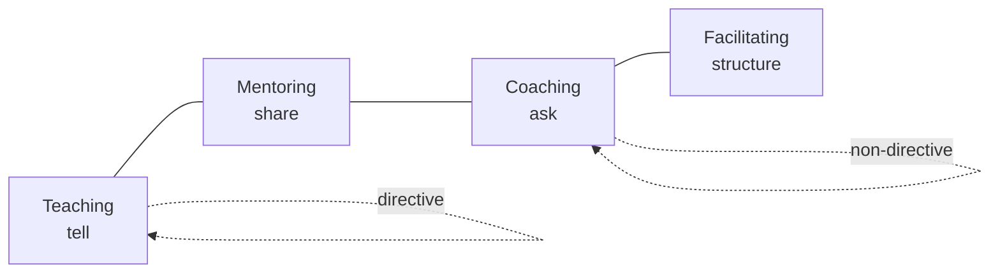
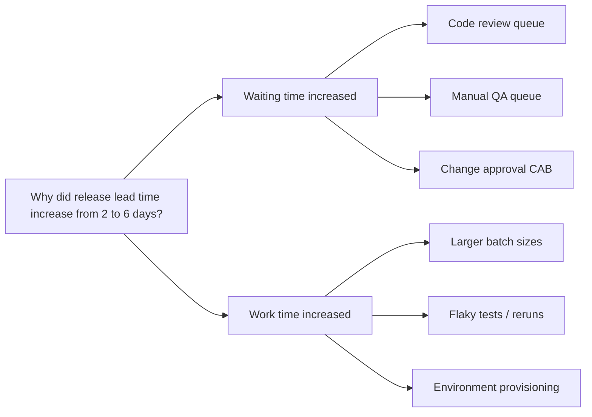

# Coaching, Mentoring and Consulting Skills

> **TL;DR** — Choose your helping stance deliberately: teach (transfer knowledge), mentor (share experience), coach (ask so they find their own answers), consult (diagnose and advise), or facilitate (guide a group process). Coach with GROW and powerful open questions; adapt to skill level (Dreyfus, Shu-Ha-Ri). As a consultant/advisor, build trust ((C+R+I)/S), contract explicitly (Block's Flawless Consulting), structure problems (issue trees, MECE, hypothesis-driven), and find root causes (5 Whys, Ishikawa). Remember Weinberg: there's always a problem, and it's always a people problem.

Related: [Motivation & leadership](motivation-and-leadership.md) · [Feedback & 1:1s](feedback-1on1s-conflict.md) · [Communication & influence](communication-and-stakeholders.md) · [Change management](change-management.md) · [Laws & mental models](../10-laws-principles-mental-models/README.md) · [Enterprise architecture & business](../11-enterprise-architecture-business/README.md)

---

## 1. Helping stances compared

| Stance | Who has the answer? | Focus | Typical question / statement | Use when |
|---|---|---|---|---|
| **Teaching / training** | Teacher | Knowledge & skills transfer | "Here's how X works…" | Novices; knowledge gap |
| **Mentoring** | Mentor (experience) | Career & experience sharing | "When I faced this, I…" | Career growth, navigating org |
| **Coaching** | Coachee | Self-discovery, ownership | "What options do you see?" | Capable person, needs clarity/commitment |
| **Consulting / advising** | Consultant (expertise) | Diagnosis & recommendation | "I recommend X because…" | Expertise lacking; time pressure |
| **Facilitating** | The group | Process for group decisions | "How do we want to decide?" | Group alignment |
| **Counseling / therapy** | — (professional) | Emotional/psychological issues | — | **Refer to professionals** |
| **Sponsoring** | Sponsor (influence) | Advocacy, opportunities | "I'll put your name forward" | Career advancement, especially underrepresented groups |
| **Managing** | Manager (accountability) | Performance & outcomes | "This needs to be done by Friday" | Accountability required |

Agile coaching competency framework (Lyssa Adkins & Michael Spayd): teaching, mentoring, professional coaching, facilitating — plus technical, business, and transformation mastery. Switch stances explicitly: "Do you want me to coach you on this, or shall I share what I'd do?"



---

## 2. Coaching

### 2.1 GROW model

Sir John Whitmore et al. (1980s; *Coaching for Performance*).

| Stage | Purpose | Questions |
|---|---|---|
| **G — Goal** | What do you want? (session goal + long-term goal) | What would you like to achieve from this conversation? What would success look like? How will you know you've achieved it? Why is that important to you? |
| **R — Reality** | Where are you now? Facts, not judgements | What's happening now? What have you tried? What's stopping you? Who else is involved? On a scale 1–10, where are you? What's in your control? |
| **O — Options** | What could you do? | What options do you have? What else? (×3) What would you do if you had no constraints? What would someone you admire do? What are the pros/cons of each? |
| **W — Will / Way forward** | What will you do? | Which option will you choose? What's the first step? When? What might get in the way? What support do you need? How committed are you, 1–10? What would make it a 10? |

Related models: **TGROW** (Topic first), **OSKAR** (Outcome, Scaling, Know-how, Affirm+Action, Review — solution-focused), **CLEAR** (Contracting, Listening, Exploring, Action, Review), **CIGAR**.

### 2.2 Powerful questions

Characteristics: open-ended, short, curious, future-focused, not leading, often start with "What" or "How" (avoid "Why" when it may sound accusatory).

**Question bank**

*Opening & focus*
- What's on your mind?
- What would be most useful to talk about?
- What's the real challenge here for you?

*Exploring*
- And what else? (Michael Bungay Stanier's "AWE" question)
- What's important about that?
- What are you assuming?
- What's the story you're telling yourself?
- What's the cost of not acting?
- What do you know for sure?

*Perspective*
- How would [stakeholder] describe this?
- If you were advising a friend, what would you say?
- What will this look like in a year?
- What would you do if you knew you couldn't fail?

*Options & action*
- What's one small step you could take tomorrow?
- What would need to be true for that to work?
- What will you say no to, to make room for this?

*Reflection & learning*
- What did you learn about yourself?
- What would you do differently next time?
- What was most useful in this conversation? (Bungay Stanier's "learning question")

### 2.3 The Coaching Habit — seven questions (Michael Bungay Stanier)

1. **Kickstart:** What's on your mind?
2. **AWE:** And what else?
3. **Focus:** What's the real challenge here for you?
4. **Foundation:** What do you want?
5. **Lazy:** How can I help?
6. **Strategic:** If you're saying yes to this, what are you saying no to?
7. **Learning:** What was most useful for you?

Tame the "advice monster" — the urge to jump to solutions.

### 2.4 Coaching session structure (30–45 min)

| Phase | Time | Content |
|---|---|---|
| Contract | 3 min | Topic, desired outcome, how you'll work |
| Explore (G-R) | 15 min | Goal and reality questions; active listening |
| Options | 10 min | Generate ≥ 3 options |
| Commit | 5 min | Next steps, obstacles, support |
| Reflect | 2 min | What was useful? |

### 2.5 Coaching dos and don'ts

| Do | Don't |
|---|---|
| Listen at level 2–3 (see [active listening](communication-and-stakeholders.md#9-active-listening)) | Interrupt with solutions |
| Hold silence | Ask multiple questions at once |
| Reflect back words and emotions | Ask leading questions ("Have you considered…?" is advice in disguise) |
| Trust the coachee is resourceful | Coach when someone needs direct help (outage!) |
| Ask permission before giving advice | Coach on topics needing therapy |

---

## 3. Skill acquisition models

### 3.1 Dreyfus model of skill acquisition

Stuart & Hubert Dreyfus (1980). Applied to software by Andy Hunt (*Pragmatic Thinking and Learning*).

| Stage | Characteristics | Needs | Leader approach |
|---|---|---|---|
| **Novice** | Follows context-free rules; no discretionary judgement | Recipes, checklists, quick wins | Teach; S1 directing |
| **Advanced beginner** | Starts recognizing situational aspects; limited big picture | Guidelines, examples, frequent feedback | Teach + mentor |
| **Competent** | Plans deliberately, prioritizes, troubleshoots; feels responsible | Goals and autonomy within boundaries | Mentor + coach |
| **Proficient** | Sees holistic picture; learns from experience; self-corrects | Context, freedom, reflection | Coach |
| **Expert** | Intuition-based; doesn't follow rules; knows what's important | Freedom; challenging problems; voice in decisions | Delegate; coach/peer |

Implications: rigid rules frustrate experts; lack of rules overwhelms novices. Most people are advanced beginners in most skills. Experts may struggle to teach (they've lost the rules).

### 3.2 Shu-Ha-Ri

Japanese martial arts concept (popularized in agile by Alistair Cockburn and others).

| Stage | Meaning | Learner behavior | Teaching approach |
|---|---|---|---|
| **Shu** (守, protect/obey) | Follow the rules / form exactly | Learns one way; copies the master | Prescribe practices; explain lightly |
| **Ha** (破, detach/break) | Understand principles; adapt; learn other schools | Questions, experiments, integrates | Explain why; discuss alternatives |
| **Ri** (離, leave/transcend) | Create own approach; rules internalized | Innovates | Peer; learns from them |

Example: a new Scrum team follows the Scrum Guide by the book (Shu), then adapts ceremonies to context (Ha), and eventually designs its own way of working grounded in principles (Ri).

### 3.3 Other learning models

| Model | Idea |
|---|---|
| **Conscious competence** (four stages) | Unconscious incompetence → conscious incompetence → conscious competence → unconscious competence |
| **Kolb's experiential learning cycle** | Concrete experience → reflective observation → abstract conceptualization → active experimentation |
| **70-20-10** | ~70% learning from on-the-job experience, 20% from others, 10% formal training (heuristic, weak evidence) |
| **Bloom's taxonomy (revised)** | Remember → Understand → Apply → Analyze → Evaluate → Create |
| **Training from the BACK of the Room** (Sharon Bowman) | 4Cs: Connections, Concepts, Concrete practice, Conclusions |
| **Deliberate practice** (Ericsson) | Focused practice at edge of ability with feedback |

---

## 4. Mentoring

### 4.1 Mentoring agreement template

```markdown
- Mentor / mentee:
- Goals of the mentorship (mentee-defined):
- Cadence & duration: e.g., every 2 weeks, 6 months
- Format: 45 min call; mentee sets agenda
- Confidentiality:
- How we'll give each other feedback:
- Review point: after 3 months — continue, adjust, or close
```

### 4.2 Mentoring session question bank

- What's one win and one struggle since we last met?
- What decision are you facing?
- What skill do you want to develop next, and how could you practice it?
- Who in the org should you get to know?
- What's something you want to try but are hesitant about?

### 4.3 Mentoring formats

| Format | Description |
|---|---|
| 1:1 traditional | Senior mentors junior |
| Reverse mentoring | Junior mentors senior (new tech, culture, perspective) |
| Peer mentoring / circles | Group of peers support each other (e.g., Troika Consulting) |
| Pairing / mob programming | Mentoring embedded in work |
| Communities of practice | Guilds, chapters, brown-bags |

---

## 5. Consulting skills

### 5.1 The Trusted Advisor — the trust equation

Maister, Green & Galford (2000).

**Trust = (Credibility + Reliability + Intimacy) / Self-orientation**

| Component | Meaning | Build it by | Destroyed by |
|---|---|---|---|
| **Credibility** | Words — can I believe what they say? | Expertise, honesty, saying "I don't know" | Bluffing, exaggeration |
| **Reliability** | Actions — can I depend on them? | Keeping small promises, consistency, follow-up | Missed commitments, surprises |
| **Intimacy** | Emotions — do I feel safe sharing with them? | Discretion, empathy, listening | Breaking confidences, coldness |
| **Self-orientation** (denominator) | Focus — whose interest are they serving? | Focus on client's problem, listening, curiosity | Selling, need to look smart, finishing others' sentences |

Self-orientation has the biggest effect: being focused on yourself (billable hours, being right, appearing clever) destroys trust fastest.

**Trust-creation process (five steps):** Engage → Listen → Frame (the problem) → Envision (a different reality) → Commit.

### 5.2 Flawless Consulting (Peter Block)

Consultant = anyone who has influence but **no direct control** — including internal staff roles (architects, IT coordinators, HR, finance). Every consultation balances technical skills, interpersonal skills, and consulting skills.

**Five phases**

| Phase | Key activities | Key outputs / questions |
|---|---|---|
| **1. Entry & contracting** | Initial contact; explore the problem; set expectations; agree on roles; address concerns about exposure and control | Explicit contract: client's wants, consultant's wants, boundaries, deliverables, timeline, support needed |
| **2. Discovery & dialogue (data collection & diagnosis)** | Collect data on the presenting problem and how it's managed (the "how"); identify underlying problems | Picture of the situation; "What is the real problem?" |
| **3. Feedback & decision to act** | Feed data back in a way the client can use; manage resistance; decide on action | Decision on what to do |
| **4. Engagement & implementation** | Carry out the plan (often with client's people); involve stakeholders | Implementation |
| **5. Extension, recycle, or termination** | Evaluate; decide whether to extend, recycle phases, or end | Learning; next steps |

**Contracting essentials**

- Contract = explicit agreement on what the consultant and client **expect from each other** and how they'll work together.
- Ask: "What do you want from me?" and state "Here's what I want from you" (wants and needs both directions — access, time, sponsorship).
- Discuss the client's concerns about **control** and **exposure** openly.
- Re-contract when scope changes.
- Authenticity: put into words what you're experiencing ("I'm sensing hesitation about involving your team — is that right?").

**Handling resistance (Block)**

- Resistance is an emotional reaction to losing control or feeling vulnerable; it's not about logic.
- Forms: flood of detail, time pressure ("we're too busy"), impracticality, "I'm not surprised", attack, confusion, silence, intellectualizing, moralizing, compliance, methodology questioning, "flight into health", pressing for solutions.
- Three steps: (1) **identify** the form, (2) **name** it neutrally and non-punitively ("You're giving me a lot of detail; I'm unsure what's most important to you"), (3) **be quiet** and let the client respond.

### 5.3 Weinberg — The Secrets of Consulting (selected laws, paraphrased)

Gerald M. Weinberg (1985).

| Law / rule | Paraphrase | Lesson |
|---|---|---|
| **First Law of Consulting** | In spite of what your client may tell you, there's always a problem. | Dig gently |
| **Second Law** | No matter how it looks at first, it's always a people problem. | Look beyond technology |
| **Third Law** | Never forget they're paying you by the hour, not by the solution. | Mind incentives & ethics |
| **Rule of Three** | If you can't think of three things that might go wrong with your plans, there's something wrong with your thinking. | Consider alternatives |
| **Ten Percent Promise** | Never promise more than ten percent improvement. | Large promises trigger resistance |
| **Marvin's Law** | If they didn't hire you, you can't help them. | Need a real client & contract |
| **The Credit Rule** | You'll never accomplish anything if you care who gets the credit. | Let client own it |
| **Lone Ranger** | Leave before the client is fully satisfied — they'll then learn to solve problems | Build client capability |
| **Orange Juice Test** | Can the client really commit to the resources needed? | Test commitment |
| **Rudy's Rutabaga Rule** | Once you eliminate your number one problem, number two gets a promotion. | Problems never end |
| **Weinberg's Law of Twins** | Most of the time, for most of the world, no matter how hard people work at it, nothing of any significance happens. | Change is hard; be patient |
| **The Bolden Rule** | If you can't fix it, feature it. | Reframe limitations |

### 5.4 Consulting engagement checklist

- [ ] Who is the client (decision-maker, sponsor, users)?
- [ ] What's the presenting problem vs suspected underlying problem?
- [ ] Contract: deliverables, roles, timeline, access, decision rights, confidentiality.
- [ ] Stakeholder map & interviews scheduled.
- [ ] Hypotheses formed early; data plan to test them.
- [ ] Interim feedback session (no surprises at the end).
- [ ] Recommendation with options, trade-offs, and implementation plan.
- [ ] Knowledge transfer: client can continue without you.
- [ ] Close-out: lessons learned, follow-up date.

---

## 6. Structured problem solving

### 6.1 MECE

**Mutually Exclusive, Collectively Exhaustive** — categories don't overlap and together cover everything. Used in McKinsey-style problem structuring.

| Not MECE | MECE |
|---|---|
| Cost drivers: cloud, salaries, AWS, overhead | Cost drivers: people costs, infrastructure costs (cloud, on-prem), licenses, other |
| Users: new users, mobile users, power users | Users by tenure: new (< 30 days), established |

Common MECE frameworks: revenue = price × volume; profit = revenue − cost; internal vs external; people / process / technology; now / later; 4Ps; value chain steps.

### 6.2 Issue trees

Decompose a problem into sub-questions until each leaf is answerable/actionable.

| Type | Root | Example |
|---|---|---|
| **Diagnostic (why) tree** | "Why is X happening?" | Why did checkout conversion drop? |
| **Solution (how) tree** | "How can we achieve Y?" | How can we reduce cloud cost 20%? |
| **Hypothesis tree** | "Y is true because…" | Conversion dropped because of payment latency |



### 6.3 Hypothesis-driven problem solving

1. **Define the problem** precisely (SMART problem statement; "What decision will this inform?").
2. **Structure** with an issue tree (MECE).
3. **Prioritize** branches (impact × ease; 80/20).
4. **Form hypotheses** early ("Day 1 answer").
5. **Plan analyses** to prove/disprove each hypothesis (what data, from whom, by when).
6. **Gather data & analyze**; kill hypotheses fast.
7. **Synthesize** — "So what?" — into a pyramid (see [Minto](communication-and-stakeholders.md#1-minto-pyramid-principle)).
8. **Communicate** recommendations.

**Problem statement template:** "How can [who] achieve [measurable goal] by [time], given [constraints], so that [decision/impact]?"

**Risk:** confirmation bias — actively seek disconfirming evidence.

### 6.4 5 Whys

Taiichi Ohno (Toyota Production System). Ask "why?" iteratively (around five times) to move from symptom to root cause.

| # | Question | Answer |
|---|---|---|
| 1 | Why did the site go down? | The database ran out of connections. |
| 2 | Why? | A new service opened connections without pooling. |
| 3 | Why? | The service template didn't include a pool config. |
| 4 | Why? | The template hasn't been updated since the DB migration. |
| 5 | Why? | No owner for templates; no review process. → **Root cause & fix: assign platform ownership + template checks** |

**Caveats:** can lead to a single linear cause when there are many contributing factors; answers depend on who's asking; stop at causes you can act on; never end at "human error" — ask why the system allowed it. For incidents, combine with blameless postmortems and contributing-factor analysis.

### 6.5 Ishikawa (fishbone) diagram

Kaoru Ishikawa (1960s). Cause-and-effect diagram: the problem is the "head"; categories are "bones".

Common category sets:

| Domain | Categories |
|---|---|
| Manufacturing (6M) | Man/People, Machine, Method, Material, Measurement, Mother Nature/Environment |
| Service (4S / 8P) | Surroundings, Suppliers, Systems, Skills / Product, Price, Place, Promotion, People, Process, Physical evidence, Productivity |
| Software (adapted) | People, Process, Tools/Tech, Code, Environment/Infra, Requirements, External dependencies |

```text
 People ──────┐    Process ─────┐    Tools ─────┐
  - on-call    \    - no review  \    - flaky CI \
  fatigue       \   of configs    \               \
                 ───────────────────────────────────► [Production outage]
                /                 /               /
  Environment  /   Code          /  Requirements  /
  - DB limits ┘   - no pooling ─┘   - unclear SLA┘
```

**How to run:** state the effect precisely → choose categories → brainstorm causes per category (silent writing first) → ask "why" on each cause → vote on most likely root causes → verify with data.

### 6.6 Other problem-solving tools

| Tool | Use |
|---|---|
| **A3 thinking** (Toyota) | One A3 page: background, current state, goal, root cause, countermeasures, plan, follow-up |
| **PDCA** (Deming) | Plan-Do-Check-Act improvement cycle |
| **Pareto chart** | Focus on the vital few causes |
| **Fault tree analysis** | Top-down failure logic (AND/OR gates) |
| **Current Reality Tree** (Goldratt) | Theory of Constraints causal mapping |
| **Kepner-Tregoe** | Situation, problem, decision, potential problem analysis |
| **Iceberg model** (systems thinking) | Events → patterns → structures → mental models |
| **First principles** | Break down to fundamentals |

See also [Laws, principles & mental models](../10-laws-principles-mental-models/README.md).

---

## 7. When to use / when not

| Tool | Use | Don't |
|---|---|---|
| Coaching (GROW) | Capable people with ownership | Emergencies; novices needing instruction |
| Mentoring | Career navigation, experience transfer | When mentee needs sponsorship (act!) |
| Consulting stance | Expertise gap, need for recommendation | When client capability-building is the goal (coach/teach) |
| Issue trees / MECE | Complicated, analyzable problems | Complex (Cynefin) problems — probe instead |
| 5 Whys | Simple-to-moderate incidents | Complex multi-causal failures alone |
| Ishikawa | Brainstorming causes in groups | Without data verification |

---

## 8. Common mistakes

- Coaching when someone needs an answer (frustrating), or telling when they need to own it (dependency).
- "Questions" that are hidden advice.
- Consulting without a clear contract → scope creep, unclear success.
- Delivering a big-bang final report full of surprises.
- Ignoring the people side of a technical problem (Weinberg's second law).
- Issue trees that aren't MECE → double counting or missed causes.
- 5 Whys ending at "human error".
- Trying to be the hero instead of building the client's capability.

---

## References

- GROW model: https://en.wikipedia.org/wiki/GROW_model
- Coaching: https://en.wikipedia.org/wiki/Coaching
- Mentorship: https://en.wikipedia.org/wiki/Mentorship
- Dreyfus model of skill acquisition: https://en.wikipedia.org/wiki/Dreyfus_model_of_skill_acquisition
- Shuhari: https://en.wikipedia.org/wiki/Shuhari
- Four stages of competence: https://en.wikipedia.org/wiki/Four_stages_of_competence
- Kolb's experiential learning: https://en.wikipedia.org/wiki/Experiential_learning
- Bloom's taxonomy: https://en.wikipedia.org/wiki/Bloom%27s_taxonomy
- Trusted Advisor Associates (trust equation): https://trustedadvisor.com/
- Peter Block (Flawless Consulting): https://www.peterblock.com/
- Gerald Weinberg: https://en.wikipedia.org/wiki/Gerald_Weinberg
- MECE principle: https://en.wikipedia.org/wiki/MECE_principle
- Issue tree: https://en.wikipedia.org/wiki/Issue_tree
- Five whys: https://en.wikipedia.org/wiki/Five_whys
- Ishikawa diagram: https://en.wikipedia.org/wiki/Ishikawa_diagram
- PDCA: https://en.wikipedia.org/wiki/PDCA
- A3 problem solving: https://en.wikipedia.org/wiki/A3_problem_solving
- Box of Crayons (The Coaching Habit): https://www.boxofcrayons.com/
- International Coaching Federation: https://coachingfederation.org/
- Books: *Coaching for Performance* (Whitmore), *The Coaching Habit* (Bungay Stanier), *Coaching Agile Teams* (Adkins), *The Trusted Advisor* (Maister, Green, Galford), *Flawless Consulting* (Block), *The Secrets of Consulting* (Weinberg), *The McKinsey Way* (Rasiel), *Bulletproof Problem Solving* (Conn & McLean), *Pragmatic Thinking and Learning* (Hunt)
