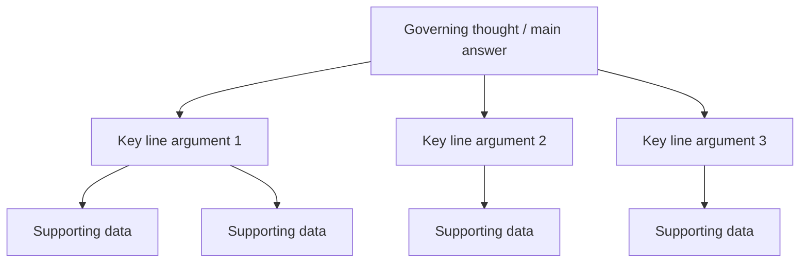

# Communication, Stakeholder Translation and Influence

> **TL;DR** — Lead with the answer (BLUF, Minto Pyramid), structure arguments top-down (SCQA, MECE), write narratives for important decisions (Amazon-style memos), translate technical issues into business terms (risk, cost, time, revenue, customer), and tell stories with data. Map stakeholders and tailor messages. Influence without authority by building trust and using ethical persuasion (Cialdini); negotiate on interests, not positions (Getting to Yes, BATNA). Adapt to cultural differences (Hofstede, Erin Meyer's Culture Map) without stereotyping.

Related: [Meetings & async](meetings-async-and-effectiveness.md) · [Coaching & consulting](coaching-and-consulting.md) · [Change management](change-management.md) · [Product management (stakeholder mapping)](../02-product-management/README.md) · [Project management](../03-project-management/README.md) · [Enterprise architecture & business](../11-enterprise-architecture-business/README.md)

---

## 1. Minto Pyramid Principle

Barbara Minto (McKinsey, 1970s): **start with the answer**, then group and order supporting arguments.



**Rules**

1. Ideas at any level summarize the ideas grouped below them.
2. Ideas in each group are the **same kind** of idea (e.g., all reasons, all steps).
3. Ideas in each group are **logically ordered** (time, structure, or importance).
4. Groups should be **MECE** — mutually exclusive, collectively exhaustive.

**Vertical logic:** each level answers the "why?/how?" question raised by the level above.
**Horizontal logic:** either **deductive** (A is true, B follows, so C) or **inductive** (A, B, C are similar points → conclusion). Prefer inductive for business communication — easier to follow.

### 1.1 SCQA introduction

| Element | Purpose | Example |
|---|---|---|
| **S**ituation | Uncontroversial context the audience agrees with | "Our order platform handles 40k orders/day and is growing 30% YoY." |
| **C**omplication | What changed / problem | "At Black Friday we hit database limits; checkout failed for 2 hours, costing ~€250k." |
| **Q**uestion | The question this raises (often implicit) | "How do we make checkout reliable for next peak season?" |
| **A**nswer | Your recommendation (governing thought) | "Invest 2 teams × 3 months to split the order database and add load testing — est. €180k, protecting ~€1M peak revenue." |

Variants: **SCR** (Situation, Complication, Resolution), **PSB** (Problem, Solution, Benefit), **"What? So what? Now what?"**.

---

## 2. BLUF — Bottom Line Up Front

Military writing convention: put the conclusion/request in the first sentence(s).

**Email template**

```text
Subject: [Decision needed by Fri] Approve €12k for load-testing tooling

BLUF: Please approve €12k for a load-testing tool so we can validate peak capacity before November.

Background: (2–3 sentences)
Options considered: (bullets)
Recommendation & why: (bullets)
Risk if we don't: (1–2 sentences)
Next step: reply "approved" or let's discuss 15 min on Thursday.
```

**Subject-line prefixes:** `[Action]`, `[Decision]`, `[FYI]`, `[Request]`, `[Urgent]` — set expectations instantly.

### 2.1 Executive summary rules

- One page max (or 3–5 sentences at the top of a long doc).
- Answer first, then the 3 main reasons, then the ask.
- Numbers with units and comparison ("€180k, ~0.5% of annual revenue").
- No jargon; define unavoidable terms.
- Make the decision explicit: "We need X from you by Y."
- State confidence and key uncertainties.

---

## 3. Writing for decisions: Amazon-style narrative memos

- Amazon replaced slide decks in senior meetings with **narrative memos** (commonly "6-pagers"; also 1–2 page memos). Meetings begin with **silent reading** (~20–30 min), then discussion.
- Rationale: narrative forces complete reasoning; slides allow gaps hidden behind bullets; reading together ensures everyone has the same context.

**6-pager outline (common structure; varies by use)**

1. **Introduction / purpose** — what is this memo for, what decision is requested.
2. **Goals / tenets** — principles guiding the decision.
3. **State of the business / context** — data, current state.
4. **Lessons learned** — what worked, what didn't.
5. **Strategic priorities / proposal** — what we plan to do, why, options considered.
6. **Risks & mitigations, resources, timeline.**
7. **FAQ** (internal / external).
8. **Appendices** — data tables, details (don't count toward page limit).

**Working Backwards / PR-FAQ:** write the future press release and FAQs before building a product to test customer value — see [product management](../02-product-management/README.md).

**Writing checklist**

- [ ] Can I state the main point in one sentence?
- [ ] Data replaces adjectives ("latency dropped from 800 ms to 120 ms", not "much faster").
- [ ] Short sentences, active voice, no weasel words ("significantly", "nearly all").
- [ ] Counterarguments addressed.
- [ ] Someone outside the team can understand it.

---

## 4. Translating technical topics for business stakeholders

### 4.1 Translation table

| Technical concept | Business framing |
|---|---|
| Technical debt | Interest payments: every feature costs X% more; risk of outages; slower time-to-market |
| Refactoring | Renovating the kitchen while still cooking — enables faster future changes |
| Test automation | Insurance + speed: fewer incidents, faster releases |
| Scalability | Ability to handle growth (e.g., peak sales) without lost revenue |
| Security vulnerability | Probability × impact of breach: fines (GDPR up to 4% global turnover), reputation, downtime |
| Observability | Time to detect & fix problems → minutes of lost revenue |
| Microservices | Teams ship independently → more parallel delivery; but higher operating cost |
| Cloud migration | CapEx → OpEx; elasticity; possible cost increase if not managed |
| Latency | Conversion: slower pages → fewer purchases |
| Legacy system | Key-person risk, vendor-support end dates, inability to change |

### 4.2 Explaining technical debt

- **Metaphor** (Ward Cunningham's original): shipping first-time code is like going into debt; a little debt speeds development as long as it's paid back by rewriting; the interest is the extra effort on every change.
- **Martin Fowler's technical debt quadrant:** reckless/prudent × deliberate/inadvertent.

| | Reckless | Prudent |
|---|---|---|
| **Deliberate** | "We don't have time for design" | "We must ship now and deal with consequences" |
| **Inadvertent** | "What's layering?" | "Now we know how we should have done it" |

**Business case structure for debt reduction**

```text
1. Symptom the business feels: "Feature X took 6 weeks instead of 2; 3 incidents last quarter."
2. Cause in plain language: "The billing module is tangled; every change risks breaking invoices."
3. Cost of doing nothing: "~30% of team capacity goes to workarounds (~€X/yr); incident risk at quarter-end."
4. Proposal: "Spend 20% of capacity for 2 quarters on targeted cleanup."
5. Expected benefit (measurable): "Lead time for billing changes from 6 → 2 weeks; incidents −50%."
6. How we'll report progress: monthly metric update.
```

Useful metrics: lead time for changes, change failure rate, time spent on unplanned work, incident counts, onboarding time, cost of delay.

### 4.3 Communicating risk and uncertainty

- Give ranges with confidence ("6–10 weeks, 80% confidence"), not single points.
- Separate known facts, assumptions, and unknowns.
- Express risk as likelihood × impact in the stakeholder's units (money, customers, compliance).
- Offer options with trade-offs (scope / time / cost / quality) — not just "no".

### 4.4 Saying no (or "not now")

- "Yes, and here's what it would cost / displace." (make trade-offs visible)
- "Not now — here's when and what would need to change."
- "Here's an alternative that gets you 80% of the value for 20% of the effort."

---

## 5. Storytelling with data

Based on Cole Nussbaumer Knaflic (*Storytelling with Data*) and general practice:

1. **Understand the context** — who is the audience, what do you want them to know or do? Write the "Big Idea" in one sentence.
2. **Choose an appropriate visual** — simple text for 1–2 numbers; line for trends; bar for comparisons; avoid pie/3D charts; tables for lookups.
3. **Eliminate clutter** — remove borders, gridlines, redundant labels; increase data-ink ratio (Tufte).
4. **Focus attention** — use color/bold sparingly to highlight what matters (preattentive attributes).
5. **Think like a designer** — alignment, white space, accessible color.
6. **Tell a story** — beginning (context), middle (tension/insight), end (call to action).

**Chart title = the takeaway:** "Checkout errors tripled after the March release" instead of "Errors per week".

---

## 6. Stakeholder mapping and management

See full treatment in [product management](../02-product-management/README.md) and [project management](../03-project-management/README.md). Summary:

### 6.1 Power/Interest grid (Mendelow)

| | Low interest | High interest |
|---|---|---|
| **High power** | **Keep satisfied** — concise updates, consult on major decisions | **Manage closely** — involve, co-create, frequent contact |
| **Low power** | **Monitor** — minimal effort | **Keep informed** — regular updates, demos, newsletters |

### 6.2 Stakeholder analysis template

| Stakeholder | Role | Interest / what they care about | Influence | Current stance (−2..+2) | Desired stance | Key concerns | Communication (channel, frequency, owner) |
|---|---|---|---|---|---|---|---|
| CFO | Budget | Cost predictability | High | −1 | +1 | Cloud cost growth | Monthly 1-page cost report, CTO |

### 6.3 Communication plan per audience

| Audience | Wants | Format | Frequency |
|---|---|---|---|
| Executives | Outcomes, risks, decisions needed | 1-page summary / dashboard, BLUF | Monthly / on events |
| Product / business | Timelines, scope, trade-offs | Roadmap reviews, demos | Bi-weekly |
| Engineers | Context, why, technical details | RFCs, design docs, Slack | Continuous |
| Customers / users | What changes for them | Release notes, webinars | Per release |
| Operations / support | What to expect, runbooks | Briefings, docs | Per release |

---

## 7. Negotiation — Getting to Yes

Fisher, Ury (and Patton) — Harvard Negotiation Project, **principled negotiation**:

| Principle | Meaning | Engineering example |
|---|---|---|
| **Separate the people from the problem** | Relationship and substance are distinct; attack the problem, not the person | "Let's look at the timeline together" vs "You always underestimate" |
| **Focus on interests, not positions** | Positions = what they say they want; interests = why | Position: "Release on 1 Nov". Interest: "Be ready for the sales conference" → maybe a demo subset suffices |
| **Invent options for mutual gain** | Brainstorm before deciding; expand the pie | Phased release, feature flags, beta for key client |
| **Insist on objective criteria** | Use fair standards (market data, benchmarks, precedent) | DORA benchmarks, vendor pricing, historical velocity |
| **Know your BATNA** | Best Alternative To a Negotiated Agreement — your walk-away power | If vendor won't agree on SLA, BATNA = alternative vendor or in-house |

**Related concepts**

- **ZOPA** — Zone Of Possible Agreement (overlap between parties' reservation points).
- **Reservation point** — worst acceptable deal.
- **Anchoring** — first offer influences outcome; anchor with justified, ambitious number.
- **Never Split the Difference** (Chris Voss): tactical empathy, labeling ("It seems like…"), mirroring (repeat last 1–3 words), calibrated "how/what" questions ("How am I supposed to do that?"), accusation audit, seek "that's right".

**Negotiation prep sheet**

```markdown
- Issue:
- My interests (ranked):
- Their likely interests:
- My BATNA: | Their BATNA (estimate):
- My reservation point: | Target:
- Objective criteria to reference:
- Options for mutual gain:
- Concessions I can trade (cheap for me, valuable for them):
- Questions to ask:
```

---

## 8. Influence without authority

### 8.1 Cialdini's 7 principles of persuasion

| Principle | Meaning | Ethical use in tech |
|---|---|---|
| **Reciprocity** | People repay what they receive | Help other teams first (review their PRs, share tools) |
| **Commitment & consistency** | People act consistently with prior commitments | Get small, public agreements (e.g., agree on principles, then on solutions) |
| **Social proof** | People follow what similar others do | "Three other teams already use this platform; here are their results" |
| **Authority** | People defer to credible experts | Cite DORA research, vendor docs, involve a respected architect |
| **Liking** | People say yes to those they like | Build relationships, find common ground, genuine compliments |
| **Scarcity** | Limited availability increases value | Honest deadlines ("vendor discount ends Q4") |
| **Unity** (added 2016, *Pre-Suasion*) | Shared identity ("we") | "We, as engineers of this platform, …" |

Use ethically: truthful scarcity, real social proof; manipulation erodes trust (and the trust equation).

### 8.2 Cohen & Bradford — Influence Without Authority ("currencies")

Exchange model: identify what the other values ("currencies") and offer it in return for what you need.

| Currency type | Examples |
|---|---|
| Inspiration-related | Vision, excellence, moral correctness |
| Task-related | Resources, assistance, cooperation, information |
| Position-related | Recognition, visibility, reputation, network |
| Relationship-related | Understanding, acceptance, personal support |
| Personal-related | Gratitude, ownership, self-concept |

### 8.3 Practical influence tactics

- **Pre-wire** (nemawashi): talk to key stakeholders 1:1 before the big meeting.
- Frame proposals in **their** goals.
- Use **pilots** to reduce perceived risk.
- Provide **options** (people prefer choosing to being told).
- Make it easy: draft the doc, the PR, the email for them.
- Give credit away generously.
- Persist with patience; follow up in writing.

---

## 9. Active listening

| Technique | Example |
|---|---|
| Attending (non-verbal) | Eye contact, nodding, no laptop/phone |
| Paraphrasing | "So what you're saying is the deadline matters because of the audit?" |
| Reflecting feelings | "It sounds like you're frustrated with the number of hand-offs." |
| Clarifying questions | "What do you mean by 'unstable'?" |
| Summarizing | "Let me recap the three concerns I heard…" |
| Silence | Pause 3–5 seconds before answering |
| Open questions | "What's most important to you here?" |
| Withhold judgement / solutions | Don't jump to fix; ask "Do you want ideas or a sounding board?" |

**Levels of listening** (Co-Active coaching model): Level 1 internal (listening to own thoughts), Level 2 focused (on the other), Level 3 global (whole context, energy, unsaid).

---

## 10. Communication styles and channels

### 10.1 Communication styles

| Style | Traits | Effect |
|---|---|---|
| Assertive | Clear, respectful, states needs | Best default |
| Passive | Avoids expressing needs | Resentment, unaddressed issues |
| Aggressive | Dominating, blaming | Fear, defensiveness |
| Passive-aggressive | Indirect hostility, sarcasm | Erodes trust |

Social-styles models (Merrill & Reid: Driver, Expressive, Amiable, Analytical) and DISC map similar preferences — e.g., Drivers want bottom line; Analyticals want data; Amiables want relationship & safety; Expressives want vision & recognition.

### 10.2 Channel choice

| Message | Best channel |
|---|---|
| Complex, emotional, sensitive | Face-to-face / video |
| Decision needing record | Written (doc + meeting) |
| Quick question | Chat |
| Status | Async written update / dashboard |
| Broad announcement | Written + Q&A session |
| Bad news to an individual | Private conversation first, then writing |

---

## 11. Presentation structure

**Structure for a stakeholder presentation (15–20 min)**

1. **Hook / BLUF** — the one thing to remember + ask.
2. **Context (SCQA)** — situation & complication.
3. **3 key points** (rule of three), each with evidence.
4. **Options & recommendation** — with trade-offs.
5. **Risks & mitigations.**
6. **Ask / next steps** — explicit decision, owner, date.
7. **Q&A** — prepare likely questions; have an appendix.

**Tips**

- One message per slide; slide title = takeaway sentence.
- Max ~3 numbers per slide.
- Rehearse with a timer; cut 20%.
- Open with the conclusion; close by repeating it.
- For executives: assume you'll get 5 minutes, not 20; have the "elevator" version.
- Tell → show → tell again.

**Demo do's:** scripted path, test data prepared, backup video, explain the user value, not the clicks.

---

## 12. Cross-cultural communication

Use cultural models as **starting hypotheses** about tendencies, never as stereotypes about individuals. Individuals vary greatly; organizational culture and personal experience matter as much as national culture.

### 12.1 Hofstede's cultural dimensions

| Dimension | Low end | High end |
|---|---|---|
| **Power Distance** | Flat hierarchy, challenging bosses is normal | Hierarchy accepted, deference to seniors |
| **Individualism vs Collectivism** | Collective/group loyalty | Individual achievement |
| **Masculinity vs Femininity** (Motivation towards achievement and success) | Consensus, quality of life, modesty | Competition, achievement, assertiveness |
| **Uncertainty Avoidance** | Comfortable with ambiguity, fewer rules | Prefers rules, structure, planning |
| **Long-term Orientation** | Tradition, short-term | Pragmatic, future-oriented, persistence |
| **Indulgence vs Restraint** | Restraint, strict norms | Gratification of desires, leisure |

Indicative tendencies often reported for the Netherlands and Poland (consult [Hofstede Insights country comparison](https://www.hofstede-insights.com/) for current scores):

| Dimension | Netherlands (tendency) | Poland (tendency) |
|---|---|---|
| Power distance | Low — egalitarian, managers are accessible | Higher — more respect for hierarchy and titles |
| Individualism | High | Moderate–high |
| Masculinity/achievement | Low (feminine) — consensus, work-life balance | Higher — achievement and competition |
| Uncertainty avoidance | Moderate | High — preference for rules, clarity, detailed plans |
| Long-term orientation | Higher | Moderate |
| Indulgence | Higher | Lower |

### 12.2 Erin Meyer — The Culture Map (8 scales)

| Scale | One end | Other end |
|---|---|---|
| **Communicating** | Low-context (explicit, literal, repeat in writing) | High-context (implicit, read between the lines) |
| **Evaluating** (negative feedback) | Direct negative feedback | Indirect negative feedback |
| **Persuading** | Principles-first (deductive, theory then conclusion) | Applications-first (inductive, examples then conclusion) — another dimension: holistic thinking (Asia) |
| **Leading** | Egalitarian | Hierarchical |
| **Deciding** | Consensual | Top-down |
| **Trusting** | Task-based (trust from reliable work) | Relationship-based (trust from personal bonds) |
| **Disagreeing** | Confrontational (open debate is positive) | Avoids confrontation |
| **Scheduling** | Linear-time (punctual, sequential) | Flexible-time (adaptable, fluid) |

**Practical neutral observations often discussed for international teams (tendencies, not rules):**

- Dutch business culture is often described as very **direct** in feedback and disagreement, egalitarian, and **consensual** in deciding ("polder model") — decisions may take longer but are then executed with commitment. Agendas and punctuality are generally valued.
- Polish business culture is often described as relatively direct in negative feedback, more **hierarchical** in leadership and more **top-down** in decisions than the Netherlands, with relationship-building mattering for trust; formal titles may be used more in initial contacts.
- When cultures with different "deciding" norms meet: clarify the decision method explicitly (see [decision making](decision-making.md)).
- When cultures with different "evaluating" norms meet: agree explicitly on how feedback will be given; directness may read as rudeness, indirectness as evasiveness.
- Low-context communication (written summaries, explicit action items) works best as the default for international/remote teams.

### 12.3 Working in international teams — checklist

- [ ] Write down decisions and action items (low-context default).
- [ ] Agree on feedback norms explicitly.
- [ ] Avoid idioms, sarcasm, and humor that relies on language nuances.
- [ ] Rotate meeting times across time zones.
- [ ] Clarify "yes" — does it mean agreement or "I heard you"?
- [ ] Invest in relationship-building (informal calls, offsites) for relationship-based trusters.
- [ ] Use structured facilitation so quieter or hierarchy-respecting members speak (1-2-4-All, rounds).

---

## 13. Common mistakes

- Burying the ask at the end of a long email.
- Explaining *how* (technology) when stakeholders need *what it means* (impact).
- Single-point estimates presented as commitments.
- Slides full of text read aloud.
- Using fear (outage stories) without quantified impact or options.
- Treating "no response" as agreement.
- Applying cultural stereotypes to individuals.
- Negotiating positions ("we need 3 months") instead of exploring interests.

---

## References

- Barbara Minto (Pyramid Principle): https://www.barbaraminto.com/
- BLUF: https://en.wikipedia.org/wiki/BLUF_(communication)
- MECE principle: https://en.wikipedia.org/wiki/MECE_principle
- Technical debt: https://en.wikipedia.org/wiki/Technical_debt
- Martin Fowler — Technical Debt Quadrant: https://martinfowler.com/bliki/TechnicalDebtQuadrant.html
- Storytelling with Data: https://www.storytellingwithdata.com/
- Edward Tufte: https://www.edwardtufte.com/
- Stakeholder analysis: https://en.wikipedia.org/wiki/Stakeholder_analysis
- Getting to Yes: https://en.wikipedia.org/wiki/Getting_to_Yes
- BATNA: https://en.wikipedia.org/wiki/Best_alternative_to_a_negotiated_agreement
- Harvard Program on Negotiation: https://www.pon.harvard.edu/
- Robert Cialdini: https://en.wikipedia.org/wiki/Robert_Cialdini
- Influence at Work (Cialdini): https://www.influenceatwork.com/
- Active listening: https://en.wikipedia.org/wiki/Active_listening
- Hofstede's cultural dimensions theory: https://en.wikipedia.org/wiki/Hofstede%27s_cultural_dimensions_theory
- Hofstede Insights: https://www.hofstede-insights.com/
- Erin Meyer (The Culture Map): https://erinmeyer.com/
- High-context and low-context cultures: https://en.wikipedia.org/wiki/High-context_and_low-context_cultures
- Books: *The Pyramid Principle* (Minto), *Storytelling with Data* (Knaflic), *Getting to Yes* (Fisher & Ury), *Influence* (Cialdini), *Never Split the Difference* (Voss), *The Culture Map* (Meyer), *Influence Without Authority* (Cohen & Bradford)
