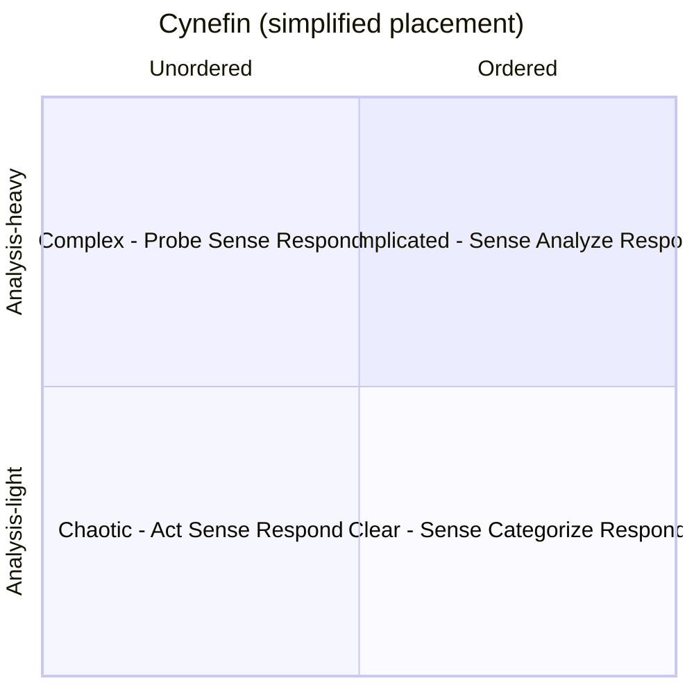
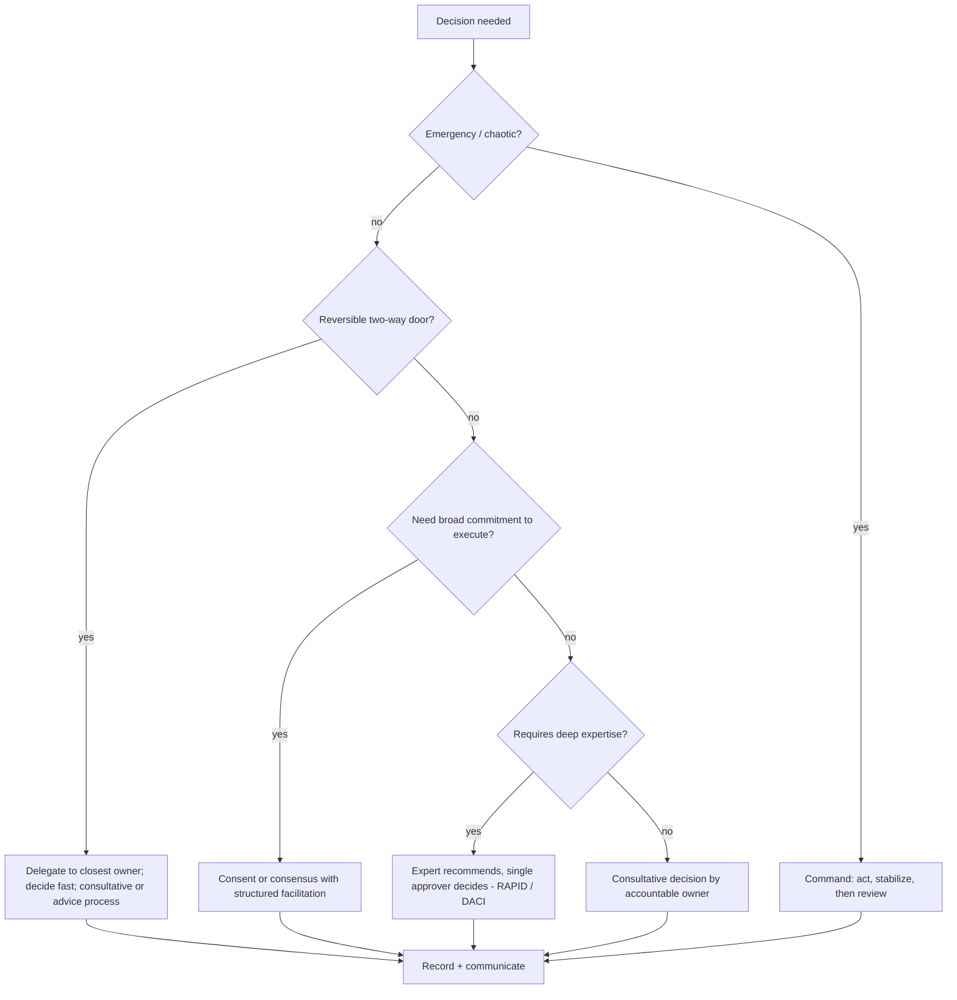

# Decision Making in Teams and Organizations

> **TL;DR** — Most decision pain comes from unclear **decision rights**, not hard choices. Make the decider explicit (RAPID, DACI), choose the right group process for the stakes (consent, consensus, advice process, autocratic), match speed to reversibility (one-way vs two-way doors), match method to context (Cynefin), and record decisions (decision log, ADRs). Once decided, disagree and commit.

Related: [Motivation & delegation](motivation-and-leadership.md#3-delegation) · [Workshop facilitation](workshop-facilitation.md) · [Software architecture / ADRs](../05-software-architecture/README.md) · [Laws & mental models](../10-laws-principles-mental-models/README.md) · [Project management](../03-project-management/README.md)

---

## 1. Decision-making checklist

- [ ] What exactly is being decided? (Write the question.)
- [ ] Why now? What's the deadline / cost of delay?
- [ ] Who decides? Who must be consulted? Who must be informed?
- [ ] Reversible or irreversible? (Door type)
- [ ] What context? (Cynefin domain)
- [ ] What options exist? (At least 3, including "do nothing")
- [ ] What criteria, and how weighted?
- [ ] What information is missing; is it worth waiting for?
- [ ] What decision method will we use (and announce it upfront)?
- [ ] How will we record and communicate the decision?
- [ ] When will we review it?

---

## 2. Decision-rights frameworks

### 2.1 RAPID (Bain & Company)

| Role | Meaning |
|---|---|
| **R**ecommend | Proposes the decision; gathers input and data; does the analysis |
| **A**gree | Must agree (formal veto, e.g., legal, compliance); use sparingly |
| **P**erform | Executes once decided |
| **I**nput | Consulted for facts/views; not binding |
| **D**ecide | Single point of accountability; makes the final call |

(The letters are not in process order: typically R gathers I, negotiates with A, D decides, P executes.)

### 2.2 DACI (popularized by Intuit; Atlassian Team Playbook)

| Role | Meaning | Count |
|---|---|---|
| **D**river | Drives the process, gathers info, schedules, ensures decision is made | 1 |
| **A**pprover | Makes the decision | **1** |
| **C**ontributors | Have knowledge; consulted | Several |
| **I**nformed | Told of the outcome | Many |

**DACI decision doc template**

```markdown
# Decision: <Choose message broker for order events>
| Status | Not started / In progress / Decided |
| Driver | @alice |
| Approver | @bob |
| Contributors | @carol @dave |
| Informed | #team-orders, platform team |
| Due date | 2026-11-15 |
| Outcome | (fill when decided) |

## Background
## Relevant data
## Options considered
| | Option A: Kafka | Option B: RabbitMQ | Option C: Cloud-native queue |
|---|---|---|---|
| Description | | | |
| Pros | | | |
| Cons | | | |
| Cost | | | |
| Effort | | | |
## Action items
## Outcome & rationale
```

### 2.3 RACI (for tasks, not decisions)

**R**esponsible (does), **A**ccountable (owns, one person), **C**onsulted, **I**nformed. Useful for activities in projects; for decisions prefer DACI/RAPID. See [project management](../03-project-management/README.md).

### 2.4 Comparison

| Framework | Best for | Watch out |
|---|---|---|
| RAPID | Cross-functional, high-stakes org decisions | Too many "A"s create gridlock |
| DACI | Product/engineering decisions; lightweight docs | Driver ≠ Approver confusion |
| RACI | Task responsibility mapping | Used for decisions → too many "C"s |
| Delegation levels | Leader–team decision rights | Must be honored |
| Advice process | Decentralized, self-managing orgs | Requires maturity, trust |

---

## 3. Group decision methods

| Method | How | Speed | Buy-in | Use when |
|---|---|---|---|---|
| **Autocratic / command** | One person decides | Very fast | Low–medium | Emergencies; clear expertise; low stakes |
| **Consultative** | Decider gathers input, then decides | Fast–medium | Medium–high | Most leadership decisions |
| **Majority vote** | >50% wins | Fast | Medium (minority may disengage) | Low stakes, many options, formal bodies |
| **Consensus** | Everyone agrees (or can live with it) | Slow | Highest (if achieved) | Small group, high commitment needed, values-level |
| **Consent** (sociocracy) | Proceed unless someone has a reasoned, paramount objection | Medium | High | "Good enough for now, safe enough to try" |
| **Advice process** | Anyone can decide after seeking advice from affected people & experts | Fast–medium | High | Self-managing teams, distributed authority |
| **Delegation to subgroup** | A smaller group decides | Medium | Medium | Specialist topics |
| **Random / lottery** | Coin flip | Instant | Low | Truly equal options, trivial decisions |

### 3.1 Consent vs consensus

| | Consensus | Consent |
|---|---|---|
| Question | "Do we all agree this is the best?" | "Is there a reason this would cause harm or move us backwards? Is it safe enough to try?" |
| Standard | Agreement / preference | Within range of tolerance |
| Veto | Any preference can block | Only reasoned objections tied to the aim |
| Speed | Slow | Faster |
| Outcome | "Best" (in theory) | "Good enough for now, safe enough to try" + review date |

**Sociocracy consent process (integrative decision making):**

1. **Present proposal** (by proposer).
2. **Clarifying questions** (rounds; no opinions yet).
3. **Quick reactions** (round; brief).
4. **Amend / clarify** (proposer may adjust).
5. **Objection round**: "Do you have an objection?" — objections must be reasoned and relate to the aim.
6. **Integrate objections** — modify proposal to address them.
7. **Celebrate** consent; set review date.

### 3.2 Advice process

From Dennis Bakke (AES) and popularized in *Reinventing Organizations* (Frederic Laloux).

1. Someone notices an issue/opportunity and takes initiative (or a decision owner is designated).
2. Decision-maker seeks advice from: everyone **meaningfully affected** and people with **expertise**.
3. Advice is considered seriously, but **the decision-maker decides**.
4. Decision is communicated to those who gave advice and those affected.

Guardrails: define what decisions require it (e.g., spending > threshold); bigger decisions → more advice. Works well for architecture changes when paired with RFCs/ADRs.

### 3.3 Quick consensus-check tools

| Tool | How |
|---|---|
| **Fist of Five** | 0 = block, 1 = major concerns, 2 = minor concerns to discuss, 3 = ok, 4 = good, 5 = champion. Any 0–2 → discuss |
| **Thumbs (Roman vote)** | Up = support, sideways = can live with it, down = object |
| **Gradients of agreement** (Kaner) | 8-point scale from "wholehearted endorsement" to "veto" |
| **Dot voting** | Multi-option prioritization — see [workshop facilitation](workshop-facilitation.md#8-convergence-and-voting-tools) |
| **Confidence vote** | 1–5 confidence in plan (Scrum PI planning) |

---

## 4. Reversible vs irreversible decisions (one-way vs two-way doors)

From Jeff Bezos' 2015 shareholder letter (paraphrased):

| | Type 1 — one-way door | Type 2 — two-way door |
|---|---|---|
| Nature | Consequential, irreversible or nearly so | Changeable, reversible |
| Process | Slow, careful, deliberate, consultation | Fast, by individuals or small groups with good judgement |
| Examples | Choosing a primary database for core data, public API contract, vendor lock-in contracts, layoffs, brand change | Library choice behind an interface, feature flag rollout, team meeting cadence, UI copy |
| Danger | Treating Type 2 as Type 1 → slowness, risk aversion; Treating Type 1 as Type 2 → irrecoverable mistakes | |

**Make doors two-way:** feature flags, abstraction layers, pilots, canary releases, time-boxed experiments, contracts with exit clauses.

Bezos also: many decisions should be made with ~**70%** of the information you wish you had; waiting for 90% is usually too slow.

---

## 5. Cynefin framework (Dave Snowden)

Sense-making framework: the nature of the situation determines the decision approach.

| Domain | Cause-effect | Approach | Practice type | Decision guidance | Example |
|---|---|---|---|---|---|
| **Clear** (formerly Simple/Obvious) | Obvious to all | **Sense → Categorize → Respond** | Best practice | Follow the procedure; delegate | Password reset, standard deployment |
| **Complicated** | Knowable with expertise/analysis | **Sense → Analyze → Respond** | Good practices (several) | Ask experts; analyze options | Performance tuning, choosing a DB |
| **Complex** | Only clear in retrospect; emergent | **Probe → Sense → Respond** | Emergent practice | Safe-to-fail experiments; amplify what works | New product market fit, culture change, team design |
| **Chaotic** | No perceivable relation | **Act → Sense → Respond** | Novel practice | Stabilize first, command style | Major production outage, security breach |
| **Confusion** (Disorder / Aporetic) | Unknown which domain | Break the situation into parts | — | Gather info to classify | — |

Note: the boundary between Clear and Chaotic is a "cliff" — complacency in Clear can tip into Chaotic.



**Safe-to-fail probe design (complex domain):**

- Several probes in parallel, some contradictory.
- Define amplification (if it works) and dampening (if it fails) signals upfront.
- Small, cheap, time-boxed.

---

## 6. OODA loop (John Boyd)

**Observe → Orient → Decide → Act**, repeated. Originated in military strategy (fighter pilot combat).

| Phase | Meaning | In engineering |
|---|---|---|
| Observe | Gather raw information | Metrics, logs, user feedback, market |
| Orient | Interpret through mental models, culture, experience (the most important phase) | Incident triage, hypothesis formation |
| Decide | Choose a course of action (hypothesis) | Select mitigation / approach |
| Act | Execute, then observe effects | Roll back, deploy fix, ship experiment |

Key insight: **faster, better-oriented loops** than competitors win; orientation (mental models) shapes everything. Related loops: PDCA (Deming), Build-Measure-Learn (Lean Startup).

---

## 7. Analytical decision tools

### 7.1 Weighted decision matrix

1. List options (rows) and criteria (columns).
2. Weight criteria (sum to 100% or 1–5).
3. Score each option per criterion (1–5), ideally independently by several people.
4. Multiply and sum; discuss surprises — the matrix supports judgement, it doesn't replace it.

| Criteria (weight) | Cost (25%) | Team skills (20%) | Scalability (20%) | Operational effort (20%) | Vendor lock-in (15%) | **Total** |
|---|---|---|---|---|---|---|
| Option A | 4 → 1.00 | 5 → 1.00 | 3 → 0.60 | 4 → 0.80 | 3 → 0.45 | **3.85** |
| Option B | 3 → 0.75 | 2 → 0.40 | 5 → 1.00 | 3 → 0.60 | 2 → 0.30 | **3.05** |
| Option C | 5 → 1.25 | 3 → 0.60 | 2 → 0.40 | 2 → 0.40 | 5 → 0.75 | **3.40** |

Variants: **Pugh matrix** (compare to a baseline: +/0/−), **Eisenhower** (urgency/importance — see [personal effectiveness](meetings-async-and-effectiveness.md#7-personal-effectiveness)), **pros/cons/fixes**, **cost-benefit**, **expected value**.

### 7.2 Six Thinking Hats (Edward de Bono)

Parallel thinking: everyone wears the same hat at the same time.

| Hat | Focus | Prompt |
|---|---|---|
| **White** | Facts, data, information gaps | "What do we know? What do we need to know?" |
| **Red** | Feelings, intuition, gut (no justification needed) | "How do we feel about this?" |
| **Black** | Caution, risks, why it may fail | "What could go wrong?" |
| **Yellow** | Benefits, optimism, value | "What are the benefits?" |
| **Green** | Creativity, alternatives, new ideas | "What else could we do?" |
| **Blue** | Process control, meta-thinking, summary | "Where are we? What next?" (facilitator) |

Typical sequence for evaluating a proposal: Blue → White → Green → Yellow → Black → Red → Blue. Keep Red short (30 s each).

### 7.3 Other tools

| Tool | Purpose |
|---|---|
| **Pre-mortem** (Gary Klein) | "Imagine it's a year from now and it failed. Why?" — surfaces risks safely |
| **Second-order thinking** | "And then what?" |
| **Inversion** | "What would guarantee failure?" (see TRIZ in [Liberating Structures](facilitation-methods-catalog.md#1-liberating-structures)) |
| **10/10/10** (Suzy Welch) | How will we feel in 10 minutes, 10 months, 10 years? |
| **Regret minimization** | Which choice will I regret less? |
| **WRAP** (Heath brothers, *Decisive*) | Widen options, Reality-test assumptions, Attain distance, Prepare to be wrong |
| **Cost of delay** | Quantify urgency for prioritization (see [product management](../02-product-management/README.md)) |
| **Red team / devil's advocate** | Deliberate challenge to avoid groupthink |

---

## 8. Cognitive biases in group decisions

| Bias | Effect | Countermeasure |
|---|---|---|
| Groupthink | Harmony over critical evaluation | Silent individual input first; devil's advocate; leader speaks last |
| Anchoring | First number/idea dominates | Independent estimates (Planning Poker style) |
| HiPPO (highest-paid person's opinion) | Seniority wins | Data, anonymous input, leader speaks last |
| Sunk cost | Continue because of past investment | Ask "Would we start this today?" |
| Confirmation bias | Seek supporting evidence | Assign someone to argue opposite; pre-mortem |
| Availability | Recent/vivid events overweighted | Base rates, data |
| Overconfidence / planning fallacy | Underestimate time/risk | Reference-class forecasting |
| Status quo bias | Prefer current state | Make "do nothing" an explicit option with costs |
| Abilene paradox | Group agrees to something nobody wants | Check privately; "Is this what we really want?" |

See also [Laws, principles & mental models](../10-laws-principles-mental-models/README.md).

---

## 9. Disagree and commit

- Origin: Intel (Andy Grove), popularized by Amazon's leadership principles ("Have Backbone; Disagree and Commit").
- **Before** the decision: voice disagreement openly, with data and conviction.
- **After** the decision: commit fully — no sabotage, no "I told you so", no relitigating without new information.
- Leaders can also disagree and commit to the team's choice.
- Requirements: genuine hearing of dissent; clear decider; known re-evaluation triggers.

**Script:** "I see it differently because of X and Y. I'd still like us to move forward with your approach; let's check metric Z in four weeks and revisit if it's below threshold."

---

## 10. Recording decisions

### 10.1 Decision log (team level)

| ID | Date | Decision | Context / why | Decider | Alternatives considered | Review date | Link |
|---|---|---|---|---|---|---|---|
| D-012 | 2026-10-01 | Adopt trunk-based development | Merge pain, slow releases | Team (consent) | GitFlow, release branches | 2027-01 | ADR-034 |

### 10.2 Architecture Decision Records

For technical decisions, use ADRs (Michael Nygard format: Title, Status, Context, Decision, Consequences) — see [software architecture section](../05-software-architecture/README.md) and [adr.github.io](https://adr.github.io/).

### 10.3 Communicating decisions

- What was decided, why, who decided, what alternatives were rejected and why, what changes for whom, when it will be reviewed.
- Use [BLUF](communication-and-stakeholders.md#2-bluf--bottom-line-up-front) for the announcement.

---

## 11. Choosing a decision approach — guide



---

## 12. When to use / when not

| Method | Use | Don't |
|---|---|---|
| Consensus | Team values, working agreements, small team | Large groups; urgent issues |
| Consent | Policies, process changes, team structure | When one person is accountable by law |
| Advice process | Mature self-managing teams | Low-trust environments without guardrails |
| Majority vote | Many options, low stakes | Divisive topics — losing minority disengages |
| Weighted matrix | Comparable options with clear criteria | Value-laden choices disguised as math |
| Six Thinking Hats | Stuck debates, mixed emotions/facts | Simple choices |

---

## 13. Common mistakes

- Not announcing how a decision will be made before discussing it ("I thought we were voting!").
- Pseudo-consultation: decision already made, input requested for show.
- Multiple approvers; nobody can say who decides.
- Reopening decisions without new information.
- Treating every decision as a one-way door.
- Not recording decisions — leads to repeated debates and lost context.
- Using consensus in large groups → lowest-common-denominator outcomes.

---

## References

- Bain RAPID: https://www.bain.com/
- Atlassian Team Playbook (DACI): https://www.atlassian.com/team-playbook
- Responsibility assignment matrix (RACI): https://en.wikipedia.org/wiki/Responsibility_assignment_matrix
- Sociocracy: https://en.wikipedia.org/wiki/Sociocracy
- Sociocracy For All: https://www.sociocracyforall.org/
- Consensus decision-making: https://en.wikipedia.org/wiki/Consensus_decision-making
- Cynefin framework: https://en.wikipedia.org/wiki/Cynefin_framework
- The Cynefin Co: https://thecynefin.co/
- OODA loop: https://en.wikipedia.org/wiki/OODA_loop
- Six Thinking Hats: https://en.wikipedia.org/wiki/Six_Thinking_Hats
- Decision matrix: https://en.wikipedia.org/wiki/Decision_matrix
- Pugh method: https://en.wikipedia.org/wiki/Pugh_method
- Pre-mortem: https://en.wikipedia.org/wiki/Pre-mortem
- Groupthink: https://en.wikipedia.org/wiki/Groupthink
- Abilene paradox: https://en.wikipedia.org/wiki/Abilene_paradox
- Amazon leadership principles: https://www.amazon.jobs/content/en/our-workplace/leadership-principles
- ADR resources: https://adr.github.io/
- Heath brothers (*Decisive*): https://heathbrothers.com/
- Books: *Reinventing Organizations* (Laloux), *Facilitator's Guide to Participatory Decision-Making* (Kaner), *Decisive* (Heath & Heath), *Thinking, Fast and Slow* (Kahneman)
