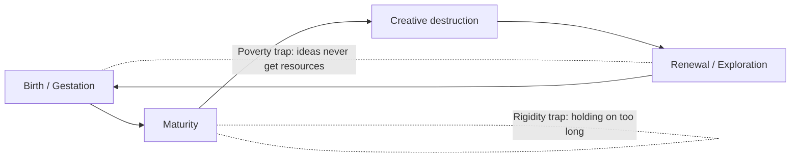
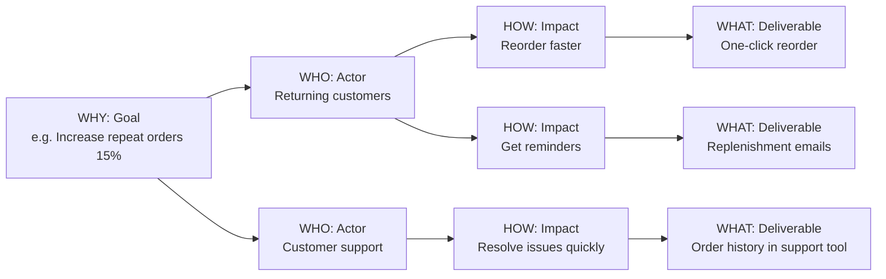

# Facilitation Methods Catalog

> **TL;DR** — A reference of proven group methods: ~25 Liberating Structures (small, repeatable micro-structures that include everyone), Gamestorming games, and larger formats — Design Sprint, Lean Coffee, World Café, Open Space, Event Storming, Impact Mapping, Story Mapping. Pick a method by purpose (connect, explore, generate, decide, plan, reflect), group size, and time.

Related: [Workshop facilitation](workshop-facilitation.md) · [Decision making](decision-making.md) · [Software architecture (DDD/Event Storming)](../05-software-architecture/README.md) · [Product management (discovery, story mapping)](../02-product-management/README.md) · [UX (design thinking)](../01-ux-ui/README.md) · [Agile (retrospectives)](../04-agile-kanban-scrum/README.md)

---

## 0. Method selector

| Purpose | Small group (3–12) | Large group (12–100+) |
|---|---|---|
| Connect / warm up | Impromptu Networking, Check-in, Personal Maps | Impromptu Networking, Mad Tea |
| Explore a problem | 1-2-4-All, Troika Consulting, Five Whys, Six Thinking Hats | World Café, Conversation Café, Open Space |
| Generate ideas | Brainwriting, 1-2-4-All, TRIZ, Crazy 8s | 25/10 Crowd Sourcing, 1-2-4-All |
| Prioritize / decide | Dot voting, Impact/Effort, Min Specs, Fist of Five | 25/10, Dot voting |
| Plan & act | 15% Solutions, Who-What-When, Story Mapping | Open Space action sessions, Celebrity Interview |
| Reflect / learn | What So What Now What, retrospectives, Ecocycle | What So What Now What (with 1-2-4-All), Conversation Café |
| Understand a domain | Event Storming, Impact Mapping | Big-picture Event Storming |
| Validate a product idea | Design Sprint | — |
| Strategy | Ecocycle, Panarchy, Purpose-To-Practice | Open Space, World Café |

---

## 1. Liberating Structures

Developed by Henri Lipmanowicz and Keith McCandless. 33 structures (plus many "string" combinations) designed to replace conventional structures (presentations, managed discussions, open discussions, status reports, brainstorms) which either over-control or under-structure, so that everyone is included. Each structure specifies five design elements: **structuring invitation, space arrangement, participation distribution, group configuration, sequence of steps & time allocation.**

Source: [liberatingstructures.com](https://www.liberatingstructures.com/).

### 1.1 Key structures

| # | Structure | Purpose | Time | How (summary) |
|---|---|---|---|---|
| 1 | **1-2-4-All** | Engage everyone in generating ideas/questions | ~12 min | 1 min alone → 2 min pairs → 4 min foursomes → 5 min whole group shares standout ideas |
| 2 | **Impromptu Networking** | Rapidly connect people & surface challenges | ~20 min | 3 rounds of pairs, 2 min each person per round, answering 2 questions ("What big challenge do you bring?", "What do you hope to get?") |
| 3 | **Nine Whys** | Clarify purpose of work | ~20 min | Pairs ask "Why is that important to you?" up to nine times |
| 4 | **Wicked Questions** | Surface paradoxical challenges | ~15 min | Form "How is it that we are both X and Y?" questions |
| 5 | **Appreciative Interviews** | Discover success root causes | ~60 min | Pairs tell stories of success; groups find patterns |
| 6 | **Troika Consulting** | Get practical help from peers quickly | ~30 min | Trios: client explains challenge (2 min), consultants ask questions (3 min), client turns back while consultants discuss (5 min), client shares what was useful (2 min); rotate |
| 7 | **What, So What, Now What? (W³)** | Reflect together on shared experience and decide next steps | ~45 min | Sequence: What happened (facts)? So what (patterns, implications)? Now what (actions)? Use with 1-2-4-All each step |
| 8 | **Discovery & Action Dialogue (DAD)** | Discover existing local solutions (positive deviance) | ~25–70 min | Seven questions to find who already succeeds and how |
| 9 | **Shift & Share** | Spread innovations across groups | ~90 min | Stations present innovations to rotating small groups |
| 10 | **25/10 Crowd Sourcing** | Rapidly generate and sift bold ideas | ~30 min | Everyone writes bold idea + first step on card; cards passed and scored 1–5, five rounds; top 10 shared |
| 11 | **Wise Crowds** | Tap group's wisdom for individual challenges | ~15 min per person | Client + consultants, larger than Troika |
| 12 | **Min Specs** | Specify only the must-dos/must-not-dos | ~35 min | List all possible rules → remove each that isn't absolutely required to achieve purpose |
| 13 | **Improv Prototyping** | Develop solutions to chronic challenges via role-play | ~20 min/round | Act out scenarios, iterate |
| 14 | **Helping Heuristics** | Practice progressive methods of helping | ~15 min | Practice quiet presence, questions, guidance |
| 15 | **Conversation Café** | Make sense of shocking/challenging situations | ~35–60 min | Small groups with talking object, rounds |
| 16 | **User Experience Fishbowl** | Share know-how from experience with large group | ~35–70 min | Inner circle of experienced people talks; outer circle listens, then asks |
| 17 | **Heard, Seen, Respected (HSR)** | Practice deep listening and empathy | ~35 min | Tell story of not being heard; partner listens |
| 18 | **Drawing Together** | Reveal insights via symbols | ~40 min | Express challenge with five symbols |
| 19 | **Design StoryBoards** | Define step-by-step elements for productive working sessions | ~25–70 min | Design meeting/workshop together |
| 20 | **Celebrity Interview** | Reconnect experience of leaders/experts with daily work | ~35–60 min | Interviewer asks prepared + audience questions |
| 21 | **Social Network Webbing** | Map informal connections and decide how to strengthen | ~60 min | Map people inside & outside around a challenge |
| 22 | **Agreement-Certainty Matrix** | Sort challenges into simple, complicated, complex, chaotic | ~30 min | Plot challenges on agreement × certainty axes (relates to Cynefin) |
| 23 | **Simple Ethnography** | Observe and record actual behaviors of users | ~70 min+ | Field observation |
| 24 | **Generative Relationships (STAR)** | Reveal relationship patterns that create surprising value | ~25 min | Assess Separateness, Tuning, Action, Reason |
| 25 | **Critical Uncertainties** | Develop strategies for plausible futures | ~1–2 h | 2×2 of key uncertainties → scenarios → strategies |
| 26 | **Ecocycle Planning** | Analyze full portfolio of activities; identify obstacles and opportunities | ~95 min | Place activities on ecocycle (birth, maturity, creative destruction, renewal); spot rigidity and poverty traps |
| 27 | **Panarchy** | Understand how embedded systems interact | ~2 h | Multi-level systems mapping |
| 28 | **Purpose-To-Practice (P2P)** | Design a resilient initiative | ~2 h | Five elements: purpose, principles, participants, structure, practices |
| 29 | **Integrated~Autonomy** | Move from either-or to robust both-and solutions | ~1–2 h | Explore tensions (centralized vs decentralized) |
| 30 | **TRIZ** | Stop counterproductive activities to make room for innovation | ~35 min | (1) "What would guarantee the worst possible result?" (2) "Which of these do we currently do?" (3) "What first step will we take to stop it?" |
| 31 | **15% Solutions** | Discover and focus on what each person has the freedom and resources to do now | ~20 min | "What is your 15% — where do you have discretion to act without more resources or authority?" alone → pairs/trios consult |
| 32 | **What I Need From You (WINFY)** | Surface essential needs across functions and accept/reject requests | ~55–70 min | Groups state needs to other groups; responses: yes / no / I'll try / whatever |
| 33 | **Open Space Technology** | Liberate inherent action and leadership in large groups | 90 min–3 days | See [Open Space](#open-space-technology) |

### 1.2 Ecocycle detail



Steps: list all activities individually → pairs place them on the ecocycle (figure-8) → whole group compiles → discuss what to let go of (creative destruction), what to invest in (birth), what's stuck in traps.

### 1.3 Strings (combining structures)

| Goal | String |
|---|---|
| Team retrospective | Impromptu Networking → What So What Now What (with 1-2-4-All) → 15% Solutions |
| Kill bad habits | TRIZ → 1-2-4-All on "first steps" → 15% Solutions |
| Strategy offsite | Ecocycle → Critical Uncertainties → 25/10 Crowd Sourcing → Min Specs |
| Peer coaching session | Impromptu Networking → Troika Consulting → 15% Solutions |
| Cross-team friction | WINFY → Min Specs (for collaboration rules) |
| Big-group kickoff | Impromptu Networking → Nine Whys → 1-2-4-All on "What makes this hard?" |

---

## 2. Gamestorming

From *Gamestorming* (Dave Gray, Sunni Brown, James Macanufo, 2010). Source: [gamestorming.com](https://gamestorming.com/).

**Game structure:** **Opening** (divergent: generate ideas) → **Exploring** (emergent: examine, experiment) → **Closing** (convergent: decide). Games have a **goal**, **boundaries** (time, space, rules), **artifacts**, and a **game world**.

### 2.1 Popular games

| Game | Phase | Purpose | How |
|---|---|---|---|
| **Empathy Map** | Opening | Understand a persona | Quadrants: Says, Thinks, Does, Feels (+ Pains, Gains) |
| **Brainwriting / 6-3-5** | Opening | Silent ideation | 6 people write 3 ideas in 5 min, pass on, build |
| **Post-up** | Opening | Generate ideas | Silent stickies to a question |
| **Cover Story** | Opening | Envision success | Design magazine cover about future success |
| **Graphic Gameplan** | Closing | Plan project | Visual timeline with tasks & milestones |
| **Speedboat / Sailboat** | Exploring | Identify impediments | Anchors slow us, wind pushes us; rocks = risks |
| **Pre-mortem** | Exploring | Risks | Imagine failure, list causes |
| **Forced Ranking** | Closing | Prioritize | Rank items by criteria |
| **The 4Cs** | Exploring | Gather information | Components, Characteristics, Challenges, Characters |
| **Context Map** | Exploring | Understand environment | Trends, political factors, economic climate, customer needs, uncertainties, technology factors |
| **Start, Stop, Continue** | Closing | Improve | Three columns |
| **Plus/Delta** | Closing | Feedback | What worked / what to change |
| **Pain-Gain Map** | Exploring | Customer understanding | |
| **Stakeholder Analysis** | Exploring | Map stakeholders | Influence × interest |
| **Who/What/When** | Closing | Action plan | Matrix of actions |
| **Help Me Understand** | Opening | Q&A on a topic | Questions in stickies, clustered |
| **Fishbowl** | Exploring | Discuss in large group | Inner circle talks, outer listens, rotate chairs |
| **Mission/Vision** | Closing | Define direction | Draft statements together |

---

## 3. Larger formats

### Design Sprint

From Jake Knapp et al. at Google Ventures, book *Sprint* (2016). Five days to answer critical business questions via design, prototyping, and testing with customers.

| Day | Activity | Outputs |
|---|---|---|
| **Mon — Map** | Set long-term goal, sprint questions; map the challenge; expert interviews ("How Might We" notes); pick a target | Goal, map, target |
| **Tue — Sketch** | Lightning demos; Four-step sketch: notes, ideas, **Crazy 8s**, solution sketch | Solution sketches |
| **Wed — Decide** | Art museum, heat map (dots), speed critique, straw poll, **Decider** chooses; storyboard | Storyboard |
| **Thu — Prototype** | "Fake it": realistic façade prototype | Prototype |
| **Fri — Test** | 5 customer interviews; look for patterns | Learnings, decision on next steps |

**Roles:** Decider (has authority), Facilitator, team of ~7 (product, design, engineering, marketing, finance, customer expert).

**Variants:** Design Sprint 2.0 (AJ&Smart, 4 days), remote sprints, shorter "mini sprints".

| Use | Don't use |
|---|---|
| High-stakes, uncertain product bets; need fast customer validation; team stuck | Problem is well understood (just build); no decider available; no customers to test with |

### Lean Coffee

Structured but agenda-less meeting (Jim Benson & Jeremy Lightsmith, 2009). Source: [leancoffee.org](https://leancoffee.org/).

1. **Set up a Kanban**: To Discuss | Discussing | Discussed.
2. **Brainstorm topics** (each person writes topics on stickies, ~5 min, short pitch each).
3. **Vote** (2–3 dots each).
4. **Discuss** in order of votes: timebox (e.g., 8 min); at timer, **Roman vote** (thumbs up = continue for 4 more minutes, down = move on).
5. **Capture** takeaways/actions per topic.

Great for: communities of practice, retros with many small issues, team syncs, conference unconference tracks.

### World Café

Juanita Brown & David Isaacs (1995). Source: [theworldcafe.com](https://theworldcafe.com/).

- Café ambiance; tables of 4–5 with paper tablecloths and markers.
- **3 rounds of ~20 min** with progressive questions.
- **One host stays** per table; others travel to new tables, carrying ideas ("cross-pollination").
- **Harvest**: whole-group sharing of patterns and insights.
- Seven design principles: set the context; create hospitable space; explore questions that matter; encourage everyone's contribution; connect diverse perspectives; listen together for patterns; share collective discoveries.

Use for: large-group exploration, strategy input, community building. Not for: decisions or detailed planning.

### Open Space Technology

Harrison Owen (1980s). Self-organizing format for 5 to 2000+ people. Source: [openspaceworld.org](https://openspaceworld.org/).

**Flow:** opening circle → theme framing question → participants propose sessions (marketplace) → self-organized agenda wall (time × room grid) → sessions run in parallel → reports documented → closing circle.

**Four principles**

1. Whoever comes are the right people.
2. Whatever happens is the only thing that could have.
3. Whenever it starts is the right time.
4. When it's over, it's over.

**One law — the Law of Two Feet (Law of Mobility):** if you're neither learning nor contributing, move somewhere you can.

**Roles:** bumblebees (cross-pollinate between sessions), butterflies (hang out, spark spontaneous conversations).

Use for: complex issues with high passion and diversity, urgency, and no obvious answer; unconferences; tech community days. Not for: predefined outcomes or when leadership won't accept emergent results.

### Event Storming

Alberto Brandolini (~2013). Collaborative modeling of a business domain via **domain events** on a long wall. Source: [eventstorming.com](https://www.eventstorming.com/). Strongly linked to DDD — see [software architecture](../05-software-architecture/README.md).

**Formats**

| Format | Purpose | Participants |
|---|---|---|
| **Big Picture** | Explore whole business line; find bottlenecks and boundaries | Domain experts + devs + stakeholders, up to ~30 |
| **Process Modeling** | Model a specific process in detail | Smaller group |
| **Software Design** | Design aggregates, commands, policies, bounded contexts | Devs + domain experts |

**Sticky-note color convention (common)**

| Color | Element |
|---|---|
| Orange | **Domain event** (past tense: "Order Placed") |
| Blue | **Command** (action: "Place Order") |
| Yellow (small) | **Actor / user** |
| Yellow (large) / pale yellow | **Aggregate** |
| Lilac / purple | **Policy** ("Whenever X then Y") |
| Pink (large) | **External system** |
| Green | **Read model / view** |
| Red / hot pink (rotated) | **Hotspot** — problem, question, conflict |

**Big Picture steps**

1. **Chaotic exploration** — everyone writes domain events, places them roughly on timeline.
2. **Enforce timeline** — sort, deduplicate, identify pivotal events and swimlanes.
3. **People & systems** — add actors and external systems.
4. **Explicit walkthrough** — narrate the flow; find gaps.
5. **Problems & opportunities** — hotspots; arrow-vote on most important problems.
6. (Process level) add commands, policies, read models; (design level) aggregates and bounded contexts.

**Facilitation tips:** unlimited modeling space (long paper roll), no chairs, plenty of markers & stickies, facilitator asks "what happens before/after?", embrace chaos at first.

**Remote:** Miro templates; smaller groups; shorter sessions.

### Impact Mapping

Gojko Adzic (2012). Strategic planning technique connecting deliverables to business goals. Source: [impactmapping.org](https://www.impactmapping.org/).



Rules: goal must be measurable; impacts are **behavior changes** of actors; deliverables are options, not commitments; test the riskiest assumption first.

### Story Mapping

Jeff Patton (*User Story Mapping*, 2014). Arrange user stories along a narrative flow to see the whole and slice releases.

```text
Backbone (user activities):  Browse      →  Select      →  Checkout     →  Track order
Walking skeleton (tasks):    Search         Add to cart    Pay            View status
--------------------------------------------------------------------------------- Release 1 (MVP)
                             Filter         Save list      Apple Pay      Notifications
--------------------------------------------------------------------------------- Release 2
                             Recommendations               Split payment  Return flow
```

**Steps:** frame (who, why) → map the big picture (activities left→right) → explore (tasks and details below) → slice releases horizontally (minimum viable outcome per slice) → plan to learn faster.

See [product management](../02-product-management/README.md) for backlog integration.

---

## 4. Other useful methods

| Method | Purpose | Notes |
|---|---|---|
| **Fishbowl** | Large-group discussion with a small active circle | Open chair variant |
| **Brainwriting (6-3-5)** | Silent ideation | Avoids production blocking |
| **Crazy 8s** | 8 sketches in 8 minutes | Design Sprint |
| **How Might We (HMW)** | Reframe problems as opportunities | "How might we reduce onboarding time?" |
| **Affinity Mapping** | Cluster qualitative data | KJ method |
| **Personas & Empathy Maps** | User understanding | See [UX](../01-ux-ui/README.md) |
| **Journey Mapping** | Experience across touchpoints | See [UX](../01-ux-ui/README.md) |
| **Value Proposition Canvas / Lean Canvas** | Business model thinking | See [product management](../02-product-management/README.md) |
| **Speedboat** | Impediments & goals | Retro / Innovation Game (Luke Hohmann) |
| **Futurespective** | Imagine future and look back | Kickoffs |
| **Pre-mortem** | Risks | Decision making |
| **Wardley Mapping** | Strategy via value chain & evolution | See [enterprise architecture](../11-enterprise-architecture-business/README.md) |
| **Domain Storytelling** | Pictographic domain modeling | Alternative to Event Storming |
| **Example Mapping** (Matt Wynne) | Rules & examples for a story | Yellow story, blue rules, green examples, red questions |
| **Retrospective formats** | Learning | [Retromat](https://retromat.org/), [Fun Retrospectives](https://www.funretrospectives.com/); see [Agile](../04-agile-kanban-scrum/README.md) |

---

## 5. When to use / when not (summary)

| Method | Use when | Avoid when |
|---|---|---|
| Liberating Structures | Any group > 4 where inclusion matters | Pure information broadcast |
| Design Sprint | High-uncertainty product bet | Decider unavailable; low risk |
| Lean Coffee | Many topics, no agenda, self-directed group | Need specific decision |
| World Café | Large-group exploration, sense-making | Detailed decisions |
| Open Space | Complex, passionate, urgent issue; self-organization accepted | Leadership needs control over outputs |
| Event Storming | Domain discovery, service boundaries, onboarding to domain | No domain experts available |
| Impact Mapping | Connecting roadmap to measurable goals | Goal unknown/unmeasurable |
| Story Mapping | Backlog structure and MVP slicing | Purely technical work without user flow |

---

## 6. Common mistakes

- Running a method because it's trendy rather than fit for purpose.
- Skipping the debrief/harvest — insights lost.
- Liberating Structures done with sloppy timing; the strict timeboxes are part of the design.
- Event Storming without domain experts → developers guess the business.
- Design Sprint without a real Decider → no decision on Wednesday.
- Open Space with hidden expectations from leadership.
- Too many methods strung together; participants confused by constant switching.

---

## References

- Liberating Structures: https://www.liberatingstructures.com/
- Gamestorming: https://gamestorming.com/
- Google Ventures — Design Sprint: https://www.gv.com/sprint/
- Sprint book site: https://www.thesprintbook.com/
- Design sprint: https://en.wikipedia.org/wiki/Design_sprint
- Lean Coffee: https://leancoffee.org/
- The World Café: https://theworldcafe.com/
- Open Space Technology: https://en.wikipedia.org/wiki/Open_space_technology
- Open Space World: https://openspaceworld.org/
- Event Storming: https://www.eventstorming.com/
- Event storming (Wikipedia): https://en.wikipedia.org/wiki/Event_storming
- Impact Mapping: https://www.impactmapping.org/
- Jeff Patton & Associates (story mapping): https://jpattonassociates.com/
- Domain Storytelling: https://domainstorytelling.org/
- Retromat: https://retromat.org/
- Fun Retrospectives: https://www.funretrospectives.com/
- Books: *The Surprising Power of Liberating Structures*, *Gamestorming*, *Sprint* (Knapp), *Introducing EventStorming* (Brandolini, Leanpub), *Impact Mapping* (Adzic), *User Story Mapping* (Patton), *Open Space Technology: A User's Guide* (Owen)
