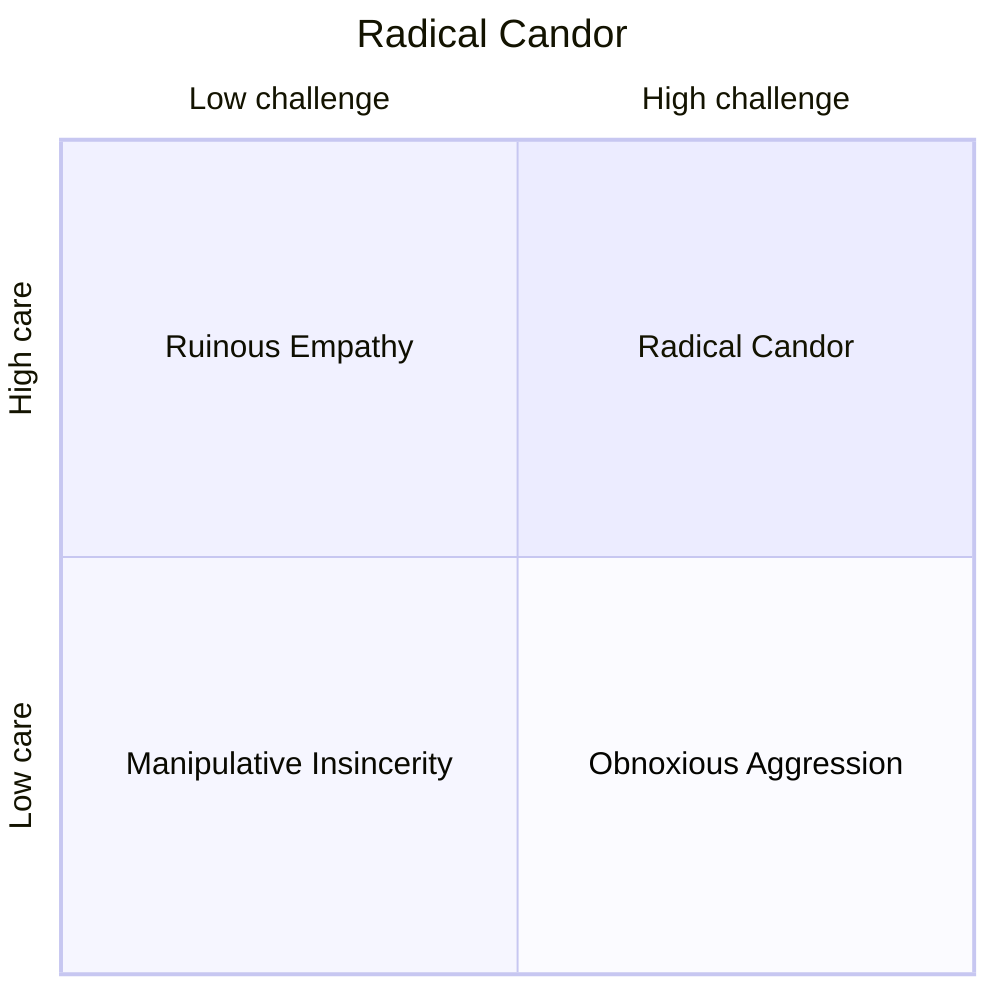
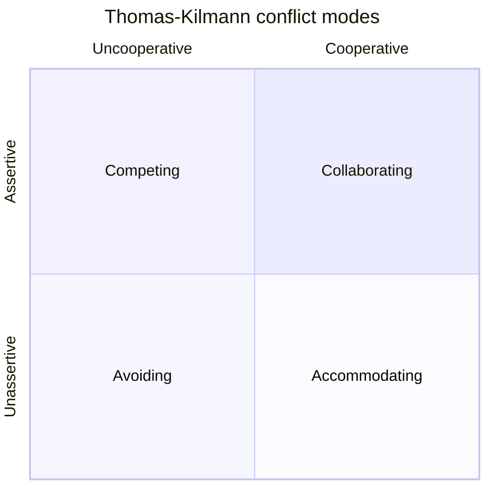

# Feedback, One-on-Ones, Difficult Conversations and Conflict

> **TL;DR** — Care personally and challenge directly (Radical Candor). Describe observable behavior and its impact, not character (SBI, COIN, NVC). Run regular, report-owned 1:1s with a reusable question bank. Pick a conflict mode deliberately (Thomas-Kilmann) and use Crucial Conversations techniques when stakes, emotions, and disagreement are high. Watch for burnout signals early.

Related: [Motivation & leadership](motivation-and-leadership.md) · [Careers & performance](careers-hiring-performance.md) · [Coaching](coaching-and-consulting.md) · [Communication](communication-and-stakeholders.md)

---

## 1. Radical Candor (Kim Scott)

Two axes: **Care Personally** (vertical) × **Challenge Directly** (horizontal).

| | Challenge directly: low | Challenge directly: high |
|---|---|---|
| **Care personally: high** | **Ruinous Empathy** — nice but unhelpful; withholding criticism to spare feelings | **Radical Candor** — kind, clear, specific, sincere |
| **Care personally: low** | **Manipulative Insincerity** — backstabbing, political, passive-aggressive | **Obnoxious Aggression** — brutal honesty, "front-stabbing" |



**Key practices**

- **Get feedback first** before giving it: "What could I do or stop doing that would make it easier to work with me?" Then embrace the discomfort (count to 6 in silence).
- **Give** praise and criticism: praise in public, criticize in private; be specific; be immediate; it's about the work, not personality.
- **Gauge** how it lands — feedback is measured at the listener's ear, not the speaker's mouth.
- The most common failure is **ruinous empathy**, not aggression.
- **HHIPP**: Humble, Helpful, Immediate, in Person (or real-time), Private criticism / Public praise, not about Personality.

---

## 2. Feedback models

### 2.1 SBI — Situation, Behavior, Impact (Center for Creative Leadership)

| Step | Content | Example |
|---|---|---|
| **Situation** | When and where — specific | "In yesterday's sprint review with the client…" |
| **Behavior** | Observable actions (what a camera would record) | "…you interrupted Anna three times while she was presenting the API design…" |
| **Impact** | Effect on you/team/outcome | "…she stopped explaining, and the client left with open questions we now need a follow-up for." |
| (+ **Intent**, SBII) | Ask about their intent / invite dialogue | "What was going on for you there?" |

Positive example: "In this morning's incident call (S), you summarized the timeline every 15 minutes (B). It kept the execs off the bridge and let the engineers focus (I). Thanks — please keep doing that."

### 2.2 COIN

| Step | Meaning |
|---|---|
| **C**ontext | Situation where it happened |
| **O**bservation | What specifically you saw/heard |
| **I**mpact | Effect it had |
| **N**ext steps | What should happen next (agreed together) |

### 2.3 Nonviolent Communication (Marshall Rosenberg) — 4 steps

| Step | Description | Avoid | Example |
|---|---|---|---|
| **Observation** | Facts without evaluation | "You always…", "You're lazy" | "The last three PRs were merged without tests…" |
| **Feeling** | Your feeling | "I feel that you…" (that's a thought) | "…I feel worried…" |
| **Need** | The underlying universal need/value | Blaming | "…because I need confidence that releases won't break production." |
| **Request** | Concrete, positive, doable — a request, not a demand | Vague: "be more careful" | "Would you be willing to add tests before merging, or pair with me on the next one?" |

Also use empathically: guess the other's feelings and needs ("Are you frustrated because you need more time to do it properly?").

### 2.4 Other models

| Model | Steps | Note |
|---|---|---|
| **Feedback Wrap** (Management 3.0) | Describe context → List observations → Express feelings → Sort by value → End with suggestions | Written feedback |
| **DESC** | Describe, Express, Specify, Consequences | Assertive requests |
| **EEC / STAR-AR** | Example, Effect, Change/Continue | Simple |
| **Feedforward** (Goldsmith) | Ask for suggestions for the future, not judgement on the past | Low-defensiveness |
| **"Sandwich"** | Praise-criticism-praise | **Avoid** — dilutes the message, trains people to distrust praise |

### 2.5 Feedback checklist

- [ ] Is it timely (within days)?
- [ ] Is it private (if corrective)?
- [ ] Is it behavior-based and specific?
- [ ] Did I state the impact?
- [ ] Did I invite their perspective?
- [ ] Is there an agreed next step?
- [ ] Is my ratio of positive:corrective healthy (people often cite ~3–5:1 as a heuristic)?
- [ ] Am I also asking for feedback on myself?

### 2.6 Receiving feedback (Stone & Heen, *Thanks for the Feedback*)

Three triggers that block reception:

1. **Truth trigger** — "That's wrong." → Look for what's right in it; ask for examples.
2. **Relationship trigger** — "Who are you to tell me?" → Separate the what from the who.
3. **Identity trigger** — "I'm a bad person." → Distinguish feedback on behavior from self-worth.

Three types of feedback: **appreciation**, **coaching**, **evaluation** — mismatches cause frustration ("I wanted appreciation, got coaching").

---

## 3. Praise and recognition

- Specific > generic ("Great job" vs "Your migration plan's rollback section saved us an hour tonight").
- Recognize effort and learning, not only outcomes.
- Match the person's preference (public vs private).
- Kudo cards, shout-outs in demos, notes to their manager's manager.

---

## 4. Difficult conversations

### 4.1 Crucial Conversations (Patterson, Grenny, McMillan, Switzler)

A crucial conversation: **high stakes, opposing opinions, strong emotions**.

| Skill | Meaning | Practice |
|---|---|---|
| **Start with heart** | Focus on what you really want for yourself, the other, the relationship | Ask: "What do I really want? What do I not want?" — refuse the "sucker's choice" (either/or) |
| **Learn to look** | Notice when the conversation turns crucial and when safety is at risk | Watch for **silence** (masking, avoiding, withdrawing) or **violence** (controlling, labeling, attacking) |
| **Make it safe** | Restore **mutual purpose** and **mutual respect** | Apologize when appropriate; contrast ("I don't mean X; I do mean Y"); CRIB to find mutual purpose (Commit, Recognize purpose, Invent, Brainstorm) |
| **Master my stories** | Separate facts from the stories we tell | Avoid victim, villain, helpless stories; ask "What would a reasonable person do this for?" |
| **STATE my path** | **S**hare facts, **T**ell your story, **A**sk for others' paths, **T**alk tentatively, **E**ncourage testing | |
| **Explore others' paths** | **AMPP**: Ask, Mirror, Paraphrase, Prime | |
| **Move to action** | Decide how decisions are made; document who does what by when | Follow up |

### 4.2 Difficult Conversations (Stone, Patton, Heen — Harvard Negotiation Project)

Every difficult conversation contains three conversations:

1. **"What happened?"** — disagreement about facts, intentions, blame. Shift from truth to perspectives; separate intent from impact; map contribution rather than blame.
2. **Feelings** — acknowledge them; unexpressed feelings leak.
3. **Identity** — what this says about me (competent? good? worthy?).

Open from the **"third story"** — how a neutral observer would describe the difference.

### 4.3 Conversation script — underperformance

```text
1. Purpose: "I want to talk about the delivery of the reporting module, because I want you to succeed here and I'm concerned."
2. Facts (SBI): "Over the last three sprints, the stories you committed to were carried over each time. Two reviewers flagged missing tests."
3. Impact: "The team had to re-plan twice and the client demo slipped."
4. Ask: "How do you see it? What's getting in the way?"
5. Listen, paraphrase, explore causes (skill? will? workload? personal? unclear expectations?).
6. Agree: "What will you do differently? What do you need from me?"
7. Specific next steps + check-in date. Document briefly.
```

### 4.4 Underperformance diagnostic

| Cause | Sign | Response |
|---|---|---|
| Unclear expectations | "I didn't know that was expected" | Clarify, write down |
| Skill gap | Tries hard, struggles | Training, pairing, Situational Leadership S1/S2 |
| Motivation / fit | Disengaged | Moving Motivators, role change |
| Personal circumstances | Sudden change | Support, flexibility, EAP / HR |
| Systemic obstacles | Whole team struggles | Fix system, not person |
| Persistent, after support | No change | Formal improvement plan with HR |

---

## 5. Conflict management

### 5.1 Thomas-Kilmann Conflict Modes (TKI)

Two dimensions: **Assertiveness** (concern for own goals) × **Cooperativeness** (concern for others').

| Mode | Assert. | Coop. | When appropriate | Overuse risk |
|---|---|---|---|---|
| **Competing** | High | Low | Emergencies, unpopular but necessary decisions, protecting against exploitation | Fear, lack of feedback |
| **Collaborating** | High | High | Important issues for both, need integrated solution, building commitment | Time-consuming, analysis paralysis |
| **Compromising** | Medium | Medium | Equal power, temporary settlements, time pressure | Mediocre outcomes, gamesmanship |
| **Avoiding** | Low | Low | Trivial issues, cooling-off, others better placed | Festering issues, decisions by default |
| **Accommodating** | Low | High | You're wrong, issue matters more to them, preserve relationship, build credit | Lost influence, resentment |


(Compromising sits in the middle.)

### 5.2 Types of conflict

| Type | Example | Typical approach |
|---|---|---|
| **Task / cognitive** | "Postgres vs DynamoDB" | Encourage; structure with criteria, ADRs |
| **Process** | "Who reviews? How do we estimate?" | Working agreements, retros |
| **Relationship / affective** | Personal friction | Address early, privately; mediation |
| **Values** | Quality vs speed beliefs | Surface underlying interests; agree on principles |
| **Structural** | Conflicting incentives between teams | Escalate to shared leader; change goals |

### 5.3 Speed Leas' levels of conflict

| Level | Name | Characteristics | Intervention |
|---|---|---|---|
| 1 | Problem to solve | Fact-focused, open | Collaborate |
| 2 | Disagreement | Self-protection, general language | Build safety, support |
| 3 | Contest | Winning matters, distortion, sides | Accommodate/negotiate, structure |
| 4 | Crusade / fight | Protect own group, ideology | De-escalate, mediation |
| 5 | World war | Destroy the other | Separate, safety first |

(Popularized in agile coaching by Lyssa Adkins, *Coaching Agile Teams*.)

### 5.4 Mediation steps (between two team members)

1. Talk to each party separately; listen; check if they want help.
2. Joint meeting with ground rules (one speaks at a time; describe, don't attack).
3. Each describes the situation and impact; the other paraphrases before replying.
4. Identify interests (not positions) — see [negotiation](communication-and-stakeholders.md#7-negotiation--getting-to-yes).
5. Brainstorm options; agree on specific behaviors.
6. Follow up within 1–2 weeks.

---

## 6. One-on-ones

### 6.1 Principles

- **Their meeting, not yours**: report owns the agenda; you add items.
- Weekly or bi-weekly, 30–45 minutes; protect it — rescheduling repeatedly signals they don't matter.
- Not a status update (use async channels for status).
- Shared running doc with agenda, notes, action items.
- Mix of: what's on their mind, feedback both ways, growth, context sharing.

### 6.2 1:1 template (shared doc)

```markdown
## 1:1 — <Name> / <Lead> — <Date>
### Their topics
-
### My topics
-
### Feedback (both directions)
-
### Growth / career (monthly)
- Progress on goal:
### Action items
- [ ] <owner> <action> <due>
### Mood check (1–5, optional): 
```

### 6.3 First 1:1 with a new report

- How do you like to receive feedback? (public/private, written/verbal, immediate/later)
- How will I know when you're stressed or unhappy?
- What did previous managers do that you found helpful / unhelpful?
- What are your career goals (1 year, 3–5 years)?
- What motivates you? (Moving Motivators)
- What do you want to learn here?
- Working preferences: hours, communication channels, focus time?
- Anything you'd like me to know about you?
- How often do you want to meet?

### 6.4 Question bank

**Engagement & wellbeing**

- What's energizing you lately? What's draining you?
- On a scale of 1–10, how are you feeling about work? What would make it +1?
- What's taking more time than it should?
- Is your workload sustainable?
- When did you last feel in flow?

**Team & collaboration**

- How do you feel the team is working together?
- Who on the team deserves recognition?
- Is there anyone you're finding it hard to work with?
- What's one thing the team should start/stop doing?

**Feedback for the lead (manage up)**

- What could I do differently to support you better?
- Is there something I do that gets in your way?
- What's one decision I made recently that you disagreed with?
- What should I be paying more attention to?

**Growth & career**

- What skill do you want to build in the next quarter?
- What part of your work would you like more / less of?
- Where do you see yourself in 2–3 years? What's the gap?
- What project would stretch you?
- Who would you like to learn from?

**Context & alignment**

- Is it clear why we're working on our current priorities?
- What do you not understand about company/team strategy?
- What rumors are you hearing?

**Retention signals**

- What would make you consider leaving?
- If you could change one thing about your job, what would it be?
- What made you stay last time you thought about leaving?

### 6.5 Skip-level 1:1s

- Purpose: hear unfiltered views, build trust across levels, spot management issues.
- Questions: "What's going well in your team?", "What would you change if you were in charge?", "How is your manager supporting your growth?", "What's something leadership doesn't understand?"
- Never undermine the direct manager; share themes, not names (unless safety/legal issues).

---

## 7. Managing up

- Know your manager's goals, pressures, and preferred communication style (detail vs summary, written vs verbal).
- **No surprises** — share bad news early with options.
- Bring problems with proposed solutions ("Here's the issue, here are two options, I recommend A").
- Agree on decision rights (delegation levels) explicitly.
- Send a short weekly update: progress, risks, decisions needed, asks.
- Ask for feedback on yourself regularly.
- Disagree privately and with data; commit publicly (see [disagree and commit](decision-making.md#9-disagree-and-commit)).

**Weekly update template**

```markdown
**TL;DR:** On track for release 2.3; one risk on auth vendor.
**Done:** …
**Next:** …
**Risks / blockers:** … (impact, mitigation, help needed)
**Decisions needed from you:** … by <date>
**People notes:** recognition, hiring, wellbeing
```

---

## 8. Personality & team-role tools (with caveats)

| Tool | What it describes | Validity notes | Fair uses |
|---|---|---|---|
| **DISC** (Dominance, Influence, Steadiness, Conscientiousness) | Behavioral style preferences | Limited scientific validation; commercial variants differ | Conversation starter about communication preferences |
| **Belbin Team Roles** (9 roles) | Behavioral contributions to teams | Mixed psychometric evidence | Discussing role gaps in a team |
| **MBTI** | 16 types | Poor test–retest reliability; widely criticized | Light self-reflection only |
| **Big Five (OCEAN)** | Openness, Conscientiousness, Extraversion, Agreeableness, Neuroticism | Best research support | Research; rarely in team workshops |
| **StrengthsFinder / CliftonStrengths** | Talent themes | Commercial | Strength-based development |

**Belbin's 9 roles**

| Category | Role | Contribution | Allowable weakness |
|---|---|---|---|
| Thinking | **Plant** | Creative, solves hard problems | Ignores details, poor communicator |
| Thinking | **Monitor Evaluator** | Strategic, discerning, judges options | Lacks drive to inspire |
| Thinking | **Specialist** | Deep knowledge | Contributes on narrow front |
| People | **Coordinator** | Clarifies goals, delegates | Can be seen as manipulative |
| People | **Teamworker** | Cooperative, diplomatic | Indecisive in crunch |
| People | **Resource Investigator** | Explores opportunities, networks | Loses interest after initial enthusiasm |
| Action | **Shaper** | Drives, challenges, has courage | Prone to provocation |
| Action | **Implementer** | Turns ideas into actions | Inflexible |
| Action | **Completer Finisher** | Polishes, finds errors | Worries unduly |

**Caveats:** never use these for hiring or promotion decisions; avoid labeling people ("you're such a D"); preferences ≠ abilities; people adapt by context.

---

## 9. Burnout signs and response

WHO (ICD-11) describes burnout as an occupational phenomenon with three dimensions: **exhaustion**, **mental distance/cynicism** about the job, **reduced professional efficacy**. (Maslach Burnout Inventory measures similar dimensions.)

**Early warning signs**

- Persistent fatigue, more sick days
- Cynicism, sarcasm, detachment ("whatever, it doesn't matter")
- Drop in quality or more mistakes
- Irritability, withdrawal from social interactions
- Working longer hours with less output
- Loss of interest in learning/growth
- Missing 1:1s, camera always off where it previously wasn't (context-dependent)

**Six workplace drivers (Maslach & Leiter):** workload, control, reward, community, fairness, values.

**Leader responses**

- Raise it privately with care: "I've noticed X; how are you doing?"
- Reduce load (actually remove work, don't just "prioritize").
- Increase control: let them choose what to drop.
- Encourage real time off; model it yourself.
- Check on-call load and after-hours messages.
- Point to professional resources (EAP, occupational health) — don't act as therapist.
- Fix systemic causes (chronic overtime, unclear priorities, heroics).

---

## 10. Common mistakes

- Saving feedback for annual reviews.
- The feedback sandwich.
- Turning 1:1s into status meetings or canceling them.
- Giving feedback about personality ("you're negative") instead of behavior.
- Avoiding conflict until it escalates to level 3+.
- Using personality profiles to explain away behavior.
- Missing burnout because the person is a high performer.
- Discussing a team member's issues with others (breaks trust).

---

## References

- Radical Candor: https://www.radicalcandor.com/
- Center for Creative Leadership (SBI): https://www.ccl.org/
- Nonviolent Communication: https://en.wikipedia.org/wiki/Nonviolent_Communication
- Center for Nonviolent Communication: https://www.cnvc.org/
- Crucial Learning (Crucial Conversations): https://cruciallearning.com/
- Thomas-Kilmann Instrument: https://kilmanndiagnostics.com/
- Belbin Team Roles: https://www.belbin.com/
- DISC assessment: https://en.wikipedia.org/wiki/DISC_assessment
- Big Five personality traits: https://en.wikipedia.org/wiki/Big_Five_personality_traits
- Occupational burnout: https://en.wikipedia.org/wiki/Occupational_burnout
- Maslach Burnout Inventory: https://en.wikipedia.org/wiki/Maslach_Burnout_Inventory
- Management 3.0 (Feedback Wraps, Kudo Cards): https://management30.com/
- Books: *Radical Candor* (Scott), *Crucial Conversations* (Patterson et al.), *Difficult Conversations* (Stone, Patton, Heen), *Thanks for the Feedback* (Stone & Heen), *Nonviolent Communication* (Rosenberg)
