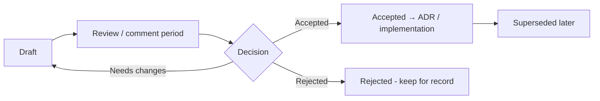

# Meetings, Async Communication and Personal Effectiveness

> **TL;DR** — Every meeting needs a purpose, an agenda, and a defined outcome; otherwise write a document. Default to async (written updates, RFCs, design docs) and reserve synchronous time for decisions, conflict, creativity, and relationships. Protect maker time (Paul Graham's maker vs manager schedule). Manage priorities (Eisenhower), commitments (GTD), focus (Deep Work, time blocking), and energy — not just time.

Related: [Communication](communication-and-stakeholders.md) · [Decision making](decision-making.md) · [Workshop facilitation](workshop-facilitation.md) · [Agile ceremonies](../04-agile-kanban-scrum/README.md) · [Engineering practices](../08-engineering/README.md)

---

## 1. Meeting types

| Type | Purpose | Typical cadence | Duration | Output |
|---|---|---|---|---|
| **Decision meeting** | Make a decision | As needed | 30–60 min | Decision + rationale |
| **Problem-solving / workshop** | Generate & evaluate options | As needed | 1–4 h | Options, plan |
| **Status / sync** | Coordination | Daily / weekly | 15 min | Blockers surfaced — prefer async |
| **Planning** | Commit to work | Per iteration / quarter | 1–4 h | Plan, commitments |
| **Review / demo** | Inspect outcomes, get feedback | Per iteration | 30–60 min | Feedback |
| **Retrospective** | Improve process | Per iteration | 45–90 min | Improvement actions |
| **1:1** | Relationship, growth, feedback | Weekly / bi-weekly | 30–45 min | Notes, actions — see [1:1s](feedback-1on1s-conflict.md#6-one-on-ones) |
| **Information sharing / all-hands** | Broadcast + Q&A | Monthly / quarterly | 30–60 min | Shared understanding |
| **Brainstorm / ideation** | Generate ideas | As needed | 30–90 min | Idea list |
| **Incident call** | Restore service | Ad hoc | Until resolved | Mitigation; postmortem later |
| **Social / team building** | Relationships | Regular | Varies | Trust |

**Andy Grove (*High Output Management*) categories:** process-oriented meetings (1:1s, staff meetings, operation reviews — regular cadence) vs mission-oriented meetings (ad hoc, to make a specific decision; ideally ≤ 6–8 people).

---

## 2. Effective meeting rules

### 2.1 Purpose — Agenda — Outcome (minimum standard)

Every invite contains:

```text
Purpose: Why we meet (1 sentence)
Desired outcome: What will exist at the end (decision, list, plan)
Agenda: Topics with owner and time
Pre-read: Link (read before the meeting, or 10 min silent reading at start)
Decision method: Who decides / how
Roles: Facilitator, note-taker, timekeeper
```

### 2.2 Rules checklist

- [ ] **Could this be an email / doc / chat thread?** If yes, cancel.
- [ ] Minimum necessary attendees (each has a clear role); others get notes.
- [ ] Agenda shared ≥ 24 h before.
- [ ] Start and end on time; default to 25/50-minute slots.
- [ ] Decision-maker present for decision meetings.
- [ ] Notes with decisions and actions (who/what/when) shared within 24 h.
- [ ] No-agenda, no-attenda: it's acceptable to decline.
- [ ] Review recurring meetings quarterly — kill or shorten.
- [ ] Laptops closed unless needed for the meeting.

### 2.3 Amazon-style meeting practices

- Narrative memos replace slides; meeting starts with **silent reading** (see [communication](communication-and-stakeholders.md#3-writing-for-decisions-amazon-style-narrative-memos)).
- Comments captured in the doc margin.
- **Two-pizza** size for working meetings.
- Single-threaded owner for the topic.

### 2.4 Other company practices worth knowing

| Practice | Description |
|---|---|
| Meeting-free days/blocks | e.g., "No-meeting Wednesday" |
| Speedy meetings | 25/50 minutes default (Google Calendar setting) |
| Walking 1:1s | For relationship conversations |
| "Leave if not contributing" | Elon Musk-style / Law of Two Feet (Open Space) — requires cultural agreement |
| Meeting cost calculator | Attendees × hourly rate shown on invite |
| Calendar audit | Quarterly: delete recurring meetings, re-add only those missed |

### 2.5 Meeting notes template

```markdown
# <Meeting> — <date>
Attendees: …          Facilitator: …        Notes: …
## Purpose / desired outcome
## Decisions
- D1: … (decided by … via …)
## Discussion highlights
## Actions
| Action | Owner | Due |
## Open questions / parking lot
```

### 2.6 Meeting anti-patterns

| Anti-pattern | Fix |
|---|---|
| Status meeting where people read updates | Async written updates; meeting only for blockers |
| Recurring meeting nobody owns | Assign owner or cancel |
| Decision deferred to "next meeting" repeatedly | Assign DACI driver & deadline |
| 15 people, 3 talk | Smaller group or structured facilitation |
| Meeting after the meeting | Psychological safety; ask "What are we not saying?" |
| No notes → re-discussion | Note-taker role; decision log |
| Back-to-back all day | Buffers; 25/50 defaults; focus blocks |

---

## 3. Async-first communication

### 3.1 Why async

- Distributed teams across time zones.
- Protects focus time (maker schedule).
- Written thinking is clearer and creates a record.
- More inclusive for non-native speakers and introverts (time to think).

### 3.2 Sync vs async decision guide

| Use **synchronous** for | Use **asynchronous** for |
|---|---|
| Sensitive / emotional topics, conflict | Status updates |
| Complex negotiation, fast iteration on ambiguous problems | Proposals & RFCs (comment period) |
| Relationship building, onboarding | Announcements |
| Brainstorming with high energy | Code review |
| Incidents (chaotic domain) | Decision records, documentation |
| Final decisions after async preparation | Questions that aren't urgent |

### 3.3 Async writing rules

- **Self-contained messages**: context + question + deadline ("No hello" — don't send just "Hi").
- Use BLUF; make the ask explicit.
- Use threads; one topic per thread.
- State response-time expectations (e.g., chat within 4 business hours, email within 1 day).
- Use status/emoji conventions (👀 seen, ✅ done) where culture allows.
- Default to public channels over DMs (findability, transparency).
- Summarize long threads with a decision post.
- Record short video walk-throughs (Loom-style) for demos/explanations, but always with a written summary.

### 3.4 Async status update template

```markdown
**Week 41 — Team Orders**
🟢 Overall: on track
**Shipped:** …
**In progress:** …
**Risks / blockers:** … (help needed from @…)
**Decisions made:** … (link)
**Next week:** …
```

### 3.5 Communication charter for a team

| Channel | Use for | Expected response |
|---|---|---|
| Ticket board | Work tracking | n/a |
| Team chat channel | Day-to-day questions | Same day |
| DM | Personal / sensitive | Same day |
| Email | External, formal | 1–2 business days |
| Docs / RFCs | Proposals, decisions | Comment period (e.g., 1 week) |
| Phone / pager | Incidents only | Immediately |
| Video call | Discussions that bounce > 3 times async | Scheduled |

Escalation rule: "If a thread goes back and forth more than 3 times, hop on a call — then post the outcome."

---

## 4. Team rituals at a glance (cadence design)

| Cadence | Ritual | Async alternative |
|---|---|---|
| Daily | Stand-up (15 min, focus on flow/blockers, walk the board right-to-left) | Async check-in bot |
| Weekly | Team sync / planning / 1:1s | Weekly written update |
| Bi-weekly | Review/demo, retro | Recorded demo + written feedback |
| Monthly | Ops review / metrics review | Dashboard + comments |
| Quarterly | Planning, OKRs, offsite, health check | Pre-reads + survey |

---

## 5. RFC / design doc culture

### 5.1 What and why

- **RFC (Request for Comments)**: a written proposal circulated for feedback before significant changes (originated with IETF networking standards; adopted by companies and open-source projects such as Rust, React, Python's PEPs).
- **Design doc**: describes the design of a system/change, alternatives, trade-offs (common at Google and many others).
- Benefits: better decisions, scaled knowledge sharing, async inclusion, record of reasoning, onboarding material, influence without authority.

### 5.2 When an RFC is required (example policy)

- Changes affecting multiple teams or public APIs.
- New infrastructure components or languages.
- Security- or data-model-significant changes.
- Anything hard to reverse (one-way doors).
- Estimated effort > N weeks.

### 5.3 RFC lifecycle



### 5.4 RFC template

```markdown
# RFC-0042: <Title>
- Author(s):            - Status: Draft | In review | Accepted | Rejected | Superseded
- Reviewers / approver: - Comment deadline: <date>
- Related: ADR-…, tickets …

## Summary (BLUF, 3–5 sentences)
## Motivation / problem
## Goals and non-goals
## Proposal (design details, diagrams)
## Alternatives considered (and why not)
## Trade-offs, risks, mitigations
## Security, privacy, compliance
## Operational impact (observability, on-call, cost)
## Migration / rollout plan (incl. rollback)
## Open questions
## Decision (filled at close)
```

### 5.5 RFC culture tips

- Keep them short (2–6 pages); appendices for details.
- Share early drafts ("rough consensus and running code" — prototype helps).
- Name an approver and a deadline (avoid infinite comment periods).
- Review meetings optional — only for unresolved disagreements.
- Distinguish blocking from non-blocking comments ("nit:", "question:", "blocking:").
- After acceptance, record an ADR (see [decision making](decision-making.md#10-recording-decisions)).
- Watch out for RFC bureaucracy for small decisions — scale the process to the impact.

---

## 6. Maker's schedule vs manager's schedule

Paul Graham (2009), [Maker's Schedule, Manager's Schedule](http://www.paulgraham.com/makersschedule.html):

| | Manager's schedule | Maker's schedule |
|---|---|---|
| Unit of time | 1-hour slots | Half-day blocks minimum |
| Meeting cost | One slot | Can destroy a whole afternoon (fragmentation, anticipation) |
| Typical role | Managers, coordinators | Engineers, designers, writers |

**Practices**

- Cluster meetings (e.g., mornings or specific days); keep afternoons free.
- Office hours instead of ad-hoc interruptions.
- Team-wide focus blocks in calendars.
- Leads with mixed roles: designate maker days vs manager days.
- Respect "do not disturb" statuses.

---

## 7. Personal effectiveness

### 7.1 Eisenhower matrix

| | **Urgent** | **Not urgent** |
|---|---|---|
| **Important** | **Do** — crises, incidents, deadlines | **Schedule** — planning, learning, relationships, tech debt, prevention (Covey's "Quadrant II") |
| **Not important** | **Delegate** — interruptions, some meetings, many requests | **Eliminate** — busywork, low-value notifications |

Leaders should spend increasing time in **Important / Not urgent** — the work that prevents future urgent crises.

### 7.2 Getting Things Done (David Allen)

Five steps:

1. **Capture** — collect everything that has your attention into trusted inboxes.
2. **Clarify** — what is it? Is it actionable? If < 2 min, do it now (**two-minute rule**). Otherwise define the next action.
3. **Organize** — lists: Next Actions (by context), Projects (multi-step outcomes), Waiting For, Someday/Maybe, Calendar (time-specific only), Reference.
4. **Reflect** — **weekly review**: get clear, get current, get creative.
5. **Engage** — choose actions based on context, time, energy, priority.

Horizons of focus: Ground (actions) → Projects → Areas of responsibility → Goals (1–2 yrs) → Vision (3–5 yrs) → Purpose & principles.

**Weekly review checklist**

- [ ] Empty inboxes (email, chat saves, notes, paper)
- [ ] Review calendar: past 2 weeks & next 2–4 weeks
- [ ] Review Waiting For list → follow up
- [ ] Review project list → each has a next action
- [ ] Review Someday/Maybe
- [ ] Pick top 3 outcomes for next week

### 7.3 Deep Work (Cal Newport)

- **Deep work:** cognitively demanding, distraction-free concentration that creates new value and is hard to replicate.
- **Shallow work:** logistical, low-cognitive, often performed while distracted.
- Philosophies: **monastic** (eliminate shallow), **bimodal** (days/weeks of deep work), **rhythmic** (daily habit, e.g., 2 h each morning), **journalistic** (fit in whenever possible — hard).
- Rules: work deeply; embrace boredom (don't reflexively check phone); quit social media selectively; drain the shallows (budget shallow work).
- Related: **attention residue** (Sophie Leroy) — switching tasks leaves part of attention on the previous task.

### 7.4 Time blocking

- Assign every hour of the workday to a block (deep work, meetings, email, admin, breaks).
- Re-plan when disrupted — the plan is a tool, not a contract.
- Include buffer and "shutdown ritual" at end of day.
- Variants: **timeboxing** (fixed time for a task), **Pomodoro** (25 min focus + 5 min break; long break after 4), **theme days** (e.g., Monday = planning, Tuesday = deep work).

**Example week for a tech lead**

| | Mon | Tue | Wed | Thu | Fri |
|---|---|---|---|---|---|
| 09:00–09:15 | Stand-up | Stand-up | Stand-up | Stand-up | Stand-up |
| 09:15–12:00 | Planning & 1:1s | **Deep work** | **Deep work** | Stakeholders & reviews | **Deep work** |
| 13:00–15:00 | Architecture reviews | **Deep work** | No-meeting afternoon | 1:1s | Demo / retro |
| 15:00–17:00 | Email / admin | Office hours | **Deep work** | Hiring interviews | Weekly review & update |

### 7.5 Energy management

From Schwartz & McCarthy (HBR, "Manage Your Energy, Not Your Time", 2007): four dimensions of energy.

| Dimension | Practices |
|---|---|
| **Physical** | Sleep, exercise, nutrition, breaks every 90–120 min (ultradian rhythms) |
| **Emotional** | Appreciation, reframing, deep breathing, positive relationships |
| **Mental** | Focus without interruption, single-tasking, energy-matching tasks (hard tasks at peak hours) |
| **Spiritual (meaning)** | Doing what you value, alignment with purpose |

Also: know your **chronotype** (morning vs evening person) and schedule deep work at peak energy; track energy levels for a week to find patterns.

### 7.6 Other techniques

| Technique | Essence |
|---|---|
| **Eat the frog** (Brian Tracy) | Do the hardest, most important task first |
| **1-3-5 rule** | Per day: 1 big, 3 medium, 5 small tasks |
| **Ivy Lee method** | End of day: list 6 most important tasks for tomorrow in order; work in order |
| **Pareto (80/20)** | Focus on the 20% that yields 80% — see [laws & principles](../10-laws-principles-mental-models/README.md) |
| **Parkinson's law** | Work expands to fill time available → set tight timeboxes |
| **Inbox zero** (Merlin Mann) | Process email to empty, using actions: delete, delegate, respond, defer, do |
| **Personal Kanban** (Jim Benson) | Visualize work; limit WIP |
| **"No" as default** | Protect commitments; say no to protect yeses |
| **Batching** | Group similar tasks (email twice daily) |
| **Notification hygiene** | Disable non-essential notifications; scheduled check times |

### 7.7 Personal effectiveness for leads — checklist

- [ ] My top 3 outcomes this week are written down.
- [ ] I have at least 2 focus blocks of ≥ 2 h this week.
- [ ] My calendar reflects my priorities (audit: % in each Eisenhower quadrant).
- [ ] I'm not the bottleneck on any decision or review (delegate!).
- [ ] I did a weekly review.
- [ ] I took real breaks and stopped at a reasonable time.

---

## 8. When to use / when not

| Practice | Use | Don't |
|---|---|---|
| Async-first | Distributed teams, focus-heavy work | Conflict, urgent incidents, early team formation (needs more sync) |
| RFCs | Cross-team, hard-to-reverse changes | Trivial decisions |
| Time blocking | Mixed-role schedules | When role is mostly interrupt-driven (on-call) — use ticket batches instead |
| GTD | Many inputs and commitments | As an end in itself (system tweaking) |
| Daily stand-ups | Collocated or overlapping hours, high interdependence | Status reporting for a manager |

---

## 9. Common mistakes

- Meetings without stated outcomes; recurring meetings that outlive their purpose.
- Inviting everyone "just in case".
- Async without norms → endless threads and unclear decisions.
- RFCs without a decider or deadline.
- Leaders' calendars 100% meetings → no thinking time, become bottleneck.
- Measuring productivity by busyness.
- Optimizing personal productivity while team flow suffers (e.g., batching reviews → teammates blocked).

---

## References

- Paul Graham — Maker's Schedule, Manager's Schedule: http://www.paulgraham.com/makersschedule.html
- Getting Things Done: https://gettingthingsdone.com/
- Getting Things Done (Wikipedia): https://en.wikipedia.org/wiki/Getting_Things_Done
- Cal Newport: https://calnewport.com/
- Time management (incl. Eisenhower method): https://en.wikipedia.org/wiki/Time_management
- Timeboxing: https://en.wikipedia.org/wiki/Timeboxing
- Pomodoro Technique: https://en.wikipedia.org/wiki/Pomodoro_Technique
- Parkinson's law: https://en.wikipedia.org/wiki/Parkinson%27s_law
- Request for Comments: https://en.wikipedia.org/wiki/Request_for_Comments
- Rust RFCs: https://github.com/rust-lang/rfcs
- Python PEPs: https://peps.python.org/
- High Output Management: https://en.wikipedia.org/wiki/High_Output_Management
- Harvard Business Review: https://hbr.org/
- GitLab handbook (async communication practices): https://handbook.gitlab.com/
- Books: *High Output Management* (Grove), *Deep Work* (Newport), *Getting Things Done* (Allen), *Make Time* (Knapp & Zeratsky), *The Effective Executive* (Drucker), *Death by Meeting* (Lencioni)
