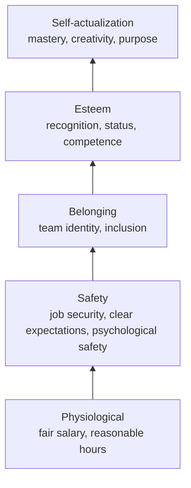
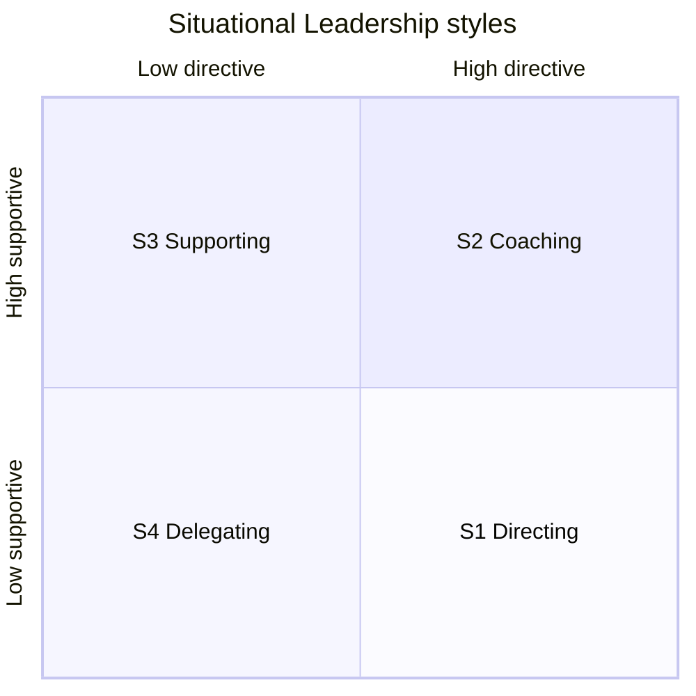

# Motivation, Leadership Styles and Delegation

> **TL;DR** — Knowledge workers are driven mostly by intrinsic motivation: autonomy, mastery, purpose (Pink). Remove dissatisfiers (Herzberg hygiene) but don't expect them to motivate. Adapt leadership style to each person's competence and commitment on each task (Situational Leadership). Make delegation explicit with levels (Management 3.0's 7 levels, delegation poker). Great leaders multiply others' intelligence (Wiseman), own outcomes fully (Extreme Ownership), and serve the team (servant leadership).

Related: [Feedback, 1:1s & conflict](feedback-1on1s-conflict.md) · [Careers, hiring & performance](careers-hiring-performance.md) · [Team dynamics](team-dynamics-culture.md) · [Coaching](coaching-and-consulting.md) · [Laws & mental models](../10-laws-principles-mental-models/README.md)

---

## 1. Motivation theories — comparison

| Theory | Author / year | Core idea | Practical use for engineering leaders | Caveats |
|---|---|---|---|---|
| Hierarchy of needs | Maslow, 1943 | Needs from physiological → safety → belonging → esteem → self-actualization | Don't expect growth talk to land when someone fears layoffs | Hierarchy isn't strict; weak empirical support for ordering |
| Two-factor | Herzberg, 1959 | Hygiene factors prevent dissatisfaction; motivators create satisfaction | Fix pay/tooling/policy problems, but motivate via achievement, recognition, responsibility | Methodology (critical incident) debated |
| Theory X / Y | McGregor, 1960 | Assumptions about people shape management: X = lazy, needs control; Y = self-motivated | Check your own assumptions; Y-style for knowledge work | Real people/contexts vary |
| Drive (AMP) | Daniel Pink, 2009 | Autonomy, Mastery, Purpose drive creative work; "if-then" rewards can harm it | Give autonomy over task/time/technique/team; growth paths; connect to mission | Pay must still be fair ("take money off the table") |
| Self-Determination Theory | Deci & Ryan, 1985+ | Competence, autonomy, relatedness | Underlying research for Pink | — |
| Expectancy theory | Vroom, 1964 | Motivation = Expectancy × Instrumentality × Valence | Make sure effort → performance → reward links are believable | — |
| Moving Motivators / CHAMPFROGS | Management 3.0 (Appelo) | 10 intrinsic motivators, individually weighted | 1:1 conversation tool | Tool for dialogue, not a test |

### 1.1 Maslow's hierarchy in the workplace

### 1.2 Herzberg two-factor theory

| Hygiene factors (absence → dissatisfaction) | Motivators (presence → satisfaction) |
|---|---|
| Salary & benefits | Achievement |
| Company policy & administration | Recognition |
| Supervision quality | The work itself |
| Working conditions (tools, laptop, office, CI speed) | Responsibility |
| Relationships with peers/manager | Advancement |
| Job security | Growth |

Implication: a slow build pipeline and bureaucratic expense policy will demotivate; fixing them won't by itself inspire. Do both.

### 1.3 Theory X vs Theory Y

| | Theory X | Theory Y |
|---|---|---|
| Belief | People dislike work, avoid responsibility | People find work natural, seek responsibility |
| Management | Command, control, close supervision, extrinsic rewards/punishment | Participation, delegation, trust, intrinsic motivation |
| Signals | Time tracking for control, approvals for everything | Outcome goals, self-organization |
| Risk | Self-fulfilling: people disengage | Needs clarity & accountability, or becomes laissez-faire |

(Ouchi's **Theory Z** — long-term employment, collective decisions, Japanese management — is sometimes added.)

### 1.4 Pink's Drive — autonomy, mastery, purpose

| Element | Meaning | Practices |
|---|---|---|
| **Autonomy** | Control over **Task, Time, Technique, Team** (the "4 Ts") | Teams choose how; flexible hours; 20% / innovation time; self-selection; decision delegation |
| **Mastery** | Getting better at something that matters; flow; it's asymptotic | Learning budget, conference talks, pairing, hard problems, career ladders, Dreyfus-level stretch |
| **Purpose** | Serving something larger than oneself | Customer contact, demos with users, explain "why" of each initiative, impact metrics |

Pink's caution: contingent "if-then" rewards work for algorithmic/routine tasks but tend to reduce performance on heuristic/creative tasks; prefer unexpected "now-that" recognition.

### 1.5 Moving Motivators (Management 3.0) — CHAMPFROGS

| Motivator | Description |
|---|---|
| **C**uriosity | Plenty of things to investigate and think about |
| **H**onor | Loyal to personal values reflected in how one works |
| **A**cceptance | People around approve of what I do and who I am |
| **M**astery | Work challenges competence but stays within abilities |
| **P**ower | Enough room to influence what happens |
| **F**reedom | Independence of work and responsibilities |
| **R**elatedness | Good social contacts with people at work |
| **O**rder | Enough rules and policies for a stable environment |
| **G**oal | Purpose in life reflected in the work |
| **S**tatus | Position is good and recognized by others |

**How to run (30–45 min, 1:1 or team):**

1. Person orders the 10 cards from least to most important (left → right).
2. Discuss top 3 and bottom 3: "What does this mean for you?"
3. Introduce a change (e.g., new role, reorg); move cards up (positive impact) or down (negative).
4. Discuss: "What could we do to move the down cards up?"
5. Photograph & revisit in 6 months.

---

## 2. Leadership styles

| Style | Description | Works when | Fails when |
|---|---|---|---|
| **Directive / autocratic** | Leader decides and instructs | Crisis, incident response, novices on a task | Experts; long-term engagement |
| **Coaching** | Develop people through questions | Willing learners with potential | Crisis; no time |
| **Democratic / participative** | Group input to decisions | Need buy-in, diverse knowledge | Urgent decisions; huge groups |
| **Affiliative** | Harmony, emotional bonds | Healing after conflict/stress | Performance problems ignored |
| **Pacesetting** | Leader sets high standards by example | Highly competent, motivated team, short bursts | Long-term: burnout, demoralization |
| **Visionary / authoritative** | Mobilize toward a vision, freedom on how | Change, new direction | Leader less expert than team |
| **Servant** | Leader serves needs of team | Knowledge work, agile teams | Misread as passivity |
| **Laissez-faire** | Minimal involvement | Very mature team — rarely ideal | Most cases: drift, conflict |

(The first six map to Daniel Goleman's six emotional-intelligence-based styles, HBR 2000.)

### 2.1 Situational Leadership (Hersey & Blanchard)

Leadership style should match the **development level** of the person **for a specific task** — a senior backend engineer may be D4 on APIs and D1 on Terraform.

| Development level | Competence | Commitment | Matching style | Behavior |
|---|---|---|---|---|
| **D1** Enthusiastic beginner | Low | High | **S1 Directing** (high directive, low supportive) | Tell what/how/when; close supervision; clear examples |
| **D2** Disillusioned learner | Low–some | Low | **S2 Coaching** (high directive, high supportive) | Explain why, invite questions, encourage, still decide |
| **D3** Capable but cautious | Moderate–high | Variable | **S3 Supporting** (low directive, high supportive) | Facilitate, listen, encourage their decisions, build confidence |
| **D4** Self-reliant achiever | High | High | **S4 Delegating** (low directive, low supportive) | Hand over responsibility; check in lightly; recognition |

**Mistakes:** over-supervising D4 (micromanagement → disengagement); under-supporting D1 (sink-or-swim → failure); treating "senior" title as D4 on everything.

### 2.2 Servant leadership

Robert Greenleaf (1970): the leader's primary role is to serve others so they grow and perform.

Ten characteristics (Larry Spears' synthesis): listening, empathy, healing, awareness, persuasion, conceptualization, foresight, stewardship, commitment to growth of people, building community.

**In practice for tech leads:**

- Remove impediments (access, approvals, unclear requirements).
- Shield focus time from interruptions.
- Ask "What do you need from me?" in every 1:1.
- Share context, not just tasks.
- Still set direction and standards — serving ≠ abdication.

### 2.3 Extreme Ownership (Jocko Willink & Leif Babin)

Principles from Navy SEAL leadership adapted to business:

| Principle | Meaning in tech |
|---|---|
| **Extreme ownership** | Leader owns everything in their world, including failures of the team; no blaming |
| **No bad teams, only bad leaders** | Performance reflects leadership standards |
| **Believe** | Understand and believe in the mission; if you don't, ask "why" up the chain |
| **Check the ego** | Ego clouds judgement |
| **Cover and move** | Teams support each other; no "not my team's problem" |
| **Simple** | Plans and communication must be simple and clear |
| **Prioritize and execute** | Relax, look around, make a call; tackle the highest-priority problem first |
| **Decentralized command** | Leaders at every level understand intent ("commander's intent") and act within it |
| **Leading up and down the chain** | Push info up, explain context down |
| **Discipline equals freedom** | Standard processes create room for creativity |

Caveat: military analogies don't transfer fully; "ownership" must come with authority, or it becomes blame-taking without control.

### 2.4 Multipliers (Liz Wiseman)

Leaders either **multiply** or **diminish** the intelligence and capability of people around them.

| Discipline | Multiplier | Diminisher |
|---|---|---|
| Managing talent | **Talent Magnet** — attracts and fully uses talent | Empire Builder — hoards resources, underuses people |
| Creating climate | **Liberator** — intense, safe environment requiring best thinking | Tyrant — tense environment that suppresses thinking |
| Setting direction | **Challenger** — defines opportunities that stretch people | Know-It-All — gives directives showcasing own knowledge |
| Making decisions | **Debate Maker** — drives sound decisions through rigorous debate | Decision Maker — decides centrally, confuses others |
| Executing | **Investor** — gives ownership and holds accountable | Micromanager — drives results through own involvement |

**Accidental diminishers** (well-intended behaviors that diminish): idea guy, always-on, rescuer, pacesetter, rapid responder, optimist, protector, strategist, perfectionist.

**Multiplier experiments:** talk last in meetings; ask questions instead of giving answers; give "51% of the vote" to the owner; let people struggle productively; play "fewer chips" (limit your contributions per meeting).

### 2.5 Management 3.0 (Jurgen Appelo)

Views organizations as complex adaptive systems. Six views of the "Martie" model:

1. **Energize people** — intrinsic motivation (CHAMPFROGS).
2. **Empower teams** — delegation & self-organization (delegation poker).
3. **Align constraints** — purpose & boundaries.
4. **Develop competence** — skills, metrics, feedback.
5. **Grow structure** — networks, communities.
6. **Improve everything** — continuous change, experiments.

Practices: Moving Motivators, Delegation Board/Poker, Kudo Cards, Personal Maps, Celebration Grid, Happiness Door, Merit Money, Feedback Wraps, Work Expos, Yay! Questions.

### 2.6 The Manager's Path (Camille Fournier) — role progression

| Stage | Focus | Key lessons |
|---|---|---|
| Being managed | Getting value from your manager | Drive your own 1:1s and career |
| Mentoring | First people-leadership | Listen; set clear expectations; mentor's growth too |
| Tech lead | Lead a team technically while coding | Balance coding with coordination; project management; don't hog the hard work |
| Managing people | First manager role | 1:1s, feedback, delegation, career growth, handling underperformance |
| Managing a team | Full team accountability | Stay technical enough; debug dysfunctional teams; shield and filter |
| Managing multiple teams | Manager of managers | Delegate deeply; manage your time; ask managers good questions |
| Managing managers | | Skip-levels, accountability for managers |
| Senior leadership (VP/CTO) | Org strategy | Set culture, technology strategy, hiring bar |

Key traps for new tech leads: becoming the bottleneck, doing all the interesting work, avoiding people issues, not saying no.

---

## 3. Delegation

### 3.1 Seven levels of delegation (Management 3.0)

| Level | Name | Who decides | Phrase |
|---|---|---|---|
| 1 | **Tell** | Leader decides, tells team | "I'll decide and tell you." |
| 2 | **Sell** | Leader decides, explains why to get buy-in | "I'll decide and convince you." |
| 3 | **Consult** | Leader asks input, then decides | "I'll ask your input, then decide." |
| 4 | **Agree** | Decide together (consensus) | "We'll decide together." |
| 5 | **Advise** | Team decides; leader advises | "I'll advise, you decide." |
| 6 | **Inquire** | Team decides; leader asks afterward | "You decide, tell me later." |
| 7 | **Delegate** | Team decides; leader doesn't need to know | "You decide, no need to tell me." |

### 3.2 Delegation Poker & Delegation Board

**Delegation Poker (45–60 min):**

1. Prepare 8–12 concrete decision scenarios (e.g., "choose a new logging library", "hire a new team member", "change sprint length", "approve production hotfix").
2. Each participant privately picks a card 1–7 for "what level should this be?"
3. Reveal simultaneously.
4. Highest and lowest explain their reasoning.
5. Discuss, then agree on a level (or re-vote).
6. Record on the delegation board.

**Delegation Board template**

| Decision area | 1 Tell | 2 Sell | 3 Consult | 4 Agree | 5 Advise | 6 Inquire | 7 Delegate |
|---|---|---|---|---|---|---|---|
| Choice of libraries within team stack | | | | | | | X |
| Architecture affecting other teams | | | X | | | | |
| Sprint length / ceremonies | | | | | | X | |
| Hiring new team member | | | | X | | | |
| Production deployment | | | | | | | X |
| Budget > €X | | X | | | | | |
| Working hours | | | | | | X | |

Revisit as maturity grows; move items to the right over time.

### 3.3 Delegation conversation checklist

- [ ] What outcome is needed, and why does it matter (intent)?
- [ ] What is the delegation level?
- [ ] Constraints / guardrails: budget, time, quality, standards, stakeholders.
- [ ] What resources and authority come with it?
- [ ] How and when will we check in? (proportional to risk & development level)
- [ ] What would make you escalate?
- [ ] How will success be recognized?

**Monkey management** (Oncken & Wass, HBR "Who's Got the Monkey?"): when someone brings a problem, avoid taking the "monkey" onto your back — ask "What do you propose?" and agree on next steps they own.

---

## 4. Leadership behaviors checklist for tech leads

**Weekly**

- [ ] 1:1s held with each direct report / mentee (see [1:1 templates](feedback-1on1s-conflict.md#6-one-on-ones))
- [ ] At least one specific piece of positive recognition given
- [ ] Removed at least one impediment
- [ ] Protected focus time for the team
- [ ] Shared relevant context from upstream meetings

**Monthly**

- [ ] Reviewed team health / cognitive load
- [ ] Revisited priorities with product/stakeholders
- [ ] Checked growth goals for each person
- [ ] Reflected: where was I a diminisher?

**Quarterly**

- [ ] Team retrospective on ways of working at larger scale
- [ ] Delegation board update
- [ ] Career conversations
- [ ] Skip-level or peer feedback for yourself

---

## 5. When to use / when not

| Tool | Use | Avoid |
|---|---|---|
| Moving Motivators | New team member, role change, reorg, stagnation | As a personality test or for selection |
| Situational leadership | Each delegation, onboarding, new tasks | As a permanent label on a person |
| Delegation poker | New team, unclear decision rights, after friction | When leader isn't willing to honor results |
| Directive style | Incidents, safety, legal deadlines | Default mode for experts |
| Multipliers lens | Self-reflection, 360 feedback | To label colleagues |

---

## 6. Common mistakes

- Treating everyone the same regardless of task maturity.
- Delegating tasks but not authority ("you own it, but run every decision by me").
- Using bonuses/targets for creative work and getting gaming instead of innovation.
- Confusing servant leadership with being a doormat or with having no vision.
- Taking back delegated work at the first sign of difficulty (rescuer pattern).
- Assuming your own motivators (e.g., status) are everyone's.
- Ignoring hygiene factors ("they should be motivated by the mission").
- Leader doing the most interesting technical work and leaving the team the leftovers.

---

## References

- Maslow's hierarchy of needs: https://en.wikipedia.org/wiki/Maslow%27s_hierarchy_of_needs
- Two-factor theory (Herzberg): https://en.wikipedia.org/wiki/Two-factor_theory
- Theory X and Theory Y: https://en.wikipedia.org/wiki/Theory_X_and_Theory_Y
- Daniel Pink: https://www.danpink.com/
- Self-determination theory: https://en.wikipedia.org/wiki/Self-determination_theory
- Expectancy theory: https://en.wikipedia.org/wiki/Expectancy_theory
- Situational leadership theory: https://en.wikipedia.org/wiki/Situational_leadership_theory
- Servant leadership: https://en.wikipedia.org/wiki/Servant_leadership
- Management 3.0 (Moving Motivators, Delegation Poker): https://management30.com/
- Extreme Ownership / Echelon Front: https://echelonfront.com/
- Liz Wiseman — Multipliers: https://thewisemangroup.com/
- Will Larson's writing on engineering management: https://lethain.com/
- Books: *Drive* (Pink), *The Manager's Path* (Fournier), *Multipliers* (Wiseman), *Extreme Ownership* (Willink & Babin), *Management 3.0* (Appelo), *An Elegant Puzzle* (Larson)
